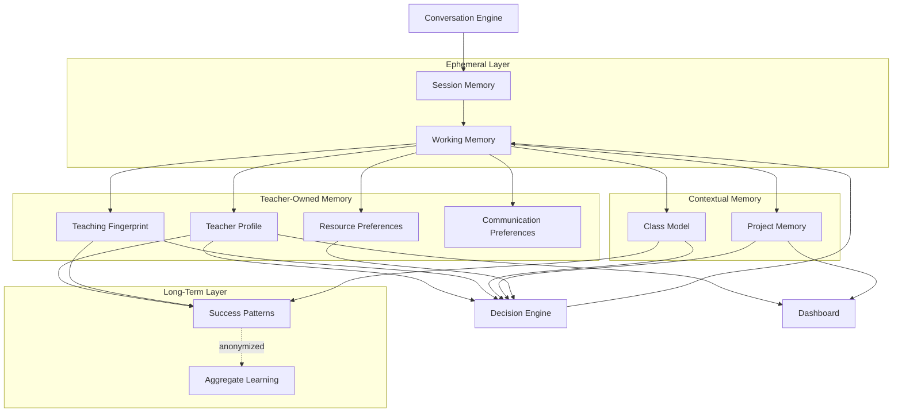
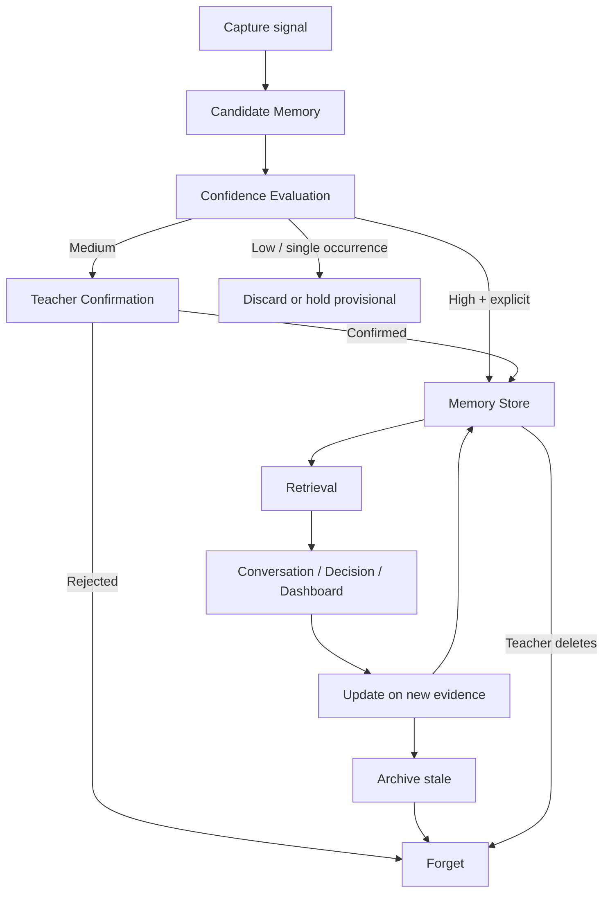
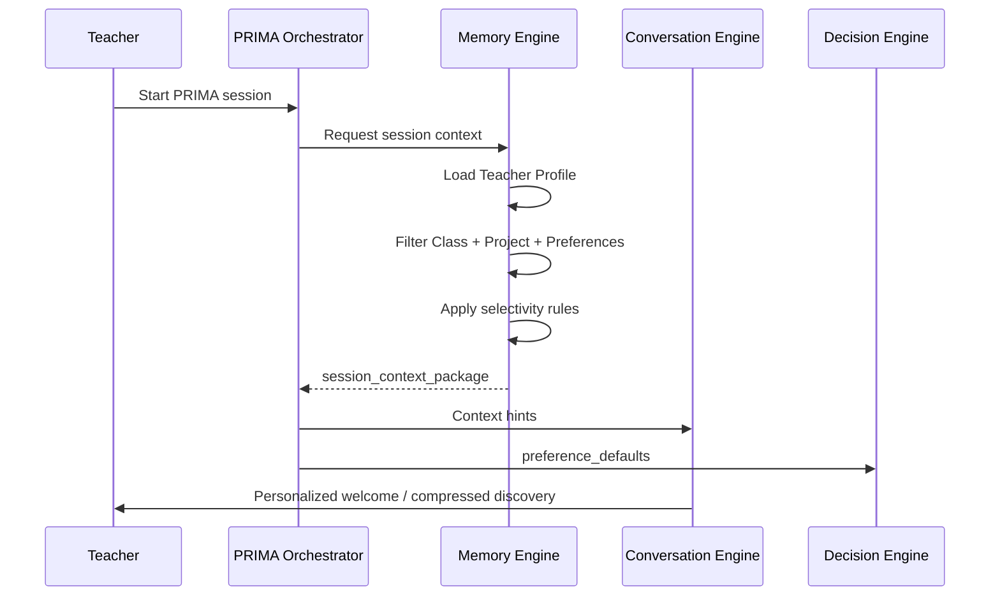
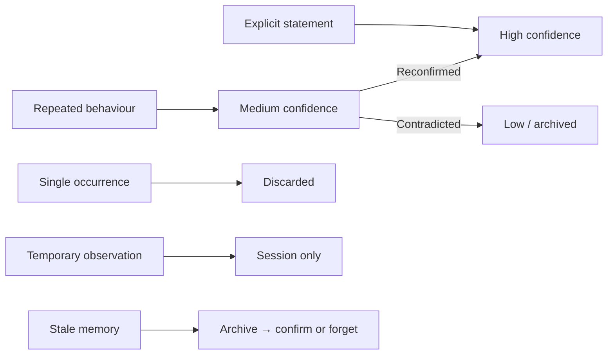
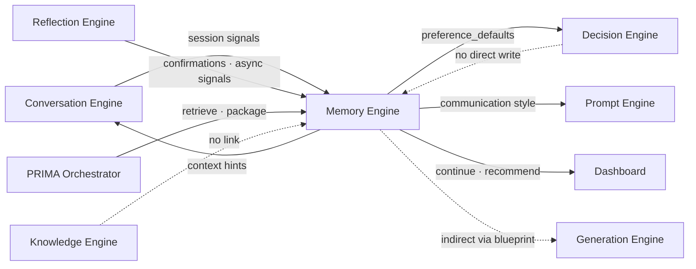
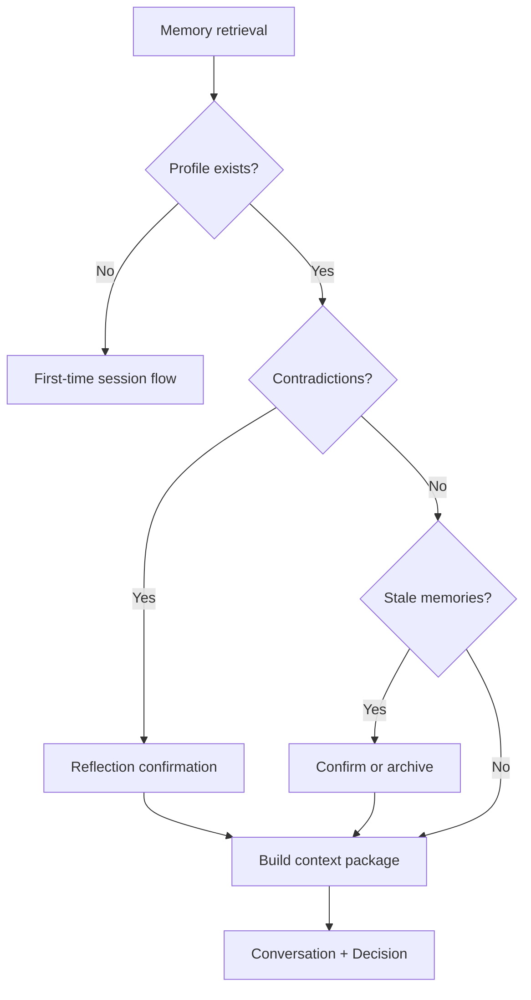

# PRIMA Memory Engine — Product Architecture Specification

---

## Purpose

This document defines the complete architectural role of the **Memory Engine** within PRIMA and LUDI ON.

The Memory Engine is the **relationship layer** between PRIMA and the teacher. It answers one product question:

> *What should PRIMA remember in order to become a better instructional design partner?*

It does **not** answer how memory is technically stored, indexed, or cached.

The Memory Engine is **not** chat history, **not** a database, and **not** generic long-term storage. It is a governed, teacher-controlled system for capturing **durable context** — who the teacher is, how they teach, what they prefer, and what has worked — so future sessions require less friction without sacrificing agency or trust.

### Why Memory Exists

Every PRIMA session begins with a teacher who brings expertise, habits, and classroom reality. Without memory, PRIMA would treat a returning teacher like a stranger — repeating questions, ignoring established preferences, and failing to build continuity across projects.

Memory exists to:

| Goal | Outcome |
|------|---------|
| **Reduce friction** | Skip redundant discovery; confirm instead of re-interview |
| **Improve personalization** | Defaults aligned with teacher style and class context |
| **Preserve continuity** | Resume projects; connect Dashboard recommendations to history |
| **Support trust** | PRIMA demonstrates it listens and remembers — transparently |
| **Accelerate design** | Decision Engine receives richer context without extra teacher effort |

Memory **assists** reasoning. It never replaces conversation, never overrides explicit teacher statements, and never decides instructional design.

This specification describes **product architecture only**. It does not define databases, APIs, vector stores, embeddings, caching, memory algorithms, prompts, or code.

Every future implementation of teacher memory in PRIMA must conform to this document.

### Version 1.0 Memory Scope

| In scope | Out of scope |
|----------|--------------|
| Session memory during PRIMA conversation | Student identities or performance records |
| Teacher profile from account + inferred defaults | School-wide admin memory |
| Basic teaching fingerprint (methods, resources) | Cross-teacher profiling |
| Continue-working project context | Surveillance or activity monitoring |
| GDPR export and deletion | Training on teacher content without consent |
| Opt-out flags in Settings | Institution memory (future) |

---

## Memory Philosophy

The following principles govern all memory behaviour in LUDI ON.

### Memory assists, never overrides

Memory supplies hints and defaults. Explicit teacher statements in the current session always win. PRIMA confirms inferences: *"Ca de obicei, folosești proiectorul?"* — it does not silently assume.

### Memory belongs to the teacher

All durable memory is **teacher-owned data**. The platform holds it on the teacher's behalf. The teacher may inspect, edit, pause, export, or delete it.

### Memory is transparent

PRIMA uses memory openly. Teachers can see what influenced a suggestion (future: Memory panel in Settings). Hidden personalization is forbidden.

### Memory is editable

Every durable memory object can be corrected or removed by the teacher. Incorrect memory is worse than no memory.

### Memory is explainable

When memory influences discovery or reasoning, PRIMA can state why: *"Țin cont că de obicei lucrezi cu clase de 25 de elevi."*

### Memory expires when no longer useful

Memories have lifetimes. Stale observations archive or decay in confidence — they do not persist indefinitely without reinforcement.

### Memory reduces friction

The purpose of remembering is fewer redundant questions and faster path to instructional design — not deeper surveillance.

### Memory preserves continuity

Projects, preferences, and patterns connect sessions into a coherent partnership — especially via Dashboard "Continue working" and PRIMA recommendations.

### Memory supports trust

Remembering well builds trust. Remembering wrongly or secretly destroys it. Memory architecture prioritizes trust over optimization.

---

## Why a Dedicated Memory Engine

Personalization, session state, and universal pedagogical knowledge are distinct concerns. Conflating them creates privacy risk, reasoning contamination, and unmaintainable architecture.

### Why Conversation History Is Insufficient

| Limitation | Consequence |
|------------|-------------|
| Raw chat is unstructured | Cannot reliably drive defaults or Decision hints |
| Chat includes transient noise | Misleading patterns from one-off statements |
| Chat has no confidence model | No distinction between explicit preference and passing remark |
| Chat is session-bound | Cross-session continuity requires distilled memory objects |

The Memory Engine **distills** durable signals from sessions — it does not replay conversation logs.

### Why the Knowledge Engine Cannot Hold Personalization

| Knowledge Engine holds | Memory Engine holds |
|------------------------|---------------------|
| Universal curriculum facts | This teacher's grade and subject defaults |
| Shared strategy patterns | This teacher's preferred methods |
| Official competencies | This teacher's typical class size |
| Versioned public packs | Private project context |

Knowledge is **authoritative and shared**. Memory is **personal and teacher-owned**. No direct link between engines — see [`PRIMA_KNOWLEDGE_ENGINE.md`](./PRIMA_KNOWLEDGE_ENGINE.md).

### Why the Decision Engine Should Never Own Memory

| Risk if Decision stores memory | Correct separation |
|--------------------------------|-------------------|
| Reasoning and preference blur | Decision reads hints; Memory writes |
| Session corrections persist incorrectly | Memory captures post-session with governance |
| Explainability breaks | Memory has its own confidence and lifecycle |
| Teacher control weakens | Memory Engine enforces ethics and deletion |

The Decision Engine **reads** memory during Apply Memory stage. It **never writes** durable preferences.

### Separation of Responsibilities

```
Conversation  → captures what was said this session
Memory        → distills what should persist about this teacher
Knowledge     → supplies universal pedagogical facts
Decision      → reasons about instructional design
Reflection    → captures post-session learning signals → Memory
```

---

## Responsibilities

| Responsibility | Description |
|----------------|-------------|
| **Capture session signals** | Identify candidate memories from conversation, approvals, edits |
| **Evaluate memory confidence** | Score durability and reliability of candidate memories |
| **Confirm when required** | Route medium-confidence candidates through Reflection for teacher confirmation |
| **Store teacher-owned memory** | Persist approved durable memory objects |
| **Retrieve selective context** | Build session context package for new PRIMA sessions |
| **Support compression** | Enable compressed discovery for high-confidence returning teachers |
| **Feed Decision Engine** | Supply preference hints and class patterns during reasoning |
| **Feed Dashboard** | Power continue working, recommendations, recent context |
| **Govern lifecycle** | Update, archive, expire, merge, and forget memories |
| **Enforce ethics and privacy** | Teacher control, no student PII, transparent use |
| **Support export and deletion** | GDPR-aligned teacher data rights |

### What Responsibility Does Not Include

The Memory Engine **never makes pedagogical decisions**, **never generates content**, and **never stores universal curriculum facts**.

---

## Inputs

| Input | Source | Purpose |
|-------|--------|---------|
| Session conversation capture | Conversation Engine | Candidate memory extraction |
| Teacher confirmations | Reflection Engine | Elevate confidence; store explicit preferences |
| Blueprint approvals and edits | Decision Engine / review UI | Success patterns; strategy preferences |
| Post-session reflection | Reflection Engine | Learning signals (async) |
| Activity edit diffs | Activity Editor | Preference and satisfaction signals (async) |
| Account profile | Authentication & Accounts | Identity baseline |
| Teacher memory edits | Settings / Memory panel | Direct correction and deletion |
| Opt-out and pause flags | Settings | Governance |
| Project save events | My Projects / Library | Project memory continuity |

---

## Outputs

| Output | Consumer | Description |
|--------|----------|-------------|
| `teacher_context_hints` | Conversation Engine | Pre-fill and skip redundant discovery |
| `preference_defaults` | Decision Engine | Non-binding defaults during Apply Memory |
| `compression_eligibility` | Conversation Engine, Orchestrator | Compressed discovery permission |
| `session_context_package` | PRIMA Orchestrator | Aggregated context at session start |
| `dashboard_recommendations` | Dashboard | Suggested builders, continue paths |
| `continue_working_context` | Dashboard, My Projects | In-progress session and project state |
| `memory_provenance` | Reflection / Prompt | Explain why memory influenced behaviour |
| `candidate_memories[]` | Internal lifecycle | Pending confirmation or storage |

---

## Memory Types

Each memory type has defined purpose, lifetime, ownership, visibility, and confidence behaviour.

### Type Summary

| Type | Scope | Lifetime | Owner |
|------|-------|----------|-------|
| Session Memory | Current session | Session end | Ephemeral — distilled before discard |
| Working Memory | Current session | Session end | Teacher — not durable |
| Teacher Profile | Cross-session | Account lifetime | Teacher |
| Teaching Fingerprint | Cross-session | Until edited/expired | Teacher |
| Class Model | Cross-session | Until edited/expired | Teacher |
| Project Memory | Cross-session | Project lifetime | Teacher |
| Resource Preferences | Cross-session | Until edited/expired | Teacher |
| Communication Preferences | Cross-session | Until edited/expired | Teacher |
| Success Patterns | Teacher + aggregate | Pattern-dependent | Teacher / platform aggregate |
| Aggregate Learning | Platform | Continuous | Platform — anonymized |

---

### Session Memory

| Attribute | Value |
|-----------|-------|
| **Purpose** | Hold everything captured during the current PRIMA session before distillation |
| **Examples** | All discovery utterances, interim inferences, draft blueprint state |
| **Lifetime** | Current session only — not durable cross-session storage |
| **Owner** | Session — owned by teacher's active session |
| **Visibility** | Implicit in conversation; not presented as "memory" |
| **Confidence** | N/A — raw capture; confidence applied at distillation |

Session memory is the **input** to memory capture — not the Memory Engine's durable store.

---

### Working Memory

| Attribute | Value |
|-----------|-------|
| **Purpose** | Active context PRIMA holds during reasoning within a session |
| **Examples** | Current topic focus, pending confirmations, revision scope |
| **Lifetime** | Session; cleared on session end or explicit pause |
| **Owner** | Teacher session |
| **Visibility** | Internal to PRIMA orchestration |
| **Confidence** | High for explicit session state |

Working memory supports continuity **within** a session — distinct from cross-session teacher memory.

---

### Teacher Profile

| Attribute | Value |
|-----------|-------|
| **Purpose** | Stable identity and role context for personalization |
| **Examples** | Name, role (primary / preschool / special ed), school type, default grade, default subject |
| **Lifetime** | Account lifetime; updated on teacher edit |
| **Owner** | Teacher |
| **Visibility** | Settings; confirmable at session start |
| **Confidence** | High when from account or explicit teacher statement |

---

### Teaching Fingerprint

| Attribute | Value |
|-----------|-------|
| **Purpose** | Distilled patterns of how this teacher designs and delivers instruction |
| **Examples** | Preferred methods (visual, narrative, inquiry), typical lesson duration, tone preference, resource habits |
| **Lifetime** | Until contradicted, expired, or deleted — reinforced by repeated approvals |
| **Owner** | Teacher |
| **Visibility** | Settings / Memory panel; surfaced in confirmations |
| **Confidence** | Medium → high with repetition and approval |

---

### Class Model

| Attribute | Value |
|-----------|-------|
| **Purpose** | Typical learner context the teacher designs for |
| **Examples** | Class size, mixed ability, SEN patterns (category-level, not individuals), engagement notes |
| **Lifetime** | Until teacher updates or marks class changed |
| **Owner** | Teacher |
| **Visibility** | Settings; confirmable during Students stage |
| **Confidence** | Medium — requires periodic confirmation |

**No individual student identities.** Class model describes aggregate classroom characteristics only.

---

### Project Memory

| Attribute | Value |
|-----------|-------|
| **Purpose** | Context for an in-progress or saved instructional design project |
| **Examples** | Activity type, partial session state, draft blueprint reference, last edited section |
| **Lifetime** | Project lifetime — archived when project completed or deleted |
| **Owner** | Teacher |
| **Visibility** | Dashboard "Continue working"; My Projects |
| **Confidence** | High — explicit save state |

---

### Resource Preferences

| Attribute | Value |
|-----------|-------|
| **Purpose** | Typical resources and export formats the teacher uses |
| **Examples** | Projector available, prefers PDF export, avoids digital-only activities, printable worksheets |
| **Lifetime** | Until edited or stale (e.g., new school year resource change) |
| **Owner** | Teacher |
| **Visibility** | Settings; confirmable at Resources stage |
| **Confidence** | High when explicit; medium when inferred from repeated behaviour |

---

### Communication Preferences

| Attribute | Value |
|-----------|-------|
| **Purpose** | How PRIMA should communicate with this teacher |
| **Examples** | Concise vs detailed explanations, formal vs warm tone, Romanian dialect preferences |
| **Lifetime** | Until teacher edits in Settings |
| **Owner** | Teacher |
| **Visibility** | Settings |
| **Confidence** | High when set explicitly in Settings |

---

### Success Patterns

| Attribute | Value |
|-----------|-------|
| **Purpose** | What design choices led to teacher satisfaction and approval |
| **Examples** | Blueprint structures frequently approved; activity types with high completion; edit patterns (teacher often simplifies assessment) |
| **Lifetime** | Reinforced with each approval; decays without reinforcement |
| **Owner** | Teacher (individual patterns); platform (anonymized aggregate portion) |
| **Visibility** | Influences recommendations; individual patterns visible in Memory panel |
| **Confidence** | Medium → high with repeated approvals |

---

### Aggregate Learning

| Attribute | Value |
|-----------|-------|
| **Purpose** | Platform-level anonymized patterns improving defaults and recommendations |
| **Examples** | Popular strategy combinations for Grade 3 literacy; common export choices |
| **Lifetime** | Continuous platform learning — no individual attribution |
| **Owner** | Platform — never attributed to identifiable teachers |
| **Visibility** | Never shown as individual surveillance; shapes system defaults only |
| **Confidence** | Statistical — never overrides individual teacher memory |

Aligned with Future Learning Memory in platform architecture — operates **asynchronously** after session completion; does **not** alter current session mid-flight.

---

## Memory Architecture

Memory is organized in **conceptual layers** from ephemeral session capture to long-term anonymized patterns. Upper layers distill from lower layers.

### Layer Model

```
Session Memory
        ↓
Working Memory
        ↓
Teacher Memory
        ↓
Class Memory
        ↓
Project Memory
        ↓
Long-term Patterns
        ↓
Aggregate Learning
```

### Layer Definitions

| Layer | Contains | Lifetime |
|-------|----------|----------|
| **Session Memory** | Raw conversation capture, interim session state | Single session |
| **Working Memory** | Active reasoning context within session | Single session |
| **Teacher Memory** | Profile, fingerprint, communication and resource preferences | Cross-session |
| **Class Memory** | Class model(s) — aggregate learner context | Cross-session |
| **Project Memory** | Saved and in-progress design projects | Project-bound |
| **Long-term Patterns** | Success patterns, reinforced preferences | Cross-session, decay-capable |
| **Aggregate Learning** | Anonymized platform patterns | Platform continuous |

### Memory Architecture Diagram



---

## Memory Lifecycle

Durable memory passes through a governed lifecycle from capture to forget.

### Lifecycle Stages

| Stage | Description |
|-------|-------------|
| **1. Capture** | Signal detected from session, approval, edit, or explicit teacher input |
| **2. Candidate Memory** | Proposed memory object with preliminary confidence |
| **3. Confidence Evaluation** | Score against Memory Quality Model and confidence rules |
| **4. Teacher Confirmation** | Required for medium confidence or sensitive categories |
| **5. Memory Store** | Durable object persisted in teacher-owned memory |
| **6. Retrieval** | Selective load at session start or on engine request |
| **7. Update** | Reinforcement, correction, or merge on new evidence |
| **8. Archive** | Stale or superseded memory moved to inactive state |
| **9. Forget** | Teacher deletion or automatic expiry |

### Lifecycle Diagram



### Async Learning Path

Post-session signals (reflection, edit diffs, approval satisfaction) follow the lifecycle **after session completion** — never blocking the current PRIMA flow.

---

## Memory Objects

Durable memory is stored as **conceptual objects** — structured units with metadata, confidence, and lifetime. Product concepts, not database schemas.

---

### Teacher Profile Object

**Contains:** Identity fields, role, school type, default grade, default subject, locale.

**Created by:** Account registration + teacher edits + explicit session statements.

**Used by:** Session start retrieval; Discovery pre-fill; Decision defaults.

---

### Teaching Preference Object

**Contains:** Named preference (method, tone, pacing), value, confidence, last confirmed date.

**Examples:** "Prefers narrative hooks", "Typical lesson 45 min", "Avoids group work unless requested".

**Used by:** Decision Apply Memory; Conversation compression eligibility.

---

### Preferred Strategies Object

**Contains:** Ranked strategy affinities derived from approvals — not Knowledge Engine patterns themselves.

**Examples:** Visual storytelling approved 8 times; drill-based rejected 3 times.

**Used by:** Decision Layer 2 as non-binding hint.

---

### Class Profile Object

**Contains:** Label (optional), size range, ability mix, SEN categories (not individuals), last confirmed date.

**Used by:** Discovery Students stage; Decision Layer 4.

---

### Project Context Object

**Contains:** Project ID, activity type, session checkpoint, blueprint version reference, last accessed.

**Used by:** Dashboard continue working; session resume.

---

### Resource Preference Object

**Contains:** Available resources, export format preferences, digital/offline bias.

**Used by:** Discovery Resources stage; Decision Layer 3 constraint hints.

---

### Export Preference Object

**Contains:** Preferred formats (PDF, PPTX), bundling habits.

**Used by:** Generation handoff defaults (via blueprint directives — teacher-approved).

---

### Communication Style Object

**Contains:** Tone, verbosity, explanation depth preferences.

**Used by:** Prompt Engine via Memory → Orchestrator context package.

---

### Working Context Object

**Contains:** Active focus within session — current stage, pending confirmations, revision scope.

**Lifetime:** Session only.

**Used by:** Orchestrator; Conversation continuity.

---

### Recent Goals Object

**Contains:** Short-horizon instructional intents from recent sessions.

**Examples:** "Working on Grade 4 science units this month".

**Lifetime:** Weeks — decays without reinforcement.

**Used by:** Dashboard recommendations.

---

### Long-term Goal Object

**Contains:** Teacher-stated or confirmed professional focus spanning months.

**Examples:** "Developing differentiation skills for mixed-ability classes".

**Lifetime:** Until achieved or deleted.

**Used by:** PRIMA recommendations; future roadmap features.

---

## Memory Retrieval Lifecycle

When a teacher begins a new PRIMA session, the Memory Engine builds a **selective context package** — not a dump of all stored memory.

### Retrieval Sequence

```
Teacher starts session
        ↓
Retrieve Teacher Profile
        ↓
Retrieve relevant Class Model(s)
        ↓
Retrieve active Project Memory (if resuming)
        ↓
Retrieve stable Preferences (resource, communication, teaching fingerprint)
        ↓
Ignore unrelated memories
        ↓
Build Session Context Package
        ↓
Send context to Conversation Engine and Decision Engine
```

### Selectivity Rules

| Rule | Description |
|------|-------------|
| **Activity-type scope** | Project memory filtered by builder type |
| **Recency weight** | Recent goals prioritized over stale patterns |
| **Confidence floor** | Low-confidence memories excluded from defaults |
| **Opt-out respect** | Paused categories return empty |
| **No cross-teacher leakage** | Strict teacher isolation |
| **Explicit over inferred** | Explicit preferences override inferred patterns in package |

### Retrieval Lifecycle Diagram



---

## When Memory Activates

| Stage / Surface | Memory use |
|-----------------|------------|
| **Welcome** | First-time vs returning greeting; compression eligibility |
| **Discovery (Stages 1–7)** | Pre-fill context; skip redundant asks; confirm inferences |
| **Students stage** | Recall typical class size and differentiation if unchanged |
| **Teaching style stage** | Suggest methods consistent with teaching fingerprint |
| **Resources / Preferences** | Default tone, language level, export formats |
| **Decision — Apply Memory** | Preference hints during reasoning pipeline |
| **Dashboard** | Continue working, PRIMA recommendations, recent resources |
| **Settings** | Inspect, edit, pause, export, delete memory |
| **Post-session (async)** | Capture success patterns; update fingerprint |

---

## Compression for Returning Users

When **memory confidence is high** and **teaching fingerprint is stable**, PRIMA may merge discovery stages into a **single confirmation summary** instead of a full re-interview — per Conversation Blueprint compressed discovery.

| Requirement | Description |
|-------------|-------------|
| High profile confidence | Grade, subject, class model confirmed recently |
| Stable fingerprint | No contradictory signals in recent sessions |
| Same activity archetype | Or compatible archetype with known patterns |
| Teacher not opted out | Compression enabled in Settings |
| Explicit escape | Teacher can expand to full discovery at any point |

Compression reduces friction — it does not remove teacher authority.

---

## Memory Confidence

**Memory confidence** measures reliability of a stored or candidate memory. It is **distinct from** Decision confidence (session inference) and Knowledge confidence (curriculum object trust).

### Memory Confidence Tiers

| Tier | Definition | Examples | Default behaviour |
|------|------------|----------|-------------------|
| **Explicit teacher statement** | Teacher directly stated or edited in Settings | "Lucrez cu clasa a IV-a" | Use as default; high weight |
| **Repeated behaviour** | Observed consistently across ≥3 sessions | Always exports PDF | Medium → high; confirm periodically |
| **Approved recommendation** | Teacher approved blueprint using suggested approach | Approved narrative hook lesson 5 times | Medium → high for strategy affinity |
| **Single occurrence** | One-time mention or action | "Maybe I'll try group work today" | Low — do not store durably |
| **Temporary observation** | Context-specific; not generalizable | "This class is restless today" | Session only — do not persist |
| **Stale memory** | Not confirmed within expiry window | Class size unchanged for 2 years | Archive or confirm before use |

### Confidence Evolution



### Interaction with Other Confidence Models

| Scenario | Behaviour |
|----------|-----------|
| High memory + explicit session statement conflict | **Session wins** — memory archived or flagged |
| High memory + Decision inference | Memory informs default; Decision scores separately |
| Low memory confidence | Omitted from context package or offered as question |

---

## Memory Quality Model

Every candidate and stored memory is evaluated across quality dimensions.

| Dimension | Definition | Failure consequence |
|-----------|------------|---------------------|
| **Accuracy** | Memory reflects what teacher actually said or approved | Rejected or corrected on challenge |
| **Freshness** | Memory is current for teacher's present context | Archived until reconfirmed |
| **Relevance** | Memory applies to current session scope | Excluded from retrieval package |
| **Stability** | Memory reinforced over time — not one-off noise | Held at low confidence |
| **Teacher confirmation** | Explicit or reflected confirmation on record | Required for medium-tier persistence |
| **Consistency** | No unresolved conflict with other memories | Merge or surface contradiction |
| **Usefulness** | Memory reduces friction without misleading | Demoted or deleted if harmful |

---

## Memory Governance

| Question | Answer |
|----------|--------|
| **Who creates memory?** | Capture from sessions (async), Reflection signals, explicit teacher Settings input |
| **Who updates memory?** | Reinforcement on approval; teacher edits; automatic merge rules |
| **Who deletes memory?** | Teacher (primary); automatic expiry for stale categories |
| **Who owns memory?** | Teacher — platform is custodian |
| **How do memories expire?** | Time-based staleness, school-year rollover prompts, teacher inactivity review |
| **How do memories merge?** | Duplicate preferences consolidated; highest confidence wins unless teacher resolves |
| **How are contradictions handled?** | New explicit statement wins; Reflection prompts gentle clarification; never silent overwrite |

### Contradiction Protocol

```
New signal contradicts stored memory
        ↓
Session explicit statement? → Update memory immediately
        ↓
Inferred contradiction? → Reflection confirms with teacher
        ↓
Unresolved? → Exclude from defaults; ask in conversation
```

---

## Memory Ethics

Memory architecture embeds ethical commitments. These are non-negotiable product requirements.

| Principle | Requirement |
|-----------|-------------|
| **Teacher owns memory** | All durable memory is teacher data subject to teacher control |
| **Teacher may inspect memory** | Settings / Memory panel shows what PRIMA remembers |
| **Teacher may delete memory** | Full deletion per category or entirely |
| **Teacher may pause memory** | Opt-out stops new capture and default use |
| **Memory is never hidden** | No silent personalization |
| **Memory is never sold** | Teacher memory is not a commercial data product |
| **Memory is never used against teacher intent** | Memory assists — never manipulates or penalizes |
| **Memory is not surveillance** | No monitoring of classroom behaviour beyond design preferences |
| **No student PII** | Class model is aggregate — never individual student records |

---

## Privacy & Compliance

| Requirement | Product behaviour |
|-------------|-------------------|
| **Teacher consent** | Memory capture enabled by default with transparent notice; pause available |
| **GDPR alignment** | Data minimization; purpose limitation; storage limitation |
| **Export** | Teacher can export all stored memory in readable format |
| **Deletion** | Teacher can delete all memory; deletion is complete for durable store |
| **Opt-out** | Pause memory capture and use without breaking core PRIMA |
| **Anonymous aggregate learning** | Only anonymized, non-attributable patterns enter Aggregate Learning |
| **Student protection** | No student names, IDs, grades, or individual performance |
| **Training policy** | No training on identifiable teacher content without explicit consent (policy TBD) |
| **Cross-border** | Romanian teacher data handled per platform policy (future legal review) |

### Data Categories (Conceptual)

```
TeacherMemory
├── identity (from account — teacher-owned)
├── defaults (grade, subject, language)
├── preferences (tone, methods, resources)
├── class_models[] (aggregate — no student PII)
├── projects[] (design context)
├── patterns (success — teacher-visible)
├── opt_out_flags
└── audit (last confirmed dates — transparency)
```

---

## Relationship with Other PRIMA Engines

### Interaction Matrix

| Engine | Direction | Boundary |
|--------|-----------|----------|
| **Conversation Engine** | Memory → Conversation | Context hints, compression eligibility, pre-fill |
| **Conversation Engine** | → Memory | Session capture signals (not direct store) |
| **Decision Engine** | Memory → Decision | `preference_defaults`, class patterns — read only |
| **Decision Engine** | → Memory | **No durable writes** — approval signals via async path only |
| **Knowledge Engine** | No direct link | Universal facts vs personal memory — separate |
| **Reflection Engine** | ↔ Memory | Confirmations → store; post-session signals → capture |
| **Prompt Engine** | Memory → Prompt | Communication style via context package |
| **Generation Engine** | Memory → Generation | **Indirect** — export preferences via approved blueprint directives only |
| **PRIMA Orchestrator** | ↔ Memory | Session start retrieval; lifecycle coordination |

### Engine Relationship Diagram



### Boundary Summary

| Question | Owner |
|----------|-------|
| What did teacher say this session? | Conversation Engine |
| What should persist about this teacher? | Memory Engine |
| What does curriculum require? | Knowledge Engine |
| What should this lesson design be? | Decision Engine |
| How should PRIMA speak? | Prompt Engine |

---

## What the Memory Engine Never Does

| Boundary | Correct owner |
|----------|---------------|
| Make pedagogical decisions | Decision Engine |
| Generate lessons, text, or resources | Generation Engine |
| Edit or approve Instructional Blueprints | Decision Engine + teacher |
| Store individual student identities | Forbidden — out of scope |
| Replace conversation discovery | Conversation Engine |
| Invent preferences teacher never expressed or implied | Forbidden |
| Retrieve unrelated memories into context | Selectivity rules enforce scope |
| Speak directly to teacher | Prompt Engine (via Reflection) |
| Hold universal curriculum facts | Knowledge Engine |
| Override explicit current-session statements | Teacher + session always win |

---

## Failure Handling

| Scenario | Detection | Product behaviour |
|----------|-----------|-------------------|
| **Contradictory memories** | Merge conflict on update | Surface via Reflection; teacher resolves; never silent pick |
| **Outdated preferences** | Staleness threshold exceeded | Archive; confirm before use: *"Mai lucrezi tot cu clasa a III-a?"* |
| **Missing profile** | New teacher or deleted profile | First-time flow; no false personalization |
| **Teacher changes style** | Repeated rejection of fingerprint suggestions | Decay old patterns; capture new approvals |
| **Deleted memories** | Teacher deletion | Immediate removal from retrieval; no ghost defaults |
| **Low confidence** | Below retrieval floor | Exclude from package; ask in conversation if relevant |
| **Conflicting class profiles** | Multiple class models ambiguous | Ask which class context applies this session |
| **Temporary projects** | Project archived or expired | Exclude from continue working; offer fresh start |

### Failure Escalation



### Teacher-Facing Failure Principle

Memory failures are collaborative, not punitive: *"Se pare că preferințele s-au schimbat — vrei să actualizăm ce știu despre resursele tale?"*

---

## Future Evolution

The following capabilities are **future product scope** — not Version 1.0 commitments.

| Capability | Description |
|------------|-------------|
| **Memory timeline** | Visual history of what PRIMA learned and when — full transparency |
| **Multiple schools** | Teacher profile spans schools with context switching |
| **Teaching career profile** | Long-horizon professional growth memory |
| **Seasonal teaching patterns** | School-year rhythm awareness (exam periods, holidays) |
| **Curriculum transition memory** | Bridge old and new curriculum years during national updates |
| **Team teaching** | Shared project memory for co-designing teachers |
| **Department memory** | Opt-in grade-level team patterns (admin-governed) |
| **Institution memory** | School-level defaults — never override individual teacher without consent |

All future memory features remain subject to Memory Ethics and teacher control.

---

## Architectural Principles

Permanent rules governing the Memory Engine.

| # | Principle |
|---|-----------|
| 1 | **Memory assists** — reduces friction; never overrides explicit teacher input |
| 2 | **Memory never decides** — Decision Engine owns pedagogical reasoning |
| 3 | **Teacher always controls memory** — inspect, edit, pause, export, delete |
| 4 | **Memory is contextual** — selective retrieval scoped to session and project |
| 5 | **Memory retrieval is selective** — unrelated memories never loaded |
| 6 | **Memory expires** — stale observations archive; nothing persists forever by default |
| 7 | **Memory supports trust** — transparent use or no use |
| 8 | **Memory is explainable** — PRIMA can state why memory influenced behaviour |
| 9 | **Memory is transparent** — no hidden personalization |
| 10 | **No student PII** — class model is aggregate only |
| 11 | **Decision reads; Memory writes** — strict write boundary from Decision Engine |
| 12 | **Knowledge and Memory are separate** — universal facts vs personal context |
| 13 | **Aggregate learning is anonymized** — never attributable surveillance |
| 14 | **Session explicit beats memory** — current statements always win |

---

## Next Recommended Document

→ [`PRIMA_GENERATION_ENGINE.md`](./PRIMA_GENERATION_ENGINE.md) — How approved blueprints become classroom resources; Generation consumes decisions, not memory directly.
