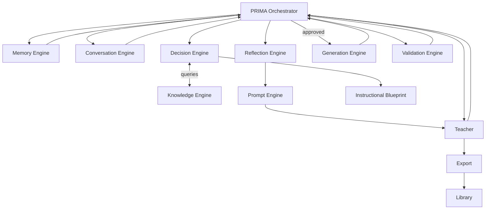
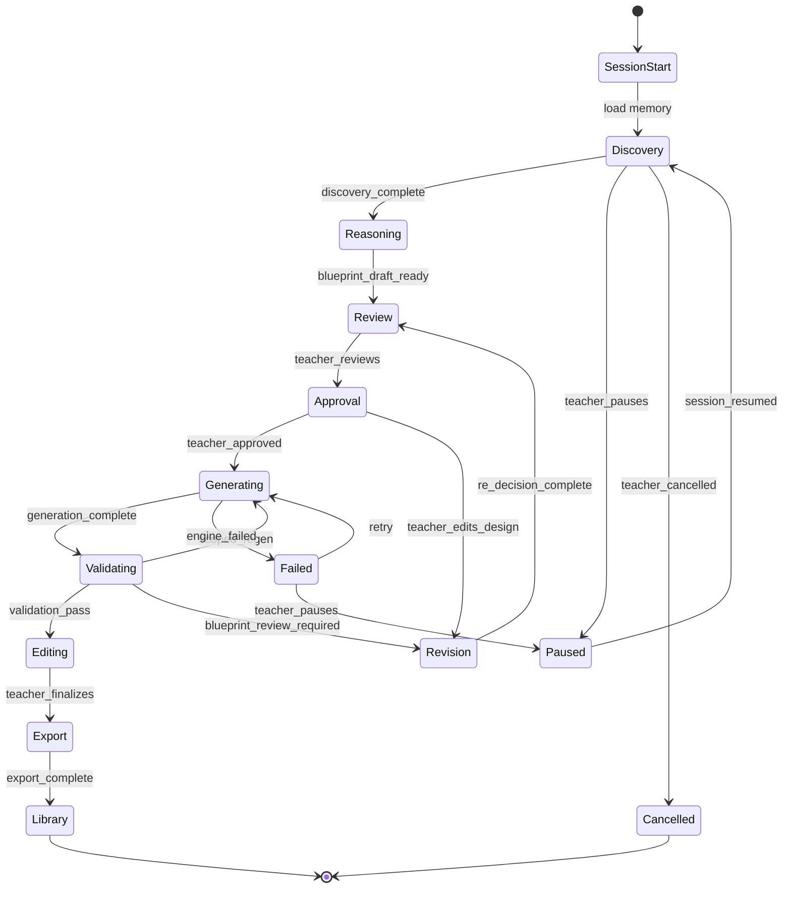
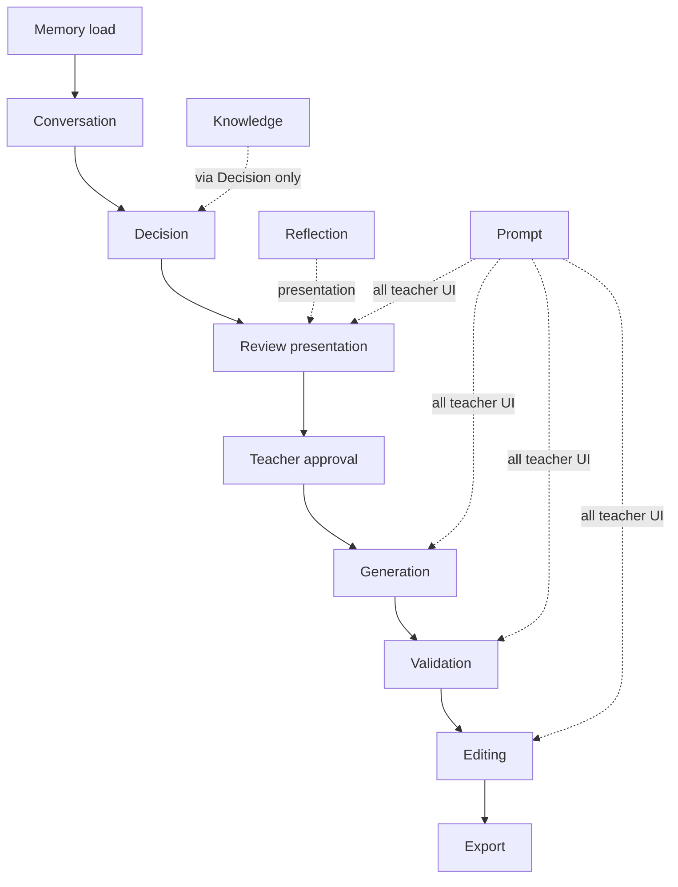
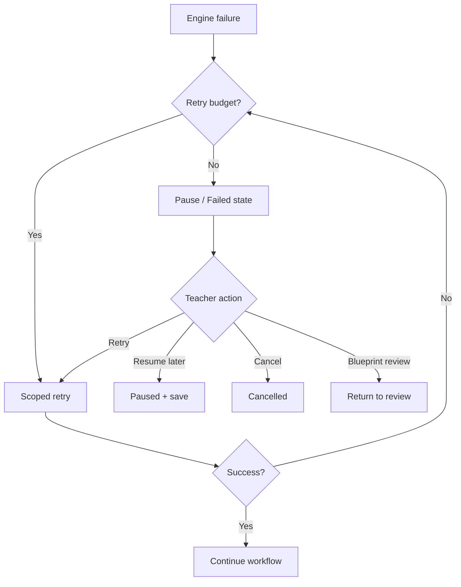
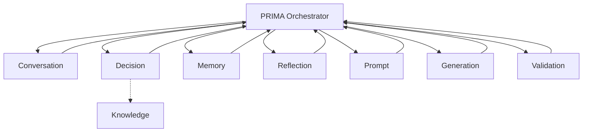

# PRIMA Orchestrator — Product Architecture Specification

---

## Purpose

This document defines the **PRIMA Orchestrator** — the central coordination system of PRIMA within LUDI ON.

The Orchestrator answers one product question:

> *Who runs next?*

It does **not** answer:

- *What should be taught?* — Decision Engine
- *Generate content* — Generation Engine
- *Validate resources* — Validation Engine
- *What does curriculum require?* — Knowledge Engine

The PRIMA Orchestrator is the **operating system of PRIMA**. It ensures every engine executes in the correct order, with the correct inputs, under the correct conditions — while containing **no pedagogical logic** of its own.

### Why Orchestration Exists

PRIMA decomposes into independent engines — each with a single responsibility. Independence improves clarity, testability, and evolution — but creates coordination complexity.

| Without orchestration | With PRIMA Orchestrator |
|-----------------------|-------------------------|
| Engines invoke each other directly | Single coordinator routes all activation |
| Implicit coupling between engines | Explicit contracts and state gates |
| Race conditions on Blueprint state | State-driven transitions |
| Unclear failure ownership | Centralized recovery routing |
| Unpredictable session behaviour | Deterministic workflow |

Orchestration **increases reliability** by making workflow explicit, observable, and recoverable. Teachers experience one coherent PRIMA session — engines experience governed handoffs.

### Scope Boundary: PRIMA vs Platform

| Coordinator | Scope |
|-------------|-------|
| **PRIMA Orchestrator** | PRIMA session lifecycle — Conversation through Export within PRIMA Experience |
| **AI Orchestrator** (platform) | Post-blueprint platform pipeline — Pedagogy, Content, Resource modules coordinated by Generation Engine |

This specification covers **PRIMA Orchestrator** only. Platform-level orchestration is referenced in [`SYSTEM_ARCHITECTURE.md`](../technical/SYSTEM_ARCHITECTURE.md) and [`PRIMA_GENERATION_ENGINE.md`](./PRIMA_GENERATION_ENGINE.md).

This document describes **product architecture only**. No implementation, APIs, code, or databases.

---

## Orchestrator Philosophy

### Coordinate

The Orchestrator's sole creative act is **sequencing** — who runs, when, with what context.

### Never decide

No pedagogical reasoning. No blueprint composition. No trade-off resolution.

### Never generate

No content production. Generation activation only after gates pass.

### Never validate

No quality rule execution. Validation activation and report routing only.

### Never replace engines

Orchestrator does not absorb engine responsibilities as shortcuts.

### State-driven

Every engine activation requires valid session and Blueprint state.

### Event-driven

Teacher actions and engine completions trigger transitions — not polling or assumption.

### Deterministic

Same state + same event → same next action under defined rules.

### Observable

Workflow state, progress, and transitions are traceable for explainability and audit.

### Recoverable

Failures route to retry, resume, rollback, or teacher intervention — not silent stall.

### Explainable

Orchestrator can answer *why* generation started, *why* validation blocked preview, *why* Blueprint reopened.

### Teacher-first

Teacher approval gates and cancellation always respected. Orchestrator serves teacher authority.

---

## Why a Dedicated Orchestrator

### Engine-to-Engine Coupling Problem

If Conversation Engine directly invokes Decision Engine, which invokes Generation:

| Coupling risk | Consequence |
|---------------|-------------|
| Hidden dependencies | Engines assume context others don't guarantee |
| Version skew | One engine changes contract; others break silently |
| Gate bypass | Generation runs without approval |
| Recovery fragmentation | Each engine implements partial retry logic |
| Testing explosion | N² interaction paths |

### Orchestration Reduces Complexity

```
Before:  Engine A ↔ Engine B ↔ Engine C ↔ …  (mesh)
After:   All engines ↔ Orchestrator  (star)
```

Each engine speaks only to the Orchestrator (conceptually). Contracts are centralized. State is single source of workflow truth.

### Orchestration Enables Scalability

| Scalability dimension | How orchestration helps |
|-----------------------|-------------------------|
| New engines | Add contract + transition rules without rewiring all engines |
| New activity types | Workflow variants as orchestration profiles |
| Async operations | Orchestrator holds state while engines complete |
| Multi-session resume | Persisted workflow state rehydrated on entry |
| Future collaboration | Shared session coordination point |

---

## Responsibilities

| Responsibility | Description |
|----------------|-------------|
| **Lifecycle coordination** | Manage PRIMA session from entry to Library archival |
| **Workflow execution** | Execute defined workflow phases in valid order |
| **State management** | Maintain session state and Blueprint state synchronization |
| **Approval gates** | Enforce Blueprint approval before Generation; teacher gates at each phase |
| **Engine sequencing** | Activate exactly one primary engine responsibility per workflow step |
| **Context routing** | Deliver correct artifacts to each engine (session model, blueprint, package) |
| **Error routing** | Direct failures to appropriate recovery path |
| **Retry management** | Coordinate scoped retries — regen, re-validation, re-decision |
| **Cancellation** | Handle teacher cancel; safe session termination |
| **Resume** | Restore in-progress sessions from Project Memory |
| **Timeout management** | Detect stalled engines; offer pause/resume or cancel |
| **Progress tracking** | Stage 11 progress; workflow position for UI |
| **Version synchronization** | Ensure Generation and Validation use matching Blueprint version |
| **Audit trail** | Record state transitions, approvals, overrides, engine activations |
| **Recovery coordination** | Orchestrate failure recovery across engines |
| **Teacher session continuity** | Bridge Dashboard entry, continue working, Library return |

---

## Inputs

The Orchestrator consumes **state**, **events**, and **status** — not pedagogical content for reasoning.

| Input | Source | Purpose |
|-------|--------|---------|
| **Conversation state** | Conversation Engine | Discovery completion, stage position, re-entry scope |
| **Blueprint state** | Instructional Blueprint | `draft` · `under_review` · `approved` · etc. |
| **Engine status** | All engines | `idle` · `running` · `complete` · `failed` |
| **Teacher actions** | PRIMA Experience UI | Approve, edit, cancel, regen request, export |
| **Validation status** | Validation Engine | Compliance status, approval recommendation |
| **Generation status** | Generation Engine | Progress, completion, failure scope |
| **Memory state** | Memory Engine | Session context package loaded; compression eligibility |
| **Knowledge availability** | Platform configuration | Active knowledge pack version for session |
| **System events** | Internal | Engine complete, timeout, retry exhausted |
| **Platform events** | Dashboard, Library | Session start, resume project, save to library |

---

## Outputs

| Output | Consumer | Description |
|--------|----------|-------------|
| **Engine activation** | Target engine | Authorized run with routed context |
| **Workflow transitions** | Internal state machine | Next workflow phase |
| **Lifecycle events** | Audit, analytics | State change records |
| **Approval requests** | Teacher UI via Prompt | Blueprint approval gate presentation |
| **Progress updates** | Prompt Engine → UI | Stage 11 checklist; workflow position |
| **Retry requests** | Generation, Validation, Decision | Scoped re-execution authorization |
| **Cancellation events** | All active engines | Session terminate signal |
| **Audit records** | Session log, compliance | Transitions, overrides, activations |
| **State transitions** | Blueprint, session | Authoritative state updates |
| **Teacher notifications** | Prompt Engine | Gate prompts, failure explanations, resume offers |

---

## Orchestration Architecture

Conceptual flow of engine involvement across a complete PRIMA session. Orchestrator activates engines; engines return status and artifacts.

### Primary Flow

```
Session Start
      ↓
Memory (context load)
      ↓
Conversation (discovery)
      ↓
Decision (+ Knowledge via Decision queries)
      ↓
Reflection + Prompt (reasoning presentation)
      ↓
Blueprint Review
      ↓
Approval Gate
      ↓
Generation
      ↓
Validation
      ↓
Teacher Editing
      ↓
Export
      ↓
Library
```

### Architecture Diagram



---

## Workflow Lifecycle

Each phase maps to Conversation Blueprint stages where applicable.

| Phase | Orchestrator role | Primary engines | Blueprint state |
|-------|-------------------|-----------------|-----------------|
| **Teacher starts session** | Initialize session; load Memory context; set `idle` → `discovery` | Memory | — |
| **Welcome** | Route to Conversation Stage 0 | Conversation, Prompt | — |
| **Conversation** | Stages 1–7; await discovery complete event | Conversation, Reflection, Prompt, Memory | Session model grows |
| **Reasoning** | Activate Decision after discovery complete | Decision, Knowledge (via Decision), Memory (hints) | → `draft` |
| **Blueprint presentation** | Stages 8–9; present reasoning and blueprint | Reflection, Prompt | `draft` → `under_review` |
| **Blueprint review** | Stage 10; await teacher action | Reflection, Prompt | `under_review` |
| **Approval** | On teacher approve → `approved`; block if gates fail | Orchestrator gate | → `approved` |
| **Generation** | Stage 11; activate Generation on approved only | Generation, Prompt (progress) | `approved` locked |
| **Validation** | Post-generation; route per compliance status | Validation, Prompt | `approved` |
| **Teacher editing** | Stage 12; teacher owns edits | Prompt assist → Generation partial | `approved` |
| **Export** | Stage 13; authorize export flow | Platform export | → `archived` path |
| **Library** | Save activity; Project Memory update | Memory (async) | `archived` |

### Workflow Diagram



---

## State Model

Session workflow state is owned by PRIMA Orchestrator. Blueprint state is synchronized per [`INSTRUCTIONAL_BLUEPRINT_SPECIFICATION.md`](./INSTRUCTIONAL_BLUEPRINT_SPECIFICATION.md).

| State | Definition | Allowed engine activations |
|-------|------------|----------------------------|
| **`idle`** | Session created; pre-Welcome | Memory load |
| **`discovery`** | Conversation Stages 0–7 | Conversation, Reflection, Prompt, Memory read |
| **`reasoning`** | Decision pipeline running | Decision, Knowledge (via Decision), Memory read |
| **`review`** | Blueprint presented; teacher reviewing | Reflection, Prompt, Decision (revision only on edit) |
| **`approved`** | Blueprint approved; design locked | Generation (on trigger), Reflection, Prompt |
| **`generating`** | Stage 11 in progress | Generation, Prompt (progress) |
| **`validating`** | Validation running | Validation |
| **`editing`** | Stage 12; teacher editing drafts | Prompt, Generation (partial on request) |
| **`exporting`** | Stage 13 | Platform export modules |
| **`completed`** | Library saved; session closed | Memory async capture only |
| **`cancelled`** | Teacher cancelled; terminal | None |
| **`failed`** | Unrecoverable or retry-exhausted | Recovery UI; retry authorization |
| **`paused`** | Teacher paused or timeout hold | Resume only |

### State Invariants

| Invariant | Rule |
|-----------|------|
| **G-01** | `generating` requires Blueprint `approved` |
| **G-02** | `validating` requires Generation complete for scope |
| **G-03** | `exporting` requires teacher finalize signal |
| **G-04** | `reasoning` requires discovery complete |
| **G-05** | Only Orchestrator transitions workflow state |

---

## Events

Events trigger state transitions. Engines emit events; Orchestrator validates and transitions.

| Event | Emitter | Typical transition |
|-------|---------|-------------------|
| **`session_started`** | Platform / Dashboard | → `idle` → `discovery` |
| **`memory_loaded`** | Memory Engine | Enable compressed discovery flag |
| **`discovery_complete`** | Conversation Engine | → `reasoning` |
| **`blueprint_draft_ready`** | Decision Engine | → `review` |
| **`teacher_approved`** | Teacher UI | → `approved` → `generating` |
| **`teacher_edits_design`** | Teacher UI | → `revision` subflow → `review` |
| **`teacher_cancelled`** | Teacher UI | → `cancelled` |
| **`generation_finished`** | Generation Engine | → `validating` |
| **`generation_failed`** | Generation Engine | → `failed` or scoped retry |
| **`validation_passed`** | Validation Engine | → `editing` |
| **`validation_failed`** | Validation Engine | → scoped regen or `review` |
| **`retry_requested`** | Teacher or Validation recommendation | Authorize scoped retry |
| **`blueprint_revised`** | Decision Engine | Blueprint version bump; gate re-check |
| **`session_resumed`** | Dashboard continue working | Rehydrate state → appropriate phase |
| **`timeout`** | Orchestrator | → `paused` or retry offer |
| **`engine_failed`** | Any engine | Error routing per failure policy |
| **`export_complete`** | Export flow | → `completed` |
| **`teacher_finalized`** | Teacher UI | → `exporting` |
| **`override_logged`** | Teacher UI | Proceed despite validation finding |

---

## Coordination Rules

### Who Can Activate Whom

**Only PRIMA Orchestrator activates engines.** No engine directly activates another.

| Orchestrator may activate | When |
|---------------------------|------|
| Memory Engine | Session start; async post-session |
| Conversation Engine | `discovery`; scoped re-entry from Decision |
| Decision Engine | `discovery_complete`; teacher design edit |
| Reflection Engine | After Decision outputs; validation report ready |
| Prompt Engine | Whenever teacher-facing copy needed |
| Generation Engine | Blueprint `approved` + `generating` authorized |
| Validation Engine | Generation complete for scope |

### Who Cannot Activate Whom

| Forbidden direct activation | Correct path |
|------------------------------|--------------|
| Conversation → Decision | Orchestrator on `discovery_complete` |
| Decision → Generation | Orchestrator on `teacher_approved` |
| Generation → Validation | Orchestrator on `generation_finished` |
| Validation → Generation regen | Orchestrator on `retry_requested` |
| Any engine → Prompt (bypass) | Orchestrator routes all teacher communication |
| Knowledge → Decision (direct) | Decision queries; Orchestrator does not short-circuit |

### Dependency Graph



---

## Engine Contracts

Conceptual contracts — what Orchestrator delivers to each engine and expects in return. Not API schemas.

---

### Conversation Contract

| Orchestrator delivers | Conversation returns |
|-----------------------|---------------------|
| Session context package, activity type, compression eligibility | Stage completion signals, session model updates, `discovery_complete` event |
| Scoped re-entry directive on Decision request | Targeted clarification only — not full restart |

---

### Decision Contract

| Orchestrator delivers | Decision returns |
|-----------------------|------------------|
| Complete session model, activity type, teacher revision scope | Blueprint draft, reasoning summary, confidence map, `blueprint_draft_ready` |
| Authorization to run Layers 1–5 | `blocking_issues` if critical — triggers Conversation re-entry |

---

### Knowledge Contract

| Orchestrator delivers | Knowledge returns |
|-----------------------|-------------------|
| Knowledge pack version, locale (via platform config) | Not activated directly by Orchestrator |
| Decision Engine queries during Decision activation | Knowledge responses to Decision only |

Orchestrator ensures **pack version context** is available — does not query Knowledge.

---

### Memory Contract

| Orchestrator delivers | Memory returns |
|-----------------------|----------------|
| Session start signal, teacher ID, project reference | Session context package, compression eligibility |
| Async session end signal | Memory capture lifecycle (post-session) |

---

### Blueprint Contract

| Orchestrator delivers | Blueprint state returns |
|-----------------------|-------------------------|
| State transition authorization | Current state gates engine activation |
| Version sync requirements | Version ID for Generation/Validation match |

Blueprint object is **authoritative design** — Orchestrator enforces state machine per Blueprint Specification.

---

### Generation Contract

| Orchestrator delivers | Generation returns |
|-----------------------|-------------------|
| Approved Blueprint + version, revision directives, generation mode | Progress events, validation package, `generation_finished` or `generation_failed` |
| Scoped regen authorization with block IDs | Partial completion status |

---

### Validation Contract

| Orchestrator delivers | Validation returns |
|-----------------------|-------------------|
| Validation package, approved Blueprint reference | Validation report, compliance status, approval recommendation |
| Scoped re-validation scope | Updated report |

---

### Prompt Contract

| Orchestrator delivers | Prompt returns |
|-----------------------|----------------|
| Structured content from engines, workflow state, progress data | Teacher-facing utterances — Orchestrator never speaks directly |

Prompt activates frequently — always orchestrator-initiated.

---

### Reflection Contract

| Orchestrator delivers | Reflection returns |
|-----------------------|-------------------|
| Reasoning summary, validation findings, mirror requests | Formatted reflective content for Prompt; confirmation signals to Conversation/Decision |

---

## Failure Recovery

| Scenario | Orchestrator behaviour |
|----------|------------------------|
| **Engine failure** | Transition to `failed`; preserve state; offer retry or pause |
| **Retry** | Authorize scoped retry — max attempts per policy; escalate to teacher |
| **Rollback** | Revert workflow to last stable state — e.g., `approved` before regen |
| **Resume** | Rehydrate session from Project Memory; restore workflow state |
| **Cancellation** | Emit `teacher_cancelled`; terminate active engines safely; save optional draft |
| **Partial completion** | Allow preview of completed blocks; retry failed scope only |
| **Conflict** | Blueprint version ≠ generation version → block; require regen from current |
| **Timeout** | → `paused`; notify teacher; offer resume or cancel |

### Recovery Diagram



---

## Explainability

Orchestrator maintains audit trail enabling PRIMA to explain workflow decisions via Reflection and Prompt.

| Question | Orchestrator evidence |
|----------|-------------------------|
| **Why did generation start?** | `teacher_approved` event + Blueprint version + timestamp |
| **Why did validation fail?** | Validation report reference + compliance status + rule IDs |
| **Why was Blueprint reopened?** | `teacher_edits_design` or `blueprint_review_required` event |
| **Why was teacher intervention requested?** | Gate failure, `failed` state, or Critical validation with block |

Explainability records: state transitions, event log, engine activation log, approval history, override log.

---

## Relationship with Every Engine

### Interaction Matrix

| Engine | Orchestrator → Engine | Engine → Orchestrator |
|--------|----------------------|----------------------|
| **Conversation** | Activate; provide context | Status, discovery_complete |
| **Decision** | Activate; provide session model | Blueprint, reasoning, blocking_issues |
| **Knowledge** | Provide pack context only | Indirect via Decision |
| **Memory** | Activate load/capture | Context package, eligibility |
| **Reflection** | Activate presentation | Formatted content, confirmations |
| **Prompt** | Activate with structured inputs | Utterances to UI |
| **Generation** | Activate on approval | Progress, package, completion |
| **Validation** | Activate post-generation | Report, recommendation |
| **Blueprint** | State transitions | State gates |
| **Teacher** | Present gates via Prompt | Actions as events |
| **Platform Export** | Activate on finalize | export_complete |
| **Dashboard** | session_started, resume | Entry, continue working |

### Star Topology Diagram



---

## What the Orchestrator Never Does

| Boundary | Owner |
|----------|-------|
| Teach or reason pedagogically | Decision Engine |
| Generate content | Generation Engine |
| Validate quality | Validation Engine |
| Query Knowledge directly | Decision Engine |
| Write Memory durables | Memory Engine |
| Compose Blueprint sections | Decision Engine |
| Speak to teacher | Prompt Engine |
| Auto-approve Blueprint | Teacher |
| Auto-export | Teacher |
| Override teacher cancel | Forbidden |
| Bypass approval gate | Forbidden |

---

## Architectural Principles

| # | Principle |
|---|-----------|
| 1 | **Single coordinator** — all engine activation through Orchestrator |
| 2 | **Engines remain independent** — star topology, not mesh |
| 3 | **No engine activates another directly** — enforced contract |
| 4 | **State before action** — valid state required for every activation |
| 5 | **Events over assumptions** — transitions driven by explicit events |
| 6 | **Teacher always in control** — approval, cancel, override respected |
| 7 | **Observable workflows** — audit trail for every transition |
| 8 | **Deterministic orchestration** — defined rules, not heuristic routing |
| 9 | **Recoverable execution** — retry, pause, resume, rollback |
| 10 | **Technology independent** — workflow logic separate from implementation |
| 11 | **Blueprint gate is sacred** — no Generation without `approved` |
| 12 | **Version synchronization** — Blueprint version matches generation run |

---

## Document Authority

On conflict regarding PRIMA session coordination and workflow:

**`PRIMA_ORCHESTRATOR.md` prevails** until officially revised by the LUDI ON Product Team.

Engine-specific behaviour remains authoritative in respective engine specifications.

---

## Next Recommended Document

→ [`PRIMA_ENGINE.md`](./PRIMA_ENGINE.md) — Update engine map to reference this orchestration specification as the coordination layer.
