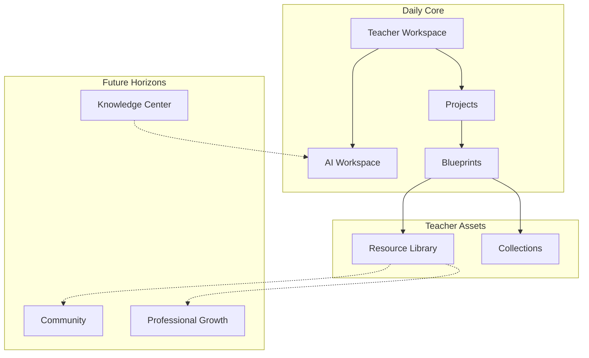
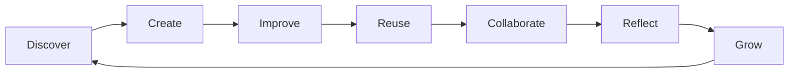
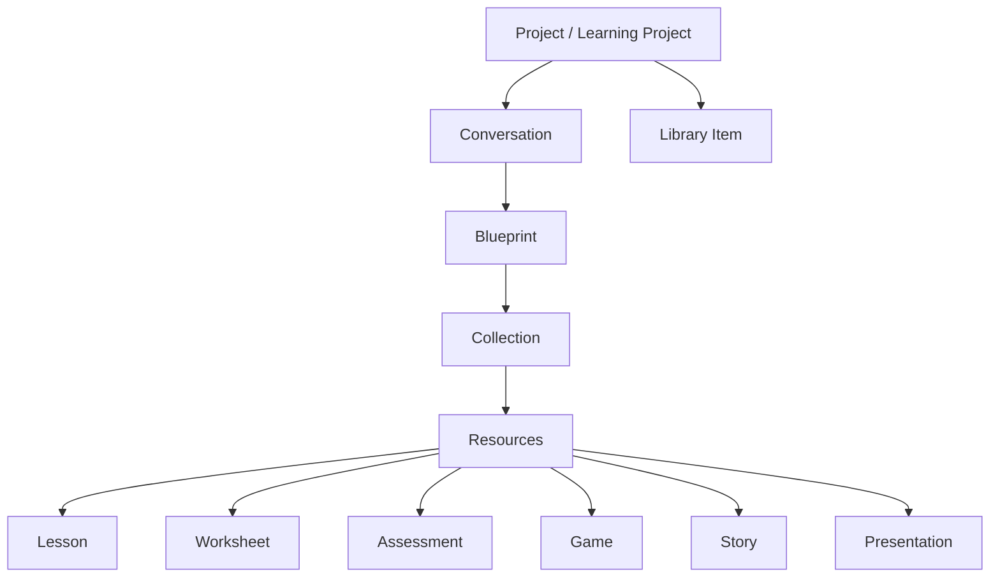

# PRIMA Product Design

**Version:** 2.0  
**Status:** Official — Product Constitution

> **This document is the Product Constitution of PRIMA.**

It defines product philosophy, user experience, interaction model, and functional ecosystem — how the platform **behaves from the teacher's perspective**. It is not a software specification. It is not a UI mock-up. It is the vision that designers, developers, AI engineers, and educational experts share when building PRIMA.

Delivered through **LUDI ON**. Educational object authority: [`PRIMA_BLUEPRINT.md`](./PRIMA_BLUEPRINT.md). Intelligence behavior: [`PRIMA_INTELLIGENCE_KERNEL.md`](./PRIMA_INTELLIGENCE_KERNEL.md). Visual execution: [`UI_GUIDELINES.md`](../UI_GUIDELINES.md).

---

## The Fundamental Question

Every chapter in this document must contribute to answering one question:

> **How should PRIMA transform the daily experience of a teacher?**

PRIMA must transform planning from **solitary, repetitive, fragmented labor** into **collaborative, reusable, pedagogically confident design** — so teachers spend their professional energy on **learning**, not on **tools**.

Avoid technical implementation here. Focus on **experience**, **simplicity**, and **educational value**.

---

## 1. Design Philosophy

Extraordinary products are created by **removing friction** — not adding features.

PRIMA must be:

| Priority | Meaning for teachers |
|----------|---------------------|
| **Simple before powerful** | Start fast; depth available when needed |
| **Guided before automated** | PRIMA leads thinking — never runs ahead of it |
| **Collaborative before prescriptive** | Proposals, not mandates |
| **Educational before technological** | Pedagogy visible; technology invisible |
| **Elegant before feature-rich** | Calm surfaces beat capability grids |
| **Predictable before surprising** | No sudden generation; no hidden actions |
| **Professional without complicated** | Serious craft; zero admin-panel feel |
| **Intelligent without intrusive** | Helpful colleague — not hovering assistant |
| **Invisible when possible** | UI disappears into the task |
| **Helpful when necessary** | Surfaces guidance at decision moments |

**Cardinal rule:** Every feature must **simplify teaching**. Nothing exists simply because it is technically possible.

**Inspiration:** Notion, Canva, Figma, Cursor, ChatGPT, and Duolingo succeed by **hiding complexity while exposing value**. PRIMA applies this to instructional design.

---

## 2. Product Principles

Immutable principles governing every product decision. Each includes purpose, educational rationale, product implications, and examples.

---

### PP-01 — Teachers Remain in Control

| Dimension | Content |
|-----------|---------|
| **Purpose** | Preserve professional autonomy as non-negotiable product law |
| **Educational rationale** | Teacher judgment integrates context no system can fully model — classroom culture, individual learners, professional ethics |
| **Product implications** | Explicit approval gates; no auto-publish; override always available; PRIMA never blocks teacher edits |
| **Examples** | Blueprint approval before generation; teacher can re-open design; generated text fully editable |

---

### PP-02 — AI Proposes; Teachers Decide

| Dimension | Content |
|-----------|---------|
| **Purpose** | Separate recommendation from commitment |
| **Educational rationale** | Professional responsibility for learning outcomes rests with the teacher — not the platform |
| **Product implications** | All AI output framed as draft; binding actions require teacher confirmation; no silent application of suggestions |
| **Examples** | *"Aș propune aceste obiective — vrei să le ajustezi?"*; approve button on Blueprint, not auto-continue |

---

### PP-03 — Every Action Must Have Educational Value

| Dimension | Content |
|-----------|---------|
| **Purpose** | Reject feature bloat and vanity automation |
| **Educational rationale** | Teacher time is a finite professional resource — every interaction must earn its place |
| **Product implications** | Feature admission bar; remove unused paths; no gamification without pedagogical purpose |
| **Examples** | Reject: animated badges for login streaks. Accept: quick reuse of last week's differentiated worksheet |

---

### PP-04 — Reduce Cognitive Load

| Dimension | Content |
|-----------|---------|
| **Purpose** | Design for tired teachers at the end of a school day |
| **Educational rationale** | Cognitive bandwidth spent on software cannot be spent on learner needs |
| **Product implications** | One primary action per view; minimal choices; smart defaults; auto-save; no configuration walls |
| **Examples** | Returning teacher sees *Continuă* — not 12 equal menu items. PRIMA confirms inferred grade instead of re-asking |

---

### PP-05 — Preserve Pedagogical Coherence

| Dimension | Content |
|-----------|---------|
| **Purpose** | Ensure objectives, activities, assessment, and resources align |
| **Educational rationale** | Incoherent lessons confuse learners and erode learning outcomes |
| **Product implications** | Blueprint as single design truth; validation flags misalignment; collections bundle coherent outputs |
| **Examples** | Worksheet cannot be generated without Blueprint activity link; assessment maps to stated objectives |

---

### PP-06 — Progressive Disclosure of Complexity

| Dimension | Content |
|-----------|---------|
| **Purpose** | Show only what matters at each moment |
| **Educational rationale** | Expertise develops gradually — beginners need guidance; experts need speed |
| **Product implications** | Conversation first; Blueprint sections expand on demand; advanced options behind deliberate access |
| **Examples** | First session: goal + conversation. Later: curriculum codes, formal competency view — opt-in |

---

### PP-07 — Reuse Instead of Repetition

| Dimension | Content |
|-----------|---------|
| **Purpose** | Compound teacher investment over time |
| **Educational rationale** | Repetitive planning is professional waste; adaptation is higher-value work than recreation |
| **Product implications** | Library; Blueprint duplication; memory of context; template-from-previous flows |
| **Examples** | *"Folosește lecția de marți ca punct de start"* — PRIMA asks only what changed |

---

### PP-08 — Explain Before Recommending

| Dimension | Content |
|-----------|---------|
| **Purpose** | Build trust through transparency |
| **Educational rationale** | Teachers must defend design choices to colleagues, leaders, and parents |
| **Product implications** | *De ce?* on every major suggestion; rationale linked to Blueprint sections; no black-box recommendations |
| **Examples** | *"Am ales activitatea în perechi pentru că ai menționat clasă numerosă"* |

---

### PP-09 — One Workspace, One Mental Model

| Dimension | Content |
|-----------|---------|
| **Purpose** | Eliminate fragmented tool-switching |
| **Educational rationale** | Context switching destroys flow and increases error |
| **Product implications** | Teacher Workspace as daily home; Projects contain full design thread; consistent object names everywhere |
| **Examples** | Lesson, Blueprint, and Conversation live in one Project — not scattered across apps |

---

### PP-10 — Every Workflow Begins with Teacher Intention

| Dimension | Content |
|-----------|---------|
| **Purpose** | Anchor all intelligence in authentic teacher purpose |
| **Educational rationale** | Design without intent produces generic, ineffective learning experiences |
| **Product implications** | No cold-start generation; conversation captures intent before composition; Activity Type scopes — not replaces — intent |
| **Examples** | Even *Fișă rapidă* begins with *"Ce vor exersa elevii?"* — not blank template fill |

---

### PP-11 — Blueprint Before Generation

| Dimension | Content |
|-----------|---------|
| **Purpose** | Separate design from production |
| **Educational rationale** | Responsible design requires reviewable plan before materials exist |
| **Product implications** | Blueprint review phase mandatory; generation blocked until approval; resources trace to design |
| **Examples** | Teacher sees Plan pedagogic before any worksheet text appears |

---

### PP-12 — Conversation Before Forms

| Dimension | Content |
|-----------|---------|
| **Purpose** | Match discovery to how teachers naturally plan |
| **Educational rationale** | Forms extract data; dialogue builds shared understanding |
| **Product implications** | No step wizards in PRIMA Experience; no *Step 1 of N*; inference reduces questions |
| **Examples** | *"Pentru clasa a III-a, la matematică — ce vrei să reușească elevii?"* not dropdown marathon |

---

### PP-13 — Romanian-First Experience

| Dimension | Content |
|-----------|---------|
| **Purpose** | Native fit for primary market classroom reality |
| **Educational rationale** | Curriculum, language, and cultural context shape valid pedagogy |
| **Product implications** | Romanian primary interface; local curriculum alignment; classroom conventions reflected in copy |
| **Examples** | Grade bands, subject names, and assessment language match Romanian primary school practice |

---

## 3. Product Vision

### Vision statement

**PRIMA becomes the daily workspace where every teacher designs learning experiences as thoughtfully as the best instructional designers — in a fraction of the time — with a partner they trust.**

### Why the platform exists

Teachers face a structural mismatch: the **quality** of learning design expected in modern classrooms exceeds the **time and training** available to most teachers daily. Existing tools either store resources without improving thinking, or generate content without improving design.

PRIMA exists to **improve professional thinking** while **removing preparation friction** — not to replace the teacher.

### What problem it solves

| Problem | PRIMA transformation |
|---------|---------------------|
| Planning steals personal time | Minutes to coherent design — not hours |
| AI tools feel untrustworthy | Blueprint makes design visible before content |
| Quality depends on individual skill | Embedded pedagogical reasoning elevates every teacher |
| Work is lost and repeated | Library and Blueprint reuse compound over years |
| Software feels like administration | Experience feels like a colleague at the next desk |

### Why teachers will adopt it

- **Immediate value** — meaningful result in first session without training  
- **Low risk** — nothing generates without approval  
- **Native fit** — Romanian curriculum and classroom language  
- **Familiar patterns** — conversation and document editing, not new software grammar  

### Why they will continue after years

- **Compound reuse** — every saved Blueprint reduces future effort  
- **Growing trust** — PRIMA learns preferences without surveillance  
- **Professional pride** — visibly better lessons; explainable design  
- **Habit integration** — opens like a planner, not a project to learn  

### What makes PRIMA fundamentally different

| Category | Typical platform | PRIMA |
|----------|------------------|-------|
| **Resource repository** | Download files | **Design experiences** — resources are outputs |
| **AI content generator** | Text in → content out | **Intent in → Blueprint → approved content** |
| **LMS / admin tool** | Manage courses, compliance | **Creative workspace** for instructional design |
| **Template marketplace** | Fill blanks | **Reasoned design** with teacher partnership |
| **Chatbot** | Answer questions | **Co-design** learning experiences with validation |

PRIMA is an **Educational Intelligence Platform** — intelligent pedagogical partner, not repository, not generator.

---

## 4. Target Users

---

### Beginning Teacher

| Dimension | Detail |
|-----------|--------|
| **Goals** | Plan confidently; learn sound design; avoid pedagogical gaps |
| **Needs** | Structure, rationale, gentle guidance, visible quality criteria |
| **Frustrations** | Uncertainty if lesson is "good enough"; fear of missing assessment or differentiation |
| **Digital maturity** | Moderate — uses smartphone daily; variable comfort with new apps |
| **Teaching context** | First years in classroom; high preparation anxiety; mentor access variable |
| **Expected outcomes** | Sound lesson structure; explainable design; growing independence over months |

**PRIMA role:** Patient colleague who teaches design by doing it together.

---

### Experienced Teacher

| Dimension | Detail |
|-----------|--------|
| **Goals** | Speed; reuse; maintain personal style; protect evenings |
| **Needs** | Minimal friction; memory of context; skip redundant steps |
| **Frustrations** | Tools that slow experts; re-entering known information; over-explanation |
| **Digital maturity** | Variable — values efficiency over exploration |
| **Teaching context** | Established routines; strong classroom intuition; low tolerance for waste |
| **Expected outcomes** | Faster prep; library of personal templates; unchanged professional voice in output |

**PRIMA role:** Fast, respectful partner who stays out of the way until needed.

---

### Mentor Teacher

| Dimension | Detail |
|-----------|--------|
| **Goals** | Support mentees; co-design; transfer tacit planning knowledge |
| **Needs** | Shareable blueprints; visible rationale; duplicate-and-adapt flows |
| **Frustrations** | Limited co-planning time; hard to show *why* a lesson is structured well |
| **Digital maturity** | Moderate to high |
| **Teaching context** | Informal coaching; model lessons; peer observation culture |
| **Expected outcomes** | Mentee sees design reasoning; reusable exemplars |

**PRIMA role (future):** Co-design surface with explainability built in.

---

### School Leader

| Dimension | Detail |
|-----------|--------|
| **Goals** | Raise instructional quality; share exemplars; support development — not surveillance |
| **Needs** | Quality visible in design; optional sharing; teacher adoption without mandate fatigue |
| **Frustrations** | Tools teachers abandon; compliance platforms; inconsistent lesson quality |
| **Digital maturity** | Moderate |
| **Teaching context** | Methodologist or principal; staff development responsibility |
| **Expected outcomes** | Teachers self-select PRIMA; shared library of school exemplars (future) |

**PRIMA role (future):** Quality elevation through voluntary reuse — never monitoring.

---

### Educational Trainer

| Dimension | Detail |
|-----------|--------|
| **Goals** | Model instructional design; train teachers in planning practice |
| **Needs** | Blueprint as teaching artifact; explainability; reproducible workshop flows |
| **Frustrations** | Abstract theory disconnected from daily planning tools |
| **Digital maturity** | High |
| **Teaching context** | Inservice training; university partnerships; curriculum projects |
| **Expected outcomes** | Teachers learn design principles through PRIMA-mediated practice |

**PRIMA role (future):** Demonstration environment for evidence-based design workflow.

---

### Future Personas

| Persona | Horizon |
|---------|---------|
| Curriculum specialist | Multi-unit Blueprint authoring |
| Special education coordinator | Accessibility-first design paths |
| Primary teacher (default v1) | Core daily workspace persona |

*Version 1.0 primary focus: beginning and experienced classroom teachers.*

---

## 5. Product Ecosystem

Conceptual structure of the platform — **educational value of each area**, not screens or menus.



---

### Teacher Workspace

**Educational value:** Daily home — continuity, orientation, momentum. Teacher returns here the way they return to a desk: everything in progress is visible.

**Contains:** Active projects, continue-working entry, creation shortcuts, light recommendations.

**Not:** Administration, grading, timetables.

---

### AI Workspace (PRIMA Experience)

**Educational value:** Partnership environment for discovery and design thinking — conversation without form fatigue.

**Contains:** Dialogue with PRIMA, intent capture, transition to Blueprint review.

**Not:** Dashboard chrome, parallel tasks, settings complexity.

---

### Projects

**Educational value:** Continuity of one design effort across days — no lost thinking.

**Contains:** Conversation history, Blueprint versions, generated resources, status.

**Not:** Course management or class roster.

---

### Blueprints

**Educational value:** Single source of pedagogical truth — design before materials.

**Contains:** Complete Learning Experience design per [`PRIMA_BLUEPRINT.md`](./PRIMA_BLUEPRINT.md).

**Not:** Generated classroom text or export files.

---

### Resource Library

**Educational value:** Professional portfolio — reuse compounds time savings over years.

**Contains:** Saved activities, Blueprint lineage, duplicate-for-adapt entry.

**Not:** Third-party content marketplace (unless explicit future scope).

---

### Collections

**Educational value:** Coherent bundles — lesson + worksheet + assessment from one design.

**Contains:** Resources sharing Blueprint version identity.

---

### Community *(future)*

**Educational value:** Voluntary sharing among professionals — exemplars, not mandates.

**Contains:** Shared Blueprints, trusted colleague resources.

**Guardrail:** Opt-in only; no performance surveillance.

---

### Knowledge Center *(future)*

**Educational value:** Curriculum and pedagogy reference accessible during design — not separate research task.

**Contains:** Curriculum maps, method patterns — feeds PRIMA reasoning, not teacher homework.

---

### Analytics *(future, constrained)*

**Educational value:** Teacher's own professional insight — time saved, reuse patterns.

**Contains:** Personal productivity signals only.

**Guardrail:** Never institutional surveillance without explicit product decision.

---

### Professional Growth *(future)*

**Educational value:** Connect design practice to development — reflection over badges.

**Contains:** Design history, improvement patterns, training pathways.

---

### Settings

**Educational value:** Set preferences once — never block first value.

**Contains:** Grade defaults, language, memory preferences.

**Not:** Pedagogical decisions belonging in conversation.

---

## 6. The Teacher Journey

Continuous lifecycle — **not fragmented modules**. Each phase flows naturally into the next.



---

### Discover

**When:** First login; return after absence; new academic year.

**Experience:** PRIMA orients without tutorial walls. *What would you like to design?* Platform feels like a creative studio — not onboarding software.

**Transformation:** Anxiety → curiosity. *This might actually help.*

---

### Create

**When:** Daily core — new lesson, worksheet, game, assessment.

**Experience:** Choose → converse → review Blueprint → approve → edit resources → export.

**Transformation:** Blank page dread → structured design in minutes.

---

### Improve

**When:** After classroom delivery; colleague feedback; changed class needs.

**Experience:** Open saved work → tell PRIMA what to improve → Blueprint diff → partial regeneration.

**Transformation:** Throw-away and restart → intentional iteration.

---

### Reuse

**When:** Similar topic next week; new class; annual repeat.

**Experience:** Library → duplicate → PRIMA asks only what changed → fast re-approval.

**Transformation:** Repetitive labor → adaptive template.

---

### Collaborate *(future)*

**When:** Co-planning with mentor; sharing with colleague.

**Experience:** Shared Blueprint view; explainability visible; duplicate to own workspace.

**Transformation:** Isolated planning → professional dialogue around design.

---

### Reflect

**When:** After lesson; end of week; end of unit.

**Experience:** PRIMA prompts gentle reflection — what worked, what to adjust. Feeds future sessions — advisory only.

**Transformation:** Tacit experience → explicit improvement signals.

---

### Grow

**When:** Months and years of use.

**Experience:** Library grows; PRIMA knows preferences; design quality confidence rises; planning time falls.

**Transformation:** Surviving prep → professional craft compounded.

---

### Journey continuity principles

| Principle | Meaning |
|-----------|---------|
| **Same mental model** | Discover through Grow use Projects → Blueprint → Resources |
| **No dead ends** | Every completion suggests natural next step — save, export, reuse |
| **Resume anywhere** | Interrupted session restores exact context |
| **Time depth** | Day-one simple; year-three powerful — without relearning |

---

## 7. Core Product Objects

Educational objects teachers manage. Architectural registry: [`PRIMA_CANONICAL_ARTIFACTS.md`](./PRIMA_CANONICAL_ARTIFACTS.md).

**Object template:** Purpose · Educational value · Relationships · Lifecycle · Transformations

---

### Blueprint

| Attribute | Content |
|-----------|---------|
| **Purpose** | Complete pedagogical design — educational DNA |
| **Educational value** | Visible, approvable, reusable design before any content |
| **Relationships** | Parent of all resources; child of Project; fed by Conversation |
| **Lifecycle** | Draft → review → approved → superseded → archived |
| **Transformations** | Source for all output types — identity preserved |

---

### Lesson

| Attribute | Content |
|-----------|---------|
| **Purpose** | Executable classroom plan from Blueprint |
| **Educational value** | Teach-tomorrow readiness with coherent flow |
| **Relationships** | Transformation of Blueprint; member of Collection |
| **Lifecycle** | Generated → edited → exported → saved |
| **Transformations** | From Blueprint flow + activities; export PDF/DOC |

---

### Worksheet

| Attribute | Content |
|-----------|---------|
| **Purpose** | Student practice aligned to objectives |
| **Educational value** | Targeted exercise — not generic fill-in |
| **Relationships** | Maps to Blueprint activity; pairs with Lesson |
| **Lifecycle** | Generated → edited → exported |
| **Transformations** | From Blueprint activity design |

---

### Assessment

| Attribute | Content |
|-----------|---------|
| **Purpose** | Evaluation materials per Blueprint assessment design |
| **Educational value** | Measures what was taught |
| **Relationships** | Links to objectives and success criteria |
| **Lifecycle** | Generated → edited → exported |
| **Transformations** | Rubric, items, observation guides |

---

### Educational Game

| Attribute | Content |
|-----------|---------|
| **Purpose** | Game-based learning from Blueprint game activity |
| **Educational value** | Engagement bound to explicit objectives |
| **Relationships** | Activity Type: Joc; Blueprint defines rules-as-design |
| **Lifecycle** | Designed → approved → generated → edited |
| **Transformations** | Playable/printable game artifact |

---

### Story

| Attribute | Content |
|-----------|---------|
| **Purpose** | Narrative learning experience embedding objectives |
| **Educational value** | Contextualized learning through narrative structure |
| **Relationships** | Blueprint narrative activity; optional cross-curricular |
| **Lifecycle** | Same as Lesson pattern |
| **Transformations** | Story document, read-aloud guide, student booklet |

---

### Presentation

| Attribute | Content |
|-----------|---------|
| **Purpose** | Visual delivery sequence of learning flow |
| **Educational value** | Phase-aligned classroom visuals |
| **Relationships** | Maps to Blueprint learning phases |
| **Lifecycle** | Generated → edited → exported |
| **Transformations** | Slide deck PPTX/PDF |

---

### Learning Project

| Attribute | Content |
|-----------|---------|
| **Purpose** | Extended multi-session learning unit design |
| **Educational value** | Coherent long-form inquiry or project-based learning |
| **Relationships** | Contains multiple Blueprints or multi-phase single Blueprint |
| **Lifecycle** | Planned → in progress → completed → archived |
| **Transformations** | Project guide, milestone sheets, assessment portfolio |

---

### Resource

| Attribute | Content |
|-----------|---------|
| **Purpose** | Any single generated or imported artifact |
| **Educational value** | Atomic editable output teacher owns |
| **Relationships** | Member of Collection; traces to Blueprint section |
| **Lifecycle** | Created → edited → exported |
| **Transformations** | Format export; partial regeneration |

---

### Conversation

| Attribute | Content |
|-----------|---------|
| **Purpose** | Living dialogue capturing teacher intention |
| **Educational value** | Natural discovery — reduces form fatigue |
| **Relationships** | Scoped to Project; summarizes to Teacher Intent |
| **Lifecycle** | Active → summarized → resumable |
| **Transformations** | Intent → Blueprint composition input |

---

### Collection

| Attribute | Content |
|-----------|---------|
| **Purpose** | Coherent bundle from one approved Blueprint |
| **Educational value** | No mismatched materials across lesson, worksheet, test |
| **Relationships** | Contains Resources; shared Blueprint version |
| **Lifecycle** | Grows as teacher adds output types |
| **Transformations** | Bulk export; library save as unit |

---

### Library Item

| Attribute | Content |
|-----------|---------|
| **Purpose** | Saved teacher-owned activity for reuse |
| **Educational value** | Compound return on design investment |
| **Relationships** | References Blueprint + Collection snapshot |
| **Lifecycle** | Saved → reopened → adapted → re-saved |
| **Transformations** | Duplicate → new Project |

---

### Object hierarchy



---

## 8. User Workflows

**Workflow template:** Goal · Entry · Teacher actions · AI contributions · Validation · Completion · Outcome

Common rhythm: **Intention → Dialogue → Blueprint → Approve → Edit → Export**

---

### Create Lesson

| Field | Content |
|-------|---------|
| **Goal** | Classroom-ready lesson from teacher intention |
| **Entry** | Teacher Workspace → new Lecție |
| **Teacher actions** | Describe class and goal; review Blueprint; approve; edit; export |
| **AI contributions** | Capture intent; compose Blueprint; explain sections; generate materials |
| **Validation** | Blueprint coherence check; teacher approval gate |
| **Completion** | Exported lesson saved to Library optional |
| **Outcome** | Pedagogically coherent lesson teacher can teach tomorrow |

---

### Generate Worksheet

| Field | Content |
|-------|---------|
| **Goal** | Student practice sheet aligned to objectives |
| **Entry** | New Fișă — or add to existing Project with Blueprint |
| **Teacher actions** | Confirm objective focus; approve; edit; export |
| **AI contributions** | Reuse Blueprint if present; propose exercise design; generate |
| **Validation** | Activity–objective link in Blueprint |
| **Completion** | PDF/export ready |
| **Outcome** | Worksheet matches lesson intent — not orphan exercises |

---

### Build Educational Game

| Field | Content |
|-------|---------|
| **Goal** | Game activity with clear learning objective |
| **Entry** | New Joc |
| **Teacher actions** | Describe objective and mechanic; review game-as-design in Blueprint; approve |
| **AI contributions** | Structure game rules pedagogically; generate playable artifact |
| **Validation** | Objective binding; age appropriateness |
| **Completion** | Editable game resource |
| **Outcome** | Fun with explicit learning purpose |

---

### Create Assessment

| Field | Content |
|-------|---------|
| **Goal** | Evaluation matching taught content |
| **Entry** | From Blueprint review or post-lesson Project |
| **Teacher actions** | Confirm assessment design; approve; edit rubric/items; export |
| **AI contributions** | Surface Blueprint assessment section; generate items/rubric |
| **Validation** | Objective and success criteria mapping |
| **Completion** | Assessment export |
| **Outcome** | Measures what was designed to be taught |

---

### Improve Existing Resource

| Field | Content |
|-------|---------|
| **Goal** | Better differentiation, timing, or assessment — without restart |
| **Entry** | Library or Projects → open item |
| **Teacher actions** | State improvement intent; review Blueprint changes; re-approve; regenerate scoped sections |
| **AI contributions** | Propose targeted Blueprint revision; partial regeneration |
| **Validation** | Diff visible; coherence re-check |
| **Completion** | Updated resources; version lineage preserved |
| **Outcome** | Iterative quality — not discard-and-redo |

---

### Import External Material

| Field | Content |
|-------|---------|
| **Goal** | Elevate existing material with proper design structure |
| **Entry** | *Îmbunătățește material* |
| **Teacher actions** | Provide reference; review extracted intent; approve enriched Blueprint |
| **AI contributions** | Extract intent; propose Blueprint; optional regeneration |
| **Validation** | Teacher confirms extracted understanding |
| **Completion** | Material integrated into PRIMA object model |
| **Outcome** | Legacy work gains reusability and coherence |

*Future v1+ scope.*

---

### Reuse Previous Blueprint

| Field | Content |
|-------|---------|
| **Goal** | New session from proven design — minimum re-work |
| **Entry** | Library → *Folosește ca șablon* |
| **Teacher actions** | Confirm what changed; quick review; approve |
| **AI contributions** | Carry forward design; ask delta questions only |
| **Validation** | Light coherence check |
| **Completion** | New generation or edit |
| **Outcome** | Highest ROI workflow for experienced teachers |

---

### Create Learning Project

| Field | Content |
|-------|---------|
| **Goal** | Multi-session unit with coherent arc |
| **Entry** | New Proiect de învățare |
| **Teacher actions** | Define unit goal; review extended Blueprint; approve phases; generate milestone resources |
| **AI contributions** | Multi-phase design; milestone suggestions |
| **Validation** | Cross-phase objective coherence |
| **Completion** | Project collection in Library |
| **Outcome** | Long-form design with reusable structure |

*Future horizon.*

---

### Share Resource

| Field | Content |
|-------|---------|
| **Goal** | Colleague receives usable artifact — teacher controls distribution |
| **Entry** | Library item → share |
| **Teacher actions** | Choose export or link; recipient duplicates to edit |
| **AI contributions** | None required |
| **Validation** | Teacher confirms share scope |
| **Completion** | Colleague has copy |
| **Outcome** | Professional collaboration without platform lock-in |

*Future — v1 export-first.*

---

### Export Resource

| Field | Content |
|-------|---------|
| **Goal** | Material in familiar format for classroom |
| **Entry** | Any Resource or Collection |
| **Teacher actions** | Select format; confirm download |
| **AI contributions** | None |
| **Validation** | None — teacher owns output |
| **Completion** | File in teacher's hands |
| **Outcome** | PRIMA invisible; classroom material ready |

**Rule:** ≤2 clicks from edit view to export.

---

## 9. AI Collaboration Model

Teachers must feel they are **designing with PRIMA** — not **using PRIMA**.

| Capability | Behavior | Teacher feeling |
|------------|----------|-----------------|
| **Understand** | Mirror intent before structuring | *It heard me* |
| **Ask** | One purposeful question at a time | *Not an interrogation* |
| **Suggest** | 2–3 ranked drafts — not ten options | *Helpful, not overwhelming* |
| **Validate** | Gentle flags — *"Obiectivul X nu are activitate"* | *Quality partner* |
| **Explain** | *De ce?* on every material recommendation | *I can defend this* |
| **Remember** | Context on return — class, style, topics | *It knows my work* |
| **Improve** | Post-lesson reflection feeds future hints — advisory | *Getting better together* |

### Collaboration contract

```
Understand → Suggest → Explain → Wait for teacher
Teacher decides → PRIMA executes faithfully → Teacher edits
PRIMA never overwhelms · PRIMA never replaces judgment
```

### Never

Auto-generate without approved Blueprint · Override correction · Flood with text · Expose AI mechanics · Nag for engagement

### Always

Confirm low-confidence fields · Allow pause · Preserve reversibility · Use teacher language

Aligns with Intelligence Kernel **CP-06**, **CP-09**, **CP-10**.

---

## 10. Product Navigation Philosophy

Navigation reflects **teacher thinking** — not software architecture.

| Principle | Meaning |
|-----------|---------|
| **Three clicks** | Anything important reachable in ≤3 actions from home |
| **One primary task** | Each moment has one obvious focus |
| **Minimal depth** | Flat hierarchy; no nested labyrinths |
| **Consistent language** | Same words for Blueprint, Project, Library everywhere |
| **Context-aware** | PRIMA Experience hides workspace navigation; editing hides conversation |
| **No unnecessary menus** | If rarely used, it does not earn top-level presence |
| **Teacher mental model** | *Create · Continue · Reuse* — not *Modules · Features · Tools* |

### Navigation anchors (maximum four persistent)

**Acasă** (workspace) · **Proiecte** (continuity) · **Bibliotecă** (reuse) · **Setări** (preferences)

### Anti-patterns

Admin sidebars on creative screens · Feature grids · Settings before value · Architecture-exposed IA

---

## 11. Product Personality

PRIMA is a **professional educational partner** — competent colleague, not chatbot, not machine, not generic assistant.

| Situation | How PRIMA communicates |
|-----------|------------------------|
| **Opening** | Warm, brief — *"Ce vrei să proiectezi azi?"* |
| **Guiding** | Socratic minimum — one question with purpose |
| **Mistakes** | No blame — *"Am înțeles greșit — poți reformula?"* |
| **Uncertainty** | Honest — *"Nu sunt sigur de nivel — confirmi clasa?"* |
| **Creativity** | Opens possibilities — *"Am putea aborda prin poveste sau prin problemă — ce ți se potrivește?"* |
| **Approval moment** | Clear, calm — *"Planul e gata. Revizuiește și aprobă când ești mulțumit."* |

### Personality traits

**Competent · Calm · Respectful · Honest · Patient · Precise · Warm**

### Authority balance

Inspires **confidence** without appearing **authoritative**. PRIMA proposes; teacher decides. Tone never condescends; never grovels.

### Anchor metaphor

> *The experienced methodologist at the next desk — listens, sketches the plan, explains why, waits for your nod before printing.*

---

## 12. Quality Experience

Exceptional experience dimensions — what teachers should **feel** in every session.

| Dimension | Definition | Failure signal |
|-----------|------------|----------------|
| **Low cognitive load** | Minimal decisions per moment | Teacher asks *"What do I click?"* |
| **Fast task completion** | Meaningful output in minutes | Session abandoned mid-flow |
| **Pedagogical confidence** | Teacher can teach and defend design | *"I'm not sure this is right"* |
| **Meaningful AI recommendations** | Suggestions fit context and intent | Blanket accept or total rewrite |
| **Consistency** | Same rules, same language, same flow | Surprise behavior session to session |
| **Trust** | No fear of hidden generation | Reluctance to approve |
| **Professional aesthetics** | Calm, serious, elegant — not toy-like | *"This feels like a game"* |
| **Reusability** | Saved work pays forward | Same planning from scratch weekly |
| **Learning continuity** | Resume exact context | Lost work; re-explaining intent |

### Ten-minute rule

First-time teacher accomplishes **meaningful design work** in ≤10 minutes **without documentation**.

### Session-end test

> *"I spent my time designing better learning experiences — not learning software."*

---

## 13. Success Metrics

Measurable indicators of product success — **teacher outcomes first**.

| Metric | Definition | Why it matters |
|--------|------------|----------------|
| **Teacher satisfaction** | Post-session usefulness rating | Emotional adoption |
| **Blueprint reuse rate** | Sessions from Library duplicate | Compound value |
| **Planning time reduction** | Self-reported prep time delta | Core promise |
| **Lesson quality confidence** | Self-reported design confidence | Educational impact proxy |
| **AI acceptance rate** | Approval without major Blueprint rewrite | Trust in recommendations |
| **Daily active use** | Teachers opening workspace weekly | Habit formation |
| **Long-term retention** | 30/90/365-day return | Sustainable transformation |
| **Professional growth signals** | Increasing reuse; decreasing questions over time | Skill + efficiency compound |
| **Educational impact** | Observable quality in saved Blueprints (rubric audit) | Mission integrity |
| **Ten-minute activation** | First session to approved Blueprint or export | Immediate value |

### North star

Pedagogically sound, differentiated, classroom-ready activity in **≤5 minutes** when context is known — with full understanding of **what** and **why**.

Speed never trades coherence or clarity.

---

## 14. Future Evolution

PRIMA grows over a **decade** without forcing teachers to relearn the platform.

### Evolution principles

| Principle | Rule |
|-----------|------|
| **Same mental model** | New capabilities fit Projects → Blueprint → Resources |
| **Additive, not disruptive** | Community, Knowledge Center integrate — don't replace core |
| **Progressive power** | Year-one simple; year-five deep — same entry points |
| **Immutable trust** | Blueprint before generation; teacher approval — forever |
| **Complexity budget** | Every addition must remove friction elsewhere |

### Horizon map

| Period | Direction |
|--------|-----------|
| **Years 1–2** | Activity types (Joc, Fișă, Prezentare); Library maturity; mobile-friendly editing |
| **Years 3–5** | Mentor co-design; school exemplar collections; Learning Projects |
| **Years 5–10** | Knowledge Center; professional growth pathways; voluntary community |
| **Always out** | LMS replacement; student portal; surveillance analytics — unless Bible amended |

New capabilities must pass: *Does this help teachers think, design, validate, improve, or reuse — without new cognitive tax?*

---

## 15. Summary

| Question | Answer |
|----------|--------|
| *How does PRIMA transform daily teaching?* | From fragmented prep to collaborative, reusable, confident design |
| *What is PRIMA?* | Intelligent pedagogical partner — not repository, not generator |
| *What is the constitution?* | PP-01–PP-13; teacher control; Blueprint before generation |
| *What is success?* | Teachers trust, reuse, and design better — in less time |
| *Why will they love it?* | Technology invisible; pedagogy visible; colleague not software |

Reading this document should enable any designer, developer, or educational specialist to understand **how PRIMA works** and **why teachers will love using it** — and to build a platform that feels **timeless, elegant, and genuinely transformative** for the teaching profession.

---

## Document Authority

| Document | Relationship |
|----------|--------------|
| **This document** | **Product Constitution** — supreme for experience and behavior |
| [`LUDI_ON_PROJECT_BIBLE.md`](./LUDI_ON_PROJECT_BIBLE.md) | Product intent — Bible prevails on scope conflict |
| [`PRIMA_BLUEPRINT.md`](./PRIMA_BLUEPRINT.md) | Educational object teachers review and approve |
| [`PRIMA_INTELLIGENCE_KERNEL.md`](./PRIMA_INTELLIGENCE_KERNEL.md) | Intelligence behavior in AI Workspace |
| [`UI_GUIDELINES.md`](../UI_GUIDELINES.md) | Visual implementation — subordinate to this constitution |
| [`PRIMA_TEACHER_EXPERIENCE.md`](./PRIMA_TEACHER_EXPERIENCE.md) | Experience manifesto — how teachers feel and move |
| [`PRODUCT_VISION.md`](./PRODUCT_VISION.md) | Strategic horizon — aligned |

---

## Compliance Rules

| ID | Rule |
|----|------|
| **PD-CR-01** | No feature ships without PP-03 educational value justification |
| **PD-CR-02** | No generation without teacher-approved Blueprint |
| **PD-CR-03** | No PRIMA Experience step indicators (*Step N of M*) |
| **PD-CR-04** | Navigation depth ≤3 clicks for primary workflows |
| **PD-CR-05** | First-session meaningful value without documentation |
| **PD-CR-06** | Product changes must preserve one workspace mental model |

---

## Next Recommended Document

→ [`PRIMA_CONVERSATION_BLUEPRINT.md`](./PRIMA_CONVERSATION_BLUEPRINT.md) — Conversational experience within the AI Workspace.
