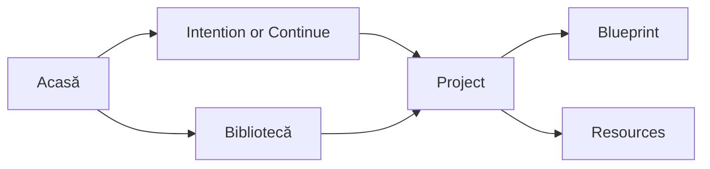
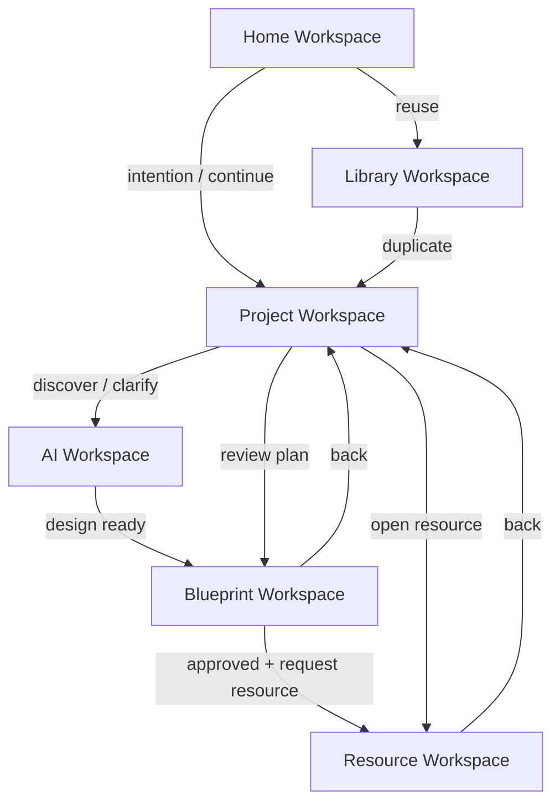

# PRIMA Product Redesign

**Version:** 1.0  
**Status:** Official — Experience Redesign Proposal (2035 Horizon)

> **This is not a feature proposal. This is a simplification mandate.**

PRIMA has grown powerful. Its current structure still thinks like software — **builders, modules, tools**. Teachers do not.

This document redesigns the entire product experience so teachers think like **educators**, while every existing capability is preserved — merely **reorganized around intention**.

Inspiration: Notion, Canva, Figma, ChatGPT, Cursor — products that won by **reducing complexity**, not adding functionality.

---

## The Fundamental Question

If a teacher opens PRIMA after a long school day…

> **What is the simplest possible experience that still allows them to create extraordinary educational resources?**

**Answer:**

```
See what matters.
Say what you need.
Approve the plan.
Take what you need.
Leave.
```

No builders. No tool selection. No re-entry of known context. No dashboard of vanity metrics. One workspace. One Project. One Blueprint. Many resources — when ready.

---

## Diagnosis — What Must Die

### Current mental model (wrong)

```
Open PRIMA
  → Choose a Builder (Lesson / Worksheet / Game / Assessment / …)
    → Configure the builder
      → Fill forms or chat in isolation
        → Get one resource type
          → Start over for the next resource type
```

**Teacher thought forced by software:** *"I need to open the Lesson Builder."*

### Target mental model (right)

```
Open PRIMA
  → Continue or express intention
    → Partner with PRIMA inside a Project
      → Approve Blueprint
        → Request any resources from the same design
          → Return tomorrow — Project remembers
```

**Teacher thought enabled by product:** *"I want to prepare tomorrow's lesson."*

### What the diagnosis rejects

| Reject | Why |
|--------|-----|
| Builder cards as primary entry | Exposes implementation; forces tool-thinking |
| Parallel creation paths per resource type | Duplicate workflows; repeated data entry |
| Home as statistics dashboard | Competes for attention; no educational value |
| Chatbot as separate "AI mode" | Partner is ambient — not a channel to visit |
| Deep navigation trees | Teachers do not navigate software architectures |

**Capabilities preserved:** Lessons, worksheets, games, assessments, presentations, stories, blueprints, library, validation, generation — all survive. Only the **mental model** changes.

---

## Product Philosophy of the Redesign

| Old | New |
|-----|-----|
| Tools first | **Intentions first** |
| Many builders | **One creation experience** |
| Isolated pages | **Coherent workspaces** |
| Chatbot sessions | **Ambient design partner** |
| Start from blank | **Start from continuity** |
| Feature discovery | **Cognitive simplicity** |

Teachers should never think: *"I need to open the Lesson Builder."*  
They should think: *"I want to prepare tomorrow's lesson."*  
**PRIMA translates intention into workflow. Architecture stays invisible.**

---

## Task 1 — Redesign Main Navigation

### Current pattern (to remove)

Navigation that exposes modules: builders, activity types as products, feature grids, admin-style sidebars, statistics hubs.

### Challenge every item

| Candidate item | Does a teacher naturally think this way? | Verdict |
|----------------|------------------------------------------|---------|
| Lesson Builder | No — they think "tomorrow's lesson" | **Remove** |
| Worksheet Builder | No — they think "practice sheet for class" | **Remove** |
| Game Builder | No — they think "engaging activity" | **Remove** |
| Create Activity | Partially — still tool language | **Replace with intentions** |
| Statistics | No — vanity metrics after school | **Remove from Home** |
| Notifications center | Rarely critical for design work | **Demote to Settings** |
| Multi-level menus | Never | **Forbidden** |

### Minimal navigation (permanent)

**Three anchors only:**

| Anchor | Teacher meaning | What it is |
|--------|-----------------|------------|
| **Acasă** | *"Where do I begin?"* | Home Workspace — intention + continuity |
| **Proiecte** | *"What am I working on?"* | Active and recent Projects |
| **Bibliotecă** | *"What can I reuse?"* | Saved work — portfolio of craft |

**Fourth, rarely used:** **Setări** — preferences only. Never a creative destination.

### Navigation principles

| Rule | Meaning |
|------|---------|
| **≤3 clicks** to any primary goal | Home → intention → Project |
| **No implementation words** | Never: Builder, Engine, Module, Generator |
| **Context hides chrome** | Inside Project / Blueprint / Resource: navigation collapses to exit + project title |
| **Romanian educational language** | *Proiect*, *Plan pedagogic*, *Resurse*, *Bibliotecă* |



---

## Task 2 — Replace Builders with Intentions

### The interaction model

Teachers begin with **educational intentions** — never software modules.

| Intention | What teachers say | What PRIMA starts |
|-----------|-------------------|-------------------|
| **Prepare a lesson** | *"Lecție pentru mâine"* | New or continued Project → Blueprint → Lesson resource |
| **Create a worksheet** | *"Fișă de lucru"* | Project (new or existing) → Blueprint activity → Worksheet |
| **Assess learning** | *"Evaluare"* | Project → Blueprint assessment design → Assessment |
| **Build a project** | *"Proiect de învățare"* | Multi-phase Learning Project |
| **Continue previous work** | *"Continuă"* | Resume exact Project state |
| **Improve an existing resource** | *"Îmbunătățește"* | Open Project → Improvement decision → scoped revision |
| **Something else** | Free text | PRIMA interprets → Clarification → same Project path |

### Critical redesign rule

**Resource type is an outcome — not an entry point.**

Teachers may say *"fișă"* at the start. PRIMA still creates a **Project** and a **Blueprint**. The worksheet is generated **from design** — never as an orphan builder session.

If the teacher later needs a presentation from the same lesson:

```
Same Project → Same Blueprint → Add Presentation
```

Not: open Presentation Builder and re-explain the lesson.

### Intention surface (Home)

```
Ce vrei să pregătești?

[ Continuă: Fracții — clasa a III-a ]     ← if work in progress

[ Pregătesc o lecție ]
[ Am nevoie de o fișă ]
[ Vreau o evaluare ]
[ Continuă ceva existent ]
[ Îmbunătățesc un material ]

sau spune-mi în cuvintele tale…
[________________________________]
```

No icons of tools. No "builders." Intentions only.

---

## Task 3 — Redesign the Home Experience

### Home answers one question

> **What do you want to prepare today?**

### What Home is

A **calm invitation to meaningful work** — Notion-home clarity, Canva-start simplicity, Cursor-focus.

### What Home is not

| Forbidden | Why |
|-----------|-----|
| Statistics strip (projects, AI generations…) | No educational value at 20:00 |
| Widget walls | Cognitive noise |
| Feature showcase | Distracts from intention |
| Empty state tutorials | Blocks first value |
| Equal grid of six builders | Tool thinking |

### Home composition (three zones only)

```
┌─────────────────────────────────────────┐
│  Greeting (one line)                    │
│  "Bine ai revenit. Ce pregătim azi?"    │
├─────────────────────────────────────────┤
│  ZONE 1 — Continuity                    │
│  In-progress Project cards (max 3)      │
│  One action: Continuă                   │
├─────────────────────────────────────────┤
│  ZONE 2 — Intention                     │
│  Primary intentions + free-text field   │
├─────────────────────────────────────────┤
│  ZONE 3 — Soft reuse                    │
│  Recent Library items (max 3)           │
│  "Folosește din bibliotecă"             │
└─────────────────────────────────────────┘
```

**Feeling:** Relief. Clarity. One path.

**Success test:** First-time teacher starts meaningful work in **under 10 seconds** without reading documentation.

---

## Task 4 — Projects as the Central Context

### Project is the unit of work

A **Project** is everything related to one educational effort — the way a Figma file holds a design, or a Notion page holds a document.

### What a Project contains

| Contained | Role |
|-----------|------|
| **Blueprint** | Pedagogical DNA — single source of educational truth |
| **Conversation** | How intention was captured |
| **Lesson** | Optional resource |
| **Worksheet** | Optional resource |
| **Assessment** | Optional resource |
| **Presentation** | Optional resource |
| **Educational Game** | Optional resource |
| **Story** | Optional resource |
| **Resources** | Any additional artifacts |
| **Teacher Notes** | Teacher-owned free notes |
| **Reflection** | Post-delivery insights |

**One Blueprint. Many resources.** Resources never exist outside a Project.

### Natural navigation inside a Project

```
Project: "Fracții — clasa a III-a"
├── Plan pedagogic (Blueprint)     ← always first
├── Resurse
│   ├── Lecție
│   ├── Fișă
│   └── Evaluare
├── Notele mele
└── Reflecție
```

Teacher moves:

| Action | Path |
|--------|------|
| Review design | Open Plan pedagogic |
| Add worksheet | From Project: *Adaugă fișă* — uses existing Blueprint |
| Edit lesson | Open Lecție in Resource Workspace |
| Export all | Project → Export collection |
| Improve | Tell PRIMA inside Project — no new Project needed |

### Project states (teacher language)

| State | Meaning |
|-------|---------|
| **În conversație** | Intention still forming |
| **Plan de revizuit** | Blueprint ready for review |
| **Aprobat** | Design locked for generation |
| **Resurse gata** | Materials available |
| **Salvat în bibliotecă** | Archived for reuse |

---

## Task 5 — Single Creation Experience

### One path. All resource types.

```
Intention
    ↓
Understanding (conversation)
    ↓
Blueprint (co-design + validation)
    ↓
Teacher Approval
    ↓
Resources (any type, on demand)
    ↓
Edit → Export → Library
```

### Complete experience narrative

**1. Intention**  
Teacher: *"Pregătesc o lecție despre fracții pentru clasa a III-a, mâine."*  
PRIMA creates Project. No builder selection.

**2. Understanding**  
PRIMA confirms: grade, topic, duration, what success looks like. One question at a time. Reuses known preferences. Decision Model: Clarification before Recommendation.

**3. Blueprint**  
PRIMA presents Plan pedagogic — objectives, flow, activities, assessment, differentiation. Teacher edits sections. Asks *De ce?* PRIMA explains. Validation flags gaps gently.

**4. Approval**  
Teacher approves. Moment of professional commitment. Generation unlocked for this Blueprint version only.

**5. Resources**  
PRIMA: *"Ce resurse vrei acum?"*  
Teacher picks Lecție, Fișă, or both. Materials generated from **same** Blueprint. Later: add Prezentare without re-interview.

**6. Polish**  
Teacher edits in Resource Workspace. Partial regen for one section. Blueprint unchanged unless pedagogy must change.

**7. Done**  
Export. Save to Library. Home shows Project as completed. Tomorrow: Continuă or reuse.

### What disappeared

- Separate Lesson Builder / Worksheet Builder / Game Builder flows  
- Re-entering subject, grade, objectives for each resource  
- Orphan resources without Blueprint  
- Generation before understanding  

### What remained (stronger)

- All resource types  
- Blueprint gate  
- Teacher approval  
- Editability  
- Library reuse  

---

## Task 6 — Redesign the AI Experience

### From chatbot → design partner

| Chatbot | Design partner |
|---------|----------------|
| Separate chat window | Ambient presence inside Project |
| Always talking | Speaks when useful; silent when teacher thinks |
| Session-bound memory | Project + preference memory |
| "How can I help?" loops | Knows Project state; offers next best action |
| Generate on demand | Decides: clarify, recommend, validate, reuse, wait, generate |

### How conversations begin

Never: blank chat.  
Always: context-aware opening.

| Context | Opening |
|---------|---------|
| New intention | *"Hai să clarificăm ce vor reuși elevii."* |
| Resume Project | *"Continuăm de la planul de ieri — obiectivele erau gata."* |
| Library reuse | *"Adaptăm lecția din 12 martie. Ce s-a schimbat?"* |
| Mid-resource edit | Silent — available via *"Întreabă PRIMA"* |

### How context is remembered

| Layer | Scope |
|-------|-------|
| **Project memory** | Conversation, Blueprint versions, resources |
| **Teacher preferences** | Grade defaults, style, verbosity — advisory |
| **Session checkpoint** | Exact resume position |

Memory never overrides Teacher Intent (Decision Model DM-T09).

### How AI offers help

- Surfaces **next best action** (Decision Model) as a quiet suggestion  
- Maximum one primary suggestion at a time  
- *De ce?* always available  

### How AI avoids interrupting

- **Wait** during Blueprint reading and resource editing  
- No nags, no streaks, no "engagement" prompts  
- Help is pull: teacher asks — or PRIMA speaks at decision gates only  

### How AI collaborates throughout the Project

```
Home:        quiet — continuity and invitation
Conversation: active partnership — understand & co-design
Blueprint:   explanatory partner — on request
Resources:   surgical helper — regenerate section, improve
Library:     reuse advisor — suggest matches
```

**Personality:** Experienced methodologist at the next desk — not ChatGPT-in-a-sidebar.

---

## Task 7 — Design Workspaces

Coherent spaces — not isolated pages. Each has one job.

| Workspace | Purpose | Teacher enters when… | Leaves toward… |
|-----------|---------|----------------------|----------------|
| **Home Workspace** | Continuity + intention | Opening PRIMA | Project or Library |
| **Project Workspace** | Overview of one educational effort | After intention or Continuă | Blueprint or Resource |
| **Blueprint Workspace** | Review, edit, approve design | Co-design / validation | Project (after approve) or Resource |
| **Resource Workspace** | Edit one material (lesson, fișă…) | After generation or Library open | Project or Export |
| **Library Workspace** | Reuse portfolio | Seeking past work | New Project (duplicate) |
| **AI Workspace** | Focused partnership dialogue | New Project discovery or deep clarification | Blueprint Workspace |

### Movement rules



**Rule:** Teachers always know *which Project they are in*. Workspace changes; Project identity does not.

### AI Workspace clarification

AI Workspace is **not** a permanent chatbot room. It is the **focused conversation phase** of a Project — emotionally distinct (no Home chrome), then dissolves into Blueprint and Resource work. Partner remains available; the "chat page" does not dominate the product.

---

## Task 8 — Simplify Everything

Feature challenge. Bold cuts.

| Feature / pattern | Why it exists today | Reduce effort? | Verdict |
|-------------------|---------------------|----------------|---------|
| Lesson / Worksheet / Game Builders | Historical module IA | No — increases tool thinking | **Merge into single creation** |
| Home statistics | Looks "product-y" | No | **Remove** |
| Platform shortcuts grid | Exposes tools | No | **Remove** |
| Separate "Create Activity" hero CTA | Tool entry | Partial | **Replace with intention field** |
| Re-entering grade/subject per builder | Form completeness | No — AI should infer | **Eliminate via Project context** |
| Multiple discovery conversations per resource | Isolation | No | **One conversation per Project** |
| Notifications on Home | Engagement | Rarely | **Demote** |
| Empty Library tutorials | Onboarding | Blocks | **Replace with one sample Project** |
| Step indicators in PRIMA | Progress illusion | Violates Bible | **Keep forbidden** |
| Parallel recommendation widgets | "AI feel" | Noise | **One next-action suggestion max** |
| Settings before first value | Completeness | Blocks | **Keep forbidden** |
| Export buried in menus | Legacy | No | **Always ≤2 clicks from Resource** |
| Partial regeneration | Saves time | Yes | **Keep — strengthen** |
| Blueprint approval | Trust + pedagogy | Yes | **Keep — immutable** |
| Library duplicate | Reuse | Yes | **Keep — promote on Home** |
| Teacher Notes in Project | Ownership | Yes | **Keep** |
| Memory preferences | Continuity | Yes | **Keep — invisible until needed** |

### Simplification doctrine

> If AI can do it automatically without harming pedagogical control — **stop asking the teacher**.  
> If two workflows do the same educational job — **merge them**.  
> If a feature exists only because architecture had a module — **hide or delete the surface**.

**Objective:** Cognitive simplicity — not feature richness.

---

## Task 9 — The Future Product (2035)

### What PRIMA should feel like after this redesign

| Less | More |
|------|------|
| Clicking | Conversation |
| Configuration | Continuity |
| Searching | Confidence |
| Repetition | Creativity |
| Tool-switching | Educational quality |
| Learning software | Designing learning |

### Day-in-the-life, 2035

Teacher opens PRIMA at 20:10.

Home shows: *Continuă: Ecosisteme — clasa a IV-a* and a quiet field: *Ce pregătim?*

She types: *"Fișă de consolidare pentru mâine, aceeași lecție."*

PRIMA opens the existing Project. Blueprint already approved. Asks one question: *"Accent pe vocabular sau pe relații?"*

She answers. Approves a tiny Blueprint delta. Fișă appears. She edits two items. Exports PDF. Closes.

**Total:** four minutes. **Zero builders.** **Zero re-entry of grade, subject, objectives.**

She does not remember using software. She remembers finishing tomorrow's prep.

### Ten-year invariants

| Invariant | Forever |
|-----------|---------|
| Intention before tools | Yes |
| Project as context | Yes |
| Blueprint before generation | Yes |
| Teacher approval | Yes |
| Three-anchor navigation | Yes |
| Partner, not chatbot | Yes |
| Home = prepare today | Yes |

New capabilities (community, multi-unit planning, mentor co-design) **attach to Projects and Library** — never spawn new builders or top-level tool menus.

### Success criteria (redesign)

The redesign succeeds **only if**:

1. Teachers no longer perceive PRIMA as a **collection of tools**  
2. Teachers experience **one coherent educational workspace**  
3. Every action naturally contributes to **better learning experiences**  
4. A tired teacher at 20:00 can create something excellent with **minimal mental effort**  
5. The product still feels this simple in **2035**

---

## Migration Principles (Capability Preservation)

| Capability | Where it lives after redesign |
|------------|-------------------------------|
| Lecție | Resource inside Project |
| Fișă | Resource inside Project |
| Joc | Resource inside Project (intention: engaging activity) |
| Evaluare | Resource inside Project |
| Prezentare | Resource inside Project |
| Poveste | Resource inside Project |
| Blueprint | Always — Project core |
| PRIMA conversation | AI phase of Project |
| Library | Library Workspace |
| Validation | Blueprint + Resource fidelity |
| Generation | Post-approval, on demand |
| Dashboard "continue" | Home Zone 1 |
| Activity-type selection | Soft preference inside intention — not a builder portal |

**No capability deleted. All builder surfaces deleted.**

---

## Compliance Rules for the Redesign

| ID | Rule |
|----|------|
| **RD-CR-01** | No teacher-facing label may contain *Builder*, *Engine*, *Module*, or *Generator* |
| **RD-CR-02** | Home may not show statistics widgets |
| **RD-CR-03** | Primary entry is intention or Continuă — never a tool grid |
| **RD-CR-04** | Every resource belongs to exactly one Project and traces to a Blueprint |
| **RD-CR-05** | One creation experience — resource type selected after (or softly within) intention, never as isolated builder |
| **RD-CR-06** | Navigation anchors ≤3 (+ Settings) |
| **RD-CR-07** | AI does not interrupt active editing (Wait decision) |
| **RD-CR-08** | Blueprint approval remains mandatory before generation |
| **RD-CR-09** | New features must attach to Project / Blueprint / Library — never new top-level builders |

---

## Summary

| Question | Redesign answer |
|----------|-----------------|
| *Simplest after-school experience?* | Continuă or say intention → approve plan → take resources |
| *What replaces builders?* | Intentions + one creation path + Project context |
| *What is Home?* | *"Ce vrei să pregătești azi?"* — nothing else |
| *What is central?* | Project containing Blueprint + resources |
| *What is AI?* | Ambient design partner — not a chatbot product |
| *What is success?* | One workspace. No tool thinking. Teachers still love it in 2035. |

**Bold claim:** Traditional educational software organizes around **tools**. PRIMA organizes around **teacher intention and pedagogical design**. That is the difference teachers will feel — and the reason they will still open it in 2035.

---

## Document Authority

| Document | Relationship |
|----------|--------------|
| **This document** | Redesign mandate — how the experience must change |
| [`PRIMA_PRODUCT_DESIGN.md`](./PRIMA_PRODUCT_DESIGN.md) | Product Constitution — align ecosystem language to Projects/intentions |
| [`PRIMA_TEACHER_EXPERIENCE.md`](./PRIMA_TEACHER_EXPERIENCE.md) | Experience manifesto — emotional truth this redesign implements |
| [`PRIMA_DECISION_MODEL.md`](./PRIMA_DECISION_MODEL.md) | Next-best-action behavior inside the single creation path |
| [`PRIMA_BLUEPRINT.md`](./PRIMA_BLUEPRINT.md) | Educational object unchanged — elevated as Project core |
| [`LUDI_ON_PROJECT_BIBLE.md`](./LUDI_ON_PROJECT_BIBLE.md) | Bible prevails on scope; this document prevails on experience structure |

---

## Next Recommended Work

1. Update Home / Dashboard implementation to intention + continuity (remove stats and builder grids)  
2. Align [`PRIMA_PRODUCT_DESIGN.md`](./PRIMA_PRODUCT_DESIGN.md) navigation and ecosystem language with this redesign  
3. Prototype Project Workspace + single creation path before any new builder features
