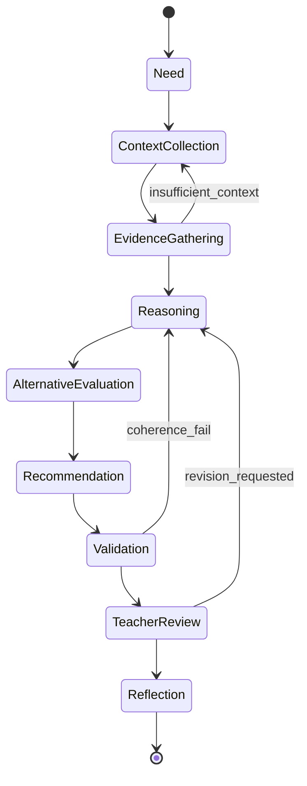
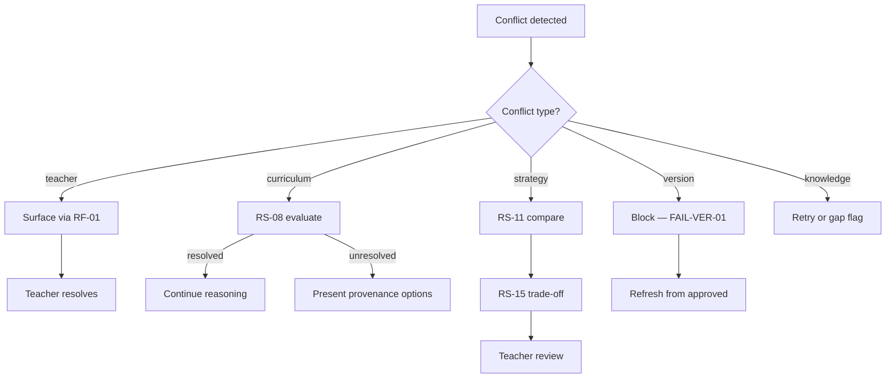
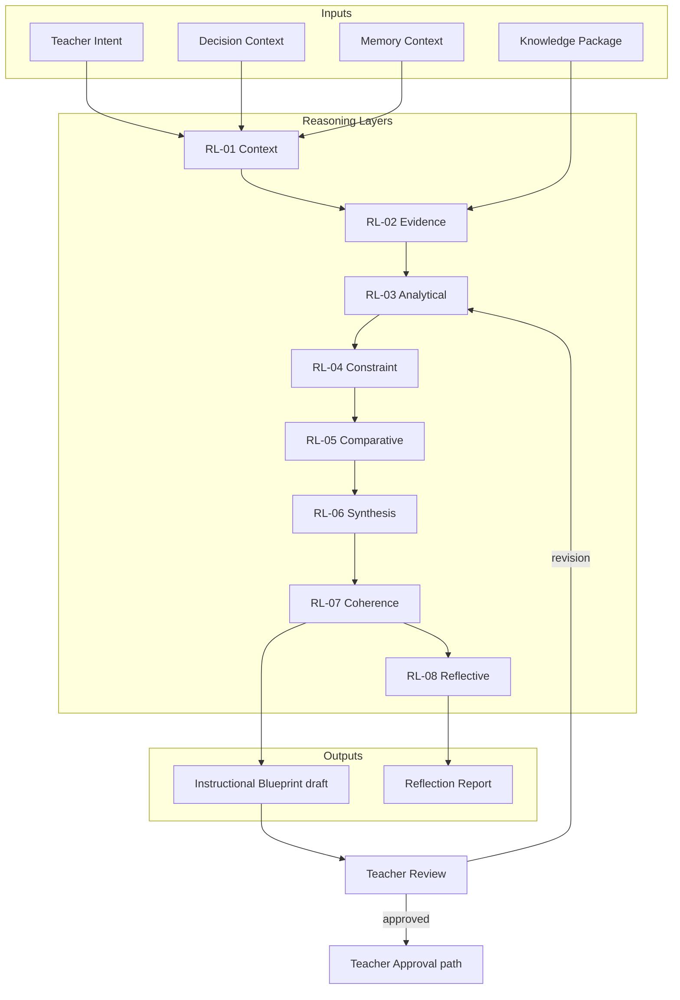
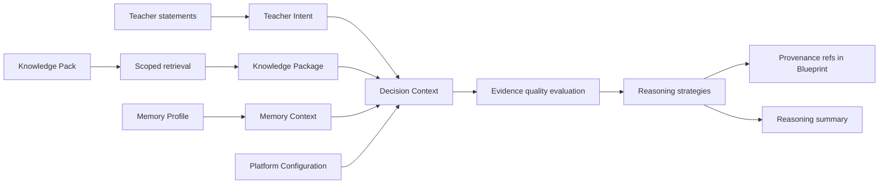
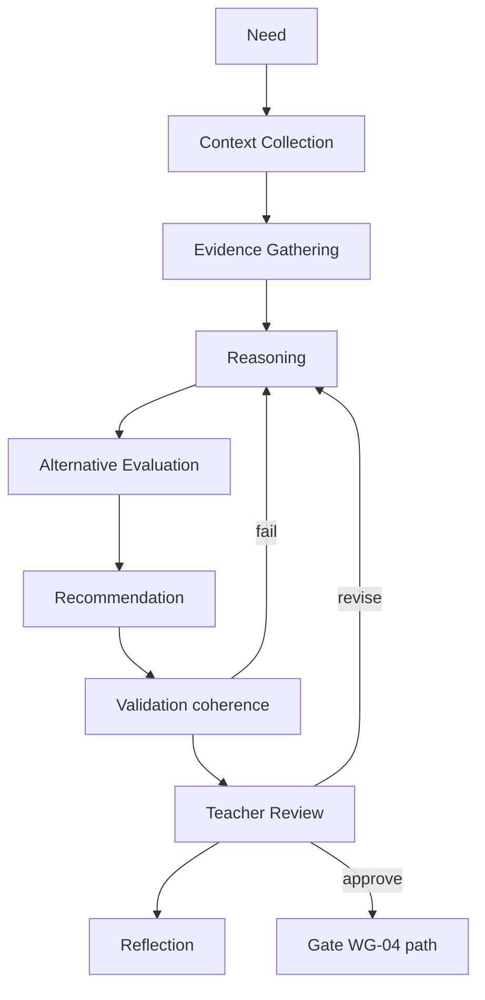
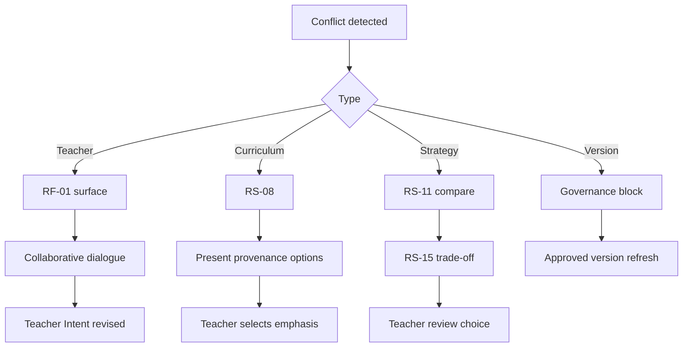
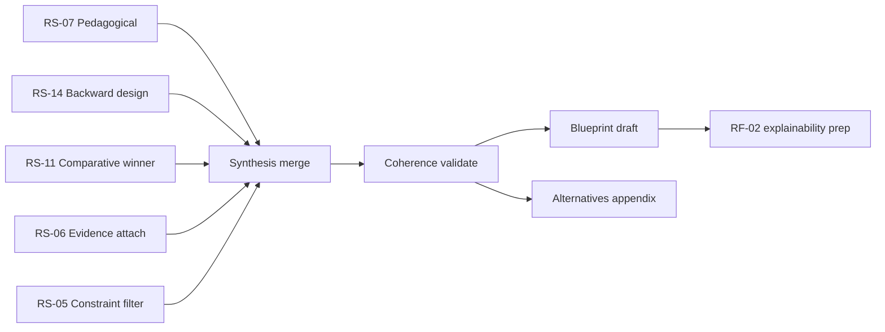
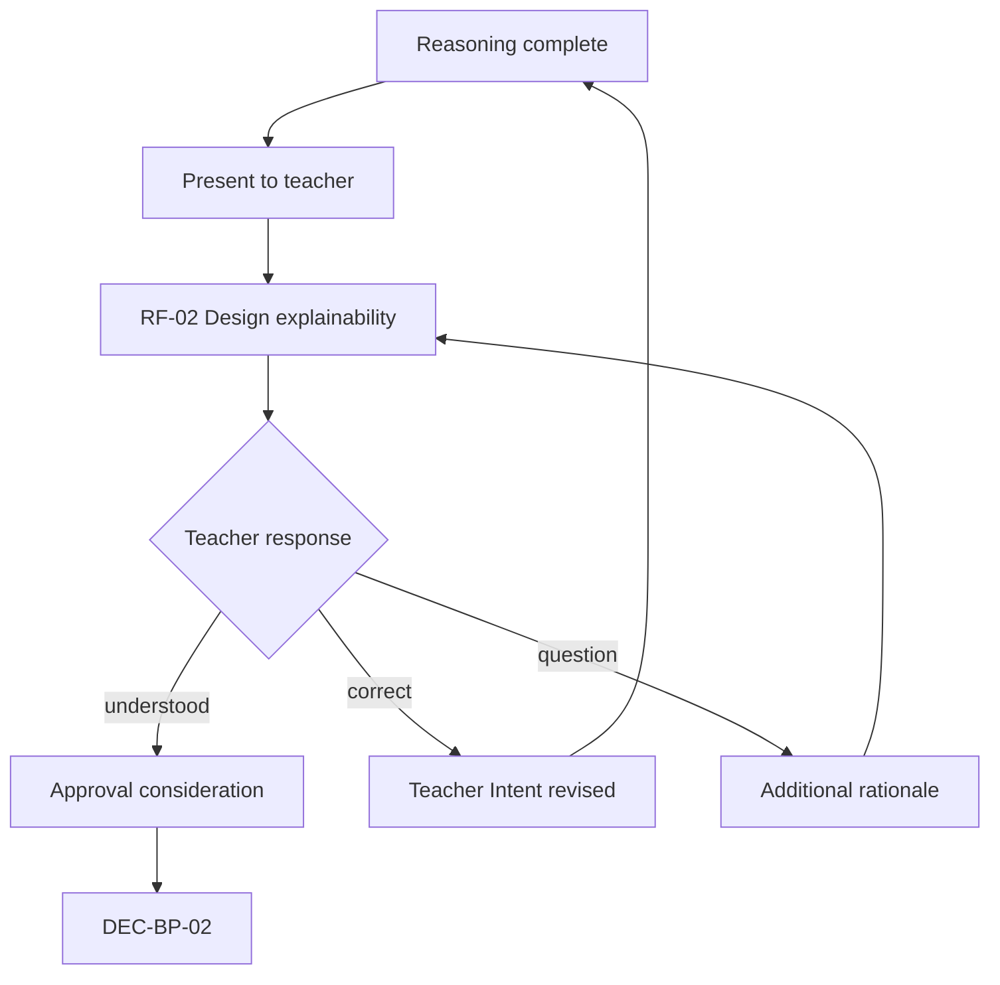
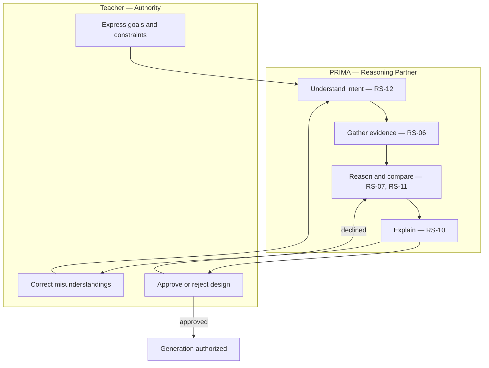

# PRIMA Reasoning Framework

**Version:** 1.0  
**Status:** Official — Enterprise Reasoning Architecture Specification

---

## Purpose

This document defines the **official conceptual reasoning architecture** of the PRIMA platform within LUDI ON.

It answers one architectural question:

> *How does PRIMA reason?*

The Reasoning Framework specifies **reasoning patterns**, **evidence evaluation**, **uncertainty management**, **conflict resolution**, and **recommendation synthesis** — the conceptual logic by which PRIMA transforms understood teacher intent and evidence into **instructional design recommendations** worthy of teacher review and approval.

This document defines **architectural reasoning** — not machine learning, not prompt engineering, not algorithms, and not implementation technology. It remains valid regardless of inference engine, language model, or programming language.

[`PRIMA_INTELLIGENCE_MODEL.md`](./PRIMA_INTELLIGENCE_MODEL.md) defines how PRIMA thinks holistically. This document **specializes** the Reasoning Intelligence layer (IL-04) and its supporting patterns. [`PRIMA_DECISION_ENGINE.md`](./PRIMA_DECISION_ENGINE.md) implements product-level reasoning pipeline stages — it does not supersede this framework.

---

## Scope

| In scope | Out of scope |
|----------|--------------|
| Reasoning philosophy, principles, and lifecycle | Model weights, training, fine-tuning |
| Registered reasoning strategies and when they apply | Prompt templates and token strategies |
| Evidence model and traceability | Vector database schemas |
| Uncertainty and conflict resolution (conceptual) | Scoring formulas and heuristic code |
| Recommendation synthesis and reflection loops | UI presentation detail |
| Governance and compliance for reasoning | Infrastructure resilience |

**Audience:** Reasoning architects, product architects, instructional designers, and engineering leads ensuring all PRIMA reasoning conforms to pedagogical governance.

---

## Reasoning Philosophy

Reasoning exists to **improve educational quality** — not to maximize output speed or content volume.

| Commitment | Architectural meaning |
|------------|------------------------|
| **Generation without reasoning is prohibited** | Instructional Blueprint reasoning and teacher approval precede Generation ([`AP-04`](./PRIMA_ARCHITECTURAL_PRINCIPLES.md), [`RP-01`](./PRIMA_INTELLIGENCE_MODEL.md)) |
| **Reasoning precedes every major recommendation** | No binding design output without reasoning trace |
| **Teacher authority is never overridden** | Reasoning proposes; teacher approves ([`TP-01`](./PRIMA_ARCHITECTURAL_PRINCIPLES.md)) |
| **Every conclusion must be explainable** | Rationale retrievable from artifacts ([`EP-01`](./PRIMA_ARCHITECTURAL_PRINCIPLES.md)) |
| **Every recommendation must be justified** | Evidence, constraints, or explicit pedagogical logic cited |
| **Coherence over novelty** | Pedagogical coherence beats complex but incoherent designs |
| **Evidence over invention** | Curriculum claims trace to Knowledge Pack — not parametric invention ([`KP-04`](./PRIMA_ARCHITECTURAL_PRINCIPLES.md)) |

### Reasoning vs intelligence vs decision

| Concept | Question | Document |
|---------|----------|----------|
| **Intelligence** | *How does PRIMA think overall?* | [`PRIMA_INTELLIGENCE_MODEL.md`](./PRIMA_INTELLIGENCE_MODEL.md) |
| **Reasoning** | *How does PRIMA derive justified recommendations?* | This document |
| **Decision** | *Who authorizes binding outcomes?* | [`PRIMA_DECISION_FRAMEWORK.md`](./PRIMA_DECISION_FRAMEWORK.md) |

Reasoning produces **advisory artifacts** (Blueprint draft, Reflection Report inputs). Decisions record **authority** (Teacher Approval, gate pass).

---

## Foundational Principles

| ID | Principle | Source | Reasoning obligation |
|----|-----------|--------|---------------------|
| **RF-01** | Backward Design | Domain Model; DP-04 | Objectives anchor activities and assessment — not reverse |
| **RF-02** | Explicit Reasoning | Decision Engine philosophy | Reasoning steps visible — not opaque jumps |
| **RF-03** | Teacher Precedence | RP-11; TP-01 | Explicit teacher statements override inference and memory |
| **RF-04** | Knowledge Informs Never Decides | KP-02; IP-04 | Evidence supports — never substitutes for approval |
| **RF-05** | Scoped Reasoning Pass | ACR-09; RP-14 | One Decision Context per invocation — bounded scope |
| **RF-06** | Single Design Authority | AC-07; FP-03 | One coherent reasoning chain per Learning Experience iteration |
| **RF-07** | Explain Before Persuade | RP-05; EP-02 | Full rationale at blueprint review — not during raw discovery |
| **RF-08** | Uncertainty Explicit | IM-CR-05 | Low confidence flagged — never hidden as certainty |
| **RF-09** | Validation Separated | VP-03 | Reasoning validates coherence pre-presentation; measurement validates execution post-generation |
| **RF-10** | Romanian Classroom Context | FP-04 | Reasoning respects national curriculum and classroom norms |

---

## Reasoning Lifecycle

Every material reasoning episode follows a **nine-phase lifecycle**. Phases may iterate — especially before WG-01 and at teacher review — but **Teacher Review** precedes any binding authority.

```
Need
    ↓
Context Collection
    ↓
Evidence Gathering
    ↓
Reasoning
    ↓
Alternative Evaluation
    ↓
Recommendation
    ↓
Validation (coherence)
    ↓
Teacher Review
    ↓
Reflection
```

| Phase | Description | Primary outputs | Gate relation |
|-------|-------------|-----------------|---------------|
| **Need** | Reasoning trigger identified — intent complete, revision scope, or design gap | Reasoning need descriptor | Post-discovery or evolution trigger |
| **Context Collection** | Teacher Intent, Activity Type, Memory hints, session scope assembled | Decision Context (forming) | Pre-WG-01 or revision scope |
| **Evidence Gathering** | Knowledge Package retrieved; provenance bound | Knowledge Package embedded in Decision Context | Knowledge Pack version fixed |
| **Reasoning** | Strategies applied; design logic executed | Candidate design structures; trade-off notes | IL-04 active |
| **Alternative Evaluation** | Viable approaches compared | Ranked alternatives; rejection rationale | IL-06 comparative |
| **Recommendation** | Preferred design synthesized for presentation | Instructional Blueprint draft sections | Pre-WG-02 |
| **Validation** | Pre-presentation coherence check | Coherence flags; completeness status | Internal — not QA-01 |
| **Teacher Review** | Teacher evaluates, approves, declines, or revises | Teacher corrections; approval path | WG-02, WG-03, WG-04 |
| **Reflection** | Understanding and rationale mirrored | Reflection Report; reasoning summary | RF-02 at review |



---

## Reasoning Layers

Conceptual layers within the reasoning episode — mapped to [`PRIMA_INTELLIGENCE_MODEL.md`](./PRIMA_INTELLIGENCE_MODEL.md) intelligence layers.

| Layer | Purpose | Strategies primarily used |
|-------|---------|---------------------------|
| **RL-01 Context** | Bound who, what, where, and why for this reasoning pass | Goal-oriented, Collaborative |
| **RL-02 Evidence** | Assemble and qualify evidentiary inputs | Evidence-based, Curriculum |
| **RL-03 Analytical** | Apply logical and pedagogical inference | Deductive, Inductive, Abductive, Pedagogical |
| **RL-04 Constraint** | Enforce feasibility, policy, and Activity Type bounds | Constraint-based, Ethical |
| **RL-05 Comparative** | Evaluate alternatives and trade-offs | Comparative, Analogical |
| **RL-06 Synthesis** | Compose coherent recommendation | Pedagogical, Goal-oriented, Backward-design |
| **RL-07 Coherence** | Pre-presentation internal validation | Deductive, Constraint-based |
| **RL-08 Reflective** | Prepare explainability bundle for teacher | Reflective, Collaborative |

Layers execute **within** Instructional Design Domain authority — outputs remain advisory until Teacher Approval.

---

## Reasoning Strategies

Fifteen registered conceptual strategies. Strategies combine in a single reasoning episode — no strategy alone authorizes Generation.

---

### RS-01 — Deductive Reasoning

| Field | Content |
|-------|---------|
| **Purpose** | Derive design implications from established objectives, rules, and approved constraints |
| **When used** | Composing Activities from Instructional Objectives; applying Activity Type rules; enforcing Blueprint schema |
| **Inputs** | Instructional Objectives; Platform Configuration; Activity Type constraints; Validation Rules (design-level) |
| **Outputs** | Logically entailed design elements; constraint satisfaction status |
| **Strengths** | High coherence; auditable rule chain; deterministic where rules explicit |
| **Limitations** | Cannot invent objectives; brittle if premises wrong |
| **Constraints** | Premises must trace to Teacher Intent or Knowledge evidence — not assumed |
| **Business Value** | Ensures design structure follows stated learning goals |
| **Related Workflows** | WF-PR-01 reasoning phase |
| **Related States** | Instructional Blueprint `draft` |
| **Related Decisions** | DEC-BP-01 Blueprint Composition Commit |
| **Related Artifacts** | Teacher Intent, Instructional Blueprint, Decision Context |

---

### RS-02 — Inductive Reasoning

| Field | Content |
|-------|---------|
| **Purpose** | Generalize patterns from teacher statements, Memory hints, and prior session signals |
| **When used** | Inferring teacher preferences; suggesting defaults for returning teachers |
| **Inputs** | Conversation Context; Memory Context; prior Project patterns |
| **Outputs** | Preference hypotheses; suggested defaults with confidence flags |
| **Strengths** | Reduces repetitive questioning; personalizes partnership |
| **Limitations** | Risk of over-generalization; requires confirmation when confidence low |
| **Constraints** | RF-03: never overrides explicit teacher statement; IP-06 memory advisory |
| **Business Value** | Efficient discovery without interrogation |
| **Related Workflows** | WF-PR-01 discovery |
| **Related States** | Teacher Intent `forming` |
| **Related Decisions** | DEC-INT-01 Intent Normalization |
| **Related Artifacts** | Memory Context, Teacher Intent |

---

### RS-03 — Abductive Reasoning

| Field | Content |
|-------|---------|
| **Purpose** | Infer the most plausible instructional explanation for partial or ambiguous teacher intent |
| **When used** | Early discovery; filling gaps before clarification |
| **Inputs** | Partial Teacher Intent; Activity Type; contextual signals |
| **Outputs** | Best-explanation hypothesis; ambiguity flags for clarification |
| **Strengths** | Progresses dialogue when information incomplete |
| **Limitations** | Hypothesis not fact — must be confirmed |
| **Constraints** | RF-08: hypothesis marked uncertain; CF-11 clarification before WG-01 if critical gap |
| **Business Value** | Keeps partnership moving without reckless assumption |
| **Related Workflows** | WF-PR-01 discovery |
| **Related States** | Conversation Context `discovering` |
| **Related Decisions** | DEC-INT-01 |
| **Related Artifacts** | Conversation Context, Reflection Report (RF-01) |

---

### RS-04 — Analogical Reasoning

| Field | Content |
|-------|---------|
| **Purpose** | Transfer proven instructional patterns from similar contexts to current design |
| **When used** | Strategy selection; Activity structure proposals; differentiation patterns |
| **Inputs** | Knowledge Package strategy options; Activity Type archetypes; similar Knowledge Objects |
| **Outputs** | Pattern-mapped design candidates; analogy rationale with source reference |
| **Strengths** | Leverages curated pedagogical patterns efficiently |
| **Limitations** | Analogies may misfit context — requires comparative evaluation |
| **Constraints** | Source must trace to Knowledge Pack — not model parametric recall alone |
| **Business Value** | Teachers receive proven patterns adapted to their context |
| **Related Workflows** | WF-PR-01 |
| **Related States** | Decision Context `assembled` |
| **Related Decisions** | DEC-CUR-01 Curriculum Alignment |
| **Related Artifacts** | Knowledge Package, Instructional Blueprint (draft) |

---

### RS-05 — Constraint-Based Reasoning

| Field | Content |
|-------|---------|
| **Purpose** | Satisfy hard and soft constraints simultaneously — time, grouping, resources, policy, grade level |
| **When used** | Trade-off resolution; feasibility filtering of alternatives |
| **Inputs** | Teacher Intent constraints; Platform Configuration; Activity Type rules; ethical bounds |
| **Outputs** | Feasible design space; constraint violation reports |
| **Strengths** | Prevents impractical designs; enforces institutional and product policy |
| **Limitations** | Over-constraining may eliminate creative options — soft constraints ranked |
| **Constraints** | Hard constraints: teacher explicit, policy, safety. Soft: preferences, memory hints |
| **Business Value** | Designs fit real classroom feasibility |
| **Related Workflows** | WF-PR-01, WF-PR-07 |
| **Related States** | Instructional Blueprint `draft` |
| **Related Decisions** | DEC-BP-03 routing (when constraints reveal design vs execution root cause) |
| **Related Artifacts** | Decision Context, Revision Directives |

---

### RS-06 — Evidence-Based Reasoning

| Field | Content |
|-------|---------|
| **Purpose** | Ground every material claim in traceable evidence |
| **When used** | Curriculum alignment; competency mapping; objective justification |
| **Inputs** | Knowledge Package; Teacher Intent explicit statements; Knowledge Object provenance |
| **Outputs** | Evidence-linked recommendations; provenance references for Blueprint |
| **Strengths** | Auditability; curriculum integrity; teacher trust |
| **Limitations** | Limited by Knowledge Pack coverage — gaps must be surfaced |
| **Constraints** | KN-04 provenance required; KP-04 retrieved not invented |
| **Business Value** | Defensible instructional design for institutional context |
| **Related Workflows** | WF-PR-01 |
| **Related States** | Knowledge Package `embedded` |
| **Related Decisions** | DEC-CUR-01, DEC-KN-01 |
| **Related Artifacts** | Knowledge Package, Instructional Blueprint Curriculum section |

---

### RS-07 — Pedagogical Reasoning

| Field | Content |
|-------|---------|
| **Purpose** | Apply instructional design logic — backward design, alignment, differentiation, assessment integration |
| **When used** | Core blueprint composition; all design-phase reasoning |
| **Inputs** | Teacher Intent; Knowledge Package; Memory Context; Activity Type pedagogical profile |
| **Outputs** | Instructional Blueprint structure; Instructional Objectives; Activities; Assessment design |
| **Strengths** | Domain-specific quality; coherence across blueprint sections |
| **Limitations** | Quality depends on intent completeness and evidence quality |
| **Constraints** | RF-01 backward design; RF-06 single authority; design only — no generated text |
| **Business Value** | Core value proposition of PRIMA as instructional design partner |
| **Related Workflows** | WF-PR-01, WF-PR-02 |
| **Related States** | Instructional Blueprint lifecycle |
| **Related Decisions** | DEC-BP-01, DEC-BP-02 |
| **Related Artifacts** | Instructional Blueprint, Blueprint Version, Decision Context |

**Capability:** ID-03 Instructional Reasoning, ID-04 Blueprint Composition

---

### RS-08 — Curriculum Reasoning

| Field | Content |
|-------|---------|
| **Purpose** | Align design to national curriculum frameworks, competencies, and subject pedagogy |
| **When used** | Objective definition; curriculum section of Blueprint; validation of alignment claims |
| **Inputs** | Knowledge Package; grade level; subject; Romanian curriculum mappings |
| **Outputs** | Competency references; framework alignment statements; gap flags |
| **Strengths** | FP-04 Romanian classroom first; institutional credibility |
| **Limitations** | Bound to active Knowledge Pack version — stale pack = stale alignment |
| **Constraints** | AC-14 scoped pack version; curriculum evidence not teacher-specific data |
| **Business Value** | Teachers meet curriculum expectations without manual mapping labor |
| **Related Workflows** | WF-PR-01 |
| **Related States** | Knowledge Package lifecycle |
| **Related Decisions** | DEC-CUR-01 |
| **Related Artifacts** | Knowledge Package, Instructional Blueprint |

---

### RS-09 — Goal-Oriented Reasoning

| Field | Content |
|-------|---------|
| **Purpose** | Maintain focus on Learning Experience outcome throughout reasoning chain |
| **When used** | Intent normalization; objective derivation; activity selection; assessment design |
| **Inputs** | Teacher Intent; Learning Experience scope; Project intent |
| **Outputs** | Goal traceability map linking objectives → activities → assessment |
| **Strengths** | Prevents template-driven filler objectives |
| **Limitations** | Requires clear teacher goal — ambiguous goals trigger RS-03 + clarification |
| **Constraints** | FP-03 Single Learning Experience Contract |
| **Business Value** | Designs serve stated learning purpose — not arbitrary activity lists |
| **Related Workflows** | WF-PR-01 |
| **Related States** | Teacher Intent `complete` |
| **Related Decisions** | DEC-INT-01, DEC-DIS-01 |
| **Related Artifacts** | Teacher Intent, Instructional Objective entities |

---

### RS-10 — Reflective Reasoning

| Field | Content |
|-------|---------|
| **Purpose** | Evaluate reasoning outputs for teacher comprehension — meta-level interpretation |
| **When used** | Post-reasoning presentation; post-validation finding interpretation |
| **Inputs** | Reasoning summary; blueprint draft; Validation Report (when applicable) |
| **Outputs** | Reflection Report; interpretive mirrors; improvement suggestions (non-prescriptive) |
| **Strengths** | Closes feedback loop; builds trust |
| **Limitations** | Non-gating — cannot authorize action |
| **Constraints** | REF-04, ACR-08, LC-08 |
| **Business Value** | Teachers understand PRIMA thinking — partnership quality |
| **Related Workflows** | WF-PR-02 review; WF-PR-04 validation presentation |
| **Related States** | Reflection Report lifecycle |
| **Related Decisions** | None binding — advisory only |
| **Related Artifacts** | Reflection Report |

**Capability:** RF-01, RF-02, RF-03

---

### RS-11 — Comparative Reasoning

| Field | Content |
|-------|---------|
| **Purpose** | Compare viable instructional alternatives on coherence, feasibility, and evidence fit |
| **When used** | Strategy selection; differentiation approach choice; assessment format options |
| **Inputs** | Multiple candidate designs from RS-07, RS-04; constraints from RS-05 |
| **Outputs** | Ranked alternatives; trade-off matrix; recommended primary with backup |
| **Strengths** | Supports REC-07 multiple alternatives; informed teacher choice |
| **Limitations** | Comparison quality limited by candidate generation quality |
| **Constraints** | REC-09 non-prescriptive — ranking is advisory |
| **Business Value** | Teachers choose among justified options — not single opaque proposal |
| **Related Workflows** | WF-PR-01, WF-PR-07 |
| **Related States** | Instructional Blueprint `draft` |
| **Related Decisions** | DEC-BP-01 |
| **Related Artifacts** | Instructional Blueprint, Reflection Report (RF-02) |

---

### RS-12 — Collaborative Reasoning

| Field | Content |
|-------|---------|
| **Purpose** | Integrate teacher dialogue corrections iteratively into reasoning scope |
| **When used** | Discovery; blueprint revision; teacher correction after RF-01 mirror |
| **Inputs** | Teacher utterances; correction signals; prior reasoning state |
| **Outputs** | Revised Teacher Intent; scoped re-reasoning trigger |
| **Strengths** | Human-AI partnership; RF-03 teacher precedence natural fit |
| **Limitations** | Requires dialogue turn management — not batch-only |
| **Constraints** | HAC-02 dialogue not form extraction |
| **Business Value** | Reasoning stays aligned with teacher mental model |
| **Related Workflows** | WF-PR-01, WF-PR-07 |
| **Related States** | Teacher Intent `revised` |
| **Related Decisions** | DEC-INT-01, ID-07 evolution path |
| **Related Artifacts** | Conversation Context, Teacher Intent |

---

### RS-13 — Ethical Reasoning

| Field | Content |
|-------|---------|
| **Purpose** | Ensure age appropriateness, inclusivity bounds, and non-surveillance compliance in design choices |
| **When used** | Activity design; assessment design; differentiation; content scope boundaries |
| **Inputs** | Grade level; Platform Configuration severity policies; TP-05 constraints |
| **Outputs** | Appropriateness flags; exclusion of surveillance patterns; accessibility considerations |
| **Strengths** | Protects students and teachers institutionally |
| **Limitations** | Policy-bound — not universal ethics engine |
| **Constraints** | TP-05 No Surveillance; class aggregate only in Memory |
| **Business Value** | Trustworthy platform for schools and teachers |
| **Related Workflows** | WF-PR-01; WF-PR-04 (QA-02 overlap) |
| **Related States** | Blueprint draft; Validation Report |
| **Related Decisions** | DEC-VAL-02 for critical blocks |
| **Related Artifacts** | Instructional Blueprint, Validation Report |

---

### RS-14 — Backward-Design Reasoning

| Field | Content |
|-------|---------|
| **Purpose** | Reason from desired learning outcomes backward through activities to assessment evidence |
| **When used** | Primary composition strategy for Instructional Blueprint |
| **Inputs** | Instructional Objectives (target outcomes); assessment intent; Activity Type |
| **Outputs** | Ordered Learning Flow; Activities; Assessment aligned to objectives |
| **Strengths** | RF-01; industry-standard instructional design quality |
| **Limitations** | Requires clear objectives — weak objectives weaken entire chain |
| **Constraints** | Objectives from teacher + evidence — not template filler |
| **Business Value** | Coherent Learning Experience design |
| **Related Workflows** | WF-PR-01 |
| **Related States** | Instructional Blueprint sections populated in dependency order |
| **Related Decisions** | DEC-BP-01 |
| **Related Artifacts** | Instructional Blueprint, Instructional Objective, Activity, Assessment entities |

---

### RS-15 — Trade-Off Resolution Reasoning

| Field | Content |
|-------|---------|
| **Purpose** | Resolve conflicts among equally valid pedagogical alternatives when constraints cannot satisfy all |
| **When used** | After RS-11 comparative ranking when no dominant candidate |
| **Inputs** | Ranked alternatives; constraint priority hierarchy; teacher explicit weights if stated |
| **Outputs** | Recommended trade-off selection with explicit sacrificed dimensions |
| **Strengths** | Transparent compromise — not hidden optimization |
| **Limitations** | Subjective dimensions require teacher confirmation |
| **Constraints** | Teacher explicit weights override system priority; RF-03 |
| **Business Value** | Honest design choices in real classroom trade-offs |
| **Related Workflows** | WF-PR-01, WF-PR-07 |
| **Related States** | Blueprint `draft` with trade-off annotations |
| **Related Decisions** | DEC-BP-01; teacher review |
| **Related Artifacts** | Reflection Report (RF-02 trade-off exposition) |

---

### Strategy selection matrix

| Reasoning phase | Primary strategies | Supporting strategies |
|-----------------|-------------------|----------------------|
| Discovery / intent | RS-03, RS-02, RS-12 | RS-09, RS-09 |
| Evidence assembly | RS-06, RS-08 | RS-04 |
| Design composition | RS-07, RS-14 | RS-01, RS-05, RS-09 |
| Alternative generation | RS-04, RS-11 | RS-07 |
| Trade-off resolution | RS-15, RS-05 | RS-11 |
| Coherence check | RS-01, RS-05 | RS-07 |
| Presentation | RS-10, RS-12 | RS-11 |

---

## Evidence Model

### Evidence sources

| Source class | Artifact / entity | Authority level | Reasoning use |
|--------------|-------------------|-----------------|---------------|
| **Teacher explicit** | Teacher Intent, Conversation Context | Highest — RF-03 | Primary premises |
| **Curriculum corpus** | Knowledge Package ← Knowledge Pack | Authoritative evidence — KP-01 | RS-06, RS-08 |
| **Personalization hint** | Memory Context ← Memory Profile | Advisory — IP-06 | RS-02 only |
| **Platform policy** | Platform Configuration | Hard constraint | RS-05, RS-13 |
| **Activity archetype** | Activity Type (Project scope) | Scoping constraint | RS-01, RS-05 |
| **Prior design** | Instructional Blueprint, Revision Directives | Context for evolution | RS-12, RS-14 |
| **Measurement** | Validation Report | Post-generation — not design authority | RS-10 presentation only |

### Evidence quality dimensions

| Dimension | Definition | Failure signal |
|-----------|------------|----------------|
| **Provenance** | Traceable origin in Knowledge Object or teacher statement | FAIL-KN-01; missing citation |
| **Recency** | Active Knowledge Pack version for session pass | Stale pack version |
| **Completeness** | Sufficient to support claim without gap inference | RF-08 uncertainty flag |
| **Consistency** | No internal contradiction with other evidence | Conflict resolution required |
| **Relevance** | Applies to current Activity Type and grade scope | Constraint filter removes |
| **Confidence** | Inference strength vs explicit statement | Clarification trigger |

### Evidence conflicts

When evidence sources conflict, resolution follows **Evidence Priority Hierarchy** (aligned with Decision Framework authority hierarchy for reasoning premises):

```
1. Teacher explicit statement (current session)
2. Approved Instructional Blueprint (within iteration — for evolution)
3. Knowledge Package provenance (curriculum)
4. Platform Configuration (policy)
5. Memory Context (hints)
6. Inductive / abductive inference (lowest — requires confirmation)
```

Conflicts are **surfaced** in Reflection Report — never silently merged ([`FAIL-CON-01`](./PRIMA_FAILURE_MODEL.md)).

### Evidence completeness

| Completeness level | Meaning | Reasoning action |
|--------------------|---------|------------------|
| **Sufficient** | All critical fields for current phase | Proceed to next lifecycle phase |
| **Partial** | Non-critical gaps | RS-03 abductive hypothesis + confirmation |
| **Insufficient** | Critical gaps | CF-11 clarification; hold WG-01 |
| **Contradictory** | Irreconcilable without teacher input | Surface conflict; RS-12 collaborative |

### Evidence prioritization

Prioritization applies **after** hierarchy — within same level, prefer:

1. More specific over general  
2. More recent teacher statement over earlier  
3. Higher provenance tier Knowledge Object over lower  
4. Explicit constraint over inferred preference  

### Evidence traceability

Every material reasoning conclusion must map to **Evidence Trace Record** conceptually embedded in:

- Instructional Blueprint provenance references (curriculum)  
- Reflection Report reasoning summary (pedagogical)  
- Decision Context assembly log (scope)  
- Audit Record on composition complete  

Traceability satisfies [`EP-04`](./PRIMA_ARCHITECTURAL_PRINCIPLES.md) End-to-End Traceability.

---

## Uncertainty Management

| Uncertainty type | Description | Reasoning response |
|------------------|-------------|-------------------|
| **Known uncertainty** | Identified low-confidence inference | RF-08 flag; RF-01 mirror confirmation |
| **Unknown uncertainty** | Unrecognized knowledge gap | Conservative design; surface "evidence gap" |
| **Ambiguity** | Multiple valid interpretations of teacher intent | RS-03 + CF-11 clarification; FAIL-INT-01 path |
| **Incomplete context** | Missing Activity Type, grade, or objective | Hold reasoning; context collection continues |
| **Contradictory inputs** | Teacher statements conflict | Evidence hierarchy + surface to teacher |
| **Confidence** | Ordinal signal: explicit > evidenced > inferred > speculative | Drives confirmation vs proceed |
| **Clarification strategy** | Ask minimum questions to resolve critical ambiguity | Inference over interrogation when confidence high |
| **Fallback reasoning** | When evidence insufficient: propose conservative scaffold with gaps flagged | Never fabricate curriculum evidence |

### Confidence handling rules

| Confidence band | Reasoning behaviour |
|-----------------|---------------------|
| **Explicit** | Treat as premise — RS-01 deductive |
| **High inferred** | Confirm briefly — RS-02 with light mirror |
| **Medium inferred** | Present with flag — RS-11 alternative if viable |
| **Low inferred** | Require clarification — no WG-01 until resolved |
| **Speculative** | Prohibit as premise — hypothesis only in RS-03 |

---

## Conflict Resolution

### Conflicting teacher instructions

| Step | Action |
|------|--------|
| 1 | Detect contradiction in Teacher Intent normalization |
| 2 | Apply RF-03 — most recent explicit statement noted |
| 3 | Surface both statements via RF-01 — never silent merge |
| 4 | RS-12 collaborative dialogue until teacher resolves |
| 5 | Record resolution in Teacher Intent `revised` |

### Conflicting curriculum requirements

| Step | Action |
|------|--------|
| 1 | Identify competing Knowledge Object references |
| 2 | RS-08 curriculum reasoning evaluates framework precedence |
| 3 | If unresolved — present both with provenance via RF-02 |
| 4 | Teacher selects alignment emphasis |
| 5 | Provenance recorded in Blueprint Curriculum section |

### Competing pedagogical strategies

| Step | Action |
|------|--------|
| 1 | RS-11 generate comparative evaluation |
| 2 | RS-15 trade-off resolution if no dominant candidate |
| 3 | Present primary + alternative via REC-07 |
| 4 | Teacher selects or hybridizes at review |

### Multiple valid alternatives

Not a conflict — **feature**. RS-11 retains viable options until teacher review narrows.

### Version conflicts

| Step | Action |
|------|--------|
| 1 | Detect Blueprint Version binding mismatch — FAIL-VER-01 |
| 2 | Block reasoning bind to stale version |
| 3 | RS-04 restart from current approved version |
| 4 | Governance Intelligence enforces — not reasoning override |

### Knowledge inconsistencies

| Step | Action |
|------|--------|
| 1 | Detect empty, error, or internally inconsistent Knowledge Package |
| 2 | FAIL-KN-01 path — retry or proceed with gap flag |
| 3 | RS-06 prohibits unsupported curriculum claims |
| 4 | Reasoning continues only with explicit teacher-provided curriculum statements |



---

## Recommendation Synthesis

Recommendation synthesis combines strategy outputs into **presentable instructional design recommendations**.

### Synthesis pipeline (conceptual)

```
Strategy outputs
    → Coherence merge (RS-07, RS-14)
    → Constraint filter (RS-05)
    → Evidence attach (RS-06)
    → Alternative retain (RS-11)
    → Trade-off annotate (RS-15)
    → Coherence validate (RL-07)
    → Explainability bundle (RS-10 prep)
    → Instructional Blueprint draft recommendation
```

### Synthesis rules

| ID | Rule |
|----|------|
| **SYN-01** | Every section traces to ≥1 objective (RS-14) |
| **SYN-02** | Curriculum claims have Knowledge provenance (RS-06) |
| **SYN-03** | Constraints satisfied or violations flagged (RS-05) |
| **SYN-04** | At least one alternative noted for major strategy choices when viable (RS-11) |
| **SYN-05** | Confidence flags on inferred fields (RF-08) |
| **SYN-06** | Output is advisory draft — not approved design |
| **SYN-07** | Synthesis completes before WG-02 presentation |

---

## Reflection

Reflection closes the reasoning loop **without granting authority**.

| Reflection point | Input to RS-10 | Output |
|------------------|--------------|--------|
| Post-discovery | Normalized Teacher Intent | RF-01 mirror |
| Pre-approval review | Reasoning summary + Blueprint draft | RF-02 design explainability |
| Post-validation | Validation Report findings | RF-03 quality presentation |
| Post-revision | Delta between versions | RF-02 evolution rationale |

Reflection feeds **Teacher Review** lifecycle phase — teacher response triggers revision loop or approval path.

---

## Explainability

Every material reasoning conclusion must satisfy the seven-question explainability bundle from [`PRIMA_INTELLIGENCE_MODEL.md`](./PRIMA_INTELLIGENCE_MODEL.md):

| Question | Reasoning framework source |
|----------|---------------------------|
| **Why?** | Strategy rationale chain (RS-07, RS-14) |
| **Based on what?** | Teacher Intent + Decision Context |
| **Which evidence?** | Knowledge Package provenance (RS-06) |
| **Which constraints?** | RS-05 constraint satisfaction log |
| **Which assumptions?** | RS-03 abductive hypotheses flagged |
| **Which alternatives?** | RS-11 comparative record |
| **Which uncertainty?** | Confidence band registry |

Explainability artifacts: **Reflection Report**, **reasoning summary** (feeds RF-02), **Blueprint provenance references**.

---

## Governance

### Reasoning governance authority

| Role | Authority |
|------|-----------|
| **LUDI ON Product Team** | Official Reasoning Framework |
| **Lead Reasoning Architect** | Propose strategy and evidence model changes |
| **Architectural review** | Changes affecting teacher authority or gate sequence |
| **Knowledge curation** | Evidence corpus quality — separate governance |

### Reasoning boundaries

| Boundary | Rule |
|----------|------|
| **Design vs execution** | Reasoning strategies apply to Instructional Blueprint — not Generation content text |
| **Advisory vs binding** | Reasoning output advisory until DEC-BP-02 Teacher Approval |
| **Scope** | One Decision Context per reasoning pass — RF-05 |
| **Gate sequence** | WG-01 before reasoning commit; WG-04 before Generation |
| **Failure** | Reasoning failure → FAIL-BP-03; recovery per Failure Model |

### Technology compatibility

Any future inference technology implementing PRIMA reasoning must:

1. Register strategy usage against this framework  
2. Produce canonical artifacts — not parallel reasoning state  
3. Preserve evidence traceability and explainability bundle  
4. Respect uncertainty and conflict resolution rules  

---

## Future Evolution

| Evolution area | Permitted | Guardrail |
|----------------|-----------|-----------|
| New reasoning strategies | Yes — register with full template | Must not bypass RF-01–RF-10 |
| Richer comparative models | Yes | REC-09 non-prescriptive |
| Expanded curriculum evidence | Yes — Knowledge Pack growth | KN-04 provenance |
| Stronger confidence signals | Yes | RF-08 explicit uncertainty |
| Autonomous approval | **No** | TP-02 immutable |

---

## Reasoning Diagrams

### Diagram 1 — Overall reasoning architecture



---

### Diagram 2 — Evidence flow



---

### Diagram 3 — Reasoning lifecycle



---

### Diagram 4 — Conflict resolution



---

### Diagram 5 — Recommendation synthesis



---

### Diagram 6 — Reflection loop



---

### Diagram 7 — Human-AI reasoning partnership



---

## Compliance Rules

| ID | Rule |
|----|------|
| **RFR-CR-01** | Reasoning always precedes generation — Instructional Blueprint approval mandatory |
| **RFR-CR-02** | Reasoning must be explainable — seven-question bundle satisfied for material conclusions |
| **RFR-CR-03** | Evidence must be traceable — KN-04 provenance for curriculum claims |
| **RFR-CR-04** | Uncertainty must never be hidden — RF-08 |
| **RFR-CR-05** | Teacher authority prevails — RF-03 over all inference |
| **RFR-CR-06** | Recommendations remain advisory until Teacher Approval |
| **RFR-CR-07** | Decision Context never persists as design authority — RF-05 |
| **RFR-CR-08** | Knowledge evidence must not be fabricated — KP-04 |
| **RFR-CR-09** | Reflection never substitutes for Teacher Approval |
| **RFR-CR-10** | Reasoning Framework prevails on reasoning architecture conflict until officially revised |

---

## Summary

The **PRIMA Reasoning Framework** defines the official **conceptual reasoning architecture** of the PRIMA platform — how PRIMA derives **justified, evidence-linked, explainable instructional design recommendations** while preserving teacher authority.

The framework establishes:

- **Nine-phase reasoning lifecycle** from Need through Reflection  
- **Eight reasoning layers** from Context through Reflective presentation  
- **Fifteen reasoning strategies** with full architectural specifications  
- **Evidence model** with source hierarchy, quality dimensions, and traceability  
- **Uncertainty management** with explicit confidence bands and clarification strategy  
- **Conflict resolution** for teacher, curriculum, strategy, version, and knowledge conflicts  
- **Recommendation synthesis rules** producing advisory Blueprint drafts  
- **Governance boundaries** separating reasoning from execution and binding authority  

Reasoning exists to **improve educational quality**. Generation without reasoning is prohibited. Every conclusion is explainable. Every recommendation is justified. Teacher authority prevails.

All present and future PRIMA implementations — regardless of AI technology — **must conform to this Reasoning Framework**, the [`PRIMA_INTELLIGENCE_MODEL.md`](./PRIMA_INTELLIGENCE_MODEL.md), and the [`PRIMA_DECISION_FRAMEWORK.md`](./PRIMA_DECISION_FRAMEWORK.md).

---

## Document Authority

| Layer | Relationship |
|-------|--------------|
| [`PRIMA_INTELLIGENCE_MODEL.md`](./PRIMA_INTELLIGENCE_MODEL.md) | Parent — IL-04 Reasoning Intelligence implements this framework |
| [`PRIMA_DECISION_FRAMEWORK.md`](./PRIMA_DECISION_FRAMEWORK.md) | Binding decisions follow reasoning outputs |
| [`PRIMA_CANONICAL_ARTIFACTS.md`](./PRIMA_CANONICAL_ARTIFACTS.md) | Decision Context, Knowledge Package, Instructional Blueprint are reasoning I/O |
| [`PRIMA_DECISION_ENGINE.md`](./PRIMA_DECISION_ENGINE.md) | Product pipeline implements lifecycle phases |
| [`PRIMA_WORKFLOW_MODEL.md`](./solution/PRIMA_WORKFLOW_MODEL.md) | WF-PR-01 sequences reasoning within business process |
| [`PRIMA_FAILURE_MODEL.md`](./PRIMA_FAILURE_MODEL.md) | FAIL-BP-03, FAIL-CON-01, FAIL-KN-01 reasoning failure paths |

---

## Next Recommended Document

→ [`PRIMA_ARCHITECTURE_CONSISTENCY_REVIEW.md`](./PRIMA_ARCHITECTURE_CONSISTENCY_REVIEW.md) — Cross-document consistency audit including intelligence, reasoning, decision, and failure alignment.
