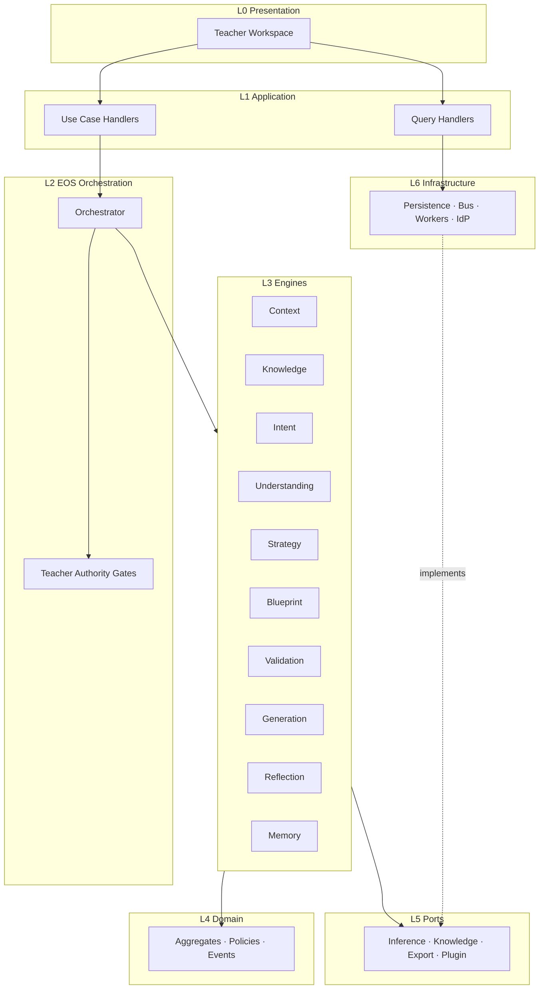
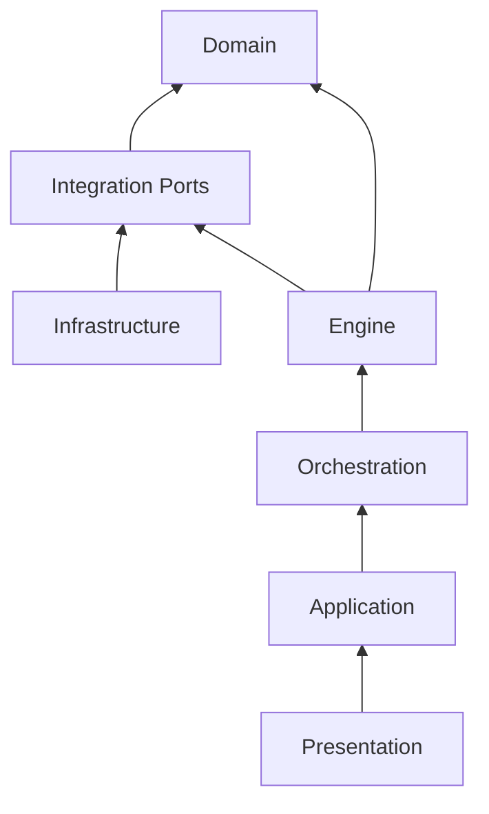
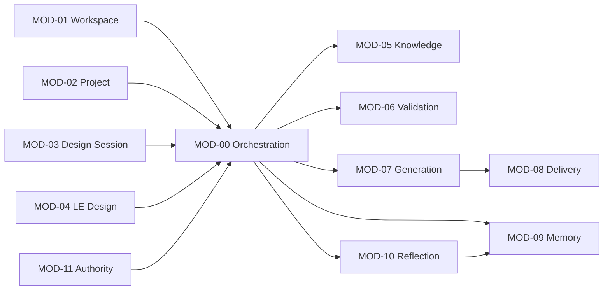
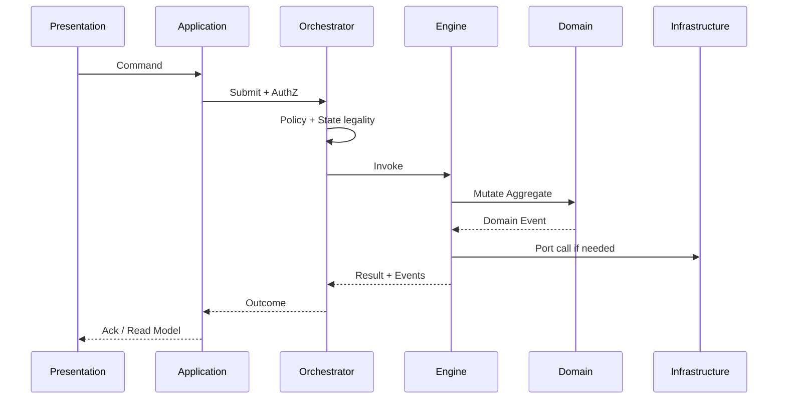
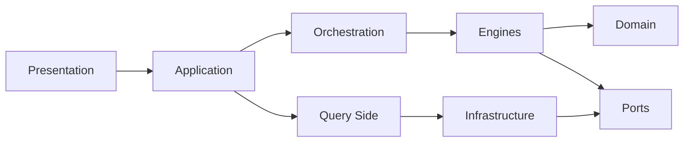
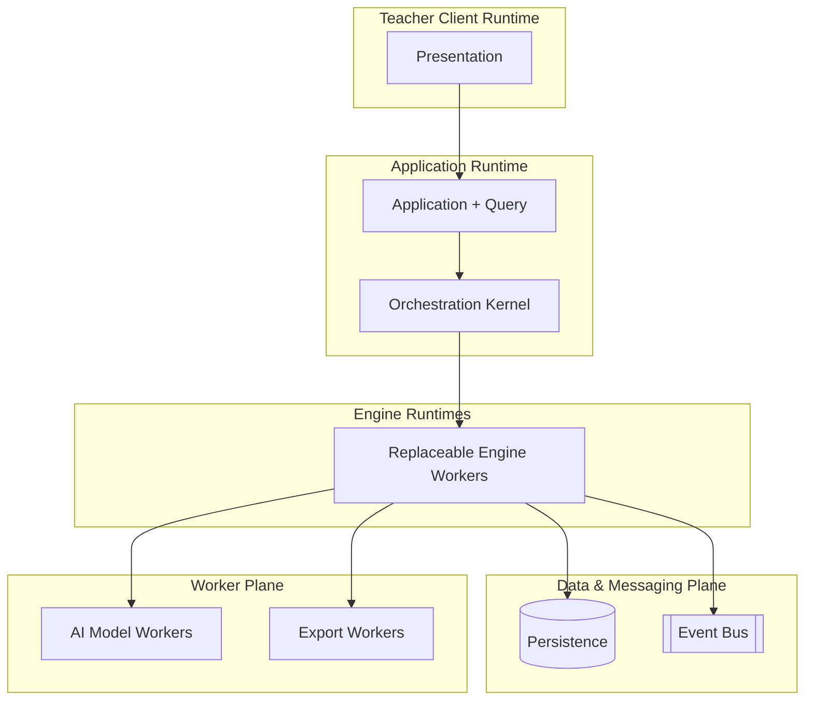

# PRIMA Reference Technical Architecture

**Version:** 1.0  
**Status:** Official — Technology-Independent Technical Structure  
**Validity horizon:** ≥ 10 years  

> **PAS family:** Platform System Architecture is defined by [`../engineering/PAS-001_PRIMA_SYSTEM_ARCHITECTURE.md`](../engineering/PAS-001_PRIMA_SYSTEM_ARCHITECTURE.md) (**PAS-001**). This document is the technology-independent **technical layer/module** specification under PAS.  
> It transforms **constitutional business architecture** into a **reference technical architecture**.  
> It describes **structure and dependencies** — not frameworks, languages, cloud vendors, or APIs.

**Principles**

| ID | Principle |
|----|-----------|
| **RTA-01** | Business architecture drives technical architecture |
| **RTA-02** | Technology serves the domain — never the reverse |
| **RTA-03** | Every layer has one responsibility |
| **RTA-04** | Every module has one owner (Bounded Context / Engine / Service) |
| **RTA-05** | Dependencies point **inward** toward Domain |
| **RTA-06** | Core Domain remains independent of Infrastructure |
| **RTA-07** | Engines remain AI-model and vendor replaceable |
| **RTA-08** | Teacher Authority and Policies are enforced in Application + Orchestration — never bypassed by UI or workers |

**Precedence:** This document owns Reference Layers, Modules, and dependency rules.  
`technical/SYSTEM_ARCHITECTURE.md` and solution/component docs **must map to this** — never redefine layers around a chosen stack.

**Out of scope:** Frameworks, languages, databases, cloud products, HTTP shapes, LLM prompts, UI kits.

---

# 1. Reference Layer Architecture (challenged)

## 1.1 Challenge to candidate layers

| Candidate | Verdict | Refinement |
|-----------|---------|------------|
| Presentation Layer | **Keep** | Teacher-facing surfaces only; no domain rules |
| Application Layer | **Keep** | Use-case adapters; Commands/Queries entry |
| EOS Orchestration Layer | **Keep** | Distinct from Application — owns gates & Engine sequencing |
| Engine Layer | **Keep** | Constitutional Engines as execution units |
| Domain Layer | **Keep** | Aggregates, Policies, Invariants — innermost core |
| Knowledge Layer | **Merge into Domain + Knowledge Module** | Not a separate platform layer — Knowledge is a Bounded Context inside Domain/Engines |
| Integration Layer | **Keep** | Outbound ports for external systems & AI workers |
| Infrastructure Layer | **Keep** | Technical adapters implementing ports |
| Persistence Layer | **Fold under Infrastructure** | Persistence is an Infrastructure concern, not a peer business layer |
| Observability Layer | **Cross-cutting plane** | Not a request path layer |
| Security Layer | **Cross-cutting plane** | AuthN/AuthZ/Audit span layers |

## 1.2 Official Reference Layers

| ID | Layer | Position |
|----|-------|----------|
| **L0** | Presentation | Outermost (Teacher) |
| **L1** | Application | Use-case boundary |
| **L2** | EOS Orchestration | Lawful coordination |
| **L3** | Engine | Specialized execution |
| **L4** | Domain | Core business truth |
| **L5** | Integration Ports | Outward-facing contracts (from Domain/Engines) |
| **L6** | Infrastructure | Adapters (incl. Persistence, messaging, AI workers, files) |

**Cross-cutting planes (not stacked layers):** Security · Observability · Configuration · Localization · Accessibility · Audit.

```
L0 Presentation
L1 Application
L2 EOS Orchestration
L3 Engine
L4 Domain  ← dependencies point inward
L5 Integration Ports (owned by Domain/Engines; implemented outward)
L6 Infrastructure (implements ports)
```

---

# 2. Layer Specifications

---

## L0 — Presentation Layer

| Field | Content |
|-------|---------|
| **Purpose** | Render Teacher Workspace and accept Teacher intent signals |
| **Responsibilities** | Screens/flows; accessibility; localization of UI strings; map UI actions → Application Commands/Queries; display Read Models |
| **Owned Components** | Teacher Workspace UI; Continuă; Project views; Blueprint review surfaces; Resource craft surfaces; Library; Admin UI shells |
| **Allowed Dependencies** | L1 Application (Commands/Queries/DTOs/Read Models only) |
| **Forbidden Dependencies** | L2–L6 directly; Domain aggregates; Engines; Persistence; AI workers; Policy engines |
| **Inputs** | Teacher gestures; Query results; projected status |
| **Outputs** | Application Commands/Queries; presentation-only state |

---

## L1 — Application Layer

| Field | Content |
|-------|---------|
| **Purpose** | Translate Teacher/System intents into constitutional Commands & Queries |
| **Responsibilities** | Use-case orchestration *at the boundary*; transaction/session scoping *policy*; DTO mapping; invoke Orchestration; return Read Models; enforce AuthZ at command edge |
| **Owned Components** | Application Services / Use Case Handlers mapped to UC-* / Commands / Queries; Anti-Corruption for UI payloads |
| **Allowed Dependencies** | L2 Orchestration; Domain types (read); Query ports; Security plane |
| **Forbidden Dependencies** | Infrastructure types; UI; Engine internals; bypassing Orchestrator for gated pipelines |
| **Inputs** | Commands; Queries; identity context |
| **Outputs** | Accepted/Rejected Commands; Read Model views; correlation ids |

---

## L2 — EOS Orchestration Layer

| Field | Content |
|-------|---------|
| **Purpose** | Enforce lawful EOS execution (ENG-00) |
| **Responsibilities** | Sequence Engines; apply Policies & Decision Authority; advance State Machines; route failures; bind Teacher Authority exclusive acts; correlate Events |
| **Owned Components** | Orchestrator runtime; Pipeline Position controller; Gate evaluators; Decision Authority applicator (DEC-*); Saga/workflow coordinators for long runs |
| **Allowed Dependencies** | L3 Engine *ports*; L4 Domain (Policies, Aggregates via Engine contracts); Event bus ports |
| **Forbidden Dependencies** | Presentation; Infrastructure concrete adapters; AI model SDKs; Persistence schemas |
| **Inputs** | Validated Commands; Engine results; Domain Events |
| **Outputs** | Engine invocations; Pipeline advances; DeniedSkip; Failure routing |

---

## L3 — Engine Layer

| Field | Content |
|-------|---------|
| **Purpose** | Execute one constitutional responsibility per Engine |
| **Responsibilities** | Implement ENG-01…ENG-10 missions; publish Domain Events; consume allowed Events; produce Engine outputs |
| **Owned Components** | Context, Knowledge, Intent, Understanding, Strategy, Blueprint, Validation, Generation, Reflection, Memory Engine runtimes |
| **Allowed Dependencies** | L4 Domain (own aggregates); L5 Integration Ports (for inference/knowledge retrieval workers); sibling Engines **only via Orchestrator or Events** — not private APIs |
| **Forbidden Dependencies** | Presentation; other Engines’ internals; Infrastructure concrete types; Teacher Authority grant logic (Policy only) |
| **Inputs** | Orchestrator requests; Commands scoped to Engine; Events |
| **Outputs** | Domain Events; Engine result objects; ValidationReports; proposals |

---

## L4 — Domain Layer

| Field | Content |
|-------|---------|
| **Purpose** | Hold educational business truth independent of technology |
| **Responsibilities** | Aggregates; Value Objects; Domain Events definitions; Invariants; Policies as domain rules; State Machine legality |
| **Owned Components** | Project, ConversationSession, LearningExperience, InstructionalBlueprint/Version, TeacherApproval, GenerationPackage, Resource, ExportPackage, KnowledgePack, Memory*, ValidationReport, LibraryEntry, Teacher; Constitutional Language types |
| **Allowed Dependencies** | None outward (pure) — may define Port *interfaces* conceptually |
| **Forbidden Dependencies** | All outer layers; frameworks; AI; storage; clocks as infrastructure (time as domain concept OK) |
| **Inputs** | Domain Commands / method intents from Engines |
| **Outputs** | State changes; Domain Events; invariant violations |

---

## L5 — Integration Ports

| Field | Content |
|-------|---------|
| **Purpose** | Declare what the core needs from the outside world |
| **Responsibilities** | Ports for AI inference workers; Knowledge repository adapters; Export formatters; Notification; Plugin hooks; External curriculum sources |
| **Owned Components** | Port definitions (owned by Domain/Engines/Application as appropriate) |
| **Allowed Dependencies** | Domain types only (in signatures) |
| **Forbidden Dependencies** | Vendor SDKs; concrete HTTP clients |
| **Inputs** | Engine/Application requests |
| **Outputs** | Port results (provenance-bearing where Knowledge) |

---

## L6 — Infrastructure Layer

| Field | Content |
|-------|---------|
| **Purpose** | Implement Ports and technical concerns |
| **Responsibilities** | Persistence adapters; Event bus; File/object storage; AI model workers; Identity providers; Schedulers; Export renderers; Cache; Config loaders |
| **Owned Components** | Repositories; Message adapters; Model workers; Auth adapters; Observability sinks |
| **Allowed Dependencies** | L5 Port contracts; Domain types for mapping (outward) |
| **Forbidden Dependencies** | Being called *from* Domain; owning business Policies; Approving Blueprints |
| **Inputs** | Port invocations; technical triggers |
| **Outputs** | Persisted state; delivered messages; worker results |

---

# 3. Reference Module Catalog

Modules are **deployable/organizational units** that map to Services/Engines — not UI pages.

## 3.1 Challenge to examples

| Candidate | Verdict |
|-----------|---------|
| Teacher Workspace | **Keep** — Presentation + Application façade |
| Conversation | **Rename** → **Design Session Module** (not chat-as-product) |
| Project Management | **Keep** → **Project Continuity Module** |
| Blueprint Management | **Keep** → **Learning Experience Design Module** |
| Generation | **Keep** |
| Knowledge | **Keep** |
| Validation | **Keep** |
| Memory | **Keep** |
| Assessment | **Reject** as module — split across Design + Generation + Validation |
| Analytics | **Future optional** |
| Collaboration | **Future** |
| Administration | **Keep** → **Platform Governance Module** |
| Notification | **Future peripheral** |
| Plugin Runtime | **Future** — Extension Host |
| Reflection | **Add** (thin) |
| Teacher Authority | **Add** (thin policy façade) |
| Delivery & Portfolio | **Add** (Export + Library) |
| Orchestration Kernel | **Add** |

## 3.2 Official modules

| ID | Module | Primary SVC / ENG | Layer home |
|----|--------|-------------------|------------|
| **MOD-00** | Orchestration Kernel | ENG-00 | L2 |
| **MOD-01** | Teacher Workspace | Presentation + Application entry | L0–L1 |
| **MOD-02** | Project Continuity | SVC-01 | L1–L4 |
| **MOD-03** | Design Session | SVC-02 + ENG-01,03,04,05 | L1–L3 |
| **MOD-04** | Learning Experience Design | SVC-03 + ENG-06 | L1–L4 |
| **MOD-05** | Knowledge | SVC-04 + ENG-02 | L3–L4 |
| **MOD-06** | Validation | SVC-05 + ENG-07 | L3–L4 |
| **MOD-07** | Generation | SVC-06 + ENG-08 | L3–L4 |
| **MOD-08** | Delivery & Portfolio | SVC-07 | L1–L4 |
| **MOD-09** | Memory | SVC-08 + ENG-10 | L3–L4 |
| **MOD-10** | Reflection | SVC-09 + ENG-09 | L3–L4 |
| **MOD-11** | Teacher Authority | SVC-10 | L1–L2 + Security |
| **MOD-12** | Platform Governance | SVC-11 | L1–L6 admin |
| **MOD-13** | Extension Host | Future Plugin Runtime | L5–L6 |
| **MOD-14** | Notification | Future SVC-13 | L6 peripheral |
| **MOD-15** | Collaboration | Future SVC-12 | Future |
| **MOD-16** | Analytics | Future optional | Future |

---

# 4. Layer Responsibility Matrix

| Concern | L0 | L1 | L2 | L3 | L4 | L5 | L6 |
|---------|----|----|----|----|----|----|-----|
| UI / a11y / i18n UI | ● | ○ | | | | | |
| Command/Query entry | | ● | | | | | |
| Policy gates / pipeline | | ○ | ● | | | | |
| Engine execution | | | ○ | ● | | | |
| Aggregates / invariants | | | | ○ | ● | | |
| External capability ports | | | | ○ | ○ | ● | |
| Persistence / AI workers | | | | | | ○ | ● |
| AuthN identity | ○ | ● | ○ | | | | ● |
| AuthZ Teacher exclusive | | ● | ● | | ○ Policy | | |
| Audit trail | | ○ | ● | ○ | ○ | | ● |
| Telemetry | ○ | ○ | ○ | ○ | | | ● |

● primary · ○ contributes

---

# 5. Dependency Rules

## 5.1 Legal communication paths

| From → To | Allowed how |
|-----------|-------------|
| L0 → L1 | Commands / Queries only |
| L1 → L2 | Submit Commands; request orchestration |
| L1 → Query ports | Read Models (CQRS query side) |
| L2 → L3 | Engine invocation contracts |
| L3 → L4 | Aggregate commands / domain methods |
| L3 → L5 | Port calls (inference, repos) |
| L6 → implements L5 | Adapters |
| Any → Event bus | Publish/consume Domain Events (via ports) |
| Engines ↔ Engines | **Only** via Orchestrator or Domain Events |

## 5.2 Forbidden paths

| Path | Why forbidden |
|------|----------------|
| L0 → L2/L3/L4/L6 | UI must not orchestrate or persist |
| L4 → L6 | Domain must not know Infrastructure |
| L3 → L3 private calls | Hidden coupling; breaks replaceability |
| L6 → L4 direct mutation | Bypass Engines/invariants |
| L0/L1 → AI worker | Skips Validation/Approval gates |
| Generation → mutate Blueprint | POL-030 |
| Memory → write KnowledgePack | POL-050 / Knowledge ownership |

## 5.3 Anti-patterns

| Anti-pattern | Remedy |
|--------------|--------|
| “Smart UI” with gates | Move gates to L2 |
| Shared mutable DB across Engines | Per-module persistence behind ports; Events for sync |
| God Orchestrator that writes pedagogy | Orchestrator sequences only |
| Prompt Engine as core layer | Voice/prompt stays in Integration worker |
| Assessment microservice | Split responsibilities per constitution |
| Sync chat-to-generation | Enforce Blueprint Approve + Authorize |

---

# 6. Execution Architecture

## 6.1 Request lifecycle (synchronous Teacher act)

1. **Presentation** captures Teacher act → Application Command  
2. **Application** authenticates/authorizes; validates shape; assigns correlation id  
3. **Orchestrator** evaluates Policy + State Machine legality  
4. If Exclusive Teacher act → **Teacher Authority** confirms eligibility  
5. Target **Engine** executes against **Domain**  
6. **Domain Events** published  
7. **Read Models** updated (sync or async projection)  
8. Response / Query refresh to Presentation  

## 6.2 Engine orchestration

Orchestrator owns order: Context → Intent → Knowledge → Understanding → Strategy → Blueprint → Validation → (Teacher Approve) → Generation → Validation → Delivery → Reflection → Memory.

Peer Engines never self-chain gated stages.

## 6.3 Asynchronous processing

| Kind | Examples | Pattern |
|------|----------|---------|
| Long Generation | StartResourceGeneration | Async run; Completed/Failed Events |
| Projections | RM-* updates | Event handlers |
| Knowledge pack publish | Admin | Async index rebuild |
| Reflection | Non-blocking | Fire-and-forget under Policy |

## 6.4 Background jobs

Schedulers live in **Infrastructure**; they emit **Commands** or technical triggers into Application/Orchestration — never mutate Aggregates silently.

## 6.5 Long-running workflows

GenerationPackage and similar use **orchestrated sagas**: Orchestrator tracks run state; compensations = fail visible / retry scoped — **never** auto-Approve or auto-Export.

## 6.6 Recovery strategies

| Failure | Strategy |
|---------|----------|
| Validation Unavailable | Do not Present-as-ready; fail visible |
| Generation Failed | Remain Failed; Teacher may Regenerate |
| Projection lag | Queries may show stale with honesty; Commands still authoritative |
| Engine Degraded | Orchestrator refuses illegal skip |

## 6.7 Error propagation

Domain/Policy violations → Application rejection (typed).  
Infrastructure faults → wrapped technical failures → Orchestrator DomainFailureRecorded → Teacher-visible when material.  
**Never** convert failure into silent success (POL-072).

---

# 7. Cross-Cutting Architecture

| Concern | Belongs where | Notes |
|---------|---------------|-------|
| **Authentication** | Security plane + L1/L6 | Identity established at edge; TeacherId in context |
| **Authorization** | L1 + L2 + MOD-11 | Exclusive acts gated; Engines check Policy, not roles alone |
| **Logging** | Observability plane | Correlation id mandatory across L1–L3 |
| **Monitoring** | Observability + L6 sinks | Engine health Ready/Degraded/Unavailable |
| **Telemetry** | Observability | Product metrics without PII abuse; Memory sensitivity |
| **Caching** | L6 behind ports | Never cache Approval as mutable truth; invalidate on Events |
| **Versioning** | Domain (BlueprintVersion, KnowledgePack) + Contracts | Immutable versions; API versioning is later tech choice |
| **Configuration** | L6 + Governance | Feature flags must not bypass Policies |
| **Localization** | L0 (UI) + content provenance | Curriculum language ≠ UI locale alone |
| **Accessibility** | L0 | Constitutional UX obligation for Teacher |
| **Audit** | L2 + Domain Events + L6 store | Approve/Authorize/Export/Memory Accept immutable trail |

---

# 8. Extension Architecture

**Rule:** Extensions **adapt through Ports**; they **never modify Core Domain** Aggregates or Policies in-place.

| Extension type | Integration method |
|----------------|-------------------|
| **AI Models** | Inference Port behind Generation / Understanding / Strategy workers; swap adapter; same Engine contracts |
| **Plugins** | Extension Host (MOD-13) registers capabilities; Orchestrator admits only Policy-approved hooks; no direct Aggregate write |
| **Integrations / External Services** | Integration Ports + Anti-Corruption; Events out / Commands in |
| **Educational Repositories** | Knowledge Port → Knowledge Engine; provenance mandatory |
| **Third-party Engines** | Must implement Engine Contract (mission, Commands, Events); registered with Orchestrator; same MUST/MUST NEVER |
| **Export formats** | Delivery Ports; Approval still required before Export Command |
| **Collaboration / Notification** | Peripheral modules; subscribe to Events; cannot Approve |

```
Core Domain (L4) ← Engines (L3) ← Orchestrator (L2)
        ↑ ports only
Infrastructure / Plugins / Models / Repositories (L6)
```

---

# 9. Mermaid Diagrams

## 9.1 Reference Architecture



## 9.2 Layer Diagram



## 9.3 Module Diagram



## 9.4 Execution Flow



## 9.5 Dependency Graph



## 9.6 Deployment View (conceptual)



*Deployment topology is conceptual: runtimes may co-locate or split; boundaries stay.*

---

# 10. Architecture Validation

| Criterion | Assessment |
|-----------|------------|
| **Layer violations** | Forbidden paths enumerated; UI→Engine and Domain→Infra banned |
| **Coupling** | Engines coupled only via Orchestrator/Events; modules map 1:1 to SVC/ENG |
| **SPOF** | Orchestrator is coordination hub — mitigate with health + fail-visible, not by pushing gates into UI |
| **Scalability** | Async Generation; Event projections; Engines independently scalable |
| **Replaceability** | AI models, persistence, bus behind Ports; Engines replaceable under Contracts |
| **Cloud portability** | No vendor assumptions; L6 adapters swap |
| **Maintainability** | Clear ownership; Assessment/Recommendation modules rejected to avoid overlap |
| **Future evolution** | Extension Host, Collaboration, Analytics, Notification without Core Domain edits |

**Verdict:** Reference Technical Architecture is **aligned to EOS**, **dependency-inward**, **vendor-neutral**, and **fit for constitutional execution**.

---

# 11. Deliverable Index

| # | Deliverable | Section |
|---|-------------|---------|
| 1 | Reference Layer Architecture | §1–§2 |
| 2 | Reference Module Catalog | §3 |
| 3 | Layer Responsibility Matrix | §4 |
| 4 | Dependency Rules | §5 |
| 5 | Execution Architecture | §6 |
| 6 | Cross-Cutting Architecture | §7 |
| 7 | Extension Architecture | §8 |
| 8 | Mermaid Diagrams | §9 |
| 9 | Architecture Validation | §10 |

---

## Closing

> **Layers protect the Domain.  
> Modules own one job.  
> Ports absorb technology.  
> Orchestration keeps education lawful.**  

Constitutional mapping:

**Presentation → Application → Orchestration → Engines → Domain**  
**Infrastructure implements Ports — never owns Policies.**
