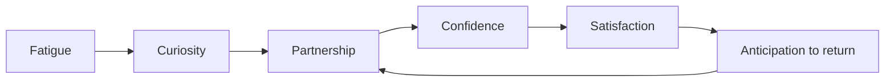
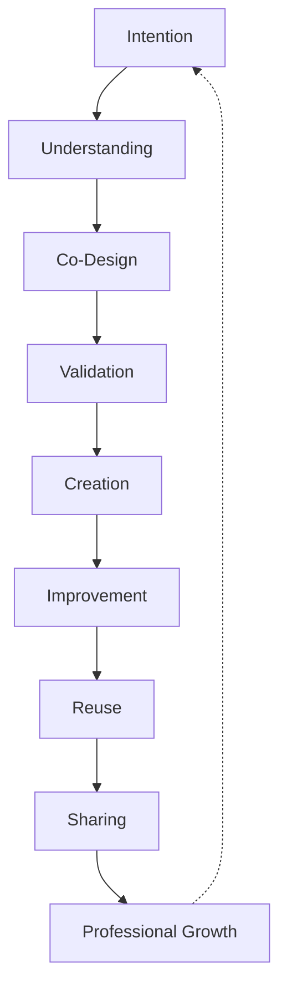

# PRIMA Teacher Experience

**Version:** 1.0  
**Status:** Official — Experience Design Manifesto

> **Design the experience teachers live — not the screens they click.**

This document is the **experience design manifesto** of PRIMA. It defines how teachers should **feel**, **think**, and **move** through the platform over years of daily use. It is the foundation for future UX, UI, and software development.

It is not a product specification. It is not a UI mock-up. It does not describe databases or APIs.

Product constitution: [`PRIMA_PRODUCT_DESIGN.md`](./PRIMA_PRODUCT_DESIGN.md). Visual execution: [`UI_GUIDELINES.md`](../UI_GUIDELINES.md).

---

## The Fundamental Question

If a teacher uses PRIMA every day for the next ten years — **what experience should they remember?**

They should remember that **planning stopped feeling like a second job**.

They should remember a **calm colleague** who helped them think clearly, design confidently, and leave school knowing tomorrow's lesson was **sound** — not just **done**.

They should **not** remember menus, settings, tutorials, or fighting software at 20:00.

Every design decision in this document serves that memory.

---

## Design Philosophy

PRIMA should feel:

| Quality | Experience meaning |
|---------|-------------------|
| **Simple** | One obvious next step — always |
| **Natural** | Like planning with a colleague — not operating a system |
| **Calm** | No urgency, no noise, no visual competition for attention |
| **Professional** | Serious about pedagogy; respectful of craft |
| **Predictable** | Same rules every session — trust compounds |
| **Helpful** | Present at decision moments; absent elsewhere |
| **Intelligent** | Understands context; proposes before interrogating |
| **Respectful** | Teacher is the expert; PRIMA is the partner |
| **Elegant** | Every element earns its place |
| **Collaborative** | *With* the teacher — never *instead of* |
| **Invisible** | Technology disappears; thinking remains |

**Cardinal law:** The platform must **never compete for the teacher's attention**. It must **amplify the teacher's thinking**.

---

## The Design Challenge

A teacher arrives home after a long school day.

They have **little energy**. **Limited time**. **Many responsibilities**.

Yet tomorrow's lesson still needs to be **excellent** — not merely **existing**.

PRIMA must help them create outstanding educational resources with the **least possible mental effort**:

| Reduce | Increase |
|--------|----------|
| Decisions | Confidence |
| Repetition | Creativity |
| Administration | Pedagogical quality |
| Uncertainty | Professional pride |
| Tool-learning | Time for life |

**Design test:** Could this work at 20:00 on a Tuesday in February? If not, redesign.

---

## Experience Principles

Every interaction must respect these principles. Each includes **educational value** — why it matters for learning design, not just UX.

---

### EP-01 — The Teacher Always Starts with Intention

**Principle:** Every session begins with *what the teacher wants learners to achieve* — never with templates, settings, or blank forms.

**Educational value:** Design without intent produces generic lessons. Intent-first anchoring ensures every downstream decision serves real learning goals.

**Experience:** *"Ce vrei să reușească elevii?"* — not *"Selectează tipul de fișier"*.

---

### EP-02 — Conversation Before Configuration

**Principle:** Discovery happens through dialogue — not dropdowns, wizards, or numbered steps.

**Educational value:** Conversation builds shared understanding; forms extract data without building partnership.

**Experience:** PRIMA Experience has no *Step 3 of 7*. Progress is felt through clarity — not a progress bar.

---

### EP-03 — Guide Before Asking

**Principle:** PRIMA proposes a sensible path first; asks only when necessary.

**Educational value:** Reduces cognitive load so teacher energy stays on pedagogical judgment, not data entry.

**Experience:** *"Pentru clasa a III-a la matematică, aș propune… Corect?"* — not twenty empty fields.

---

### EP-04 — Show Before Explaining

**Principle:** Let teachers see the design — then offer rationale on demand.

**Educational value:** Visualized design enables professional review; walls of explanation substitute for trust.

**Experience:** Blueprint appears as readable plan; *De ce?* available per section — not mandatory lecture first.

---

### EP-05 — Suggest Before Requiring

**Principle:** Every AI output is a draft suggestion — never an imposed requirement.

**Educational value:** Preserves teacher professional authority and classroom contextual judgment.

**Experience:** Approve is always explicit. Nothing materializes without consent.

---

### EP-06 — Validate Before Generating

**Principle:** Design coherence is confirmed before any classroom material exists.

**Educational value:** Prevents polished but pedagogically incoherent resources — the failure mode of content generators.

**Experience:** Blueprint review is a calm checkpoint — not a bureaucratic gate.

---

### EP-07 — Reuse Before Recreating

**Principle:** Prior work is the default starting point when it exists.

**Educational value:** Repetition is professional waste; adaptation is higher-value craft.

**Experience:** *Continuă* and *Folosește din bibliotecă* appear before *Creează de la zero*.

---

### EP-08 — Never Interrupt Thinking

**Principle:** No modal surprises, no nagging, no irrelevant notifications mid-design.

**Educational value:** Flow state supports deeper pedagogical reasoning — interruption fragments design quality.

**Experience:** PRIMA waits. Teacher pauses without penalty. Resume restores exact context.

---

### EP-09 — Reduce Unnecessary Decisions

**Principle:** Every decision costs energy — eliminate those that do not improve learning design.

**Educational value:** Decision fatigue degrades judgment; defaults and inference protect quality at low energy.

**Experience:** Smart defaults for returning teachers. Two options — not ten.

---

### EP-10 — One Meaningful Step at a Time

**Principle:** Each moment has one primary focus — one educational task.

**Educational value:** Parallel complexity mirrors bad lesson design — one objective at a time produces coherence.

**Experience:** Conversation OR blueprint review OR editing — not all three competing on one surface.

---

### EP-11 — Predictability Builds Trust

**Principle:** Same sequence, same language, same approval rules — every session.

**Educational value:** Trust enables faster professional judgment; surprise erodes willingness to delegate thinking to a partner.

**Experience:** Approve always precedes generate. Always.

---

### EP-12 — Invisibility Is a Feature

**Principle:** When PRIMA works well, the teacher forgets they are using software.

**Educational value:** Attention belongs to learners' needs — not interface mechanics.

**Experience:** Export feels like saving a document — not completing a platform workflow.

---

## The Teacher Experience

### Beginning — *Arrival*

**What happens:** Teacher opens PRIMA. Warm orientation. One invitation: continue or create. No tutorial wall. No settings maze.

**How they should feel:** Relief. *This is for me — not for administrators.*

**What must always happen:** Immediate path to value. Returning work visible.

**What must never happen:** Configuration before creation. Feature tour. Empty dashboard guilt.

---

### Middle — *Partnership*

**What happens:** Conversation → Blueprint → Approval → Materials. PRIMA listens, proposes, explains on request. Teacher reviews, corrects, approves.

**How they should feel:** Collaboration. *We're designing this together.*

**What must always happen:** Visible design before content. Teacher consent at approval. Full editability after.

**What must never happen:** Surprise generation. Black-box recommendations. Forced acceptance. Jargon dumps.

---

### End — *Closure*

**What happens:** Export. Save to Library. Optional reflection. Clean exit back to life.

**How they should feel:** Satisfaction. *Tomorrow is handled — and I'm proud of the design.*

**What must always happen:** Clear completion signal. Saved work. Reuse path visible.

**What must never happen:** Ambiguity about whether work saved. Trap in platform. Export hidden.

---

### Emotional Journey

```
Fatigue → Curiosity → Partnership → Confidence → Satisfaction → Anticipation (return)
```

PRIMA transforms **dread of evening planning** into **quiet professional satisfaction** — never excitement hype, never guilt, never overwhelm.

Over ten years, the emotional arc **compresses**: fatigue and curiosity shrink; confidence and satisfaction grow. The product **disappears**; the partnership **deepens**.



---

## Experience Stages

Nine stages describe the **lived experience** — not software modules.

---

### 1 — Arrival

| Dimension | Content |
|-----------|---------|
| **Purpose** | Orient without friction; restore continuity |
| **Teacher mindset** | Tired or rushed; seeking fastest path to done |
| **AI behavior** | Silent until invited; surface *Continuă* if work exists; one warm line — not a speech |
| **Educational value** | Protects energy for actual design |
| **Expected outcome** | Teacher knows next action in ≤5 seconds |

---

### 2 — Understanding

| Dimension | Content |
|-----------|---------|
| **Purpose** | Build accurate shared intent |
| **Teacher mindset** | Willing to explain if heard; impatient if interrogated |
| **AI behavior** | Mirror understanding; confirm inferences; one question at a time |
| **Educational value** | Correct intent prevents wasted design effort |
| **Expected outcome** | Teacher feels *understood* before any plan appears |

---

### 3 — Co-Design

| Dimension | Content |
|-----------|---------|
| **Purpose** | Compose pedagogical plan collaboratively |
| **Teacher mindset** | Professional review mode; evaluating reasoning |
| **AI behavior** | Present Blueprint in teacher language; offer *De ce?*; accept edits gracefully |
| **Educational value** | Visible design enables pedagogical judgment |
| **Expected outcome** | Teacher can explain lesson structure to a colleague |

---

### 4 — Validation

| Dimension | Content |
|-----------|---------|
| **Purpose** | Confirm coherence before commitment |
| **Teacher mindset** | Quality check — not compliance audit |
| **AI behavior** | Flag gaps gently; never block with error dumps; suggest fixes |
| **Educational value** | Catches objective–activity–assessment misalignment early |
| **Expected outcome** | Teacher approves with confidence — not hope |

---

### 5 — Creation

| Dimension | Content |
|-----------|---------|
| **Purpose** | Produce materials faithful to approved design |
| **Teacher mindset** | Expectation match — materials should reflect the plan |
| **AI behavior** | Transparent progress; trace materials to blueprint; no silent scope creep |
| **Educational value** | Execution serves design — does not replace it |
| **Expected outcome** | Editable resources teacher recognizes as *theirs* |

---

### 6 — Improvement

| Dimension | Content |
|-----------|---------|
| **Purpose** | Iterate without restart |
| **Teacher mindset** | Specific intent — *more differentiation*, *shorter timing* |
| **AI behavior** | Targeted Blueprint diff; partial regeneration; preserve what worked |
| **Educational value** | Professional practice is iterative — tools must match |
| **Expected outcome** | Better design in less time than recreating |

---

### 7 — Reuse

| Dimension | Content |
|-----------|---------|
| **Purpose** | Compound prior investment |
| **Teacher mindset** | Efficiency seeking — *I did this before* |
| **AI behavior** | Carry forward design; ask delta only; skip solved problems |
| **Educational value** | Adaptation beats recreation for quality and time |
| **Expected outcome** | Second use dramatically faster than first |

---

### 8 — Reflection

| Dimension | Content |
|-----------|---------|
| **Purpose** | Close the learning loop — design and delivery |
| **Teacher mindset** | Optional; brief; professional — not mandatory journaling |
| **AI behavior** | One gentle prompt if invited; store advisory hints — never preach |
| **Educational value** | Reflection improves future design quality |
| **Expected outcome** | Next session slightly smarter — teacher barely notices |

---

### 9 — Growth

| Dimension | Content |
|-----------|---------|
| **Purpose** | Long-term deepening of partnership and craft |
| **Teacher mindset** | PRIMA is part of professional routine — like a planner |
| **AI behavior** | Increasing inference; decreasing questions; consistent respect |
| **Educational value** | Sustained quality improvement across career |
| **Expected outcome** | Ten-year user plans faster, designs better, trusts completely |

---

## Product Conversation

How PRIMA speaks — the **voice of the experience**.

### Asking questions

| Rule | Application |
|------|-------------|
| **One at a time** | Never stack three questions in one message |
| **Purpose visible** | *"Întreb ca să pot alinia obiectivele"* — when non-obvious |
| **Choice when useful** | *"Poveste sau problemă?"* — not open void |
| **Minimum viable ask** | Infer grade from context; confirm — don't re-interview |

### Information requested

Request only what **cannot** be inferred responsibly. Returning teachers: confirm deltas. New teachers: gentle discovery — not intake forms.

### Silence

PRIMA remains silent when:

- Teacher is reading Blueprint  
- Teacher is editing  
- Teacher paused mid-thought  
- No decision is required  

Silence is **respect** — not abandonment.

### Explanation

Explain when:

- Teacher asks *De ce?*  
- Recommendation is non-obvious  
- Confidence is low  
- Approval moment approaches  

Never explain unprompted at length.

### Suggestion

Frame as draft: *"Aș propune…"*, *"O variantă ar fi…"*. Maximum **two or three** options — ranked, not enumerated menus.

### Uncertainty

Honest and brief: *"Nu sunt sigur de nivel — poți confirma?"* Never fake confidence. Never expose AI mechanics.

### Mistakes

No blame: *"Am înțeles greșit — reformulează, te rog."* Correction is welcome — never penalized. PRIMA updates understanding without defensiveness.

---

## Experience Objects

Mental models teachers carry — **not database tables**.

| Object | Why it exists | Why it's natural | Experience contribution |
|--------|---------------|------------------|------------------------|
| **Blueprint** | Design before materials | Teachers already plan on paper | Trust — see the plan first |
| **Lesson** | Teachable output | Universal teacher concept | Tomorrow-ready closure |
| **Project** | One design effort | Matches "working on a lesson" | Continuity across days |
| **Collection** | Coherent bundle | "Lesson + worksheet + test" | No mismatched materials |
| **Resource** | Single editable output | Like any document they own | Ownership and control |
| **Conversation** | How intent is captured | Talking is how teachers plan | Natural entry — no forms |
| **Workspace** | Daily professional home | Desk, planner, studio | Return without re-orienting |
| **Library** | Personal portfolio | Filing cabinet of good work | Reuse and pride |
| **Reflection** | Professional growth | After-action review | Improvement without overhead |

**One mental model rules all:**

```
Workspace → Project → Conversation → Blueprint → Resources → Library
```

Teachers never need a second grammar.

---

## Experience Flows

Natural work rhythm and **why each transition feels right**.

```
Teacher intention
    ↓  Natural: teachers always know what they want before tools
Understanding
    ↓  Natural: good colleagues listen before proposing
Co-design
    ↓  Natural: planning together before making copies
Validation
    ↓  Natural: professionals review before committing
Creation
    ↓  Natural: production follows approved plan
Improvement
    ↓  Natural: teaching is iterative
Reuse
    ↓  Natural: good work deserves a second life
Sharing
    ↓  Natural: colleagues exchange materials
Professional Growth
    ↓  Natural: craft compounds over years
```

### Transition design

| Transition | Why it feels natural |
|------------|---------------------|
| **Intention → Understanding** | Mirrors staff-room conversation opening |
| **Understanding → Co-design** | Partner sketches plan after hearing goal |
| **Co-design → Validation** | Review before photocopying — universal professional habit |
| **Validation → Creation** | Make the materials — only after plan is right |
| **Creation → Improvement** | After teaching, you know what to fix |
| **Improvement → Reuse** | Fixed design becomes template for next time |
| **Reuse → Sharing** | Good lessons travel between colleagues |
| **Sharing → Growth** | Exchange elevates whole profession |



---

## Product Personality

### If PRIMA were a colleague...

**Who:** The experienced methodologist three years senior — not the administrator, not the intern, not the motivational speaker.

**Communicates:** Brief, warm, precise Romanian. Professional *tu*. Never exclamation spam. Never corporate.

**Motivates:** By making the work feel doable — *"Hai să structurăm asta împreună"* — not by cheerleading.

**Disagrees:** Gently and with reason — *"Aș avea o rezervă: obiectivul pare prea amplu pentru 45 de minute. Vrei să îl împărțim?"*

**Explains:** On request, with evidence — linked to blueprint, not lectures.

**Admits uncertainty:** Openly — *"Nu sunt sigur. Confirmi?"* — builds trust, not doubt.

**Celebrates success:** Quietly — *"Planul e solid. Succes mâine la clasă."* — not confetti.

### Personality anti-patterns

| Never | Always |
|-------|--------|
| Chatbot cheerfulness | Colleague calm |
| *"Ca inteligență artificială…"* | *"Am nevoie de confirmarea ta"* |
| Authority without reason | Reason before recommendation |
| Playful mascot energy | Professional warmth |

---

## Moments of Delight

Pleasant surprise that builds **trust, confidence, satisfaction** — never distraction.

| Moment | Delight | Why it works |
|--------|---------|--------------|
| **Return visit** | *Continuă exact unde ai rămas* — context restored | Respects time; feels cared for |
| **Inference accepted** | PRIMA skipped five questions — teacher confirms one | Competence, not magic |
| **Blueprint clarity** | Teacher sees coherent plan first time | *"Da, asta are sens"* |
| **Partial regen** | Only worksheet updates — lesson untouched | Surgical improvement |
| **Library reuse** | Last month's lesson → this week in two minutes | Compound value |
| **Export simplicity** | PDF ready — two clicks | Invisibility |
| **Honest uncertainty** | PRIMA asks instead of guessing wrong | Trust over flash |

**Delight rule:** Surprise **competence and respect** — never novelty for its own sake. No streaks, badges, or gamification unless pedagogically justified (none today).

---

## Product Simplicity

Every feature must answer:

| Question | Pass criteria |
|----------|---------------|
| **Why does it exist?** | Clear educational or time-saving purpose |
| **What teacher problem does it solve?** | Named frustration — not "because competitors have it" |
| **What if it disappeared?** | Teachers would measurably suffer — not merely notice |

**Fail all three → feature does not ship.**

Simplicity is not minimalism for aesthetics. It is **respect for a tired teacher at 20:00**.

---

## Product Evolution

PRIMA grows for a **decade** without growing **harder**.

| Evolution rule | Meaning |
|----------------|---------|
| **Same front door** | Workspace → intention → partnership — forever |
| **Same mental model** | Objects unchanged; capabilities deepen |
| **Additive power** | New activity types fit existing flow — not new flows |
| **Complexity ledger** | Add feature → remove friction elsewhere |
| **No relearning tax** | Year-five teacher uses year-one paths — faster, not different |

Future capabilities — community, knowledge center, professional growth — **integrate into reuse and co-design** — never as separate product inside the product.

---

## Why PRIMA Feels Different

| Traditional platform | PRIMA experience |
|---------------------|------------------|
| Browse resources | **Design experiences** |
| Generate content | **Approve design first** |
| Configure software | **Have a conversation** |
| Learn the tool | **Do your work** |
| More features over time | **More capability, same simplicity** |
| AI as gimmick | **AI as colleague** |

Someone reading this manifesto should understand immediately: PRIMA is not where teachers **find** materials. It is where they **think**, **design**, **validate**, and **improve** — with a partner that respects their craft.

---

## Summary

| Ten-year memory | Planning stopped being a second job |
|-----------------|-------------------------------------|
| **Daily feeling** | Calm partnership — not software operation |
| **Design test** | Works at 20:00 on a tired Tuesday |
| **Experience law** | Amplify thinking; never compete for attention |
| **Success signal** | *"I designed something better — and still have energy left"* |

This manifesto prioritizes **clarity over completeness**, **simplicity over feature quantity**, and **educational value over technological sophistication**.

It is the experience foundation for every future UX decision, UI component, and software feature built on PRIMA.

---

## Document Authority

| Document | Role |
|----------|------|
| **This document** | Experience design manifesto — how teachers should *feel* and *move* |
| [`PRIMA_PRODUCT_DESIGN.md`](./PRIMA_PRODUCT_DESIGN.md) | Product Constitution — what the product *is* and *does* |
| [`UI_GUIDELINES.md`](../UI_GUIDELINES.md) | Visual implementation |
| [`PRIMA_CONVERSATION_BLUEPRINT.md`](./PRIMA_CONVERSATION_BLUEPRINT.md) | Conversation stage detail |

On experience vs. product structure: **this document** prevails for emotional and interaction design intent. Product Design prevails for ecosystem and workflow scope.

---

## Next Recommended Document

→ [`PRIMA_CONVERSATION_BLUEPRINT.md`](./PRIMA_CONVERSATION_BLUEPRINT.md) — Stage-by-stage conversational experience within Understanding and Co-Design.
