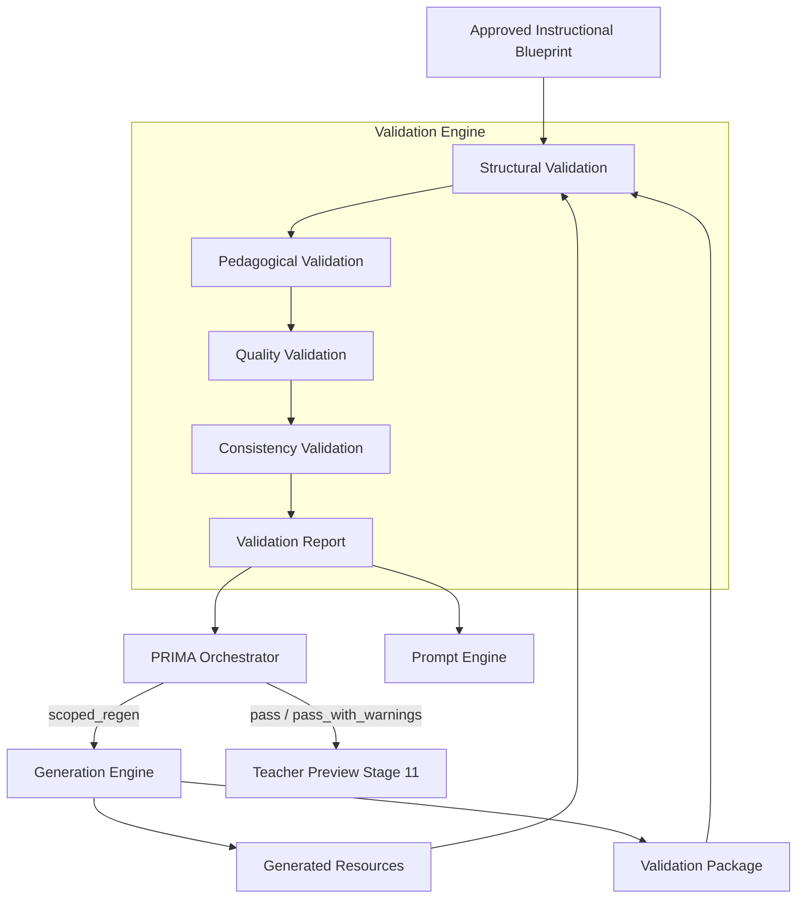
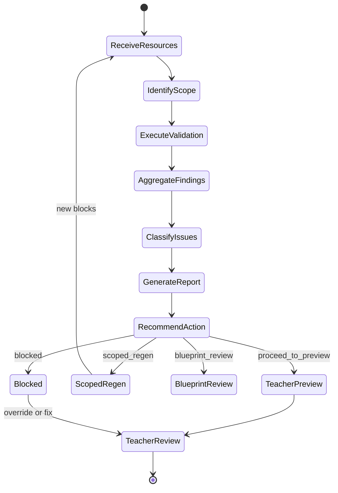
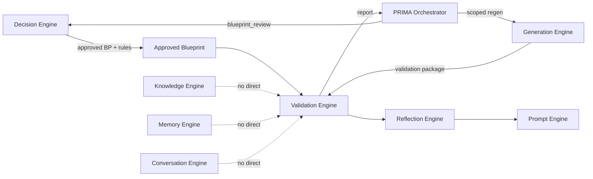
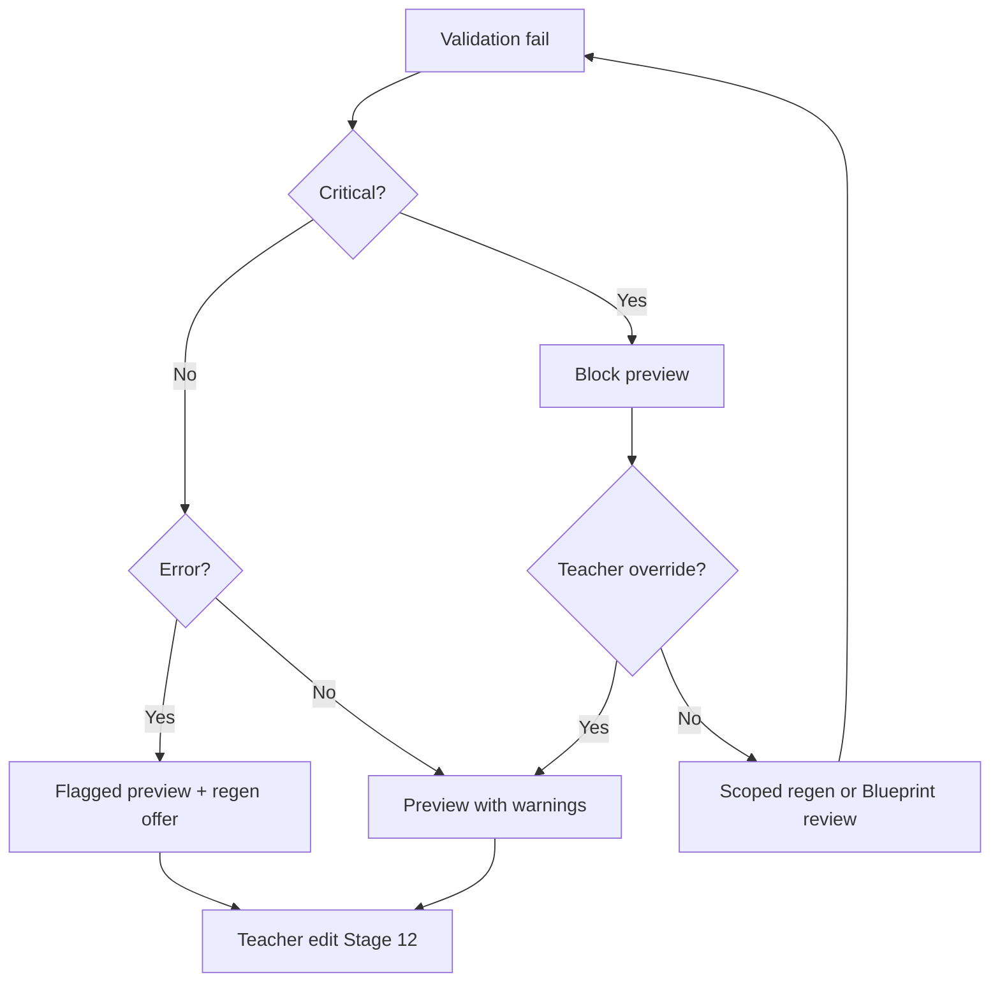

# PRIMA Validation Engine — Product Architecture Specification

---

## Purpose

This document defines the complete architectural role of the **Validation Engine** within PRIMA and LUDI ON.

The Validation Engine answers one product question:

> *Can this educational resource be safely delivered to the teacher?*

It validates **educational quality and blueprint fidelity** of generated materials. It does **not** redesign pedagogy, generate content, or edit resources.

### Why the Validation Engine Exists

Generation without validation is insufficient for an educational platform.

| Risk without validation | Consequence |
|-------------------------|-------------|
| Blueprint drift | Generated content contradicts approved design |
| Age-inappropriate language | Student-facing materials unsuitable for grade |
| Assessment misalignment | Quizzes test content never taught |
| Incomplete resource sets | Teacher receives broken activity packages |
| Safety gaps | Harmful or inappropriate content reaches classroom |
| Silent quality failure | Teacher trust erodes |

Educational AI requires **quality gates** because AI execution is probabilistic while instructional design is intentional. The teacher approved a Blueprint — Validation Engine verifies that what was generated **faithfully and safely implements** that design.

### Position in the PRIMA Ecosystem

| Phase | Validation owner | What is validated |
|-------|------------------|-------------------|
| **Pre-approval** | Decision Engine (Layer 5) | Blueprint structure and pedagogical coherence |
| **Post-generation** | **Validation Engine** | Generated resources vs approved Blueprint |

This specification covers the **Validation Engine** — post-generation quality assurance. Blueprint validation before approval is defined in [`PRIMA_DECISION_ENGINE.md`](./PRIMA_DECISION_ENGINE.md) and [`INSTRUCTIONAL_BLUEPRINT_SPECIFICATION.md`](./INSTRUCTIONAL_BLUEPRINT_SPECIFICATION.md).

This document describes **product architecture only**. It does not define implementation, code, APIs, databases, prompts, LLM internals, token management, rendering, or model providers.

Every future implementation of quality assurance in PRIMA must conform to this document.

### Version 1.0 Validation Scope

| In scope | Out of scope |
|----------|--------------|
| Post-generation validation of Lecție resource sets | Blueprint composition (Decision Engine) |
| Validation against Blueprint Validation Rules | Live Knowledge Engine queries |
| Scoped re-validation after partial regen | Auto-fix of failed content |
| Teacher-visible validation report | Auto-export without teacher review |
| Severity-classified findings | Student learning evaluation |
| Teacher override of non-critical warnings | Institution certification (future) |

---

## Validation Philosophy

### Validate before preview

Teachers see generated drafts only after Validation Engine completes — or receive explicit flagged preview with critical issues disclosed.

### Validate before export

Export (Stage 13) requires teacher satisfaction with validated drafts. Re-validation runs when generation changes materially affect validated scope.

### Validation is evidence-based

Every finding references a Validation Rule, Blueprint section, or quality dimension — not opaque AI judgment.

### Validation never changes pedagogy

Validation **measures compliance**. It never modifies objectives, strategies, or Blueprint sections. Pedagogy change routes to Decision Engine.

### Validation is transparent

Teachers receive understandable findings — not internal error codes.

### Validation is explainable

Every warning and error answers: *what failed*, *why it matters*, *what section is affected*, *what action is recommended*.

### Validation is reproducible

Same Blueprint version + same generation version + same validation rule set → same validation outcome.

### Validation is deterministic

Validation applies defined rules consistently. It does not improvise quality criteria at runtime.

### Teacher can override warnings

Non-critical warnings may be acknowledged by teacher. **Critical** findings may block preview until resolved or explicitly overridden with teacher acknowledgment — product policy per severity model.

### Teacher remains final authority

Validation recommends. The teacher decides whether to regenerate, edit manually, revise Blueprint, or proceed despite warnings.

---

## Core Philosophy Summary

| Principle | Meaning |
|-----------|---------|
| **Validation protects quality** | Educational standards enforced before delivery |
| **Validation protects trust** | Teachers know materials were checked |
| **Validation never creates** | No content generation |
| **Validation never decides pedagogy** | No design reasoning |
| **Validation measures compliance** | Blueprint and rule adherence |
| **Validation explains failures** | Actionable, traceable findings |
| **Validation supports improvement** | Scoped revalidation and regen guidance |

---

## Why a Dedicated Validation Engine

Quality cannot be delegated to Generation alone.

| Problem if Generation self-validates | Dedicated Validation Engine solution |
|--------------------------------------|--------------------------------------|
| Execution bias toward passing own output | Independent verification |
| Quality criteria drift with generation logic | Stable rule set from Blueprint |
| No separation of concerns | Execution vs verification split |
| Failures hidden to meet speed goals | Mandatory quality gate |
| Teacher receives unvetted drafts | Preview gated on validation |

### Separation of Execution and Verification

```
Generation Engine  →  produces drafts (executes Blueprint)
Validation Engine  →  verifies drafts (measures compliance)
Teacher            →  owns final acceptance
```

The Validation Engine is **independent** from Generation. It reads the same approved Blueprint and Validation Rules but applies verification logic without ability to alter source design or generated content.

---

## Responsibilities

| Responsibility | Description |
|----------------|-------------|
| **Validate Blueprint fidelity** | Generated resources match approved Blueprint sections and Generation Directives |
| **Validate curriculum alignment** | Content respects curriculum metadata encoded in Blueprint |
| **Validate objectives** | Generated activities address stated objectives |
| **Validate assessment** | Assessment items map to objectives and cognitive levels |
| **Validate differentiation** | Tier variants present when Blueprint specifies |
| **Validate accessibility** | Accessibility commitments from Blueprint reflected in outputs |
| **Validate age appropriateness** | Vocabulary and content within grade ceiling |
| **Validate structural completeness** | All planned resource types and blocks present |
| **Validate consistency** | Terminology and content aligned across resource types |
| **Validate terminology** | Key concept names consistent lesson ↔ worksheet ↔ slides ↔ quiz |
| **Validate timing** | Phase timing references match Blueprint Timing section |
| **Validate readiness for teacher review** | Package complete enough for meaningful Stage 12 editing |
| **Prepare validation report** | Structured findings for Orchestrator, Reflection, Prompt |
| **Support scoped re-validation** | Re-run validation on regenerated blocks only |
| **Classify issue severity** | Information, Suggestion, Warning, Error, Critical |
| **Recommend actions** | Regeneration scope, Blueprint revision, manual edit |
| **Never modify content** | Findings only — no auto-fix |

---

## Inputs

Validation consumes **approved design artifacts** and **generation outputs** — never live conversation, Memory, or Knowledge queries.

| Input | Source | Role in validation |
|-------|--------|-------------------|
| **Approved Instructional Blueprint** | PRIMA Orchestrator | Authoritative design reference |
| **Blueprint Validation Rules** | Blueprint Validation Rules section | Rule set for compliance checks |
| **Generated Resources** | Generation Engine | Draft resource blocks to validate |
| **Generation Metadata** | Generation Engine | Blueprint version, generation run ID, block-to-section map |
| **Validation Package** | Generation Engine | Assembled bundle for validation |
| **Curriculum metadata** | Blueprint Curriculum + Competencies sections | Alignment checks |
| **Vocabulary ceiling** | Blueprint Generation Directives | Age/language limits |
| **Teacher constraints** | Blueprint Resources + Accessibility | Constraint compliance |
| **Generation version** | Generation Metadata | Reproducibility and re-validation scope |
| **Resource relationships** | Generation Metadata | Cross-resource consistency checks |
| **Activity type** | Blueprint Identity | Archetype-specific validation profile |

---

## Outputs

| Output | Consumer | Description |
|--------|----------|-------------|
| **Validation Report** | Orchestrator, Reflection, Prompt, Teacher UI | Complete findings document |
| **Quality Score** | Orchestrator, Dashboard analytics (anonymized) | Aggregate quality indicator — not pass/fail alone |
| **Compliance Status** | Orchestrator | `pass` · `pass_with_warnings` · `fail` · `blocked` |
| **Warning List** | Prompt Engine → Teacher | Non-blocking issues requiring awareness |
| **Critical Issues List** | Prompt Engine → Teacher | Blocking or high-risk findings |
| **Suggested Revalidation Scope** | Generation Engine via Orchestrator | Block IDs for scoped regen |
| **Approval Recommendation** | Orchestrator | `proceed_to_preview` · `scoped_regen` · `blueprint_review` · `blocked` |
| **Finding provenance** | Reflection Engine | Rule ID + Blueprint section + resource block link |

---

## Validation Architecture

Validation executes as a layered pipeline measuring generated output against approved design.

### Pipeline Stages

```
Approved Blueprint
        +
Generated Resources
        ↓
Structural Validation
        ↓
Pedagogical Validation
        ↓
Quality Validation
        ↓
Consistency Validation
        ↓
Validation Report
        ↓
Teacher Preview (if permitted)
```

### Architecture Diagram



---

## Validation Lifecycle

### Lifecycle Stages

| Stage | Description |
|-------|-------------|
| **1. Receive resources** | Validation Package arrives from Generation Engine |
| **2. Identify validation scope** | Full run vs scoped re-validation after partial regen |
| **3. Execute validation** | Apply rules across all validation dimensions |
| **4. Aggregate findings** | Collect results from all rule executions |
| **5. Classify issues** | Assign severity to each finding |
| **6. Generate report** | Produce Validation Report with explainability |
| **7. Recommend action** | Approval recommendation to Orchestrator |
| **8. Teacher review** | Teacher sees report summary; decides next action |

### Lifecycle Diagram



---

## Validation Objects

Conceptual objects used within the Validation Engine — product definitions, not schemas.

---

### Validation Rule

**Definition:** A testable compliance condition derived from Blueprint Validation Rules or platform quality policy.

**Contains:** Rule identifier, description, source (Blueprint / platform), dimension, severity default.

**Example:** VR-01 — Every generated activity block links to ≥1 Blueprint objective.

---

### Validation Result

**Definition:** Outcome of applying one Validation Rule to one target object.

**Contains:** Rule reference, target (block / resource / section), pass/fail, severity, evidence snippet.

---

### Quality Indicator

**Definition:** A scored sub-metric contributing to Quality Score.

**Contains:** Dimension name, score, weight, finding count.

**Example:** Generation Fidelity — 94/100.

---

### Compliance Record

**Definition:** Pass/fail status for a validation dimension or rule group.

**Contains:** Dimension, status, rule results summary.

---

### Warning

**Definition:** A non-blocking finding requiring teacher awareness.

**Contains:** Message, affected block, rule reference, suggested action.

---

### Critical Issue

**Definition:** A blocking or high-risk finding — safety, missing core content, severe misalignment.

**Contains:** Message, affected block, rule reference, required action before preview.

---

### Validation Report

**Definition:** The complete output document for one validation run.

**Contains:** Executive summary, compliance status, all findings, recommendations, explainability section.

---

### Validation Package

**Definition:** Input bundle assembled by Generation Engine for validation.

**Contains:** Generated resources, generation metadata, blueprint version reference, block map.

---

## Validation Dimensions

Each dimension groups related Validation Rules. All dimensions execute during full validation unless scoped re-validation limits scope.

---

### Structural Quality

**Purpose:** Verify all expected resources and blocks exist and are well-formed.

**Checks:** No empty sections; all planned output types present; required block fields populated; no orphan resource blocks.

**Failure impact:** Error or Critical — may block preview.

---

### Pedagogical Quality

**Purpose:** Verify generated content supports the instructional design.

**Checks:** Activities implement Blueprint phase purposes; assessment measures taught content; no memorization-only output for understanding objectives.

**Failure impact:** Warning to Critical depending on misalignment severity.

---

### Curriculum Quality

**Purpose:** Verify content respects curriculum metadata in Blueprint.

**Checks:** Topic scope within curriculum unit; competency alignment when encoded; no out-of-grade content claims.

**Failure impact:** Warning when metadata present; Information when curriculum optional.

---

### Assessment Quality

**Purpose:** Verify assessment items align with Blueprint Assessment section.

**Checks:** VR-03 analogs on generated items; cognitive level match; success criteria coverage.

**Failure impact:** Error on objective mismatch; Critical on harmful assessment design.

---

### Differentiation Quality

**Purpose:** Verify tier variants when Blueprint Differentiation specifies them.

**Checks:** Support/extension blocks present; tier content distinct and appropriate.

**Failure impact:** Warning if tiers missing; Error if SEN accommodations specified but absent.

---

### Accessibility

**Purpose:** Verify Blueprint accessibility commitments appear in outputs.

**Checks:** Simplified language variants; structural cues; accommodation notes in teacher materials.

**Failure impact:** Warning to Error based on Blueprint Accessibility section.

---

### Language Quality

**Purpose:** Verify natural, age-appropriate Romanian classroom language.

**Checks:** Readability for grade; natural phrasing; no bureaucratic or machine-odd constructions.

**Failure impact:** Warning — teacher may edit; Error on severe incomprehensibility.

---

### Terminology

**Purpose:** Verify consistent concept naming across all generated resources.

**Checks:** Key terms identical across lesson, worksheet, presentation, assessment; no conflicting definitions.

**Failure impact:** Warning with affected blocks listed.

---

### Timing

**Purpose:** Verify timing references in generated materials match Blueprint Timing.

**Checks:** Phase durations cited correctly; total lesson time consistent; activity pacing feasible.

**Failure impact:** Suggestion or Warning.

---

### Generation Fidelity

**Purpose:** Verify every generated block traces to a Blueprint section.

**Checks:** Block map complete; no extra content outside Blueprint scope; directives followed.

**Failure impact:** Error on untraceable blocks; Critical on content contradicting Blueprint.

---

### Blueprint Fidelity

**Purpose:** Verify aggregate output implements the approved design holistically.

**Checks:** All objectives represented in generated activities; flow order preserved; strategy reflected in materials.

**Failure impact:** Error to Critical on systematic drift.

---

### Teacher Readiness

**Purpose:** Verify package is usable for Stage 12 editing and classroom preparation.

**Checks:** Teacher notes present; implementation guidance clear; editable structure intact.

**Failure impact:** Warning if usability gaps; blocks preview only if structurally unusable.

---

## Validation Rules

Validation Rules extend Blueprint rules ([`INSTRUCTIONAL_BLUEPRINT_SPECIFICATION.md`](./INSTRUCTIONAL_BLUEPRINT_SPECIFICATION.md) BV-01–BV-12) to **generated resource compliance**.

### Blueprint-Aligned Rules (Post-Generation)

| Rule ID | Rule | Dimension |
|---------|------|-----------|
| **VR-01** | Every Blueprint objective appears in ≥1 generated activity block | Pedagogical / Fidelity |
| **VR-02** | Every generated activity block supports ≥1 Blueprint objective | Pedagogical |
| **VR-03** | Every assessment item maps to ≥1 Blueprint objective | Assessment |
| **VR-04** | Assessment cognitive level ≤ objective ceiling | Assessment |
| **VR-05** | Every differentiation tier in output references Blueprint tier | Differentiation |
| **VR-06** | Vocabulary within Blueprint vocabulary ceiling | Language / Age |
| **VR-07** | Phase timing in materials matches Blueprint Timing | Timing |
| **VR-08** | No empty resource blocks or missing output types | Structural |
| **VR-09** | Terminology consistent across all resource types | Terminology |
| **VR-10** | No orphan resource blocks without Blueprint section link | Generation Fidelity |
| **VR-11** | Cross-resource content aligned (worksheet ↔ presentation) | Consistency |
| **VR-12** | No harmful or age-inappropriate content | Pedagogical — Critical |
| **VR-13** | Differentiation variants present when Blueprint specifies tiers | Differentiation |
| **VR-14** | Success criteria addressed by generated assessment | Assessment |
| **VR-15** | Resources referenced in Blueprint appear in generated materials | Structural |

### Rule Source Hierarchy

```
Blueprint Validation Rules (BV-xx)
        ↓
Platform Validation Rules (VR-xx)
        ↓
Activity-type validation profile
        ↓
Validation execution
```

Platform rules never contradict approved Blueprint — they measure fidelity **to** it.

---

## Validation Severity Model

| Level | Definition | Preview allowed | Export allowed | Teacher action |
|-------|------------|-----------------|----------------|----------------|
| **Information** | FYI — quality note, no action required | Yes | Yes | Optional review |
| **Suggestion** | Improvement opportunity; design compliant | Yes | Yes | Optional regen or edit |
| **Warning** | Notable issue; teacher should review | Yes with disclosure | Yes after acknowledgment | Review recommended |
| **Error** | Significant compliance failure | Flagged preview or blocked per policy | After fix or override | Regen or edit required |
| **Critical** | Safety, severe misalignment, or missing core content | **Blocked** until resolved or explicit override | Blocked until resolved | Regen, Blueprint review, or override with acknowledgment |

### Severity Assignment Principles

| Principle | Description |
|-----------|-------------|
| **Safety always Critical** | Age-inappropriate or harmful content |
| **Objective drift → Error minimum** | Assessment tests untaught objectives |
| **Cosmetic issues → Suggestion** | Minor formatting without pedagogical impact |
| **Teacher override** | Warnings and some Errors — teacher may proceed; Critical requires explicit acknowledgment |

---

## Quality Model

Aggregate **Quality Score** combines dimension scores — supplementary to Compliance Status, not a replacement.

| Dimension | Definition | Weight (conceptual) |
|-----------|------------|---------------------|
| **Completeness** | All required blocks and fields present | High |
| **Accuracy** | Content correctly represents Blueprint design | High |
| **Consistency** | Cross-resource alignment | High |
| **Alignment** | Objectives ↔ activities ↔ assessment | Highest |
| **Coverage** | All Blueprint sections represented in output | High |
| **Accessibility** | Accessibility commitments implemented | Medium |
| **Readability** | Age-appropriate language quality | Medium |
| **Pedagogical Integrity** | Sound instructional logic in generated form | Highest |
| **Teacher Usability** | Clear, editable, classroom-ready structure | Medium |
| **Generation Integrity** | Traceability and directive compliance | High |

Quality Score informs analytics and recommendations — **Compliance Status** governs lifecycle actions.

---

## Validation Report

The Validation Report is the primary teacher-facing quality artifact — delivered via Reflection and Prompt engines.

### Report Structure

| Section | Content |
|---------|---------|
| **Executive Summary** | Compliance status, quality score, one-paragraph overview in Romanian |
| **Passed Rules** | Count and optional highlight of strong areas |
| **Warnings** | List with rule ID, affected block, plain-language explanation, suggested action |
| **Critical Findings** | Prominent list with required actions |
| **Suggested Regeneration** | Scoped block list for Generation Engine |
| **Teacher Actions** | Available paths: regen, edit, Blueprint review, proceed |
| **Approval Status** | `proceed_to_preview` · `scoped_regen` · `blueprint_review` · `blocked` |
| **Explainability Section** | For each major finding: rule → Blueprint section → resource block → rationale |

### Example Summary (Product Copy — via Prompt Engine)

*"Am verificat lecția ta față de planul aprobat. Totul este aliniat, cu o observație minoră la terminologie în fișă. Poți continua spre editare."*

---

## Teacher Interaction

Validation supports teacher authority — never auto-decides classroom use.

| Action | Trigger | Result |
|--------|---------|--------|
| **Ignore warning** | Teacher acknowledges non-critical warning | Proceed to preview/edit; warning logged |
| **Accept recommendation** | Teacher accepts suggested regen scope | Orchestrator triggers scoped Generation regen |
| **Request regeneration** | Teacher selects blocks to regen | Scoped re-validation after regen |
| **Request blueprint revision** | Systematic fidelity failure | Route to Decision Engine; Blueprint re-open |
| **Approve anyway** | Teacher overrides Error with acknowledgment | Proceed despite finding — logged |
| **Return to Decision** | Pedagogy must change | Blueprint `needs_revision` flow |
| **Return to Generation** | Execution fix only | Scoped regen without Blueprint change |
| **Manual edit** | Teacher fixes in Stage 12 | Optional re-validation on edited blocks |

Validation **never** auto-exports. Export remains Stage 13 teacher action.

---

## Relationship with Every Engine

### Interaction Matrix

| Engine | Direction | Boundary |
|--------|-----------|----------|
| **Decision Engine** | Decision → Validation | Blueprint Validation Rules composed at approval; no post-gen Blueprint writes |
| **Decision Engine** | Validation → Decision | `blueprint_review` recommendation only — teacher initiates |
| **Generation Engine** | Generation → Validation | Validation Package + Generated Resources |
| **Generation Engine** | Validation → Generation | Scoped regen scope via Orchestrator — Validation never regens |
| **Knowledge Engine** | Indirect | Curriculum checks use Blueprint-encoded metadata only |
| **Memory Engine** | No direct link | Preferences already in Blueprint/directives |
| **Conversation Engine** | No direct link | Validation post-dates discovery |
| **Reflection Engine** | Validation → Reflection | Report content for teacher presentation |
| **Prompt Engine** | Validation → Prompt | Findings translated to teacher-friendly Romanian |
| **Blueprint Specification** | Canonical rules | BV-xx rules; Validation Engine implements VR-xx |
| **PRIMA Orchestrator** | ↔ Validation | Lifecycle, gating, regen routing, override logging |

### Engine Diagram



---

## Validation Boundaries

The Validation Engine **never**:

| Boundary | Reason |
|----------|--------|
| **Creates resources** | Generation Engine owns execution |
| **Changes objectives** | Decision Engine + teacher own design |
| **Changes pedagogy** | Measured, not modified |
| **Writes Blueprint** | Read-only reference |
| **Writes Memory** | Memory Engine owns persistence |
| **Retrieves Knowledge independently** | Blueprint encodes curriculum metadata |
| **Talks directly to teacher** | Prompt Engine delivers findings |
| **Starts generation** | Orchestrator routes regen requests |
| **Approves exports automatically** | Teacher owns Stage 13 |
| **Auto-fixes failed content** | Recommendations only |
| **Evaluates student learning** | Out of platform scope |
| **Overrides teacher Blueprint approval** | Validates fidelity to it |

---

## Failure Handling

| Scenario | Detection | Product behaviour |
|----------|-----------|-------------------|
| **Validation interrupted** | Pipeline timeout or cancel | Save partial report; resume or restart validation |
| **Missing Blueprint** | Package without approved Blueprint reference | Hard fail — block; Orchestrator error state |
| **Missing Resources** | Empty validation package | Hard fail — return to Generation |
| **Conflicting rules** | Rule A pass + Rule B fail on same target | Both findings reported; severity max applies |
| **Incomplete validation** | Scope execution partial | Report marked incomplete; block preview until complete |
| **Unsupported validation rule** | Unknown rule in Blueprint set | Skip with Information finding; log for curation |
| **Repeated failures** | Same block fails ≥3 validations | Escalate to teacher: manual edit or Blueprint review |
| **Teacher override** | Teacher proceeds despite Critical | Log override with acknowledgment; proceed to preview |
| **Blueprint version mismatch** | Generation used stale Blueprint | Block; require regen from current approved version |

### Escalation Path



---

## Future Evolution

Future capabilities — **not Version 1.0 commitments**.

| Capability | Description |
|------------|-------------|
| **Adaptive validation** | Rule weight adjusts by activity type and teacher history — rules stable |
| **Institution validation profiles** | School-specific rule overlays — never override Blueprint |
| **National curriculum profiles** | Romania-specific validation packs aligned with Knowledge packs |
| **Custom school rules** | Admin-defined checks — cosmetic and compliance, not pedagogy |
| **AI-assisted validation explanations** | Richer teacher-facing finding narratives via Prompt Engine |
| **Continuous validation** | Re-validate on every edit in Stage 12 — scoped, lightweight |
| **Validation analytics** | Aggregate quality trends — anonymized |
| **Certification readiness** | Optional formal compliance report for institutional review |

All future capabilities preserve: independence from Generation, no pedagogy modification, teacher final authority.

---

## Architectural Principles

Permanent rules governing the Validation Engine.

| # | Principle |
|---|-----------|
| 1 | **Validation is independent** — separate from Generation and Decision |
| 2 | **Validation follows generation** — post-execution quality gate |
| 3 | **Validation protects trust** — teachers receive vetted drafts |
| 4 | **Validation is explainable** — every finding traces to rule and Blueprint section |
| 5 | **Validation is deterministic** — same inputs → same rule outcomes |
| 6 | **Validation never redesigns** — measures compliance; never changes pedagogy |
| 7 | **Validation supports teachers** — actionable findings and clear paths |
| 8 | **Teacher remains final authority** — override and edit always available |
| 9 | **Blueprint is the reference** — fidelity to approved design is the standard |
| 10 | **Severity governs gating** — Critical protects safety; Warnings inform |
| 11 | **Scoped recovery** — regen minimum scope, not full pipeline by default |
| 12 | **Validate before preview** — no silent bypass of quality gate |

---

## Document Authority

On conflict between this specification and other PRIMA documents regarding post-generation validation:

**`PRIMA_VALIDATION_ENGINE.md` prevails** for Validation Engine behaviour until officially revised by the LUDI ON Product Team.

Blueprint rule definitions remain authoritative in [`INSTRUCTIONAL_BLUEPRINT_SPECIFICATION.md`](./INSTRUCTIONAL_BLUEPRINT_SPECIFICATION.md).

Pre-approval Blueprint validation remains authoritative in [`PRIMA_DECISION_ENGINE.md`](./PRIMA_DECISION_ENGINE.md).

---

## Next Recommended Document

→ [`PRIMA_ENGINE.md`](./PRIMA_ENGINE.md) — Complete PRIMA orchestration architecture integrating all engines including Validation.
