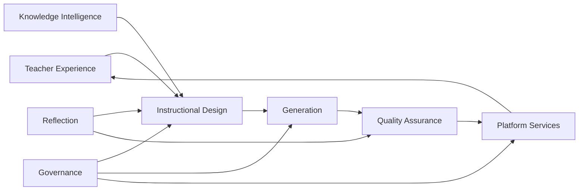
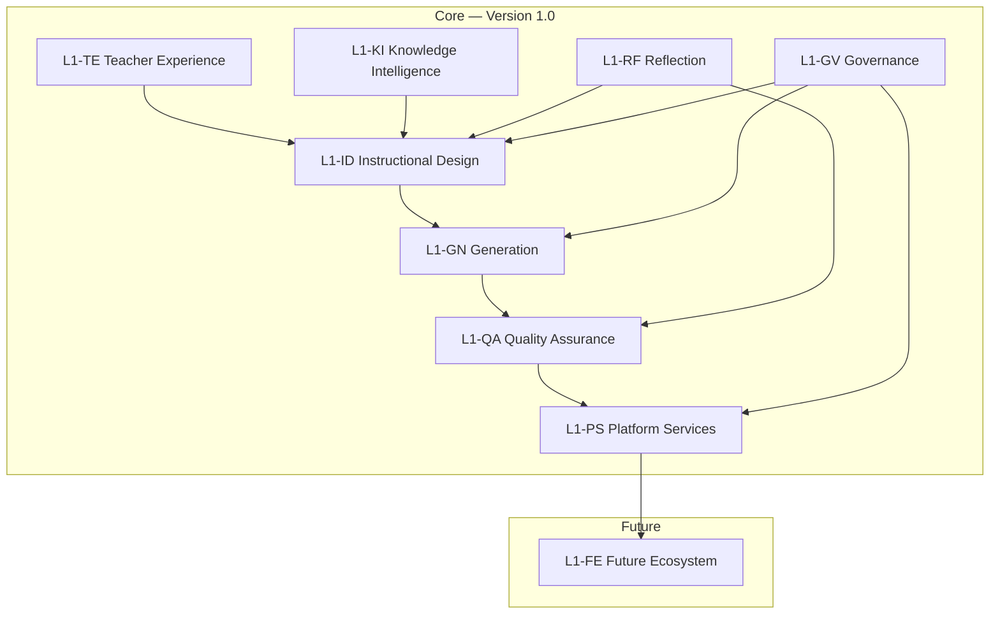
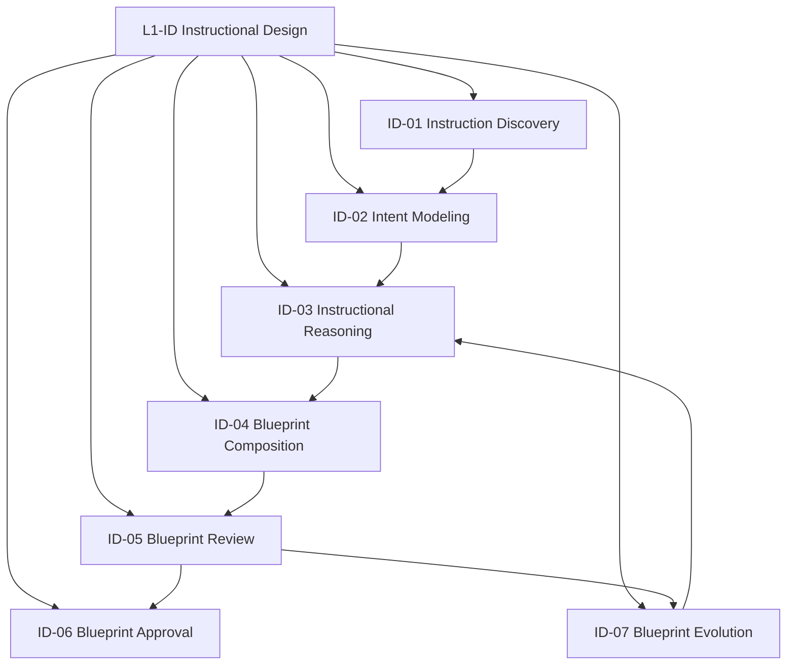
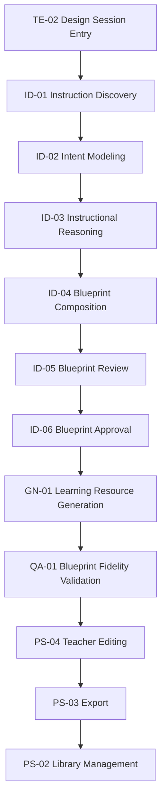
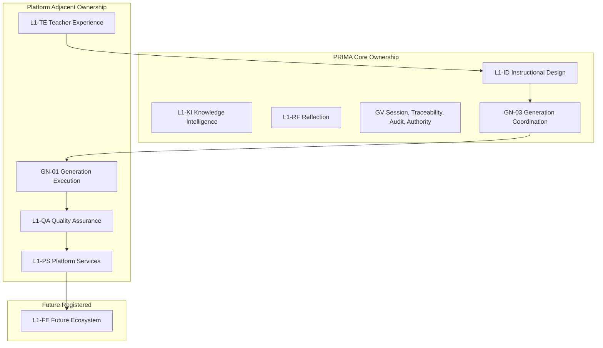
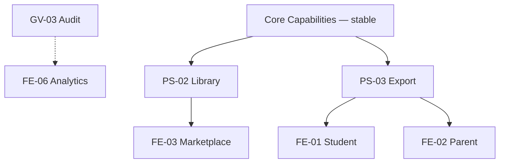

# PRIMA Capability Model

**Version:** 1.0  
**Status:** Official — Enterprise Solution Architecture Specification

---

## Purpose

This document defines the **official business capability model** of the PRIMA platform within LUDI ON — the enduring abilities the platform delivers to teachers, independent of components, engines, workflows, or technology.

It answers one architectural question:

> *What is PRIMA capable of doing?*

Capabilities describe **business value** — what the platform enables teachers to accomplish. They remain stable when implementation, organization, or technology changes completely.

This document does **not** define system boundaries, domain entities, artifact schemas, components, engine behaviour, or implementation.

---

## Scope

| In scope | Out of scope |
|----------|--------------|
| Business capability hierarchy (Level 1 and Level 2) | Component mapping (see Component Model) |
| Full capability catalogue with ownership and dependencies | Engine specifications |
| Capability relationships and collaboration patterns | Workflow state machines (see State Model) |
| Ownership domains and maturity classification | API contracts, UI specifications |
| Cross-cutting capabilities | Infrastructure and deployment |
| Future capability evolution | Detailed artifact field schemas |

**Boundary note:** Capabilities span the LUDI ON instructional design platform. Each capability declares whether PRIMA owns it directly or participates through an adjacent platform system — per [`PRIMA_SYSTEM_CONTEXT.md`](./PRIMA_SYSTEM_CONTEXT.md).

---

## Related Documents

| Document | Relationship |
|----------|--------------|
| [`LUDI_ON_PROJECT_BIBLE.md`](../LUDI_ON_PROJECT_BIBLE.md) | Defines **why** — product intent that capabilities realize |
| [`PRIMA_ARCHITECTURAL_PRINCIPLES.md`](../PRIMA_ARCHITECTURAL_PRINCIPLES.md) | Defines **rules** — principles that constrain capability design |
| [`PRIMA_DOMAIN_MODEL.md`](../PRIMA_DOMAIN_MODEL.md) | Defines **concepts** — domain entities capabilities operate on |
| [`PRIMA_CANONICAL_ARTIFACTS.md`](../PRIMA_CANONICAL_ARTIFACTS.md) | Defines **information** — artifacts capabilities produce and consume |
| [`PRIMA_SYSTEM_CONTEXT.md`](./PRIMA_SYSTEM_CONTEXT.md) | Defines **boundaries** — which capabilities sit inside or outside PRIMA core |
| [`PRIMA_COMPONENT_MODEL.md`](./PRIMA_COMPONENT_MODEL.md) | Next layer — components that implement these capabilities |

**Precedence:** On capability identity, ownership, or dependency conflict, **this document prevails** until officially revised. On boundary conflict, System Context prevails. On entity or artifact identity, Domain Model and Canonical Artifacts prevail.

---

## Why Capability Modeling Exists

### Why enterprise architecture separates capabilities from implementation

Implementation describes *how* work is done. Capabilities describe *what* the organization or platform can accomplish. When teams organize around microservices, engines, or UI modules, business intent becomes buried. A "Conversation Engine refactor" does not tell stakeholders whether teachers can still approve blueprints. Capability modeling preserves **business intent** as the stable layer above every implementation generation.

### Why capabilities survive organizational and technical changes

Teams reorganize. Frameworks change. Model providers rotate. The ability to *partner with a teacher to design a Learning Experience and produce an approved Instructional Blueprint before generation* does not change when React becomes something else or when inference moves from one vendor to another. Capabilities anchor architecture to **enduring value** — not current structure.

### Why capabilities become the foundation for future components

Components implement capabilities — never the reverse. When a new subsystem is proposed, the first question is: *which capability does this serve?* If none, the subsystem is orphan architecture. The capability model is the **allocation basis** for Component Model, Interaction Model, and all downstream technical specifications.

---

## Capability Design Principles

| ID | Principle | Meaning |
|----|-----------|---------|
| **CDP-01 — Business-first** | Capabilities express teacher and platform outcomes — not technical tasks |
| **CDP-02 — Technology independence** | No capability name or definition references vendors, models, or frameworks |
| **CDP-03 — Stable vocabulary** | Capability names remain valid across product generations |
| **CDP-04 — Single responsibility** | Each capability delivers one coherent business ability |
| **CDP-05 — Explicit ownership** | Every capability has one primary ownership domain |
| **CDP-06 — Capability autonomy** | Capabilities collaborate through declared inputs and outputs — not shared implicit state |
| **CDP-07 — Human-centered design** | Capabilities serve teacher workflow — not algorithmic convenience |
| **CDP-08 — Teacher partnership** | Capabilities preserve teacher authority — especially at design approval gates |
| **CDP-09 — No implementation leakage** | Capabilities never describe engines, APIs, databases, or UI components |
| **CDP-10 — Traceable to domain** | Every capability maps to domain concepts — never invents parallel vocabulary |
| **CDP-11 — Artifact-articulated collaboration** | Capability inputs and outputs reference canonical artifacts conceptually |
| **CDP-12 — Design before execution** | Instructional design capabilities complete before generation capabilities activate |

---

## Capability Map

### Level 1 — Capability domains

| L1 ID | Domain | Business intent |
|-------|--------|-----------------|
| **L1-TE** | Teacher Experience | Enable teachers to navigate, enter, and continue instructional design work |
| **L1-ID** | Instructional Design | Partner with teachers to discover intent and compose approved instructional plans |
| **L1-KI** | Knowledge Intelligence | Ground design decisions in authoritative curriculum and pedagogical evidence |
| **L1-GN** | Generation | Transform approved design into editable classroom materials |
| **L1-QA** | Quality Assurance | Measure fidelity and quality before teachers receive output |
| **L1-RF** | Reflection and Explainability | Help teachers understand what was captured, designed, and validated |
| **L1-GV** | Governance | Preserve session integrity, traceability, audit, and teacher authority |
| **L1-PS** | Platform Services | Support continuity, assets, personalization, and configuration |
| **L1-FE** | Future Ecosystem | Registered future abilities — not active in Version 1.0 |

### Level 2 — Decomposition

```
L1-TE  Teacher Experience
       ├── TE-01  Workspace Navigation
       ├── TE-02  Design Session Entry
       └── TE-03  Work Continuation

L1-ID  Instructional Design
       ├── ID-01  Instruction Discovery
       ├── ID-02  Intent Modeling
       ├── ID-03  Instructional Reasoning
       ├── ID-04  Blueprint Composition
       ├── ID-05  Blueprint Review
       ├── ID-06  Blueprint Approval
       └── ID-07  Blueprint Evolution

L1-KI  Knowledge Intelligence
       ├── KI-01  Curriculum Alignment
       └── KI-02  Pedagogical Evidence Access

L1-GN  Generation
       ├── GN-01  Learning Resource Generation
       ├── GN-02  Partial Regeneration
       └── GN-03  Generation Coordination

L1-QA  Quality Assurance
       ├── QA-01  Blueprint Fidelity Validation
       └── QA-02  Pedagogical Quality Validation

L1-RF  Reflection and Explainability
       ├── RF-01  Understanding Mirroring
       ├── RF-02  Design Explainability
       └── RF-03  Quality Finding Presentation

L1-GV  Governance
       ├── GV-01  Session Integrity
       ├── GV-02  Traceability
       ├── GV-03  Audit
       ├── GV-04  Version Lineage
       ├── GV-05  Teacher Authority Enforcement
       └── GV-06  Failure Recovery

L1-PS  Platform Services
       ├── PS-01  Project Continuity
       ├── PS-02  Library Management
       ├── PS-03  Export
       ├── PS-04  Teacher Editing
       ├── PS-05  Personalization
       └── PS-06  Configuration

L1-FE  Future Ecosystem
       ├── FE-01  Student Experience
       ├── FE-02  Parent Experience
       ├── FE-03  Marketplace
       ├── FE-04  Collaboration
       ├── FE-05  School Integration
       ├── FE-06  Analytics
       └── FE-07  Adaptive Learning
```

---

## Capability Catalog

Each entry uses the official capability template. Capabilities are grouped by Level 1 domain.

---

### L1-TE — Teacher Experience

---

#### TE-01 — Workspace Navigation

| Field | Content |
|-------|---------|
| **Name** | Workspace Navigation |
| **Purpose** | Enable teachers to browse activity types, view recommendations, and orient within the creative workspace |
| **Business Value** | Teachers find and initiate work without administrative friction |
| **Primary Responsibilities** | Present activity options; surface recent and recommended work; provide calm entry to design |
| **Inputs (conceptual)** | Teacher identity; project catalogue signals; recommendation hints |
| **Outputs (conceptual)** | Activity selection intent; navigation context |
| **Owner** | Teacher Experience domain — **adjacent platform** (Dashboard System per System Context) |
| **Consumers** | Design Session Entry; Work Continuation |
| **Dependencies** | Configuration (locale defaults) |
| **Non-responsibilities** | Discovery dialogue; blueprint composition; generation |
| **Related Domain Concepts** | Project; Teacher; Platform Configuration |
| **Related Canonical Artifacts** | Session State (read reference) |
| **Architectural Notes** | Outside PRIMA core boundary. PRIMA never hosts workspace navigation. |

---

#### TE-02 — Design Session Entry

| Field | Content |
|-------|---------|
| **Name** | Design Session Entry |
| **Purpose** | Transition teachers deliberately from workspace into focused instructional design partnership |
| **Business Value** | Teachers enter design mode with clear intent — not accidental context switch |
| **Primary Responsibilities** | Initialize or restore design session; bind teacher to Conversation Session |
| **Inputs (conceptual)** | Activity type selection; optional topic hint; resume reference |
| **Outputs (conceptual)** | Active Conversation Session scope; Session State initialization |
| **Owner** | Teacher Experience domain — **shared** (Dashboard initiates; PRIMA receives) |
| **Consumers** | Instruction Discovery; Session Integrity |
| **Dependencies** | Workspace Navigation; Project Continuity (when resuming) |
| **Non-responsibilities** | Pedagogical reasoning; material generation |
| **Related Domain Concepts** | Conversation Session; Project; Teacher |
| **Related Canonical Artifacts** | Session State; Workflow State |
| **Architectural Notes** | Implements "two worlds" transition from System Context. |

---

#### TE-03 — Work Continuation

| Field | Content |
|-------|---------|
| **Name** | Work Continuation |
| **Purpose** | Enable teachers to resume in-progress design or generation from any valid checkpoint |
| **Business Value** | Teachers never lose preparatory work; design sessions fit real schedules |
| **Primary Responsibilities** | Restore session snapshot; route to correct design or execution phase |
| **Inputs (conceptual)** | Project reference; Session State checkpoint |
| **Outputs (conceptual)** | Restored session scope; valid workflow position |
| **Owner** | Platform Services domain — **shared** (Dashboard entry; PRIMA session restore) |
| **Consumers** | All design and generation capabilities |
| **Dependencies** | Session Integrity; Project Continuity |
| **Non-responsibilities** | Silent state merge; gate bypass on resume |
| **Related Domain Concepts** | Conversation Session; Project; Session State |
| **Related Canonical Artifacts** | Session State; Workflow State; Conversation Context |
| **Architectural Notes** | Resume never overwrites approved design without explicit teacher action. |

---

### L1-ID — Instructional Design

---

#### ID-01 — Instruction Discovery

| Field | Content |
|-------|---------|
| **Name** | Instruction Discovery |
| **Purpose** | Capture what the teacher wants students to learn through guided partnership — not forms |
| **Business Value** | Teachers express intent naturally; platform adapts to expertise and classroom context |
| **Primary Responsibilities** | Conduct discovery dialogue; capture topic, constraints, learner context; infer responsibly |
| **Inputs (conceptual)** | Teacher expressions; Memory Context hints; session scope |
| **Outputs (conceptual)** | Conversation Context; discovery completeness signal |
| **Owner** | Instructional Design domain — **PRIMA core** |
| **Consumers** | Intent Modeling; Understanding Mirroring |
| **Dependencies** | Design Session Entry; Personalization (optional) |
| **Non-responsibilities** | Blueprint composition; content generation; student assessment |
| **Related Domain Concepts** | Conversation Session; Teacher; Learning Experience (emerging) |
| **Related Canonical Artifacts** | Conversation Context; Memory Context |
| **Architectural Notes** | Realizes Project Bible principle: Conversation Before Forms. |

---

#### ID-02 — Intent Modeling

| Field | Content |
|-------|---------|
| **Name** | Intent Modeling |
| **Purpose** | Normalize captured dialogue into structured instructional intent ready for reasoning |
| **Business Value** | Design decisions build on explicit, reviewable intent — not ambiguous chat history |
| **Primary Responsibilities** | Consolidate discovery signals; produce normalized Teacher Intent; flag confidence gaps |
| **Inputs (conceptual)** | Conversation Context; teacher corrections |
| **Outputs (conceptual)** | Teacher Intent |
| **Owner** | Instructional Design domain — **PRIMA core** |
| **Consumers** | Instructional Reasoning; Blueprint Composition |
| **Dependencies** | Instruction Discovery (complete) |
| **Non-responsibilities** | Final blueprint authority; generation directives |
| **Related Domain Concepts** | Teacher Intent; Learning Experience |
| **Related Canonical Artifacts** | Teacher Intent; Conversation Context |
| **Architectural Notes** | Intent is capture truth — not design authority. |

---

#### ID-03 — Instructional Reasoning

| Field | Content |
|-------|---------|
| **Name** | Instructional Reasoning |
| **Purpose** | Apply pedagogical logic to transform intent into coherent Learning Experience design decisions |
| **Business Value** | Teachers receive professionally structured design — not raw AI text |
| **Primary Responsibilities** | Apply curriculum-aware strategies; resolve design trade-offs; assemble Decision Context |
| **Inputs (conceptual)** | Teacher Intent; Knowledge Package; Memory Context; Decision Context |
| **Outputs (conceptual)** | Instructional design decisions; Decision Context updates |
| **Owner** | Instructional Design domain — **PRIMA core** |
| **Consumers** | Blueprint Composition; Design Explainability |
| **Dependencies** | Intent Modeling; Curriculum Alignment |
| **Non-responsibilities** | Classroom material writing; export formatting |
| **Related Domain Concepts** | Instructional Blueprint; Instructional Objective; Activity; Decision Context |
| **Related Canonical Artifacts** | Decision Context; Knowledge Package; Revision Directives |
| **Architectural Notes** | Realizes Pedagogy Before Technology. Reasoning completes before generation. |

---

#### ID-04 — Blueprint Composition

| Field | Content |
|-------|---------|
| **Name** | Blueprint Composition |
| **Purpose** | Produce the Instructional Blueprint — the authoritative design contract for the Learning Experience |
| **Business Value** | Teachers receive a complete, structured plan before any material is created |
| **Primary Responsibilities** | Compose objectives, phases, differentiation, assessment, and resource requirements |
| **Inputs (conceptual)** | Decision Context; Instructional reasoning output |
| **Outputs (conceptual)** | Instructional Blueprint (draft); Blueprint Version |
| **Owner** | Instructional Design domain — **PRIMA core** |
| **Consumers** | Blueprint Review; Blueprint Approval; Learning Resource Generation |
| **Dependencies** | Instructional Reasoning |
| **Non-responsibilities** | Worksheet or slide content; teacher approval recording |
| **Related Domain Concepts** | Instructional Blueprint; Blueprint Version; Learning Experience |
| **Related Canonical Artifacts** | Instructional Blueprint; Blueprint Version |
| **Architectural Notes** | Single authoritative blueprint per design iteration (FP-03). |

---

#### ID-05 — Blueprint Review

| Field | Content |
|-------|---------|
| **Name** | Blueprint Review |
| **Purpose** | Present the Instructional Blueprint for teacher understanding before approval decision |
| **Business Value** | Teachers see and comprehend the full design — no hidden pedagogy |
| **Primary Responsibilities** | Present blueprint structure; support section-level review; enable correction requests |
| **Inputs (conceptual)** | Instructional Blueprint; Reflection Report |
| **Outputs (conceptual)** | Review completion signal; revision requests |
| **Owner** | Instructional Design domain — **PRIMA core** |
| **Consumers** | Blueprint Approval; Blueprint Evolution |
| **Dependencies** | Blueprint Composition; Design Explainability |
| **Non-responsibilities** | Auto-approval; generation activation |
| **Related Domain Concepts** | Instructional Blueprint; Teacher |
| **Related Canonical Artifacts** | Instructional Blueprint; Reflection Report |
| **Architectural Notes** | Review is mandatory phase — not skippable for returning teachers without explicit product decision. |

---

#### ID-06 — Blueprint Approval

| Field | Content |
|-------|---------|
| **Name** | Blueprint Approval |
| **Purpose** | Record teacher authority over the Instructional Blueprint before execution begins |
| **Business Value** | Teachers trust the platform because nothing generates without their explicit consent |
| **Primary Responsibilities** | Capture approval decision; lock Blueprint Version; enforce generation gate |
| **Inputs (conceptual)** | Instructional Blueprint; teacher approval action |
| **Outputs (conceptual)** | Teacher Approval; approved Blueprint Version |
| **Owner** | Teacher Interaction domain — **PRIMA core** (teacher authority) |
| **Consumers** | Learning Resource Generation; Generation Coordination; Traceability |
| **Dependencies** | Blueprint Review |
| **Non-responsibilities** | Substituting teacher judgment; conditional auto-approval |
| **Related Domain Concepts** | Teacher; Teacher Approval; Blueprint Version |
| **Related Canonical Artifacts** | Teacher Approval; Blueprint Version; Audit Record |
| **Architectural Notes** | Mandatory gate — no generation without this capability completing. |

---

#### ID-07 — Blueprint Evolution

| Field | Content |
|-------|---------|
| **Name** | Blueprint Evolution |
| **Purpose** | Govern revision of instructional design before or after initial approval |
| **Business Value** | Teachers refine design without losing lineage or bypassing authority |
| **Primary Responsibilities** | Initiate design revision; produce Revision Directives; supersede prior versions with traceability |
| **Inputs (conceptual)** | Teacher revision intent; current Instructional Blueprint |
| **Outputs (conceptual)** | Revision Directives; new Blueprint Version or returned draft state |
| **Owner** | Instructional Design domain — **PRIMA core** |
| **Consumers** | Instructional Reasoning; Blueprint Composition; Partial Regeneration (execution-scoped only) |
| **Dependencies** | Blueprint Review or post-validation design return |
| **Non-responsibilities** | Silent overwrite of approved versions; execution-time pedagogy changes without teacher initiation |
| **Related Domain Concepts** | Instructional Blueprint; Blueprint Version; Revision Directives |
| **Related Canonical Artifacts** | Revision Directives; Blueprint Version; Version Manifest |
| **Architectural Notes** | Approved versions are immutable — evolution produces new version lineage. |

---

### L1-KI — Knowledge Intelligence

---

#### KI-01 — Curriculum Alignment

| Field | Content |
|-------|---------|
| **Name** | Curriculum Alignment |
| **Purpose** | Ensure design decisions reference Romanian primary and preschool curriculum expectations |
| **Business Value** | Activities fit real classroom standards — not generic global templates |
| **Primary Responsibilities** | Match competencies and grade expectations; surface curriculum constraints |
| **Inputs (conceptual)** | Structured knowledge queries within Decision Context |
| **Outputs (conceptual)** | Knowledge Package with curriculum evidence |
| **Owner** | Knowledge domain — **PRIMA core** (consumption); Knowledge Curator (corpus stewardship — external actor) |
| **Consumers** | Instructional Reasoning |
| **Dependencies** | Pedagogical Evidence Access |
| **Non-responsibilities** | Corpus authorship; teacher-specific memory |
| **Related Domain Concepts** | Knowledge Pack; Knowledge Object |
| **Related Canonical Artifacts** | Knowledge Package |
| **Architectural Notes** | PRIMA consumes — never owns curriculum corpus (BR-02). |

---

#### KI-02 — Pedagogical Evidence Access

| Field | Content |
|-------|---------|
| **Name** | Pedagogical Evidence Access |
| **Purpose** | Provide authoritative frameworks, strategies, and domain pedagogy to support reasoning |
| **Business Value** | Design recommendations are evidence-based — not invented |
| **Primary Responsibilities** | Respond to structured pedagogical queries; supply versioned reference evidence |
| **Inputs (conceptual)** | Decision Context query scope |
| **Outputs (conceptual)** | Knowledge Package |
| **Owner** | Knowledge domain — **PRIMA core** |
| **Consumers** | Curriculum Alignment; Instructional Reasoning |
| **Dependencies** | None at runtime — corpus maintained externally |
| **Non-responsibilities** | Teacher personalization; generated content |
| **Related Domain Concepts** | Knowledge Pack; Knowledge Object |
| **Related Canonical Artifacts** | Knowledge Package |
| **Architectural Notes** | Universal shared content — no teacher-specific data in Knowledge domain. |

---

### L1-GN — Generation

---

#### GN-01 — Learning Resource Generation

| Field | Content |
|-------|---------|
| **Name** | Learning Resource Generation |
| **Purpose** | Transform approved Instructional Blueprint into editable draft classroom materials |
| **Business Value** | Teachers receive classroom-ready drafts traceable to their approved design |
| **Primary Responsibilities** | Produce worksheets, presentations, plans, and activity content faithful to blueprint |
| **Inputs (conceptual)** | Approved Blueprint Version; Teacher Approval; Revision Directives |
| **Outputs (conceptual)** | Generation Package; Generated Resource |
| **Owner** | Generation domain — **adjacent platform** (execution); PRIMA coordinates handoff |
| **Consumers** | Blueprint Fidelity Validation; Teacher Editing |
| **Dependencies** | Blueprint Approval |
| **Non-responsibilities** | Pedagogical redesign; publishing to students; blueprint mutation |
| **Related Domain Concepts** | Generation Package; Learning Resource; Instructional Blueprint |
| **Related Canonical Artifacts** | Generation Package; Generated Resource; Blueprint Version |
| **Architectural Notes** | Activates only post-approval. Faithful rendering — not reinterpretation. |

---

#### GN-02 — Partial Regeneration

| Field | Content |
|-------|---------|
| **Name** | Partial Regeneration |
| **Purpose** | Re-execute generation for a scoped resource or section without reopening full design |
| **Business Value** | Teachers fix execution issues without losing approved design or unrelated edits |
| **Primary Responsibilities** | Scope regen to named blocks; preserve approved Blueprint Version binding |
| **Inputs (conceptual)** | Approved Blueprint Version; scoped Revision Directives; block identifiers |
| **Outputs (conceptual)** | Partial Generation Package update |
| **Owner** | Generation domain — **adjacent platform** |
| **Consumers** | Teacher Editing; Quality Validation |
| **Dependencies** | Blueprint Approval (still valid); Learning Resource Generation |
| **Non-responsibilities** | Return to Instructional Reasoning without teacher design initiation |
| **Related Domain Concepts** | Generation Package; Revision Directives |
| **Related Canonical Artifacts** | Revision Directives; Generation Package; Blueprint Version |
| **Architectural Notes** | Design lock maintained — execution scope only. |

---

#### GN-03 — Generation Coordination

| Field | Content |
|-------|---------|
| **Name** | Generation Coordination |
| **Purpose** | Authorize, sequence, and monitor generation execution within the design session |
| **Business Value** | Teachers experience coherent generation flow — not disconnected production events |
| **Primary Responsibilities** | Authorize handoff post-approval; relay progress; route validation findings |
| **Inputs (conceptual)** | Teacher Approval; Blueprint Version; generation mode |
| **Outputs (conceptual)** | Handoff authorization; session progress signals |
| **Owner** | Governance domain — **PRIMA core** |
| **Consumers** | Learning Resource Generation; Failure Recovery |
| **Dependencies** | Blueprint Approval |
| **Non-responsibilities** | Content production; format rendering |
| **Related Domain Concepts** | Conversation Session; Workflow State |
| **Related Canonical Artifacts** | Teacher Approval; Workflow State; Session State |
| **Architectural Notes** | PRIMA authorizes; platform executes. |

---

### L1-QA — Quality Assurance

---

#### QA-01 — Blueprint Fidelity Validation

| Field | Content |
|-------|---------|
| **Name** | Blueprint Fidelity Validation |
| **Purpose** | Measure whether generated materials faithfully implement the approved Instructional Blueprint |
| **Business Value** | Teachers receive output that matches what they approved — not drifted pedagogy |
| **Primary Responsibilities** | Compare Generation Package against Blueprint Version; report fidelity gaps |
| **Inputs (conceptual)** | Generation Package; approved Blueprint Version |
| **Outputs (conceptual)** | Validation Report (fidelity dimension) |
| **Owner** | Validation domain — **adjacent platform** |
| **Consumers** | Quality Finding Presentation; Partial Regeneration; Teacher Editing |
| **Dependencies** | Learning Resource Generation |
| **Non-responsibilities** | Content creation; auto-correction without teacher awareness |
| **Related Domain Concepts** | Validation Report; Validation Rule |
| **Related Canonical Artifacts** | Validation Report; Generation Package; Blueprint Version |
| **Architectural Notes** | Advisory — may block preview on critical findings; never auto-approves. |

---

#### QA-02 — Pedagogical Quality Validation

| Field | Content |
|-------|---------|
| **Name** | Pedagogical Quality Validation |
| **Purpose** | Measure age-appropriateness, completeness, and pedagogical soundness of generated materials |
| **Business Value** | Teachers trust materials meet classroom quality standards |
| **Primary Responsibilities** | Evaluate against pedagogical rules; classify finding severity |
| **Inputs (conceptual)** | Generation Package; approved Blueprint Version; quality rule catalog reference |
| **Outputs (conceptual)** | Validation Report (quality dimension) |
| **Owner** | Validation domain — **adjacent platform** |
| **Consumers** | Quality Finding Presentation; Blueprint Evolution (when design root cause) |
| **Dependencies** | Learning Resource Generation |
| **Non-responsibilities** | Redesigning blueprint; suppressing findings |
| **Related Domain Concepts** | Validation Report; Validation Rule |
| **Related Canonical Artifacts** | Validation Report |
| **Architectural Notes** | Teacher decides action on findings — platform recommends. |

---

### L1-RF — Reflection and Explainability

---

#### RF-01 — Understanding Mirroring

| Field | Content |
|-------|---------|
| **Name** | Understanding Mirroring |
| **Purpose** | Reflect captured intent back to the teacher for confirmation during discovery |
| **Business Value** | Teachers trust PRIMA understood them before design proceeds |
| **Primary Responsibilities** | Summarize captured intent; present mirrors and confirmations |
| **Inputs (conceptual)** | Conversation Context; Teacher Intent |
| **Outputs (conceptual)** | Reflection Report (discovery phase) |
| **Owner** | Teacher Interaction domain — **PRIMA core** |
| **Consumers** | Instruction Discovery; Intent Modeling |
| **Dependencies** | Instruction Discovery (in progress or complete) |
| **Non-responsibilities** | Workflow gating; approval authority |
| **Related Domain Concepts** | Reflection Report; Teacher Intent |
| **Related Canonical Artifacts** | Reflection Report; Conversation Context |
| **Architectural Notes** | Interpretive — never a workflow gate (CR-07 in Canonical Artifacts). |

---

#### RF-02 — Design Explainability

| Field | Content |
|-------|---------|
| **Name** | Design Explainability |
| **Purpose** | Explain instructional design choices when the teacher reviews the blueprint |
| **Business Value** | Teachers approve designs they understand — building professional trust |
| **Primary Responsibilities** | Present reasoning linkage between discovery evidence and blueprint sections |
| **Inputs (conceptual)** | Instructional Blueprint; Decision Context summary |
| **Outputs (conceptual)** | Reflection Report (design phase) |
| **Owner** | Teacher Interaction domain — **PRIMA core** |
| **Consumers** | Blueprint Review |
| **Dependencies** | Blueprint Composition |
| **Non-responsibilities** | Substituting blueprint content; generation |
| **Related Domain Concepts** | Reflection Report; Instructional Blueprint |
| **Related Canonical Artifacts** | Reflection Report; Instructional Blueprint |
| **Architectural Notes** | Transparency at the right moment — not during raw discovery. |

---

#### RF-03 — Quality Finding Presentation

| Field | Content |
|-------|---------|
| **Name** | Quality Finding Presentation |
| **Purpose** | Present validation findings in teacher-comprehensible form |
| **Business Value** | Teachers act on quality issues without interpreting raw compliance data |
| **Primary Responsibilities** | Translate Validation Report into actionable teacher guidance |
| **Inputs (conceptual)** | Validation Report |
| **Outputs (conceptual)** | Reflection Report (validation phase) |
| **Owner** | Teacher Interaction domain — **PRIMA core** |
| **Consumers** | Teacher Editing; Partial Regeneration; Blueprint Evolution |
| **Dependencies** | Blueprint Fidelity Validation; Pedagogical Quality Validation |
| **Non-responsibilities** | Auto-resolution of findings |
| **Related Domain Concepts** | Reflection Report; Validation Report |
| **Related Canonical Artifacts** | Reflection Report; Validation Report |
| **Architectural Notes** | Teacher chooses regen, edit, or design return. |

---

### L1-GV — Governance

---

#### GV-01 — Session Integrity

| Field | Content |
|-------|---------|
| **Name** | Session Integrity |
| **Purpose** | Maintain coherent design session across pause, resume, failure, and context transition |
| **Business Value** | Teachers never lose work or encounter inconsistent session state |
| **Primary Responsibilities** | Checkpoint session; enforce valid workflow position; prevent gate bypass |
| **Inputs (conceptual)** | Subsystem status signals; teacher pause/resume actions |
| **Outputs (conceptual)** | Session State; Workflow State |
| **Owner** | Orchestration domain — **PRIMA core** |
| **Consumers** | Work Continuation; all session capabilities |
| **Dependencies** | Design Session Entry |
| **Non-responsibilities** | Pedagogical content; artifact schema definition |
| **Related Domain Concepts** | Conversation Session; Session State |
| **Related Canonical Artifacts** | Session State; Workflow State |
| **Architectural Notes** | One authoritative Session State per active session. |

---

#### GV-02 — Traceability

| Field | Content |
|-------|---------|
| **Name** | Traceability |
| **Purpose** | Reconstruct full lineage from discovery through export |
| **Business Value** | Teachers and auditors can answer "where did this come from?" |
| **Primary Responsibilities** | Bind artifacts in traceability chain; maintain Version Manifest |
| **Inputs (conceptual)** | All phase artifacts |
| **Outputs (conceptual)** | Version Manifest; traceability references |
| **Owner** | System Governance domain — **PRIMA core** |
| **Consumers** | Library Management; Audit; Design Explainability |
| **Dependencies** | Blueprint Approval; Learning Resource Generation |
| **Non-responsibilities** | External LMS tracking |
| **Related Domain Concepts** | Version Manifest; Conversation Session |
| **Related Canonical Artifacts** | Version Manifest; Audit Record |
| **Architectural Notes** | Chain: Conversation Context → Blueprint Version → Generation Package → Export Package. |

---

#### GV-03 — Audit

| Field | Content |
|-------|---------|
| **Name** | Audit |
| **Purpose** | Record workflow transitions, gate events, overrides, and failures |
| **Business Value** | Platform accountability and post-incident reconstruction |
| **Primary Responsibilities** | Append-only event recording; gate and approval history |
| **Inputs (conceptual)** | Workflow events; Teacher Approval; failure signals |
| **Outputs (conceptual)** | Audit Record |
| **Owner** | System Governance domain — **PRIMA core** |
| **Consumers** | Design Explainability; Failure Recovery; future Analytics |
| **Dependencies** | Session Integrity |
| **Non-responsibilities** | Real-time institutional reporting (future) |
| **Related Domain Concepts** | Audit Record |
| **Related Canonical Artifacts** | Audit Record |
| **Architectural Notes** | Append-only — no silent history mutation. |

---

#### GV-04 — Version Lineage

| Field | Content |
|-------|---------|
| **Name** | Version Lineage |
| **Purpose** | Govern immutability and supersession of blueprint and export versions |
| **Business Value** | Design history is trustworthy — approved versions are never silently overwritten |
| **Primary Responsibilities** | Bind versions; record supersession; enforce immutability rules |
| **Inputs (conceptual)** | Blueprint Version; Export Package; generation bindings |
| **Outputs (conceptual)** | Version Manifest updates; Artifact Metadata |
| **Owner** | System Governance domain — **PRIMA core** |
| **Consumers** | Blueprint Evolution; Library Management; Traceability |
| **Dependencies** | Blueprint Approval |
| **Non-responsibilities** | Git-style merge semantics for design |
| **Related Domain Concepts** | Blueprint Version; Version Manifest |
| **Related Canonical Artifacts** | Version Manifest; Blueprint Version; Artifact Metadata |
| **Architectural Notes** | Approved Blueprint Version is immutable (EV-03). |

---

#### GV-05 — Teacher Authority Enforcement

| Field | Content |
|-------|---------|
| **Name** | Teacher Authority Enforcement |
| **Purpose** | Ensure no execution or persistence proceeds without required teacher authority |
| **Business Value** | Teachers remain designers — not recipients of autogenerated output |
| **Primary Responsibilities** | Enforce approval gate; block unauthorized generation; honour teacher overrides |
| **Inputs (conceptual)** | Teacher Approval; teacher action events |
| **Outputs (conceptual)** | Gate pass/fail signals; Audit Record entries |
| **Owner** | Teacher Interaction domain — **PRIMA core** |
| **Consumers** | Learning Resource Generation; Export; Library Management |
| **Dependencies** | Blueprint Approval capability |
| **Non-responsibilities** | Algorithmic override of teacher decisions |
| **Related Domain Concepts** | Teacher; Teacher Approval |
| **Related Canonical Artifacts** | Teacher Approval; Audit Record |
| **Architectural Notes** | Cross-cutting enforcement — applies at every authority boundary. |

---

#### GV-06 — Failure Recovery

| Field | Content |
|-------|---------|
| **Name** | Failure Recovery |
| **Purpose** | Preserve session state and offer constructive recovery when failures occur |
| **Business Value** | Teachers never lose work to silent failures |
| **Primary Responsibilities** | Classify failure; checkpoint state; present recovery options |
| **Inputs (conceptual)** | Failure signals; Session State |
| **Outputs (conceptual)** | Recovery routing; updated Workflow State |
| **Owner** | Orchestration domain — **PRIMA core** |
| **Consumers** | Work Continuation; Generation Coordination |
| **Dependencies** | Session Integrity; Audit |
| **Non-responsibilities** | Unlimited automatic retry without teacher awareness |
| **Related Domain Concepts** | Conversation Session; Workflow State |
| **Related Canonical Artifacts** | Session State; Audit Record |
| **Architectural Notes** | Detail in Error Model. Fail visible — never silent. |

---

### L1-PS — Platform Services

---

#### PS-01 — Project Continuity

| Field | Content |
|-------|---------|
| **Name** | Project Continuity |
| **Purpose** | Bind Conversation Sessions to durable Project scope for long-running teacher work |
| **Business Value** | Teachers manage preparatory work as projects — not ephemeral chats |
| **Primary Responsibilities** | Associate sessions with projects; support multi-session projects |
| **Inputs (conceptual)** | Teacher identity; project selection or creation |
| **Outputs (conceptual)** | Project reference; session binding |
| **Owner** | Orchestration domain — **adjacent platform** (persistence); PRIMA consumes |
| **Consumers** | Work Continuation; Design Session Entry |
| **Dependencies** | Session Integrity |
| **Non-responsibilities** | Blueprint authority |
| **Related Domain Concepts** | Project; Conversation Session |
| **Related Canonical Artifacts** | Session State |
| **Architectural Notes** | Project is container — Conversation Session is design unit. |

---

#### PS-02 — Library Management

| Field | Content |
|-------|---------|
| **Name** | Library Management |
| **Purpose** | Persist, catalogue, and retrieve teacher-owned activities and exports |
| **Business Value** | Teachers build a reusable personal asset collection over time |
| **Primary Responsibilities** | Store Export Package; index by Version Manifest; support reopen |
| **Inputs (conceptual)** | Export Package; Version Manifest |
| **Outputs (conceptual)** | Library catalogue entries; retrieval references |
| **Owner** | Teacher Interaction domain — **adjacent platform** (Library System) |
| **Consumers** | Work Continuation; Export |
| **Dependencies** | Traceability; Teacher Authority Enforcement |
| **Non-responsibilities** | Instructional design; blueprint storage as authority |
| **Related Domain Concepts** | Export Package; Learning Experience (realized) |
| **Related Canonical Artifacts** | Export Package; Version Manifest |
| **Architectural Notes** | Rejects assets without Version Manifest lineage. |

---

#### PS-03 — Export

| Field | Content |
|-------|---------|
| **Name** | Export |
| **Purpose** | Produce teacher-initiated deliverable bundles for classroom use |
| **Business Value** | Teachers own final materials in usable formats |
| **Primary Responsibilities** | Assemble Export Package from finalized resources; bind lineage |
| **Inputs (conceptual)** | Generated Resource (finalized); Blueprint Version; teacher export decision |
| **Outputs (conceptual)** | Export Package; Version Manifest update |
| **Owner** | Teacher Interaction domain — **shared** (teacher initiates; platform assembles) |
| **Consumers** | Library Management |
| **Dependencies** | Teacher Editing; Teacher Authority Enforcement |
| **Non-responsibilities** | Auto-delivery to LMS or students |
| **Related Domain Concepts** | Export Package; Teacher |
| **Related Canonical Artifacts** | Export Package; Version Manifest |
| **Architectural Notes** | Export formats are implementation — Export Package is domain artifact. |

---

#### PS-04 — Teacher Editing

| Field | Content |
|-------|---------|
| **Name** | Teacher Editing |
| **Purpose** | Enable structured modification of all generated materials before finalization |
| **Business Value** | Teachers finalize — AI drafts; professional ownership preserved |
| **Primary Responsibilities** | Present editable Generated Resources; persist teacher modifications |
| **Inputs (conceptual)** | Generation Package; Validation Report |
| **Outputs (conceptual)** | Generated Resource (teacher-modified) |
| **Owner** | Teacher Interaction domain — **PRIMA session + platform** |
| **Consumers** | Export |
| **Dependencies** | Learning Resource Generation; Quality Assurance (resolved or acknowledged) |
| **Non-responsibilities** | Blueprint redesign during edit (requires Blueprint Evolution) |
| **Related Domain Concepts** | Generated Resource; Learning Resource; Teacher |
| **Related Canonical Artifacts** | Generated Resource; Generation Package |
| **Architectural Notes** | Everything Editable — Project Bible principle. |

---

#### PS-05 — Personalization

| Field | Content |
|-------|---------|
| **Name** | Personalization |
| **Purpose** | Apply teacher-specific context to reduce repetition and improve relevance |
| **Business Value** | Returning teachers experience a platform that remembers — without losing control |
| **Primary Responsibilities** | Supply Memory Context; capture post-session learning signals |
| **Inputs (conceptual)** | Memory Profile; teacher preference settings |
| **Outputs (conceptual)** | Memory Context |
| **Owner** | Memory domain — **PRIMA core** (consumption); Settings (persistence — adjacent) |
| **Consumers** | Instruction Discovery; Instructional Reasoning |
| **Dependencies** | Configuration |
| **Non-responsibilities** | Overriding teacher authority; modifying blueprint content |
| **Related Domain Concepts** | Memory Profile; Memory Context |
| **Related Canonical Artifacts** | Memory Context |
| **Architectural Notes** | Advisory only — never design authority. |

---

#### PS-06 — Configuration

| Field | Content |
|-------|---------|
| **Name** | Configuration |
| **Purpose** | Govern teacher preferences, locale defaults, and memory controls |
| **Business Value** | Teachers control how the platform adapts to them |
| **Primary Responsibilities** | Persist preferences; supply locale and opt-out settings |
| **Inputs (conceptual)** | Teacher settings changes |
| **Outputs (conceptual)** | Preference signals; Memory Profile updates |
| **Owner** | Memory domain — **adjacent platform** (Settings System) |
| **Consumers** | Personalization; Workspace Navigation |
| **Dependencies** | Teacher identity |
| **Non-responsibilities** | Session orchestration; design decisions |
| **Related Domain Concepts** | Platform Configuration; Memory Profile |
| **Related Canonical Artifacts** | Memory Context |
| **Architectural Notes** | Romanian locale default for v1.0. |

---

## Capability Relationships

Capabilities collaborate through **conceptual inputs and outputs** — not through engine invocation or API calls.

### Primary collaboration chain

```
Workspace Navigation → Design Session Entry → Instruction Discovery
      → Intent Modeling → Instructional Reasoning → Blueprint Composition
      → Blueprint Review → Blueprint Approval → Learning Resource Generation
      → Blueprint Fidelity Validation → Teacher Editing → Export → Library Management
```

### Cross-cutting collaboration

| Capability | Collaborates with | Nature |
|--------------|-------------------|--------|
| Personalization | Instruction Discovery, Instructional Reasoning | Advisory enrichment |
| Understanding Mirroring | Instruction Discovery | Confirmation loop |
| Design Explainability | Blueprint Review | Comprehension support |
| Teacher Authority Enforcement | Blueprint Approval, Generation, Export | Gate enforcement |
| Traceability | All phase capabilities | Lineage binding |
| Failure Recovery | Generation Coordination, Work Continuation | State preservation |

### Business collaboration rules

| Rule | Description |
|------|-------------|
| **CR-01** | Instructional Design capabilities complete before Generation capabilities activate |
| **CR-02** | Knowledge capabilities supply evidence — never design authority |
| **CR-03** | Reflection capabilities inform — never gate (except via teacher decision) |
| **CR-04** | Platform Services capabilities never absorb Instructional Design ownership |
| **CR-05** | Future Ecosystem capabilities consume outputs — never enter design arc |



---

## Capability Hierarchy Diagrams

### Diagram 1 — Overall capability landscape



### Diagram 2 — Instructional Design decomposition



### Diagram 3 — Capability dependency (required path)



### Diagram 4 — Capability grouping by ownership



---

## Capability Ownership

Ownership domains align with [`PRIMA_DOMAIN_MODEL.md`](../PRIMA_DOMAIN_MODEL.md) bounded contexts — expressed as business capability stewardship.

| Ownership domain | Capabilities owned | Why this domain exists |
|------------------|-------------------|------------------------|
| **Teacher Interaction** | Blueprint Approval, Teacher Editing, Export initiation, Reflection, Library (adjacent) | Teacher authority is a first-class architectural concern — not delegated to automation |
| **Instructional Design** | Discovery through Blueprint Evolution | Design is PRIMA's core value — must not leak to execution or navigation systems |
| **Knowledge** | Curriculum Alignment, Pedagogical Evidence Access | Universal truth separated from teacher-specific context |
| **Generation** | Learning Resource Generation, Partial Regeneration (adjacent execution) | Execution separated from reasoning — faithful rendering only |
| **Validation** | Fidelity and Quality Validation (adjacent) | Measurement separated from creation |
| **Orchestration** | Session Integrity, Generation Coordination, Failure Recovery, Project Continuity (shared) | Workflow integrity without pedagogical logic |
| **Memory** | Personalization, Configuration (shared) | Teacher context separated from curriculum corpus |
| **System Governance** | Traceability, Audit, Version Lineage, Teacher Authority Enforcement | Compliance and lineage across all domains |
| **Future Platform** | Future Ecosystem capabilities | Registered expansion without boundary mutation |

---

## Capability Dependencies

| Dependency class | Capabilities | Description |
|------------------|--------------|-------------|
| **Required** | ID-06 → GN-01 → QA-01 → PS-04 → PS-03 | Mandatory path to export |
| **Required** | ID-01 → ID-02 → ID-03 → ID-04 | Mandatory design path |
| **Supporting** | KI-01, KI-02 → ID-03 | Evidence for reasoning — not blocking discovery start |
| **Supporting** | PS-05 → ID-01, ID-03 | Personalization enriches — never blocks |
| **Supporting** | RF-01 → ID-01; RF-02 → ID-05 | Explainability supports — never gates alone |
| **Optional** | GN-02 Partial Regeneration | Only when execution scope fails or teacher requests |
| **Independent** | GV-03 Audit | Runs append-only throughout — no upstream blocker |
| **Shared** | GV-01 Session Integrity | Required by all session capabilities |
| **Shared** | GV-05 Teacher Authority Enforcement | Cross-cutting at every gate |

---

## Capability Boundaries

| Capability | Belongs | Never belongs |
|------------|---------|---------------|
| Instruction Discovery | Dialogue capture, inference, confirmation | Blueprint sections, generated text |
| Instructional Reasoning | Pedagogical decisions, strategy selection | Worksheet content, PDF export |
| Blueprint Approval | Teacher authority recording | Automated approval inference |
| Learning Resource Generation | Draft material production | Blueprint mutation, pedagogy change |
| Library Management | Asset catalogue, retrieval | Design session orchestration |
| Personalization | Memory hints | Instructional Blueprint content |
| Workspace Navigation | Activity browsing, entry | PRIMA conversation UI |

**Overlap prevention:** If two capabilities claim the same business ability, merge or split until each has single responsibility (CDP-04). Generation Coordination (PRIMA) vs Learning Resource Generation (platform) is intentional split: authorize vs execute.

---

## Core Capabilities

Strategic capabilities that define PRIMA's product identity for Version 1.0:

| ID | Capability | Strategic role |
|----|------------|----------------|
| ID-01 | Instruction Discovery | Product differentiation — conversation, not forms |
| ID-03 | Instructional Reasoning | Pedagogical intelligence core |
| ID-04 | Blueprint Composition | Design authority artifact |
| ID-06 | Blueprint Approval | Teacher trust gate |
| GN-01 | Learning Resource Generation | Execution value delivery |
| PS-04 | Teacher Editing | Professional ownership |
| GV-05 | Teacher Authority Enforcement | Constitutional enforcement |
| RF-02 | Design Explainability | Trust through transparency |
| GV-02 | Traceability | Auditability and reuse integrity |

Without these nine, LUDI ON ceases to be an AI-assisted **instructional design** platform.

---

## Supporting Capabilities

Secondary capabilities that enable core capabilities but are not product differentiators alone:

| ID | Capability | Supports |
|----|------------|----------|
| GV-01 | Session Integrity | All session capabilities |
| GV-03 | Audit | Traceability, Failure Recovery |
| GV-04 | Version Lineage | Blueprint Evolution, Library |
| GV-06 | Failure Recovery | Generation, Work Continuation |
| PS-01 | Project Continuity | Work Continuation |
| PS-05 | Personalization | Instruction Discovery |
| PS-06 | Configuration | Personalization, Navigation |
| TE-01 | Workspace Navigation | Design Session Entry |
| KI-01 | Curriculum Alignment | Instructional Reasoning |

---

## Capability Maturity

| Maturity | Capabilities | Rationale |
|----------|--------------|-----------|
| **Core** | All L1-ID; ID-06; GN-01, GN-03; QA-01, QA-02; RF-01, RF-02; GV-01, GV-02, GV-05; PS-03, PS-04; TE-02, TE-03 | Required for Lecție end-to-end v1.0 |
| **Supporting** | KI-01, KI-02; RF-03; GV-03, GV-04, GV-06; PS-01, PS-05, PS-06; TE-01; GN-02 | Enhances core — platform incomplete without them but not first demo path |
| **Future** | All L1-FE (FE-01 through FE-07) | Registered — not committed v1.0 |
| **Experimental** | FE-07 Adaptive Learning | Research backlog — no v1.0 design |

---

## Cross-Cutting Capabilities

Capabilities that affect the entire platform — not one phase:

| Capability | Cross-cutting effect |
|------------|-------------------|
| **GV-05 Teacher Authority Enforcement** | Every gate — design, generation, export |
| **GV-02 Traceability** | Every artifact binding |
| **GV-04 Version Lineage** | Every immutable version |
| **GV-01 Session Integrity** | Every pause, resume, failure |
| **RF-* Reflection suite** | Discovery, design, validation phases |
| **PS-05 Personalization** | Discovery and reasoning enrichment |
| **GV-03 Audit** | Append-only across all transitions |

**Teacher Authority** is the supreme cross-cutting concern — no capability may circumvent it.

---

## Capability Matrix

### Capability → Business Value

| Capability | Business value |
|------------|----------------|
| Instruction Discovery | Teachers express intent naturally — reduced form fatigue |
| Blueprint Approval | Trust — no surprise generation |
| Learning Resource Generation | Time saved on material preparation |
| Teacher Editing | Professional ownership of final output |
| Traceability | Reuse confidence; audit readiness |
| Library Management | Long-term asset accumulation |

### Capability → Domain

| Capability | Primary domain |
|------------|----------------|
| ID-03 Instructional Reasoning | Instructional Design |
| KI-01 Curriculum Alignment | Knowledge |
| GN-01 Learning Resource Generation | Generation |
| QA-01 Blueprint Fidelity Validation | Validation |
| GV-01 Session Integrity | Orchestration |
| PS-05 Personalization | Memory |
| GV-05 Teacher Authority Enforcement | Teacher Interaction |

### Capability → Canonical Artifacts

| Capability | Primary artifacts |
|------------|-------------------|
| ID-01 Instruction Discovery | Conversation Context |
| ID-02 Intent Modeling | Teacher Intent |
| ID-04 Blueprint Composition | Instructional Blueprint, Blueprint Version |
| ID-06 Blueprint Approval | Teacher Approval |
| GN-01 Learning Resource Generation | Generation Package, Generated Resource |
| QA-01 Blueprint Fidelity Validation | Validation Report |
| PS-03 Export | Export Package |
| GV-02 Traceability | Version Manifest |
| GV-03 Audit | Audit Record |

### Capability → Actors

| Capability | Primary actor |
|------------|---------------|
| ID-05 Blueprint Review | Teacher |
| ID-06 Blueprint Approval | Teacher |
| PS-04 Teacher Editing | Teacher |
| KI-01 Curriculum Alignment | Knowledge Curator (indirect) |
| GV-03 Audit | Product Team (review); Teacher (beneficiary) |

### Capability → Future Evolution

| Core capability | Future extension |
|-----------------|------------------|
| Library Management | Marketplace (FE-03) |
| Export | School Integration delivery (FE-05) |
| Traceability | Analytics (FE-06) |
| Instruction Discovery | Collaboration co-design (FE-04) — post-v1.0 product decision |

---

## Future Capability Evolution

Future capabilities **connect to outputs** of core capabilities — they do not modify Instructional Design ownership.

| Future capability | Integration pattern | Core capabilities unchanged |
|-------------------|--------------------|-----------------------------|
| **FE-01 Student Experience** | Consumes Export Package via teacher publish | ID-*, GN-*, PS-03 remain |
| **FE-02 Parent Experience** | Reads summaries from exported content | No PRIMA session access |
| **FE-03 Marketplace** | Shares Library entries between teachers | PS-02 extended — not ID-* |
| **FE-04 Collaboration** | Co-editing post-export materials | Design arc remains single-teacher v1.0 |
| **FE-05 School Integration** | Identity/policy adjacency | TE-* extended — not ID-* |
| **FE-06 Analytics** | Read-only Audit and Version Manifest aggregation | GV-03 consumption only |
| **FE-07 Adaptive Learning** | Experimental — may consume Memory Profile | Requires Principles review before Core promotion |



---

## Governance

### Capability ownership authority

| Role | Authority |
|------|-----------|
| **LUDI ON Product Team** | Official capability registry; maturity classification; retirement |
| **Lead Capability Architect** | Propose new capabilities; overlap analysis |
| **Architectural review** | Mandatory for Core promotion from Experimental |

### Introducing new capabilities

1. Propose in session log with business value statement  
2. Verify no overlap with existing capability (CDP-04)  
3. Assign ownership domain and maturity class  
4. Map to domain concepts and canonical artifacts  
5. Update Component Model to implement — not precede — capability registration  

### Retiring capabilities

Capabilities are retired when product scope explicitly excludes them — never silently. Retirement requires version bump, dependent spec alignment, and migration path for any implemented components.

### Overlap prevention

Quarterly capability registry review. Any component that cannot map to a registered capability triggers architectural review.

---

## Compliance Rules

| ID | Rule |
|----|------|
| **CAP-CR-01** | Components implement capabilities — capabilities never implement components |
| **CAP-CR-02** | Capabilities never describe technology, engines, APIs, or databases |
| **CAP-CR-03** | Every component must map to at least one registered capability |
| **CAP-CR-04** | No capability overlap without documented boundary split |
| **CAP-CR-05** | Core capabilities cannot depend on Future capabilities |
| **CAP-CR-06** | Capability definitions reference domain concepts — never invent parallel terms |
| **CAP-CR-07** | Capability inputs/outputs align with Canonical Artifacts — not ad hoc payloads |
| **CAP-CR-08** | New features must identify target capability before Component Model update |
| **CAP-CR-09** | Future capabilities register in L1-FE before any implementation exploration |
| **CAP-CR-10** | Capability Model prevails on capability identity conflict until officially revised |

---

## Summary

The Capability Model defines the **enduring business abilities** of the PRIMA platform within LUDI ON — **38 registered Level 2 capabilities** across nine Level 1 domains, classified as Core, Supporting, Future, or Experimental.

The enterprise architecture stack:

```
Project Bible ..................... WHY
Architectural Principles .......... RULES
Domain Model ...................... CONCEPTS
Canonical Artifacts ............... INFORMATION
System Context .................... BOUNDARIES
Capability Model (this document) .... ABILITIES
```

All downstream architecture — Component Model, Interaction Model, State Model, Error Model, engine specifications, and Technical Architecture — **must derive from these capabilities**. Components implement capabilities. Capabilities never describe implementation.

**The platform can** partner with teachers to discover intent, reason pedagogically, compose and approve Instructional Blueprints, generate faithful classroom materials, validate quality, and deliver teacher-owned exports with full traceability — regardless of how it is built.

---

## Next Recommended Document

→ [`PRIMA_COMPONENT_MODEL.md`](./PRIMA_COMPONENT_MODEL.md) — Logical components that implement these capabilities.
