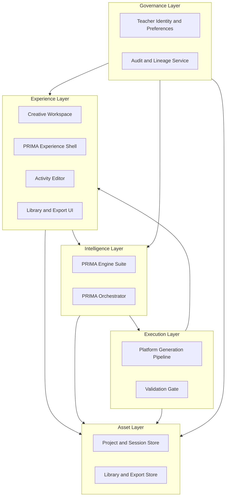
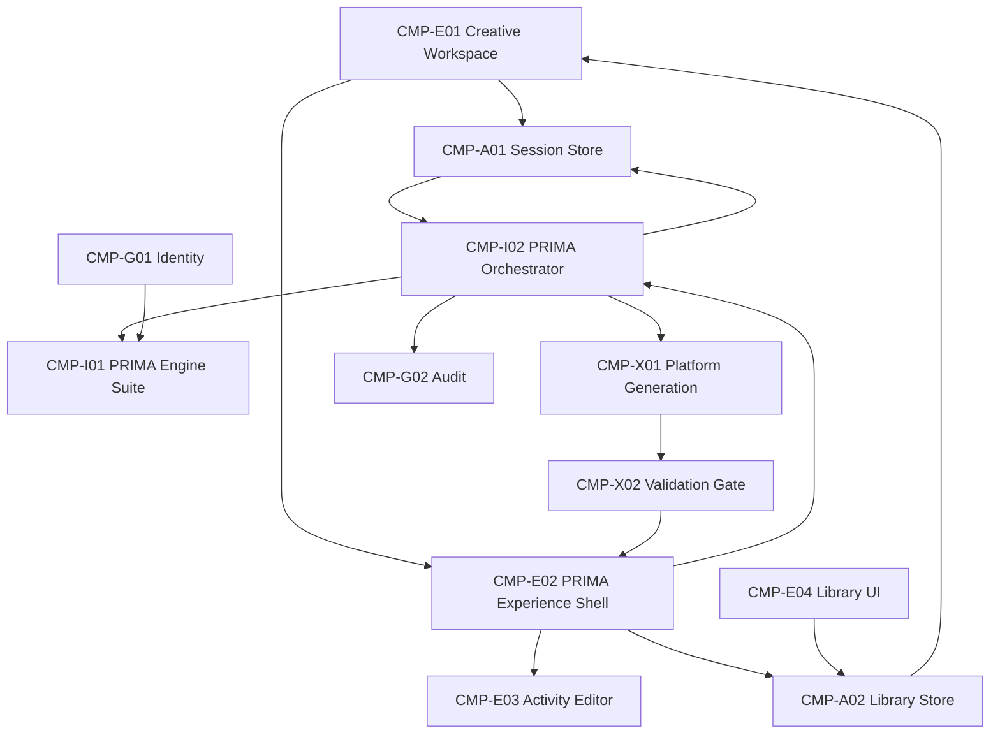

# PRIMA Component Model

**Version:** 1.0  
**Status:** Official — Enterprise Solution Architecture Specification

---

## Purpose

This document defines the **logical components** that compose the LUDI ON solution — their responsibilities, layers, domain alignment, and boundary rules.

It answers one question:

> *What components compose the solution, and what is each responsible for?*

Components are **logical building blocks** — not microservices, classes, or deployment units.

---

## Scope

| In scope | Out of scope |
|----------|--------------|
| Component catalogue and layers | Interaction flows (see Interaction Model) |
| Responsibility and boundary rules | State transitions (see State Model) |
| Capability-to-component mapping | Error routing (see Error Model) |
| Domain alignment | Implementation mapping |

---

## Solution Layer Model

| Layer | Responsibility | Must not |
|-------|----------------|----------|
| **Experience** | Teacher-facing surfaces; collect approvals and edits | Contain pedagogical reasoning or generation logic |
| **Intelligence** | Discover, reason, compose blueprint; coordinate design session | Generate materials without Teacher Approval |
| **Execution** | Render approved blueprint into draft resources | Mutate Instructional Blueprint |
| **Asset** | Persist teacher-owned sessions, projects, library items | Store untraceable artifacts |
| **Governance** | Identity, audit, version lineage | Make pedagogical decisions |

---

## Component Catalogue

### Experience Layer

| ID | Component | Responsibility | Primary capabilities |
|----|-----------|----------------|----------------------|
| **CMP-E01** | Creative Workspace | Activity selection, resume entry, recommendations display | CAP-P01, CAP-P03 |
| **CMP-E02** | PRIMA Experience Shell | Host PRIMA design and generation UI without Dashboard chrome | CAP-D01–D03, CAP-E01–E03 |
| **CMP-E03** | Activity Editor | Structured editing of Generated Resources | CAP-E03 |
| **CMP-E04** | Library and Export UI | Browse, open, duplicate library items; initiate export | CAP-P02, CAP-E03 |

### Intelligence Layer

| ID | Component | Responsibility | Primary capabilities |
|----|-----------|----------------|----------------------|
| **CMP-I01** | PRIMA Engine Suite | Conversation, Reflection, Decision, Knowledge, Memory, Prompt, Generation coordination | CAP-D01–D03, CAP-P03 |
| **CMP-I02** | PRIMA Orchestrator | Design session workflow, gates, artifact routing, state synthesis | CAP-G01, CAP-G03 |

**PRIMA Engine Suite** sub-components (logical, not separate deployment units):

| Engine | Domain | Role |
|--------|--------|------|
| Conversation | Instructional Design | Discovery dialogue and capture |
| Reflection | Teacher Interaction | Mirroring and interpretive presentation |
| Decision | Instructional Design | Pedagogical reasoning and blueprint composition |
| Knowledge | Knowledge | Curriculum and framework evidence |
| Memory | Memory | Personalization hints |
| Prompt | Teacher Interaction | Teacher-facing expression |
| Generation (PRIMA) | Generation | Handoff coordination to Platform Execution |

### Execution Layer

| ID | Component | Responsibility | Primary capabilities |
|----|-----------|----------------|----------------------|
| **CMP-X01** | Platform Generation Pipeline | Post-approval content and resource production | CAP-E01 |
| **CMP-X02** | Validation Gate | Blueprint fidelity and quality measurement | CAP-E02 |

Platform Generation Pipeline sub-modules (logical):

| Module | Role |
|--------|------|
| Pedagogy validation | Blueprint conformance before content |
| Content production | Learner-facing content from blueprint |
| Resource production | Worksheets, slides, PDFs |
| Platform validation | Final quality gate |

### Asset Layer

| ID | Component | Responsibility | Primary capabilities |
|----|-----------|----------------|----------------------|
| **CMP-A01** | Project and Session Store | In-progress sessions, Conversation Context, draft blueprints | CAP-P01, CAP-G01 |
| **CMP-A02** | Library and Export Store | Export Packages, Version Manifests, completed activities | CAP-P02, CAP-G02 |

### Governance Layer

| ID | Component | Responsibility | Primary capabilities |
|----|-----------|----------------|----------------------|
| **CMP-G01** | Teacher Identity and Preferences | Account, memory controls, locale | CAP-P03 |
| **CMP-G02** | Audit and Lineage Service | Audit Record, Version Manifest, Artifact Metadata | CAP-G02 |

---

## Component Boundary Rules

| ID | Rule |
|----|------|
| **CMP-R01** | CMP-E01 never hosts PRIMA conversation UI. |
| **CMP-R02** | CMP-I01 never invokes CMP-X01 without Teacher Approval artifact. |
| **CMP-R03** | CMP-X01 never mutates Instructional Blueprint or Blueprint Version. |
| **CMP-R04** | CMP-E03 operates on Generated Resources — not blueprint reasoning state. |
| **CMP-R05** | CMP-A02 accepts only artifacts bound to Version Manifest. |
| **CMP-R06** | CMP-I02 is sole artifact router within PRIMA Solution Zone. |
| **CMP-R07** | CMP-G01 supplies Memory Context — never Blueprint content. |
| **CMP-R08** | CMP-I02 and CMP-X01 maintain separate orchestration scopes — sequential, not nested. |
| **CMP-R09** | No component reads another component's internal state — only canonical artifacts. |
| **CMP-R10** | Experience components delegate all intelligence to Intelligence Layer. |

---

## Component-to-Domain Alignment

| Component | Primary domain(s) |
|-----------|-------------------|
| CMP-E01, CMP-E04 | Orchestration, Teacher Interaction |
| CMP-E02, CMP-E03 | Teacher Interaction |
| CMP-I01 | Instructional Design, Knowledge, Memory |
| CMP-I02 | Orchestration |
| CMP-X01, CMP-X02 | Generation, Validation |
| CMP-A01 | Orchestration |
| CMP-A02 | Teacher Interaction |
| CMP-G01 | Memory, Teacher Interaction |
| CMP-G02 | System Governance |

Full domain definitions: [`PRIMA_DOMAIN_MODEL.md`](../PRIMA_DOMAIN_MODEL.md).

---

## Capability-to-Component Mapping

| Capability | Primary component(s) |
|------------|---------------------|
| CAP-P01 Activity Lifecycle | CMP-E01, CMP-I02, CMP-A01 |
| CAP-P02 Teacher Assets | CMP-A02, CMP-E04 |
| CAP-P03 Personalization | CMP-G01, CMP-I01 (Memory) |
| CAP-D01 Intent Discovery | CMP-I01 (Conversation, Reflection, Prompt) |
| CAP-D02 Pedagogical Reasoning | CMP-I01 (Decision, Knowledge) |
| CAP-D03 Blueprint Governance | CMP-I01 (Decision), CMP-E02, CMP-I02 |
| CAP-E01 Generation | CMP-X01, CMP-I01 (Generation handoff) |
| CAP-E02 Validation | CMP-X02 |
| CAP-E03 Editing and Export | CMP-E03, CMP-E04, CMP-A02 |
| CAP-G01 Session Integrity | CMP-I02, CMP-A01 |
| CAP-G02 Traceability | CMP-G02, CMP-A02 |
| CAP-G03 Failure Recovery | CMP-I02 |

---

## Orchestration Scopes

| Component | Orchestration scope |
|-----------|---------------------|
| **CMP-I02 PRIMA Orchestrator** | Discovery → Reasoning → Approval → Generation handoff → Validation routing → Export initiation |
| **CMP-X01 Platform Generation Pipeline** | Post-approval: Pedagogy → Content → Resource → Platform validation |

PRIMA Orchestrator **completes the design contract** before Platform Generation Pipeline activates. Platform orchestration does not reverse into PRIMA design phases.

---

## Component Dependency Graph

---

## Future Component Evolution

| May add | Requires |
|---------|----------|
| Scenario Studio component | Component Model amendment + Capability Model update |
| AI Teaching Assistant (lightweight) | New boundary rules for partial PRIMA invocation |
| Student Portal component | System Context boundary expansion |

| Must remain stable | Rationale |
|--------------------|-----------|
| CMP-I02 as sole PRIMA router | AP-02 star topology |
| CMP-X01 post-approval only | Design–execution separation |
| CMP-E01 / CMP-E02 context split | Two worlds principle |

---

## Summary

The LUDI ON solution comprises **twelve logical components** across five layers — Experience, Intelligence, Execution, Asset, and Governance. PRIMA Orchestrator and Platform Generation Pipeline maintain separate orchestration scopes. All cross-component communication uses canonical artifacts.

---

## Next Recommended Document

→ [`PRIMA_INTERACTION_MODEL.md`](./PRIMA_INTERACTION_MODEL.md) — How components interact and exchange artifacts.
