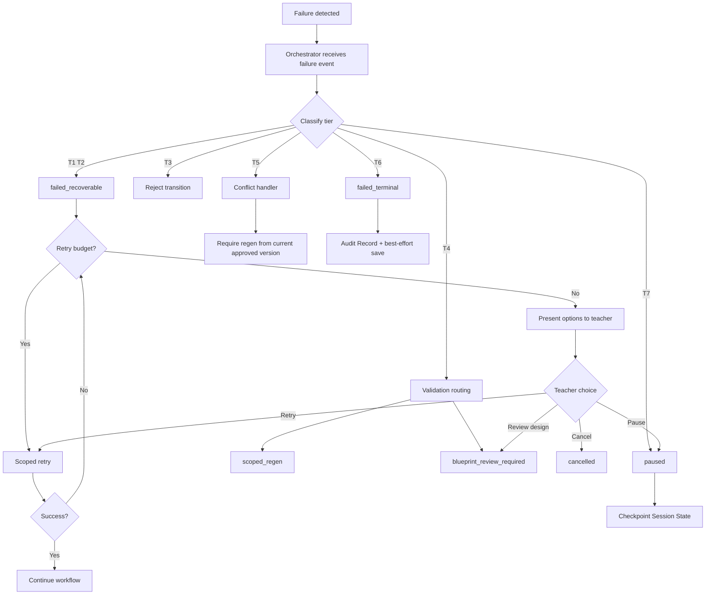

# PRIMA Error Model

**Version:** 1.0  
**Status:** Official — Enterprise Solution Architecture Specification

---

## Purpose

This document defines how the LUDI ON solution **classifies, routes, surfaces, and recovers from failures** — ensuring no silent degradation and preserving teacher authority during error conditions.

It answers one question:

> *When something fails, what happens — and who decides what to do next?*

This document defines **solution-level failure behaviour** — not HTTP status codes, exception classes, or logging formats.

---

## Scope

| In scope | Out of scope |
|----------|--------------|
| Error classification taxonomy | Implementation error types |
| Failure routing and recovery paths | Monitoring alert rules (Technical Architecture) |
| Teacher-facing failure principles | Retry algorithms and backoff timing |
| State preservation on failure | Stack traces, log schemas |
| Orchestrator recovery coordination | Infrastructure failover |

---

## Error Philosophy

| Principle | Meaning |
|-----------|---------|
| **Fail visible** | Teachers always know when something failed — no silent fallback |
| **Preserve state** | Failures checkpoint Session State — no data loss on recoverable errors |
| **Teacher decides** | Recovery options presented to teacher — platform does not auto-abandon work |
| **Scope failures** | Failures bound to engine scope — whole session not discarded for partial failure |
| **No gate bypass** | Recovery never skips Teacher Approval or Blueprint gates |
| **Explainable** | Teacher receives human-readable explanation via Prompt Engine |
| **Audit everything** | Failures recorded in Audit Record with scope and recovery outcome |

---

## Error Classification

### Tier 1 — Recoverable Engine Failure

| Field | Content |
|-------|---------|
| **Definition** | Engine scope failed; retry may succeed; session state intact |
| **Examples** | Generation timeout, validation processing error, Knowledge query timeout |
| **Workflow transition** | → `failed_recoverable` |
| **Teacher impact** | Retry, pause, or cancel offered |
| **State preservation** | Full Session State checkpoint |

### Tier 2 — Scoped Partial Failure

| Field | Content |
|-------|---------|
| **Definition** | Subset of generation scope failed; other blocks succeeded |
| **Examples** | Worksheet generated; quiz generation failed |
| **Workflow transition** | Remain in `generating` or → `failed_recoverable` for failed scope |
| **Teacher impact** | Preview completed blocks; retry failed scope only |
| **State preservation** | Partial Generation Package retained |

### Tier 3 — Gate Failure

| Field | Content |
|-------|---------|
| **Definition** | Preconditions for phase transition not met |
| **Examples** | Generation attempted without Teacher Approval; discovery incomplete before reasoning |
| **Workflow transition** | Transition **rejected** — remain in current state |
| **Teacher impact** | Prompt explains missing gate; no false progress |
| **State preservation** | Unchanged |

### Tier 4 — Validation Block

| Field | Content |
|-------|---------|
| **Definition** | Validation Report contains critical findings blocking preview |
| **Examples** | Age-inappropriate content; blueprint fidelity breach |
| **Workflow transition** | `validating` → `generating` (scoped regen) OR `review` (design issue) |
| **Teacher impact** | Findings presented; teacher chooses regen or design review |
| **State preservation** | Validation Report retained; Blueprint Version unchanged |

### Tier 5 — Conflict Failure

| Field | Content |
|-------|---------|
| **Definition** | Artifact version mismatch or concurrent modification conflict |
| **Examples** | Blueprint Version ≠ Generation binding version; stale Session State |
| **Workflow transition** | Block operation; → `failed_recoverable` or require refresh |
| **Teacher impact** | Explain conflict; offer regen from current approved version |
| **State preservation** | No overwrite of approved artifacts |

### Tier 6 — Terminal Failure

| Field | Content |
|-------|---------|
| **Definition** | Retry exhausted; unrecoverable corruption; teacher cancels recovery |
| **Examples** | Max retries exceeded; session data unrecoverable |
| **Workflow transition** | → `failed_terminal` or `cancelled` |
| **Teacher impact** | Option to save draft if available; return to Workspace |
| **State preservation** | Best-effort draft save; Audit Record complete |

### Tier 7 — Session Timeout

| Field | Content |
|-------|---------|
| **Definition** | Inactivity or platform hold exceeds policy threshold |
| **Examples** | Teacher away; long-running engine await |
| **Workflow transition** | → `paused` |
| **Teacher impact** | Resume or cancel on return |
| **State preservation** | Full checkpoint |

---

## Error Classification Matrix

| Tier | Name | Retry? | Teacher action required? | Gate bypass? |
|------|------|:------:|:------------------------:|:------------:|
| T1 | Recoverable engine failure | Yes | Optional | No |
| T2 | Scoped partial failure | Scoped | Optional | No |
| T3 | Gate failure | No | Yes (complete gate) | No |
| T4 | Validation block | Scoped | Yes | No |
| T5 | Conflict failure | Conditional | Yes | No |
| T6 | Terminal failure | No | Yes (acknowledge) | No |
| T7 | Session timeout | N/A | On resume | No |

---

## Failure Routing Model

All failures route through **PRIMA Orchestrator** — engines report failure; Orchestrator classifies and transitions.

---

## Recovery Actions

| Action | Description | Available when |
|--------|-------------|----------------|
| **Scoped retry** | Re-execute failed engine scope | T1, T2 — within retry budget |
| **Pause** | Checkpoint and hold session | T1, T7, teacher request |
| **Resume** | Restore from Session State checkpoint | `paused` state |
| **Rollback to stable** | Revert to last stable Workflow State (e.g., `approved` before regen) | T1 failed regen |
| **Scoped regen** | Re-run generation for failed blocks only | T2, T4 |
| **Design review return** | Transition to `review` for blueprint correction | T4 — design root cause |
| **Cancel** | Terminal session cancel; optional draft save | Any recoverable state |
| **Refresh from approved** | Rebind Generation to current Blueprint Version | T5 conflict |
| **Teacher override** | Proceed despite non-critical validation findings | T4 — advisory findings only |

---

## Failure Scenarios

### Scenario: Generation engine failure

| Step | Behaviour |
|------|-----------|
| 1 | Generation Pipeline reports `generation_failed` |
| 2 | Orchestrator classifies T1 → `failed_recoverable` |
| 3 | Session State checkpoint written |
| 4 | Prompt Engine presents explanation + options |
| 5 | Teacher chooses retry → scoped retry within budget |
| 6 | Retry exhausted → teacher chooses pause, cancel, or design review |
| 7 | Audit Record captures failure scope and recovery path |

### Scenario: Critical validation block

| Step | Behaviour |
|------|-----------|
| 1 | Validation Gate returns Validation Report with critical findings |
| 2 | Orchestrator classifies T4 |
| 3 | Preview blocked until resolved |
| 4 | If execution issue → `scoped_regen` |
| 5 | If design issue → `blueprint_review_required` → `review` |
| 6 | Teacher Approval **not** invalidated unless teacher initiates design change |

### Scenario: Blueprint version conflict

| Step | Behaviour |
|------|-----------|
| 1 | Generation binding Blueprint Version ≠ current approved version |
| 2 | Orchestrator classifies T5 |
| 3 | Operation blocked |
| 4 | Teacher offered regen from current approved Blueprint Version |
| 5 | No silent use of stale or draft blueprint |

### Scenario: Session timeout

| Step | Behaviour |
|------|-----------|
| 1 | Inactivity threshold exceeded |
| 2 | Orchestrator classifies T7 → `paused` |
| 3 | Full Session State checkpoint |
| 4 | Teacher notified on return via Workspace |
| 5 | Resume restores exact checkpoint — no gate bypass |

### Scenario: Teacher cancellation

| Step | Behaviour |
|------|-----------|
| 1 | Teacher emits `teacher_cancelled` |
| 2 | Orchestrator terminates active engines safely |
| 3 | Optional draft save if Instructional Blueprint or partial Generation exists |
| 4 | → `cancelled` terminal state |
| 5 | Audit Record captures cancellation |

---

## Error Ownership

| Failure domain | Primary owner | Escalation |
|----------------|---------------|------------|
| Conversation / Discovery | Conversation Engine → Orchestrator | Teacher retry or pause |
| Reasoning / Blueprint | Decision Engine → Orchestrator | Design review return |
| Generation execution | Platform Generation Pipeline → Orchestrator | Scoped retry or regen |
| Validation | Validation Gate → Orchestrator | Regen or design review |
| State / Conflict | Orchestrator | Refresh from approved |
| Session / Timeout | Orchestrator | Pause and resume |
| Export | Export flow → Orchestrator | Retry export |

Engines **report** failures. Orchestrator **routes**. Teacher **decides** recovery path (within offered options).

---

## Teacher-Facing Error Principles

| Rule | Description |
|------|-------------|
| **ERR-T01** | All teacher-facing error messages via Prompt Engine — Romanian, calm, non-technical |
| **ERR-T02** | Never expose internal engine names or stack information |
| **ERR-T03** | Always offer at least one constructive path forward (retry, pause, review) |
| **ERR-T04** | Never auto-cancel session without teacher acknowledgement |
| **ERR-T05** | Partial success always shown before retry prompt |
| **ERR-T06** | Gate failures explain what is missing — not generic "error occurred" |

---

## Audit and Explainability on Failure

Every failure produces Audit Record entries:

| Recorded | Purpose |
|----------|---------|
| Failure tier and classification | Post-incident analysis |
| Engine scope and artifact refs | Reconstruction |
| Workflow State at failure | State model validation |
| Recovery action taken | Explainability |
| Teacher decision | Authority trace |
| Retry count | Policy enforcement |

Orchestrator enables Reflection Engine to answer: *"Why did generation stop?"* — referencing Audit Record evidence.

---

## Error Constraints

| ID | Constraint |
|----|------------|
| **ERR-C01** | No failure path bypasses Teacher Approval gate. |
| **ERR-C02** | Recovery never silently overwrites approved Blueprint Version. |
| **ERR-C03** | Terminal failure always attempts best-effort draft preservation. |
| **ERR-C04** | Retry budget enforced by Orchestrator — not unbounded engine retry. |
| **ERR-C05** | Gate failures never advance Workflow State. |
| **ERR-C06** | Validation critical blocks require explicit teacher resolution. |
| **ERR-C07** | All failures recorded in Audit Record before session close. |

---

## Relationship with Technical Architecture

Technical Architecture documents (Monitoring, Events, API) **implement** this error model — they do not redefine it.

| Solution concept | Technical mapping (future) |
|------------------|---------------------------|
| Failure event | Events specification |
| Audit Record | Storage + Monitoring |
| Retry budget | API / orchestration policy |
| Teacher notification | API + Experience Layer |
| Session checkpoint | Storage |

---

## Summary

Failures classify into **seven tiers** — from recoverable engine errors to terminal failure. PRIMA Orchestrator routes all failures, preserves state, and presents recovery options to the teacher. No silent failure. No gate bypass. Every failure auditable.

---

## Next Recommended Document

→ [`../../technical/SYSTEM_ARCHITECTURE.md`](../../technical/SYSTEM_ARCHITECTURE.md) — Technical Architecture overview and implementation mapping.
