# PRIMA Interaction Model

**Version:** 1.0  
**Status:** Official — Enterprise Solution Architecture Specification

---

## Purpose

This document defines **how PRIMA components collaborate** to deliver business capabilities — the conceptual interactions, collaboration patterns, artifact handoffs, and authority flows that connect logical components without prescribing implementation.

It answers one architectural question:

> *How do PRIMA components collaborate to deliver business capabilities?*

Interactions describe **collaboration** — who initiates, who participates, what artifacts cross boundaries, and what business outcome results. They do not describe APIs, protocols, queues, or code.

---

## Scope

| In scope | Out of scope |
|----------|--------------|
| Interaction catalogue with business purpose and artifact bindings | Component responsibilities (see Component Model) |
| Collaboration domains and patterns | Capability definitions (see Capability Model) |
| Interaction lifecycle and constraints | Workflow state enums (see State Model) |
| Interaction matrices (component, capability, artifact, actor) | Error classification detail (see Error Model) |
| Cross-cutting and future interaction evolution | HTTP, REST, gRPC, messaging, databases |
| Governance and compliance for interactions | Engine internal behaviour |

---

## Related Documents

| Document | Relationship |
|----------|--------------|
| [`PRIMA_COMPONENT_MODEL.md`](./PRIMA_COMPONENT_MODEL.md) | Defines **components** — this document defines how they collaborate |
| [`PRIMA_CAPABILITY_MODEL.md`](./PRIMA_CAPABILITY_MODEL.md) | Defines **abilities** — interactions realize capabilities |
| [`PRIMA_CANONICAL_ARTIFACTS.md`](../PRIMA_CANONICAL_ARTIFACTS.md) | Defines **information contracts** — interactions consume and produce artifacts |
| [`PRIMA_SYSTEM_CONTEXT.md`](./PRIMA_SYSTEM_CONTEXT.md) | Defines **boundaries** — interactions respect subsystem and system perimeter |
| [`PRIMA_ARCHITECTURAL_PRINCIPLES.md`](../PRIMA_ARCHITECTURAL_PRINCIPLES.md) | **AP-03** artifact-based communication governs all interactions |

**Precedence:** On interaction identity, collaboration rules, or artifact handoff conflict at the solution layer, **this document prevails** until officially revised. On artifact identity, Canonical Artifacts prevail. On component boundaries, Component Model and System Context prevail.

---

## Why Interaction Modeling Exists

### Why collaboration is modeled separately from components

Components answer *who is responsible*. Interactions answer *how responsibility is fulfilled together*. A component catalogue alone cannot tell an architect whether Dashboard hands state directly to Generation, or whether Teacher Approval sits between design and execution. Interaction modeling makes **collaboration explicit** — the connective tissue between static structure and dynamic teacher journey.

### Why explicit interactions reduce coupling

When collaboration is undocumented, teams invent direct dependencies — shared buffers, implicit state, shortcut calls. Explicit interactions constrain collaboration to **declared artifact handoffs** and **named participation roles**. Components remain replaceable because their collaboration surface is documented independently of their internal structure.

### Why interaction models remain stable despite implementation changes

Implementation chooses transport, sequencing technology, and deployment topology. The business fact that *Instructional Design Workspace produces Instructional Blueprint and Teacher Approval must precede Generation Handoff* does not change when the platform moves from monolith to distributed services. Interaction models describe **enduring collaboration contracts** — stable for years, independent of technology generation.

---

## Interaction Principles

| ID | Principle | Meaning |
|----|-----------|---------|
| **IP-01 — Artifact-based collaboration** | Components collaborate through canonical artifacts — never shared implicit state |
| **IP-02 — Loose coupling** | Participants know handoff contracts — not each other's internals |
| **IP-03 — Single responsibility** | Each interaction serves one business purpose |
| **IP-04 — Explicit authority** | Every interaction declares who holds decision authority |
| **IP-05 — Deterministic collaboration** | Same collaboration context + same teacher action → same interaction outcome |
| **IP-06 — Teacher-centered interaction** | Teacher-facing interactions preserve partnership — not form submission |
| **IP-07 — No hidden communication** | Every cross-component collaboration is registered in this document |
| **IP-08 — Orchestrated coordination** | Session Governance mediates Intelligence and Execution collaborations |
| **IP-09 — Technology independence** | Interactions describe roles and artifacts — not transport or protocol |
| **IP-10 — Capability realization** | Every interaction maps to at least one business capability |
| **IP-11 — Advisory non-gating** | Reflection and validation interactions inform — they do not replace approval |
| **IP-12 — Fail-visible collaboration** | Failed interactions surface to teacher — no silent handoff drop |

---

## Interaction Landscape

Collaboration domains map internal subsystems from [`PRIMA_SYSTEM_CONTEXT.md`](./PRIMA_SYSTEM_CONTEXT.md) to logical components from [`PRIMA_COMPONENT_MODEL.md`](./PRIMA_COMPONENT_MODEL.md).

| Collaboration domain | Components / subsystems | Collaboration responsibility |
|---------------------|-------------------------|------------------------------|
| **Teacher ↔ PRIMA Experience** | Teacher ↔ CMP-E02 (PRIMA Experience Shell) | Capture teacher actions; present design and progress |
| **Workspace ↔ PRIMA Entry** | CMP-E01 ↔ CMP-E02 | Deliberate session entry and exit |
| **Experience ↔ Conversation** | CMP-E02 ↔ Conversation Environment (within CMP-I01) | Discovery dialogue and intent capture |
| **Conversation ↔ Instructional Design** | Conversation Environment ↔ Instructional Design Workspace | Normalize intent; initiate reasoning |
| **Instructional Design ↔ Reflection** | Instructional Design Workspace ↔ Reflection Environment | Present reasoning; mirror understanding |
| **Instructional Design ↔ Teacher Approval** | Instructional Design Workspace ↔ CMP-E02 ↔ Teacher | Blueprint review and authority recording |
| **Instructional Design ↔ Generation** | Instructional Design Workspace ↔ Generation Coordination ↔ CMP-X01 | Post-approval execution handoff |
| **Generation ↔ Validation** | CMP-X01 ↔ CMP-X02 | Quality measurement on produced materials |
| **Validation ↔ Reflection ↔ Teacher** | CMP-X02 ↔ Reflection Environment ↔ CMP-E02 ↔ Teacher | Present findings; teacher decides action |
| **Generation ↔ Editing** | Generation Coordination ↔ CMP-E03 (Activity Editor) | Teacher refinement of drafts |
| **Experience ↔ Library** | CMP-E02 / CMP-E04 ↔ CMP-A02 | Export persistence and re-open |
| **Governance ↔ All** | CMP-I02 (Session Governance) ↔ all participants | Gate enforcement, routing, checkpoint, audit |
| **Identity ↔ Session** | CMP-G01 ↔ CMP-I02 | Teacher context binding — not design content |
| **Lineage ↔ Assets** | CMP-G02 ↔ CMP-A02 | Version Manifest and traceability on save |

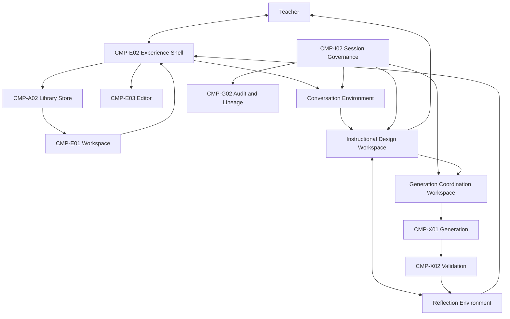

---

## Interaction Catalog

Each interaction uses the official template. Interactions are identified as **INT-{category}-{sequence}**.

---

### Teacher Interactions

---

#### INT-TE-01 — Design Session Entry

| Field | Content |
|-------|---------|
| **Interaction Name** | Design Session Entry |
| **Purpose** | Transfer teacher from creative workspace into focused instructional design partnership |
| **Initiator** | Teacher (via CMP-E01 Creative Workspace) |
| **Participants** | CMP-E01, CMP-E02, CMP-I02, CMP-A01 |
| **Business Goal** | Begin or resume governed design session with explicit context transition |
| **Consumed Capabilities** | TE-02 Design Session Entry; GV-01 Session Integrity |
| **Produced Capabilities** | TE-03 Work Continuation (when resuming) |
| **Consumed Artifacts** | Project reference; Session State (on resume) |
| **Produced Artifacts** | Session State; Workflow State (initialization) |
| **Authority** | Teacher initiates; Session Governance assigns session scope |
| **Constraints** | Two-worlds separation — Dashboard chrome must not persist in PRIMA Experience |
| **Expected Outcome** | Active Conversation Session bound to teacher and activity type |
| **Failure Considerations** | Stale Session State → governed refresh; no silent merge |
| **Architectural Notes** | Realizes System Context transition: Workspace → PRIMA Experience |

---

#### INT-TE-02 — Discovery Partnership

| Field | Content |
|-------|---------|
| **Interaction Name** | Discovery Partnership |
| **Purpose** | Co-construct instructional intent through dialogue |
| **Initiator** | Session Governance (activates Conversation Environment after entry) |
| **Participants** | Teacher, CMP-E02, Conversation Environment, Reflection Environment, CMP-G01 (Memory Context) |
| **Business Goal** | Capture what teacher wants students to learn — without forms |
| **Consumed Capabilities** | ID-01 Instruction Discovery; PS-05 Personalization; RF-01 Understanding Mirroring |
| **Produced Capabilities** | ID-02 Intent Modeling |
| **Consumed Artifacts** | Memory Context; teacher expressions |
| **Produced Artifacts** | Conversation Context; Reflection Report (mirrors); Teacher Intent (at completion) |
| **Authority** | Teacher confirms or corrects; PRIMA infers responsibly |
| **Constraints** | No blueprint composition during pure discovery |
| **Expected Outcome** | Discovery-complete signal with normalized Teacher Intent |
| **Failure Considerations** | Incomplete discovery blocks reasoning handoff (GV-01) |
| **Architectural Notes** | Conversation Before Forms — Project Bible principle |

---

#### INT-TE-03 — Blueprint Review Partnership

| Field | Content |
|-------|---------|
| **Interaction Name** | Blueprint Review Partnership |
| **Purpose** | Enable teacher to understand full Instructional Blueprint before approval decision |
| **Initiator** | Session Governance (on blueprint draft ready) |
| **Participants** | Teacher, CMP-E02, Instructional Design Workspace, Reflection Environment |
| **Business Goal** | Teacher comprehends design — objectives, phases, differentiation, assessment |
| **Consumed Capabilities** | ID-05 Blueprint Review; RF-02 Design Explainability |
| **Produced Capabilities** | ID-06 Blueprint Approval OR ID-07 Blueprint Evolution |
| **Consumed Artifacts** | Instructional Blueprint; Reflection Report |
| **Produced Artifacts** | Review completion signal; revision request (if editing) |
| **Authority** | Teacher — Reflection Report is advisory only |
| **Constraints** | Reflection never substitutes approval |
| **Expected Outcome** | Teacher ready to approve, revise, or reject design |
| **Failure Considerations** | Teacher exit → session pause via INT-GV-02 |
| **Architectural Notes** | Transparency at the right moment — not during raw discovery |

---

#### INT-TE-04 — Blueprint Approval Decision

| Field | Content |
|-------|---------|
| **Interaction Name** | Blueprint Approval Decision |
| **Purpose** | Record teacher authority over Instructional Blueprint before execution |
| **Initiator** | Teacher (via CMP-E02) |
| **Participants** | Teacher, CMP-E02, CMP-I02, Instructional Design Workspace, CMP-G02 |
| **Business Goal** | Explicit teacher consent before any classroom material is produced |
| **Consumed Capabilities** | ID-06 Blueprint Approval; GV-05 Teacher Authority Enforcement |
| **Produced Capabilities** | GN-03 Generation Coordination; GN-01 Learning Resource Generation (handoff) |
| **Consumed Artifacts** | Instructional Blueprint; teacher approval action |
| **Produced Artifacts** | Teacher Approval; Blueprint Version (`approved`); Audit Record |
| **Authority** | Teacher exclusively — no automated approval |
| **Constraints** | Mandatory gate — INT-GN-01 cannot begin without this interaction completing |
| **Expected Outcome** | Approved Blueprint Version locked; generation authorized |
| **Failure Considerations** | Rejection routes to INT-ID-01 Blueprint Evolution |
| **Architectural Notes** | Highest authority interaction in design arc |

---

#### INT-TE-05 — Resource Editing Partnership

| Field | Content |
|-------|---------|
| **Interaction Name** | Resource Editing Partnership |
| **Purpose** | Enable teacher structured modification of generated drafts |
| **Initiator** | Teacher (via CMP-E03 Activity Editor) |
| **Participants** | Teacher, CMP-E03, CMP-E02, Generation Coordination Workspace |
| **Business Goal** | Teacher finalizes materials — AI drafts, teacher owns outcome |
| **Consumed Capabilities** | PS-04 Teacher Editing |
| **Produced Capabilities** | PS-03 Export |
| **Consumed Artifacts** | Generation Package; Generated Resource |
| **Produced Artifacts** | Generated Resource (teacher-modified) |
| **Authority** | Teacher owns all edits |
| **Constraints** | Editing does not mutate Instructional Blueprint |
| **Expected Outcome** | Teacher-satisfied draft ready for export |
| **Failure Considerations** | Scoped regen via INT-GN-02 preserves unrelated edits |
| **Architectural Notes** | Everything Editable — Project Bible principle |

---

### Component Collaborations

---

#### INT-ID-01 — Intent-to-Design Handoff

| Field | Content |
|-------|---------|
| **Interaction Name** | Intent-to-Design Handoff |
| **Purpose** | Transfer normalized intent to instructional reasoning |
| **Initiator** | Session Governance (on discovery complete) |
| **Participants** | Conversation Environment, Instructional Design Workspace, CMP-I02 |
| **Business Goal** | Begin pedagogical reasoning on explicit Teacher Intent |
| **Consumed Capabilities** | ID-02 Intent Modeling; ID-03 Instructional Reasoning |
| **Produced Capabilities** | ID-04 Blueprint Composition |
| **Consumed Artifacts** | Teacher Intent; Memory Context; Knowledge Package (via query) |
| **Produced Artifacts** | Decision Context; Instructional Blueprint (draft) |
| **Authority** | Instructional Design Workspace owns design truth |
| **Constraints** | Knowledge Package is evidence — not design authority |
| **Expected Outcome** | Instructional Blueprint draft ready for review |
| **Failure Considerations** | Reasoning failure → INT-GV-03 Failure Recovery |
| **Architectural Notes** | Mediated exclusively through Session Governance |

---

#### INT-ID-02 — Blueprint Evolution Collaboration

| Field | Content |
|-------|---------|
| **Interaction Name** | Blueprint Evolution Collaboration |
| **Purpose** | Govern instructional design revision without losing lineage |
| **Initiator** | Teacher (revision request) or Validation (design root cause return) |
| **Participants** | Instructional Design Workspace, Reflection Environment, CMP-I02, CMP-G02 |
| **Business Goal** | Revise design with traceable Revision Directives |
| **Consumed Capabilities** | ID-07 Blueprint Evolution |
| **Produced Capabilities** | ID-03 Instructional Reasoning; ID-05 Blueprint Review |
| **Consumed Artifacts** | Instructional Blueprint; teacher revision intent |
| **Produced Artifacts** | Revision Directives; new Blueprint Version or draft state |
| **Authority** | Teacher initiates; design workspace composes |
| **Constraints** | Approved versions immutable — evolution creates new version |
| **Expected Outcome** | Updated draft for re-review |
| **Failure Considerations** | Cannot silently overwrite approved version |
| **Architectural Notes** | Separates design return from execution regen (INT-GN-02) |

---

#### INT-GN-01 — Generation Handoff

| Field | Content |
|-------|---------|
| **Interaction Name** | Generation Handoff |
| **Purpose** | Authorize platform execution of approved instructional design |
| **Initiator** | Session Governance (on Teacher Approval recorded) |
| **Participants** | CMP-I02, Generation Coordination Workspace, CMP-X01, CMP-G02 |
| **Business Goal** | Produce classroom drafts faithful to approved Blueprint Version |
| **Consumed Capabilities** | GN-03 Generation Coordination; GN-01 Learning Resource Generation |
| **Produced Capabilities** | QA-01 Blueprint Fidelity Validation |
| **Consumed Artifacts** | Blueprint Version (`approved`); Teacher Approval; Revision Directives |
| **Produced Artifacts** | Generation Package; Generation progress signals |
| **Authority** | Session Governance authorizes; CMP-X01 executes |
| **Constraints** | CMP-X01 never mutates Blueprint Version; design locked |
| **Expected Outcome** | Generation Package ready for validation |
| **Failure Considerations** | Handoff failure → INT-GV-03; no gate bypass retry |
| **Architectural Notes** | PRIMA–Platform boundary interaction per System Context |

---

#### INT-GN-02 — Scoped Regeneration Collaboration

| Field | Content |
|-------|---------|
| **Interaction Name** | Scoped Regeneration Collaboration |
| **Purpose** | Re-execute generation for defined scope without reopening design |
| **Initiator** | Teacher or Session Governance (post-validation routing) |
| **Participants** | CMP-E02, CMP-E03, CMP-I02, CMP-X01, CMP-X02 |
| **Business Goal** | Fix execution issues while preserving approved design and unrelated edits |
| **Consumed Capabilities** | GN-02 Partial Regeneration |
| **Produced Capabilities** | QA-01; PS-04 Teacher Editing |
| **Consumed Artifacts** | Blueprint Version (`approved`); scoped Revision Directives; block identifiers |
| **Produced Artifacts** | Partial Generation Package update; Validation Report |
| **Authority** | Teacher approves regen scope; design remains locked |
| **Constraints** | Instructional Design Workspace not reactivated |
| **Expected Outcome** | Updated scope validated; other edits preserved |
| **Failure Considerations** | Retry budget governed by Failure Recovery interaction |
| **Architectural Notes** | Execution-only collaboration |

---

#### INT-QA-01 — Validation Collaboration

| Field | Content |
|-------|---------|
| **Interaction Name** | Validation Collaboration |
| **Purpose** | Measure blueprint fidelity and pedagogical quality of generated materials |
| **Initiator** | Session Governance (on generation scope complete) |
| **Participants** | CMP-X01, CMP-X02, CMP-I02, Reflection Environment |
| **Business Goal** | Ensure materials match approved design before teacher preview |
| **Consumed Capabilities** | QA-01 Blueprint Fidelity Validation; QA-02 Pedagogical Quality Validation |
| **Produced Capabilities** | RF-03 Quality Finding Presentation; PS-04 Teacher Editing |
| **Consumed Artifacts** | Generation Package; Blueprint Version |
| **Produced Artifacts** | Validation Report |
| **Authority** | Validation measures; teacher decides action on findings |
| **Constraints** | Validation Report advisory — may block preview, never auto-approves |
| **Expected Outcome** | Teacher receives actionable quality assessment |
| **Failure Considerations** | Critical findings → INT-GN-02 or INT-ID-02 based on root cause |
| **Architectural Notes** | Validation never creates content |

---

#### INT-PS-01 — Export and Library Persistence

| Field | Content |
|-------|---------|
| **Interaction Name** | Export and Library Persistence |
| **Purpose** | Persist teacher-owned deliverable with full lineage |
| **Initiator** | Teacher (export decision via CMP-E02) |
| **Participants** | CMP-E02, CMP-E04, CMP-A02, CMP-G02, CMP-I02 |
| **Business Goal** | Save reusable activity with traceable provenance |
| **Consumed Capabilities** | PS-03 Export; PS-02 Library Management; GV-02 Traceability |
| **Produced Capabilities** | TE-03 Work Continuation (future reopen) |
| **Consumed Artifacts** | Generated Resource (finalized); Blueprint Version |
| **Produced Artifacts** | Export Package; Version Manifest; Audit Record |
| **Authority** | Teacher initiates export; Lineage Service binds manifest |
| **Constraints** | CMP-A02 rejects assets without Version Manifest |
| **Expected Outcome** | Library entry with full traceability chain |
| **Failure Considerations** | Export failure → retry without lineage corruption |
| **Architectural Notes** | Platform-adjacent persistence — outside PRIMA design core |

---

#### INT-PS-02 — Session Resume Collaboration

| Field | Content |
|-------|---------|
| **Interaction Name** | Session Resume Collaboration |
| **Purpose** | Restore governed session from checkpoint |
| **Initiator** | Teacher (via CMP-E01 continue working) |
| **Participants** | CMP-E01, CMP-A01, CMP-I02, CMP-E02 |
| **Business Goal** | Continue design or generation without data loss or gate bypass |
| **Consumed Capabilities** | TE-03 Work Continuation; GV-01 Session Integrity |
| **Produced Capabilities** | Context-appropriate design or execution capabilities |
| **Consumed Artifacts** | Session State; Workflow State; artifact references |
| **Produced Artifacts** | Restored session scope; reactivated collaboration path |
| **Authority** | Session Governance validates checkpoint integrity |
| **Constraints** | Approved design not restored as draft; gates re-validated |
| **Expected Outcome** | Teacher returns to exact valid collaboration point |
| **Failure Considerations** | Conflict → governed refresh from approved version |
| **Architectural Notes** | Resume binding pattern — never silent merge |

---

#### INT-PS-03 — Library Re-open Collaboration

| Field | Content |
|-------|---------|
| **Interaction Name** | Library Re-open Collaboration |
| **Purpose** | Return saved activity to edit or new design iteration |
| **Initiator** | Teacher (via CMP-E04) |
| **Participants** | CMP-E04, CMP-A02, CMP-E02, CMP-I02 |
| **Business Goal** | Reuse or extend prior work with lineage preserved |
| **Consumed Capabilities** | PS-02 Library Management; TE-02 Design Session Entry OR PS-04 Teacher Editing |
| **Produced Capabilities** | Branch-appropriate downstream capabilities |
| **Consumed Artifacts** | Export Package; Version Manifest |
| **Produced Artifacts** | New Conversation Session (design iteration) OR restored edit scope |
| **Authority** | Teacher chooses continue-edit vs new-iteration path |
| **Constraints** | Original Version Manifest immutable |
| **Expected Outcome** | Governed re-entry without shadow overwrite |
| **Failure Considerations** | Missing manifest → re-open rejected |
| **Architectural Notes** | Two paths: execution continue vs new design iteration |

---

### Governance Interactions

---

#### INT-GV-01 — Session Checkpoint Collaboration

| Field | Content |
|-------|---------|
| **Interaction Name** | Session Checkpoint Collaboration |
| **Purpose** | Preserve session integrity on pause, exit, or failure |
| **Initiator** | Session Governance (CMP-I02) |
| **Participants** | CMP-I02, CMP-A01, CMP-G02, all active collaborators |
| **Business Goal** | Enable resume and audit without collaboration state loss |
| **Consumed Capabilities** | GV-01 Session Integrity; GV-03 Audit |
| **Produced Capabilities** | TE-03 Work Continuation |
| **Consumed Artifacts** | Subsystem collaboration status; Workflow State |
| **Produced Artifacts** | Session State checkpoint; Audit Record entry |
| **Authority** | Session Governance exclusively writes Session State |
| **Constraints** | Checkpoint on every pause; append-only audit |
| **Expected Outcome** | Durable snapshot for INT-PS-02 |
| **Failure Considerations** | Checkpoint failure → fail-visible to teacher |
| **Architectural Notes** | Cross-cutting — applies to all session interactions |

---

#### INT-GV-02 — Gate Enforcement Collaboration

| Field | Content |
|-------|---------|
| **Interaction Name** | Gate Enforcement Collaboration |
| **Purpose** | Block downstream collaboration until authority preconditions satisfied |
| **Initiator** | Session Governance (evaluates before each phase transition) |
| **Participants** | CMP-I02, Artifact Coordination, initiating collaborator |
| **Business Goal** | Preserve design-before-execution and teacher authority |
| **Consumed Capabilities** | GV-05 Teacher Authority Enforcement |
| **Produced Capabilities** | Downstream interaction authorization or rejection |
| **Consumed Artifacts** | Teacher Approval; Workflow State; gate preconditions |
| **Produced Artifacts** | Gate pass/reject signal; Audit Record |
| **Authority** | Session Governance enforces; teacher provides approval artifacts |
| **Constraints** | INT-GN-01 blocked without INT-TE-04; no override |
| **Expected Outcome** | Only authorized collaborations proceed |
| **Failure Considerations** | Gate failure → teacher notified with missing precondition |
| **Architectural Notes** | Deterministic — same state, same gate result |

---

#### INT-GV-03 — Failure Recovery Collaboration

| Field | Content |
|-------|---------|
| **Interaction Name** | Failure Recovery Collaboration |
| **Purpose** | Route collaboration failure to constructive recovery options |
| **Initiator** | Session Governance (on collaborator failure signal) |
| **Participants** | CMP-I02, CMP-E02, CMP-G02, Teacher |
| **Business Goal** | Preserve work; offer retry, pause, rollback, or cancel |
| **Consumed Capabilities** | GV-06 Failure Recovery |
| **Produced Capabilities** | Context-appropriate retry collaboration |
| **Consumed Artifacts** | Session State; failure scope descriptor |
| **Produced Artifacts** | Updated Workflow State; Audit Record; teacher recovery options |
| **Authority** | Teacher selects recovery path from offered options |
| **Constraints** | No silent retry; no gate bypass on recovery |
| **Expected Outcome** | Collaboration resumes or session pauses safely |
| **Failure Considerations** | Terminal failure → best-effort draft save |
| **Architectural Notes** | Detail classification in Error Model |

---

#### INT-GV-04 — Traceability Binding Collaboration

| Field | Content |
|-------|---------|
| **Interaction Name** | Traceability Binding Collaboration |
| **Purpose** | Bind artifacts in lineage chain at each phase transition |
| **Initiator** | Session Governance / CMP-G02 (on phase completion) |
| **Participants** | CMP-G02, CMP-I02, CMP-A02 |
| **Business Goal** | Maintain reconstructable path discovery → export |
| **Consumed Capabilities** | GV-02 Traceability; GV-04 Version Lineage |
| **Produced Capabilities** | PS-02 Library Management integrity |
| **Consumed Artifacts** | Phase artifacts (Blueprint Version, Generation Package, etc.) |
| **Produced Artifacts** | Version Manifest updates; Artifact Metadata |
| **Authority** | Lineage Service owns manifest binding rules |
| **Constraints** | Every Export Package requires complete chain |
| **Expected Outcome** | End-to-end lineage documented |
| **Failure Considerations** | Incomplete chain blocks library write |
| **Architectural Notes** | Cross-cutting at approval, generation, export |

---

## Interaction Categories

| Category | Interactions | Nature |
|----------|--------------|--------|
| **Teacher interactions** | INT-TE-01 through INT-TE-05 | Human authority and partnership |
| **Component collaborations** | INT-ID-01, INT-ID-02, INT-GN-01, INT-GN-02, INT-QA-01, INT-PS-01–03 | Artifact-mediated subsystem collaboration |
| **Governance interactions** | INT-GV-01 through INT-GV-04 | Gates, checkpoint, recovery, lineage |
| **Artifact lifecycle interactions** | Embedded in all — produce/consume per registry | Governed by Artifact Coordination |
| **Approval interactions** | INT-TE-04, INT-GV-02 | Teacher authority gates |
| **Validation interactions** | INT-QA-01 | Measurement → teacher decision |
| **Future ecosystem interactions** | Registered — not active v1.0 | See Future Interaction Evolution |

---

## Collaboration Patterns

Recurring patterns — multiple interactions instantiate the same pattern.

| Pattern | Description | When applied | Example interactions |
|---------|-------------|--------------|---------------------|
| **Discovery** | Dialogue capture → intent normalization | Session start through discovery complete | INT-TE-02 |
| **Review** | Present design for teacher comprehension | Blueprint draft ready | INT-TE-03 |
| **Approval** | Record teacher authority before downstream action | Pre-generation gate | INT-TE-04, INT-GV-02 |
| **Handoff** | Authorized transfer across system boundary | Post-approval execution | INT-GN-01 |
| **Generation** | Faithful execution of approved design | After approval | INT-GN-01, INT-GN-02 |
| **Validation** | Measure without creating | Post-generation | INT-QA-01 |
| **Reflection** | Interpretive presentation — non-gating | Discovery, review, validation | INT-TE-02, INT-TE-03, INT-QA-01 |
| **Export** | Teacher-initiated persistence with lineage | Post-edit finalization | INT-PS-01 |
| **Governance** | Checkpoint, gate, audit, recovery | Cross-cutting | INT-GV-01–04 |
| **Resume** | Restore collaboration from snapshot | Pause/continue | INT-PS-02 |

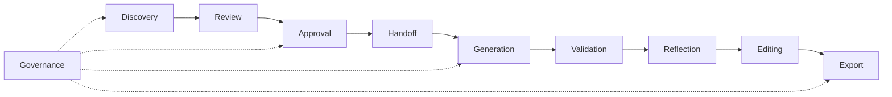

---

## Interaction Lifecycle

Every collaboration progresses through conceptual lifecycle phases — independent of implementation sequencing technology.

| Phase | Description | Governance role |
|-------|-------------|-----------------|
| **1 — Initiation** | Initiator requests collaboration; Session Governance validates preconditions | Gate check |
| **2 — Authorization** | Session Governance confirms Workflow State permits interaction | INT-GV-02 |
| **3 — Participation** | Participants fulfill roles; produce/consume artifacts | Pattern execution |
| **4 — Artifact exchange** | Artifact Coordination delivers canonical handoffs | AP-03 enforcement |
| **5 — Completion** | Business outcome achieved; Audit Record appended | INT-GV-01, INT-GV-04 |
| **6 — Transition** | Session Governance advances Workflow State or routes recovery | Next interaction or INT-GV-03 |

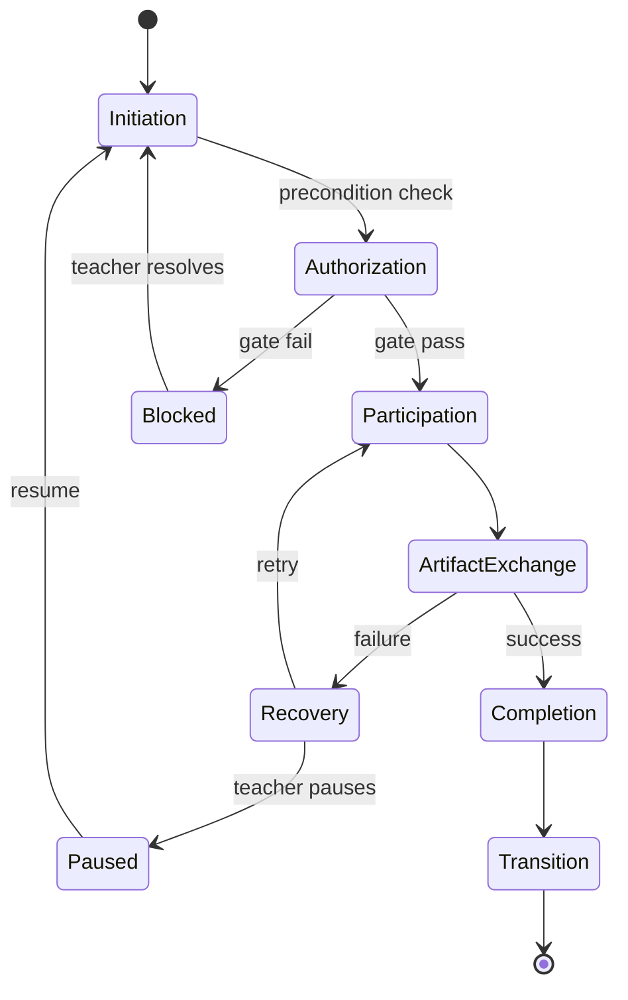

---

## Context Diagrams

### Diagram 1 — Overall collaboration map

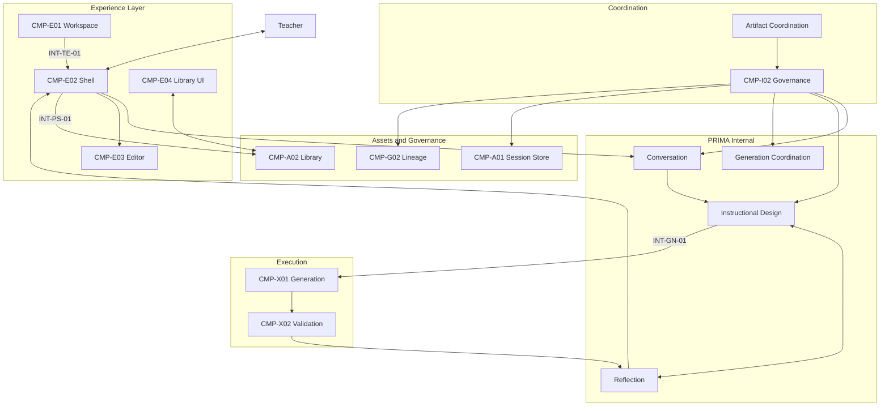

### Diagram 2 — Teacher journey interactions

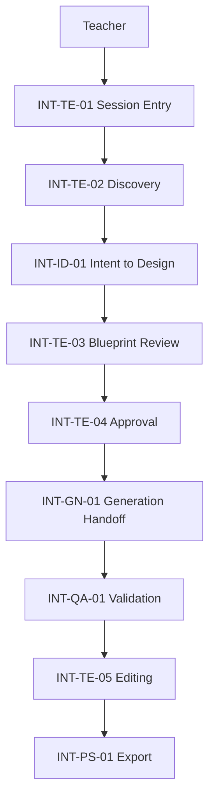

### Diagram 3 — Artifact collaboration flow

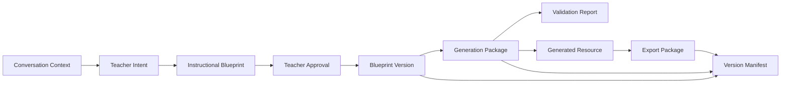

### Diagram 4 — Approval flow

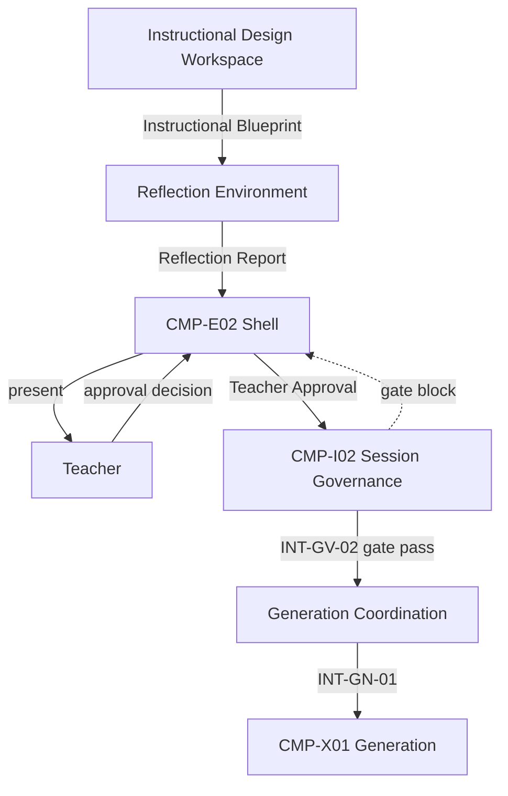

### Diagram 5 — Generation collaboration

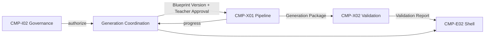

### Diagram 6 — Validation collaboration

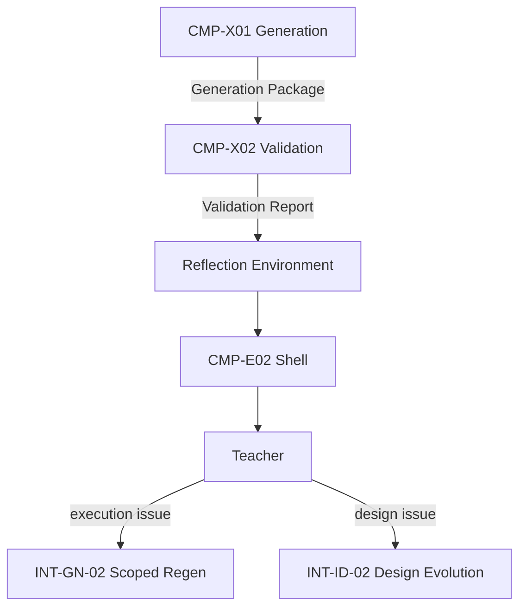

### Diagram 7 — Governance collaboration

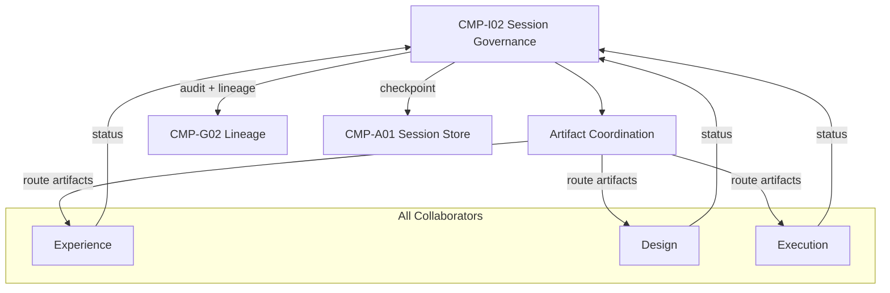

---

## Interaction Constraints

| ID | Constraint |
|----|------------|
| **IC-01** | Interactions never bypass Session Governance gate enforcement |
| **IC-02** | Components collaborate only through registered interactions and canonical artifacts |
| **IC-03** | Teacher Approval interaction (INT-TE-04) cannot be skipped for generation path |
| **IC-04** | Artifacts remain authoritative — interactions do not mutate artifact identity |
| **IC-05** | Reflection interactions never replace approval interactions |
| **IC-06** | Generation interactions never redesign Instructional Blueprint |
| **IC-07** | Library persistence interactions require Version Manifest from traceability interaction |
| **IC-08** | Resume interactions never bypass gate re-validation |
| **IC-09** | Cross-system handoffs (INT-GN-01) are sequential — not nested with design interactions |
| **IC-10** | Undocumented collaboration between components is prohibited |
| **IC-11** | Teacher authority flows inward; execution results flow outward |
| **IC-12** | Failure recovery interactions preserve Session State before retry |

---

## Interaction Matrix

### Component ↔ Component

| From ↓ / To → | E02 | I02 | IDW | X01 | X02 | A02 | G02 |
|---------------|:---:|:---:|:---:|:---:|:---:|:---:|:---:|
| **E01 Workspace** | INT-TE-01 | — | — | — | — | — | — |
| **E02 Shell** | — | all TE | INT-TE-03 | — | — | INT-PS-01 | — |
| **I02 Governance** | state | — | INT-ID-01 | INT-GN-01 | route | — | INT-GV-04 |
| **IDW** | present | status | — | via I02 | — | — | — |
| **X01 Generation** | via I02 | status | — | — | INT-QA-01 | — | — |
| **A02 Library** | INT-PS-03 | — | — | — | — | — | read VM |

### Capability ↔ Capability (collaboration triggers)

| Upstream capability | Interaction | Downstream capability |
|--------------------|-------------|----------------------|
| ID-01 Instruction Discovery | INT-TE-02 | ID-02 Intent Modeling |
| ID-04 Blueprint Composition | INT-TE-03 | ID-05 Blueprint Review |
| ID-06 Blueprint Approval | INT-TE-04 | GN-01 Learning Resource Generation |
| GN-01 Learning Resource Generation | INT-GN-01 | QA-01 Blueprint Fidelity Validation |
| QA-01 + QA-02 | INT-QA-01 | PS-04 Teacher Editing |
| PS-04 Teacher Editing | INT-TE-05 | PS-03 Export |

### Artifact ↔ Interaction

| Artifact | Produced by interaction | Consumed by interaction |
|----------|------------------------|-------------------------|
| Conversation Context | INT-TE-02 | INT-ID-01 |
| Teacher Intent | INT-TE-02 | INT-ID-01 |
| Instructional Blueprint | INT-ID-01 | INT-TE-03, INT-TE-04 |
| Teacher Approval | INT-TE-04 | INT-GN-01, INT-GV-02 |
| Blueprint Version | INT-TE-04 | INT-GN-01, INT-QA-01 |
| Generation Package | INT-GN-01 | INT-QA-01, INT-TE-05 |
| Validation Report | INT-QA-01 | INT-TE-03 (via Reflection) |
| Export Package | INT-PS-01 | INT-PS-03 |
| Version Manifest | INT-GV-04, INT-PS-01 | INT-PS-03 |
| Session State | INT-GV-01 | INT-PS-02 |

### Interaction ↔ Actor

| Interaction | Primary actor | System participants |
|-------------|---------------|---------------------|
| INT-TE-02 Discovery | Teacher | Conversation, Reflection environments |
| INT-TE-04 Approval | Teacher | Design Workspace, Governance |
| INT-TE-05 Editing | Teacher | Editor, Generation Coordination |
| INT-PS-01 Export | Teacher | Library Store, Lineage |
| INT-ID-01 Intent-to-Design | — (governed) | Conversation → Design Workspace |
| INT-GV-02 Gate Enforcement | Teacher (provides approval) | Session Governance |

### Interaction ↔ Responsibility

| Interaction | Initiator responsibility | Participant responsibility |
|-------------|-------------------------|----------------------------|
| INT-TE-04 | Teacher decides | Governance records; Design locks version |
| INT-GN-01 | Governance authorizes | Generation executes faithfully |
| INT-QA-01 | Governance activates | Validation measures; Reflection presents |
| INT-GV-03 | Governance classifies | Teacher selects recovery |
| INT-PS-01 | Teacher finalizes | Library persists with lineage |

---

## Cross-Cutting Interactions

| Concern | Interactions involved | Collaboration nature |
|---------|----------------------|---------------------|
| **Governance** | INT-GV-01–04 | Mediate every phase transition |
| **Traceability** | INT-GV-04, INT-PS-01 | Bind lineage at approval, generation, export |
| **Versioning** | INT-TE-04, INT-ID-02, INT-GV-04 | Immutable approved versions; supersession on evolution |
| **Teacher authority** | INT-TE-04, INT-GV-02 | Gate all execution and export paths |
| **Explainability** | INT-TE-02, INT-TE-03, INT-QA-01 (via Reflection) | Interpretive — never gating alone |
| **Observability** | INT-GV-01, INT-GV-04 | Audit Record at every completion and gate |

**Teacher Authority** is the supreme cross-cutting interaction constraint — no interaction may circumvent INT-TE-04 for generation initiation.

---

## Future Interaction Evolution

Future capabilities integrate through **output consumption** — not by entering existing design collaboration paths.

| Future capability | Interaction pattern | Existing interactions unchanged |
|-------------------|----------------------|--------------------------------|
| **Student Portal** | New INT-FE-01: Publish Consumption — Library → Student channel | INT-PS-01 produces Export Package |
| **Parent Portal** | New INT-FE-02: Summary Consumption — derived from exported content | No PRIMA session interaction |
| **Marketplace** | New INT-FE-03: Asset Sharing — Library ↔ Marketplace | INT-PS-01, INT-PS-03 |
| **Analytics** | New INT-FE-04: Signal Consumption — read-only Audit/Version Manifest | INT-GV-04 append-only |
| **Collaboration** | New INT-FE-05: Post-Export Co-edit — outside PRIMA session | After INT-PS-01 |
| **School Integration** | New INT-FE-06: Policy Adjacency — Identity/Settings only | Not INT-TE-01 through INT-TE-04 |
| **Notification** | New INT-FE-07: Async Alert — triggered by INT-GV-01 checkpoint | No session entry |

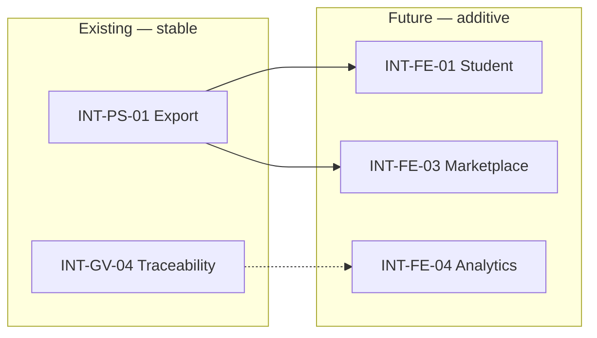

---

## Governance

### Interaction definition authority

| Role | Authority |
|------|-----------|
| **LUDI ON Product Team** | Official interaction registry; approval of new interactions |
| **Interaction Architecture Lead** | Propose interactions; overlap and artifact alignment review |
| **Architectural review** | Mandatory when new interaction crosses system boundary |

### Introducing new interactions

1. Identify business purpose and target capabilities  
2. Map initiator, participants, consumed/produced artifacts  
3. Verify no overlap with existing interaction (IP-03)  
4. Confirm Component Model participants exist  
5. Register in this document; update State Model if lifecycle impact  
6. Session log entry with rationale  

### Preventing interaction drift

| Mechanism | Description |
|-----------|-------------|
| **Interaction registry** | Only documented collaborations permitted |
| **Compliance rules** | Downstream specs must reference interaction IDs |
| **Artifact alignment review** | Every new interaction must consume/produce registry artifacts |
| **Quarterly audit** | Unregistered component coupling triggers review |

---

## Compliance Rules

| ID | Rule |
|----|------|
| **INT-CR-01** | Every interaction must have a documented business purpose |
| **INT-CR-02** | Every interaction must preserve authority boundaries |
| **INT-CR-03** | Every interaction must consume or produce at least one canonical artifact |
| **INT-CR-04** | Interactions never redefine component responsibilities |
| **INT-CR-05** | No undocumented collaboration between components |
| **INT-CR-06** | Components implement capabilities; interactions realize capability collaboration |
| **INT-CR-07** | State Model transitions must align with interaction lifecycle |
| **INT-CR-08** | Error Model recovery paths must reference interaction IDs |
| **INT-CR-09** | Technical Architecture must implement interactions — not invent parallel collaboration |
| **INT-CR-10** | Future interactions register as INT-FE-* before exploration |

---

## Summary

The Interaction Model defines **how PRIMA components collaborate** to realize business capabilities while preserving architectural boundaries — **18 registered interactions** across teacher, component, and governance categories, organized into **10 collaboration patterns**, governed by **12 interaction principles** and **12 constraints**.

Architecture progression:

```
Project Bible ............... WHY
Architectural Principles .... RULES
Domain Model ................ CONCEPTS
Canonical Artifacts ......... INFORMATION
System Context .............. BOUNDARIES
Capability Model ............ ABILITIES
Component Model ............. STRUCTURE
Interaction Model (this) .... COLLABORATION
```

Future **State Model**, **Error Model**, and **Technical Architecture** must conform to this interaction model. Components implement capabilities. Interactions connect components. Artifacts carry information across collaborations. Teacher authority gates execution.

**Collaboration is architecture made dynamic — without implementation dependency.**

---

## Next Recommended Document

→ [`PRIMA_WORKFLOW_MODEL.md`](./PRIMA_WORKFLOW_MODEL.md) — End-to-end business workflows that deliver platform value.
