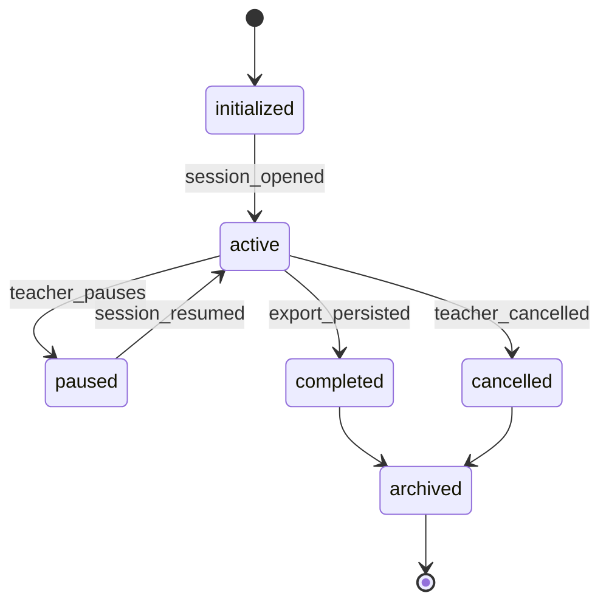
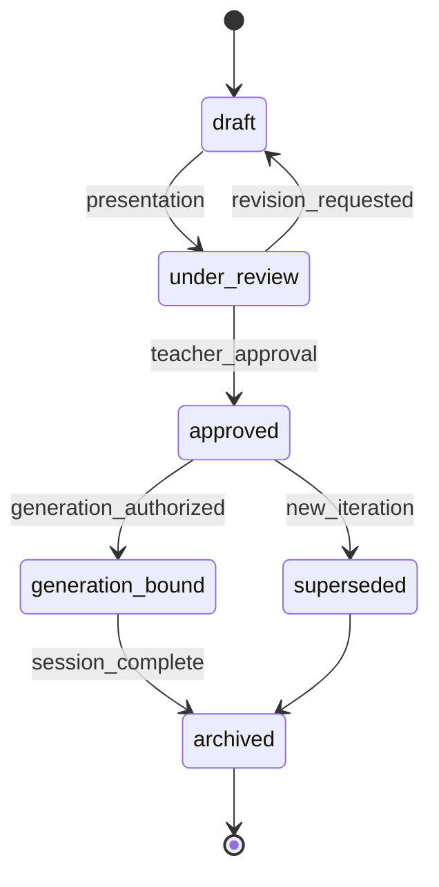
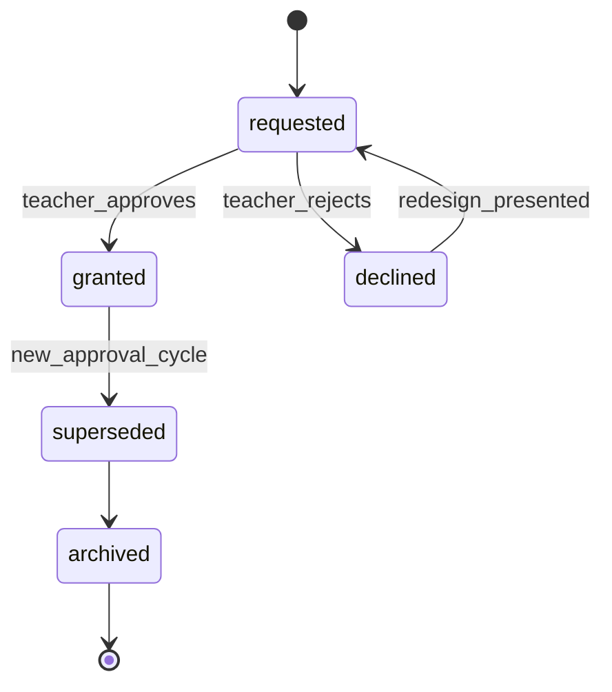
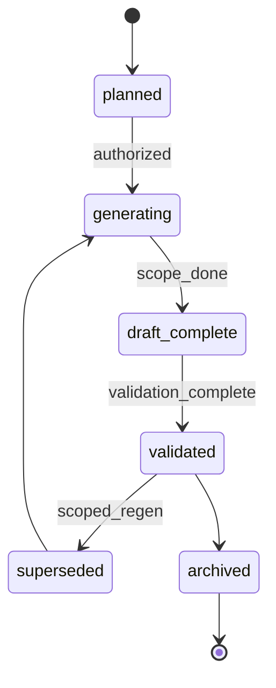
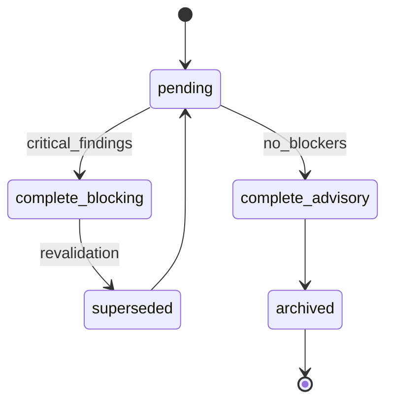
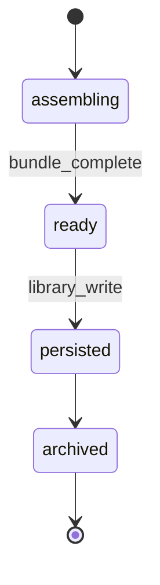
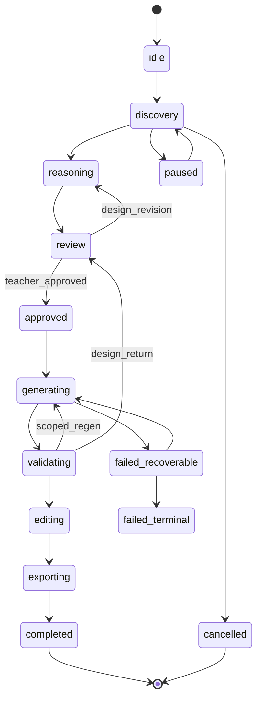
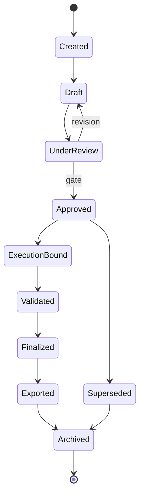
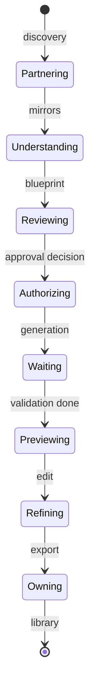

# PRIMA State Model

**Version:** 1.0  
**Status:** Official — Enterprise Solution Architecture Specification

---

## Purpose

This document defines the **official lifecycle architecture** of PRIMA — how every important architectural object evolves through time, which states are legal, who may transition them, and which states are terminal.

It answers one architectural question:

> *How do the important architectural objects evolve through time?*

The State Model defines **lifecycle** — the condition of objects. It does **not** define business workflow activities ([`PRIMA_WORKFLOW_MODEL.md`](./PRIMA_WORKFLOW_MODEL.md)), component collaboration ([`PRIMA_INTERACTION_MODEL.md`](./PRIMA_INTERACTION_MODEL.md)), or implementation.

---

## Scope

| In scope | Out of scope |
|----------|--------------|
| Lifecycle state machines for architectural objects | Workflow business process steps |
| Legal and illegal transitions | API payloads, event transport |
| Authority and terminal states | Database persistence schemas |
| Recovery paths at lifecycle level | Engine internal behaviour |
| Cross-object lifecycle constraints | Field-level artifact schemas (Canonical Artifacts owns identity; this doc owns transitions) |

---

## Related Documents

| Document | Relationship |
|----------|--------------|
| [`PRIMA_CANONICAL_ARTIFACTS.md`](../PRIMA_CANONICAL_ARTIFACTS.md) | Artifact identity, ownership, invariants — this document instantiates **lifecycle transitions** |
| [`PRIMA_WORKFLOW_MODEL.md`](./PRIMA_WORKFLOW_MODEL.md) | Business processes — workflows **consume** object states; they do not replace them |
| [`PRIMA_DOMAIN_MODEL.md`](../PRIMA_DOMAIN_MODEL.md) | Domain entities — this document governs their **temporal evolution** |
| [`PRIMA_ERROR_MODEL.md`](./PRIMA_ERROR_MODEL.md) | Failure classification — references lifecycle recovery paths defined here |

**Precedence:** On lifecycle state identity and transition legality, **this document prevails** until officially revised. On artifact field schema, Canonical Artifacts prevails. On workflow gate business meaning, Workflow Model prevails.

---

## State vs Workflow

| Concept | Question answered | Example |
|---------|-------------------|---------|
| **Workflow** | What business activity runs? | "Blueprint Approval workflow" |
| **State** | What condition is the object in? | Instructional Blueprint is `under_review` |

Workflows **operate on** objects in particular states. Changing Workflow State (coordination position) does not substitute for changing Blueprint lifecycle state. Both must align — but they are modeled separately.

```
Workflow Model:  WHAT happens  (business process)
State Model:     WHAT condition objects are in  (lifecycle)
```

---

## Why State Modeling Exists

### Why enterprise systems require explicit lifecycle models

Without governed lifecycles, teams invent implicit states — "mostly approved," "draft but generating," "exported draft blueprint." Implicit states produce gate bypass, untraceable exports, and regeneration from stale design. Explicit lifecycle models make **object condition** auditable and enforceable.

### Why state models reduce ambiguity

When Instructional Blueprint is `approved`, every architect, product owner, and compliance reviewer means the same thing: Teacher Approval recorded, Blueprint Version immutable, generation authorized. Shared lifecycle vocabulary eliminates interpretation drift across specifications and teams.

### Why lifecycle survives implementation changes

Storage format, orchestration technology, and UI framework change. The rule that *an approved Blueprint Version is immutable* does not. Lifecycle models bind architecture to **enduring object semantics**.

### Why state machines simplify governance

Gates, compliance rules, and audit requirements map to **legal transitions**. Forbidden transitions are architectural violations — detectable before implementation, testable after. Governance becomes enumerable rather than tribal knowledge.

---

## State Modeling Principles

| ID | Principle | Meaning |
|----|-----------|---------|
| **SP-01 — Explicit lifecycle** | Every architectural object has a documented state machine |
| **SP-02 — No hidden transitions** | All legal transitions appear in this document |
| **SP-03 — Immutable historical states** | Terminal and approved states are never silently rewritten |
| **SP-04 — Deterministic transitions** | Same object state + same authorized action → same next state |
| **SP-05 — Teacher authority** | Teacher-driven transitions require explicit teacher action |
| **SP-06 — Artifact authority** | Object state derives from canonical artifact lifecycle — no shadow states |
| **SP-07 — Single active state** | Each object instance occupies exactly one lifecycle state at a time |
| **SP-08 — Governed evolution** | New states require State Model amendment |
| **SP-09 — Auditability** | Material transitions produce Audit Record entries |
| **SP-10 — Explainability** | State condition enables "why is preview blocked?" answers |
| **SP-11 — Recovery without gate bypass** | Recovery paths restore or retry — never skip approval states |
| **SP-12 — Technology independence** | Lifecycle valid regardless of implementation |

---

## State Categories

| Category | Objects | Purpose |
|----------|---------|---------|
| **Session States** | Conversation Session, Session State, Workflow State | Scope and coordination position |
| **Conversation States** | Conversation Context, Teacher Intent | Discovery capture lifecycle |
| **Design States** | Instructional Blueprint, Blueprint Version, Decision Context, Revision Directives | Instructional design authority |
| **Approval States** | Teacher Approval | Governance gates |
| **Generation States** | Generation Package, Generated Resource | Execution output lifecycle |
| **Validation States** | Validation Report | Quality measurement lifecycle |
| **Reflection States** | Reflection Report | Interpretive artifact lifecycle |
| **Export States** | Export Package | Deliverable lifecycle |
| **Governance States** | Audit Record, Version Manifest, Artifact Metadata | Traceability and compliance |
| **Knowledge States** | Knowledge Package, Memory Context | Ephemeral evidence and hints |
| **Future States** | Registered extensions | Not active v1.0 |

---

## State Catalog

Official template applied to each architectural object. State Model IDs: **SM-{object}**.

---

### SM-ConversationSession — Conversation Session

| Field | Content |
|-------|---------|
| **State Model Name** | Conversation Session Lifecycle |
| **Purpose** | Govern the bounded span of one PRIMA design interaction |
| **Object Owner** | Orchestration Domain |
| **Lifecycle Description** | Session opens on design entry, progresses through design and optional execution, closes on complete or cancel |
| **Possible States** | `initialized`, `active`, `paused`, `completed`, `cancelled`, `archived` |
| **Entry Conditions** | Teacher enters PRIMA Experience; Session State initialized |
| **Exit Conditions** | Library save complete OR teacher cancel OR terminal failure |
| **Valid Transitions** | `initialized`→`active`; `active`↔`paused`; `active`→`completed`\|`cancelled`; `completed`\|`cancelled`→`archived` |
| **Invalid Transitions** | `archived`→`active`; `cancelled`→`completed` |
| **Authority** | Session Governance opens/closes; Teacher pauses/cancels |
| **Terminal States** | `completed`, `cancelled`, `archived` |
| **Recovery Paths** | `paused`→`active` via resume; failed sub-process does not change session to terminal unless cancel |
| **Architectural Constraints** | One active session scope per design iteration entry |
| **Related Canonical Artifacts** | Session State, Workflow State |
| **Related Components** | CMP-I02, CMP-E02, CMP-A01 |
| **Related Capabilities** | TE-02, GV-01, TE-03 |
| **Related Workflows** | WF-PR-01, WF-PR-09, WF-SU-01 |
| **Notes** | Domain entity: Conversation Session |



---

### SM-ConversationContext — Conversation Context

| Field | Content |
|-------|---------|
| **State Model Name** | Conversation Context Lifecycle |
| **Purpose** | Track discovery capture progression |
| **Object Owner** | Orchestration Domain |
| **Possible States** | `initializing`, `discovering`, `discovery_complete`, `superseded`, `archived` |
| **Valid Transitions** | Per Canonical Artifacts: linear discovery path; `discovery_complete`→`superseded` on new session |
| **Invalid Transitions** | `discovery_complete`→`discovering` without new session scope |
| **Authority** | Conversation capture process writes; Teacher corrects via dialogue |
| **Terminal States** | `archived`, `superseded` |
| **Recovery Paths** | Resume from Session State checkpoint in `discovering` |
| **Related Workflows** | WF-PR-01 discovery phase |
| **Notes** | Aligns with Canonical Artifacts lifecycle |

---

### SM-TeacherIntent — Teacher Intent

| Field | Content |
|-------|---------|
| **State Model Name** | Teacher Intent Lifecycle |
| **Purpose** | Track normalization of instructional intent before reasoning |
| **Object Owner** | Instructional Design Domain |
| **Possible States** | `forming`, `complete`, `revised`, `consumed`, `archived` |
| **Valid Transitions** | `forming`→`complete`; `complete`→`revised`→`complete`; `complete`→`consumed`; `consumed`→`archived` |
| **Invalid Transitions** | `consumed`→`forming` without new discovery scope |
| **Authority** | Normalization at discovery completion; Teacher corrections pre-consumption |
| **Terminal States** | `archived` |
| **Recovery Paths** | Scoped `revised` on teacher correction before reasoning |
| **Related Workflows** | WG-01 Discovery Complete requires `complete` |

---

### SM-InstructionalBlueprint — Instructional Blueprint

| Field | Content |
|-------|---------|
| **State Model Name** | Instructional Blueprint Lifecycle |
| **Purpose** | Govern authoritative design artifact from draft through archival |
| **Object Owner** | Instructional Design Domain (structure); Teacher Interaction Domain (approval) |
| **Possible States** | `draft`, `under_review`, `approved`, `generation_bound`, `superseded`, `archived` |
| **Valid Transitions** | `draft`→`under_review`→`approved`; `under_review`→`draft`; `approved`→`generation_bound`; `approved`→`superseded`; `*`→`archived` |
| **Invalid Transitions** | `draft`→`approved` (skip review); `approved`→`draft` (in-place revert); `generation_bound`→`draft` without evolution workflow |
| **Authority** | Design composition; Teacher approval for `approved` |
| **Terminal States** | `archived`, `superseded` (as authority — lineage preserved) |
| **Recovery Paths** | `under_review`→`draft` on revision; new version via WF-PR-07 |
| **Related Workflows** | WF-PR-02, WF-PR-07; gates WG-02, WG-03, WG-04 |
| **Notes** | Schema authority: Blueprint Specification |



---

### SM-BlueprintVersion — Blueprint Version

| Field | Content |
|-------|---------|
| **State Model Name** | Blueprint Version Lifecycle |
| **Purpose** | Immutable version identity for design snapshots and execution binding |
| **Object Owner** | Instructional Design Domain (lineage); Orchestration Domain (binding) |
| **Possible States** | `draft`, `under_review`, `approved`, `superseded`, `archived` |
| **Valid Transitions** | Same as Blueprint aggregate version record; `approved` is **immutable** |
| **Invalid Transitions** | Any in-place mutation of `approved` version |
| **Authority** | Orchestrator binds generation to `approved` version ID |
| **Terminal States** | `archived`; `superseded` remains addressable |
| **Recovery Paths** | New version record — never overwrite approved |
| **Related Workflows** | All execution workflows bind to `approved` |

---

### SM-TeacherApproval — Teacher Approval

| Field | Content |
|-------|---------|
| **State Model Name** | Teacher Approval Lifecycle |
| **Purpose** | Record immutable teacher authorization at governance gates |
| **Object Owner** | Teacher Interaction Domain |
| **Possible States** | `requested`, `granted`, `declined`, `superseded`, `archived` |
| **Valid Transitions** | `requested`→`granted`\|`declined`; `declined`→`requested` after revision; `granted`→`superseded` on new cycle |
| **Invalid Transitions** | `granted`→`declined`; silent revocation of `granted` |
| **Authority** | Teacher only — `granted` requires explicit action |
| **Terminal States** | `archived`; `granted` immutable within cycle |
| **Recovery Paths** | New approval cycle after design change |
| **Related Workflows** | WG-04; WF-PR-02 |



---

### SM-GenerationPackage — Generation Package

| Field | Content |
|-------|---------|
| **State Model Name** | Generation Package Lifecycle |
| **Purpose** | Track execution bundle from plan through validation |
| **Object Owner** | Generation Domain |
| **Possible States** | `planned`, `generating`, `draft_complete`, `validated`, `superseded`, `archived` |
| **Valid Transitions** | Linear execution path; `validated`→`superseded` on scoped regen |
| **Invalid Transitions** | `planned`→`validated` (skip generation); any transition without `approved` Blueprint Version binding |
| **Authority** | Generation execution; Session Governance authorizes start |
| **Terminal States** | `archived`, `superseded` |
| **Recovery Paths** | `generating` failure → retry; `superseded` partial package on scoped regen |
| **Related Workflows** | WF-PR-03; WG-05 |



---

### SM-GeneratedResource — Generated Resource

| Field | Content |
|-------|---------|
| **State Model Name** | Generated Resource Lifecycle |
| **Purpose** | Track individual classroom material from draft through teacher ownership |
| **Object Owner** | Generation Domain (draft); Teacher Interaction Domain (finalization) |
| **Possible States** | `draft`, `under_edit`, `teacher_finalized`, `superseded`, `archived` |
| **Valid Transitions** | `draft`→`under_edit`→`teacher_finalized`; regen may `supersede` draft segments |
| **Invalid Transitions** | `teacher_finalized`→`draft` without explicit teacher reopen |
| **Authority** | Teacher owns edits and finalization |
| **Related Workflows** | WF-PR-05; WG-07 |

---

### SM-ValidationReport — Validation Report

| Field | Content |
|-------|---------|
| **State Model Name** | Validation Report Lifecycle |
| **Purpose** | Track quality assessment outcome |
| **Object Owner** | Validation Domain |
| **Possible States** | `pending`, `complete_advisory`, `complete_blocking`, `superseded`, `archived` |
| **Valid Transitions** | `pending`→`complete_*`; new validation `supersedes` prior |
| **Invalid Transitions** | `pending`→`archived` without measurement |
| **Authority** | Validation measures; Teacher resolves blocking findings |
| **Related Workflows** | WF-PR-04; WG-06 |



---

### SM-ReflectionReport — Reflection Report

| Field | Content |
|-------|---------|
| **State Model Name** | Reflection Report Lifecycle |
| **Purpose** | Track interpretive presentation artifact — non-gating |
| **Object Owner** | Teacher Interaction Domain |
| **Possible States** | `draft`, `presented`, `acknowledged`, `superseded`, `archived` |
| **Valid Transitions** | `draft`→`presented`→`acknowledged`; new mirror `supersedes` |
| **Invalid Transitions** | `acknowledged`→ substitute for Teacher Approval |
| **Authority** | Reflection presents; Teacher acknowledges optionally |
| **Notes** | Never a workflow gate |

---

### SM-ExportPackage — Export Package

| Field | Content |
|-------|---------|
| **State Model Name** | Export Package Lifecycle |
| **Purpose** | Track teacher deliverable bundle |
| **Object Owner** | Teacher Interaction Domain |
| **Possible States** | `assembling`, `ready`, `persisted`, `archived` |
| **Valid Transitions** | `assembling`→`ready`→`persisted`→`archived` |
| **Invalid Transitions** | `assembling`→`persisted` without teacher authorization (WG-08) |
| **Authority** | Teacher initiates; Lineage Service binds manifest |
| **Related Workflows** | WF-PR-06, WF-PR-08; WG-08, WG-09 |



---

### SM-WorkflowState — Workflow State

| Field | Content |
|-------|---------|
| **State Model Name** | Workflow State Lifecycle |
| **Purpose** | Track coordination position within session — distinct from business workflow |
| **Object Owner** | Orchestration Domain |
| **Possible States** | `idle`, `discovery`, `reasoning`, `review`, `approved`, `generating`, `validating`, `editing`, `exporting`, `completed`, `paused`, `cancelled`, `failed_recoverable`, `failed_terminal` |
| **Valid Transitions** | See diagram below; Orchestrator exclusive writer |
| **Invalid Transitions** | `generating` from non-`approved`; self-transition by non-Orchestrator participants |
| **Authority** | Session Governance exclusively |
| **Terminal States** | `completed`, `cancelled`, `failed_terminal` |
| **Recovery Paths** | `paused`, `failed_recoverable`→ prior active phase |
| **Related Workflows** | Maps to WF-PR-01 phases — workflow describes activity; this describes coordination position |



---

### SM-SessionState — Session State

| Field | Content |
|-------|---------|
| **State Model Name** | Session State Lifecycle |
| **Purpose** | Track persistence snapshot of session — checkpoint envelope |
| **Object Owner** | Orchestration Domain |
| **Possible States** | `active`, `paused`, `completed`, `archived` |
| **Valid Transitions** | `active`↔`paused`; `active`→`completed`→`archived` |
| **Invalid Transitions** | `archived`→`active` |
| **Authority** | Session Governance writes; Dashboard reads for resume |
| **Terminal States** | `archived` |
| **Recovery Paths** | `paused`→`active` restores artifact references |
| **Notes** | Distinct from Workflow State — snapshot vs position |

---

### SM-AuditRecord — Audit Record

| Field | Content |
|-------|---------|
| **State Model Name** | Audit Record Lifecycle |
| **Purpose** | Append-only compliance trace |
| **Object Owner** | Orchestration Domain |
| **Possible States** | `recording`, `session_complete`, `archived` |
| **Valid Transitions** | Linear; append-only — no backward transitions |
| **Invalid Transitions** | Any deletion or mutation of entries |
| **Terminal States** | `archived` (retention policy) |

---

### SM-VersionManifest — Version Manifest

| Field | Content |
|-------|---------|
| **State Model Name** | Version Manifest Lifecycle |
| **Purpose** | Bind lineage chain for library and audit |
| **Object Owner** | System Governance Domain |
| **Possible States** | `draft`, `bound`, `sealed`, `archived` |
| **Valid Transitions** | `draft`→`bound`→`sealed`→`archived` |
| **Invalid Transitions** | `sealed`→`draft` |
| **Authority** | Lineage Service; sealed on library persistence |
| **Terminal States** | `archived` — sealed manifests immutable |

---

### SM-MemoryContext — Memory Context

| Field | Content |
|-------|---------|
| **State Model Name** | Memory Context Lifecycle |
| **Purpose** | Ephemeral personalization delivery per session |
| **Object Owner** | Memory Domain |
| **Possible States** | `assembled`, `active`, `consumed`, `superseded` |
| **Valid Transitions** | Ephemeral path per Canonical Artifacts |
| **Invalid Transitions** | `consumed`→ design authority |
| **Notes** | Advisory only — never gates |

---

### SM-KnowledgePackage — Knowledge Package

| Field | Content |
|-------|---------|
| **State Model Name** | Knowledge Package Lifecycle |
| **Purpose** | Ephemeral curriculum evidence for reasoning |
| **Object Owner** | Knowledge Domain |
| **Possible States** | `assembled`, `consumed`, `superseded` |
| **Valid Transitions** | Query response lifecycle — no long-term session authority |
| **Notes** | Consumed within Decision Context assembly |

---

### SM-DecisionContext — Decision Context

| Field | Content |
|-------|---------|
| **State Model Name** | Decision Context Lifecycle |
| **Purpose** | Ephemeral reasoning input assembly |
| **Object Owner** | Instructional Design Domain |
| **Possible States** | `assembling`, `ready`, `consumed`, `superseded` |
| **Valid Transitions** | Assembled per reasoning pass; consumed by Decision composition |
| **Notes** | Ephemeral — not design authority |

---

### SM-RevisionDirectives — Revision Directives

| Field | Content |
|-------|---------|
| **State Model Name** | Revision Directives Lifecycle |
| **Purpose** | Scoped constraints for design or execution revision |
| **Object Owner** | Instructional Design Domain |
| **Possible States** | `draft`, `active`, `consumed`, `superseded`, `archived` |
| **Valid Transitions** | `draft`→`active`→`consumed`; new directive supersedes |
| **Notes** | Binds regen scope — design vs execution distinguished in workflow |

---

### SM-ArtifactMetadata — Artifact Metadata

| Field | Content |
|-------|---------|
| **State Model Name** | Artifact Metadata Lifecycle |
| **Purpose** | Schema version and envelope metadata for artifacts |
| **Object Owner** | System Governance Domain |
| **Possible States** | `attached`, `versioned`, `archived` |
| **Valid Transitions** | Attached at artifact creation; versioned on schema bump |
| **Notes** | Cross-cutting envelope — not business content |

---

## Ephemeral vs Persistent State Summary

| Object | Persistence class | Terminal |
|--------|--------------------|----------|
| Conversation Context, Teacher Intent | Session-persistent | `archived` |
| Instructional Blueprint, Blueprint Version | Persistent | `archived` / `superseded` |
| Teacher Approval | Persistent immutable | `archived` |
| Generation Package, Generated Resource | Persistent | `archived` |
| Decision Context, Knowledge Package, Memory Context | Ephemeral | `superseded` |
| Reflection Report | Session-persistent | `archived` |
| Export Package, Version Manifest | Persistent | `archived` |
| Audit Record | Persistent append-only | `archived` |

---

## Transition Rules

| Rule class | Description | Examples |
|------------|-------------|----------|
| **Legal transitions** | Documented in State Catalog | `under_review`→`approved` with Teacher Approval |
| **Illegal transitions** | Architecturally forbidden | `draft`→`generation_bound`; `granted`→`declined` |
| **Automatic transitions** | System progresses when preconditions met | `generating`→`draft_complete` on scope completion |
| **Teacher-driven transitions** | Require explicit teacher action | `requested`→`granted`; `under_edit`→`teacher_finalized` |
| **Governance transitions** | Session Governance only | Workflow State phase changes |
| **Recovery transitions** | Restore or retry without gate bypass | `paused`→`active`; `failed_recoverable`→`generating` |
| **Terminal transitions** | No outbound except archival | `completed`→`archived`; `cancelled`→`archived` |

---

## Lifecycle Constraints

| ID | Constraint |
|----|------------|
| **LC-01** | Instructional Blueprint cannot reach `approved` before `under_review` |
| **LC-02** | Generation Package cannot leave `planned` without Teacher Approval `granted` |
| **LC-03** | Validation Report cannot reach `complete_*` before Generation Package `draft_complete` |
| **LC-04** | Export Package cannot reach `persisted` without Generated Resource `teacher_finalized` |
| **LC-05** | `archived` objects never return to active production states |
| **LC-06** | Teacher Approval `granted` cannot be bypassed for generation binding |
| **LC-07** | Approved Blueprint Version is immutable — changes require new version |
| **LC-08** | Reflection Report `acknowledged` ≠ Teacher Approval `granted` |
| **LC-09** | Version Manifest `sealed` is immutable |
| **LC-10** | Workflow State `generating` requires Blueprint Version `approved` |
| **LC-11** | Audit Record entries are append-only |
| **LC-12** | Memory Context never transitions to design authority states |

---

## Cross-Cutting State Principles

| Principle | Application |
|-----------|-------------|
| **Traceability** | Version Manifest binds states across Blueprint Version → Generation Package → Export Package |
| **Versioning** | Supersession creates new records — never in-place overwrite of approved/immutable states |
| **Governance** | Session Governance owns Workflow State; Teacher owns approval transitions |
| **Recoverability** | `paused`, `failed_recoverable` preserve object states for resume |
| **Auditability** | Material transitions append Audit Record |
| **Teacher authority** | All `granted` and `teacher_finalized` transitions require teacher |
| **Explainability** | Object state answers blocking questions at gates |
| **Consistency** | Coordination position (Workflow State) aligns with object states at gates |

---

## State Recovery

| Condition | Affected objects | Recovery path | Gate preserved |
|-----------|------------------|---------------|----------------|
| **Paused session** | Session State, Workflow State | Resume to checkpoint | Yes |
| **Cancelled generation** | Generation Package | `generating`→`failed_recoverable`→ retry or cancel | Yes |
| **Rejected blueprint** | Teacher Approval, Blueprint | `declined`→ redesign → new approval cycle | Yes |
| **Failed validation** | Validation Report, Generation Package | Scoped regen OR design return | Yes |
| **Expired approval** | Teacher Approval (future policy) | New approval cycle | Yes |
| **Interrupted export** | Export Package | `assembling` retry from `ready` prerequisites | Yes |
| **Incomplete workflow** | Workflow State | `paused` or `failed_recoverable` | Yes |
| **Session resume** | All session objects | Restore from Session State refs | Yes |

Recovery detail and failure tiers: [`PRIMA_ERROR_MODEL.md`](./PRIMA_ERROR_MODEL.md). Recovery **never** transitions approved Blueprint Version back to `draft` silently.

---

## State Dependency Matrix

### State → Workflow (preconditions)

| Object state | Required for workflow |
|--------------|----------------------|
| Teacher Intent `complete` | Reasoning phase (WG-01) |
| Instructional Blueprint `under_review` | Blueprint Approval (WG-03) |
| Teacher Approval `granted` | Generation (WG-04) |
| Generation Package `draft_complete` | Validation (WG-05) |
| Validation Report `complete_advisory` or resolved blocking | Editing (WG-06) |
| Generated Resource `teacher_finalized` | Export (WG-07) |
| Export Package `ready` | Library Save (WG-08) |

### State → Component (transition authority)

| Component | States it may transition |
|-----------|-------------------------|
| CMP-I02 Session Governance | Workflow State, Session State checkpoint |
| CMP-E02 Experience Shell | Teacher action initiation (not state write) |
| Teacher | Teacher Approval, Generated Resource finalization |
| CMP-X01 Generation | Generation Package execution states |
| CMP-X02 Validation | Validation Report states |
| CMP-G02 Lineage | Version Manifest binding states |

### State → Authority

| Transition | Authority holder |
|------------|------------------|
| → `approved` (Blueprint) | Teacher |
| → `granted` (Approval) | Teacher |
| Workflow State phase change | Session Governance |
| → `teacher_finalized` | Teacher |
| → `sealed` (Version Manifest) | Lineage Service on library write |

---

## Platform Lifecycle Diagrams

### Overall platform object lifecycle (simplified)

```mermaid
stateDiagram-v2
  direction LR
  [*] --> Discovery: Conversation Context
  Discovery --> Design: Teacher Intent complete
  Design --> Approval: Blueprint under_review
  Approval --> Execution: Teacher Approval granted
  Execution --> Quality: Generation Package
  Quality --> Finalize: Validation complete
  Finalize --> Deliver: Export Package
  Deliver --> [*]: Library archived
```



### Artifact lifecycle (master pattern)



### Teacher interaction state view



---

## Future State Evolution

Future capabilities add **downstream states** — not redesign of core lifecycles.

| Future capability | State extension | Core lifecycle impact |
|-------------------|-----------------|----------------------|
| **Student Portal** | Export Package `published` (future) | New terminal after `persisted` |
| **Marketplace** | Export Package `shared` (future) | Branch from `persisted` |
| **Collaboration** | Generated Resource `co_editing` (future) | Post-`teacher_finalized` only |
| **Analytics** | Audit Record `aggregated` (future) | Read-only from `archived` |
| **Adaptive Learning** | Memory Profile states (future) | Outside session design objects |

Core rules **LC-01 through LC-12** remain unchanged. New states register in this document before activation.

---

## Governance

| Concern | Authority | Process |
|---------|-----------|---------|
| State definition | Product Team | State Model amendment |
| New state enum value | Product Team + Architectural review | Version bump; Workflow/Interaction sync |
| New transition | Same | Verify LC constraints; update diagrams |
| Transition retirement | Product Team | Deprecation period; migration path |
| Lifecycle drift prevention | Quarterly audit — implementation must match SM catalog |

Backward compatibility: `approved`, `granted`, `sealed` semantics are **immutable** across versions. Additive states only unless major version with migration.

---

## Compliance Rules

| ID | Rule |
|----|------|
| **SM-CR-01** | Every architectural object has exactly one official lifecycle in this document |
| **SM-CR-02** | Every legal transition is explicitly documented |
| **SM-CR-03** | No hidden states or undocumented transitions |
| **SM-CR-04** | Terminal states are immutable — no silent resurrection |
| **SM-CR-05** | Historical states remain auditable via Audit Record |
| **SM-CR-06** | Future specifications reuse these lifecycles — no parallel state enums |
| **SM-CR-07** | Workflow Model gates map to object states defined here |
| **SM-CR-08** | Error Model recovery paths respect LC constraints |
| **SM-CR-09** | Canonical Artifacts lifecycle fields align with this document — on conflict, reconcile via amendment |
| **SM-CR-10** | Technical Architecture implements lifecycles — does not redefine them |

---

## Summary

The State Model defines the **official lifecycle architecture** of PRIMA — **19 governed state machines** for sessions, artifacts, coordination objects, and governance records, with explicit transitions, authority rules, terminal states, and recovery paths.

Architecture progression:

```
Project Bible → Architectural Principles → Domain Model → Canonical Artifacts
→ System Context → Capability Model → Component Model → Interaction Model
→ Workflow Model → State Model (this document)
```

**Workflow** describes business activities. **State** describes object condition. Both are required; neither substitutes for the other.

Every future Decision Framework, Error Model detail, and Technical Architecture specification **must conform** to these lifecycle definitions. Approved design is immutable. Teacher approval is irreversible within a cycle. Archived objects never return.

**Lifecycle is law — implementation serves it.**

---

## Next Recommended Document

→ [`PRIMA_ERROR_MODEL.md`](./PRIMA_ERROR_MODEL.md) — Failure classification and recovery routing aligned to these lifecycle states.
