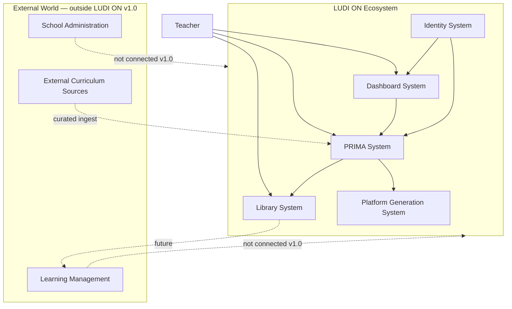
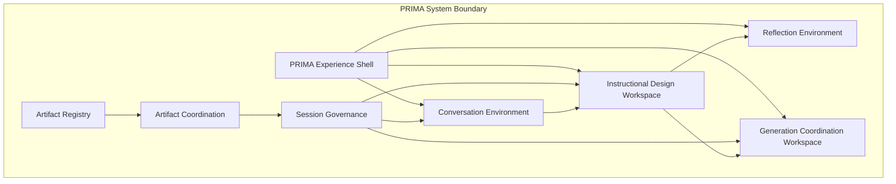
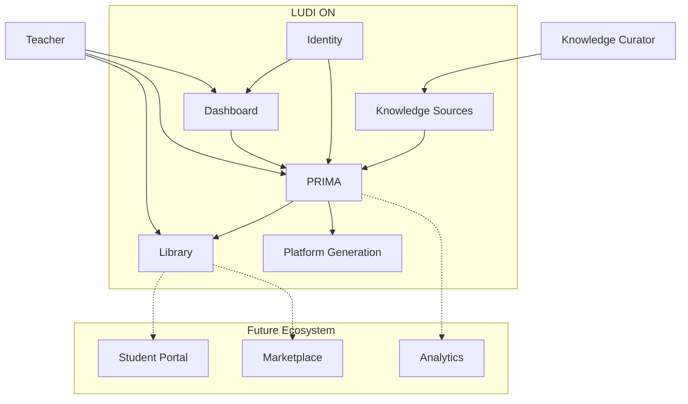
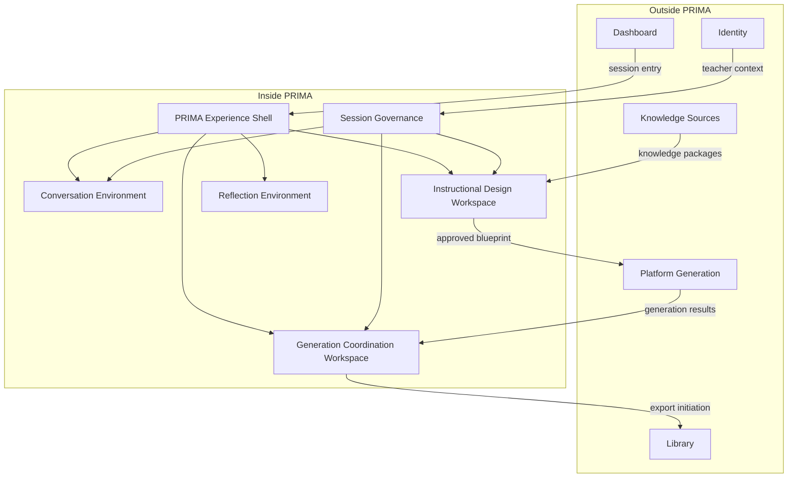
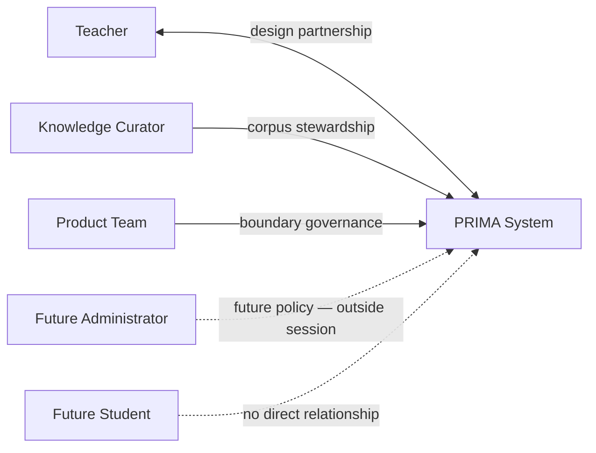
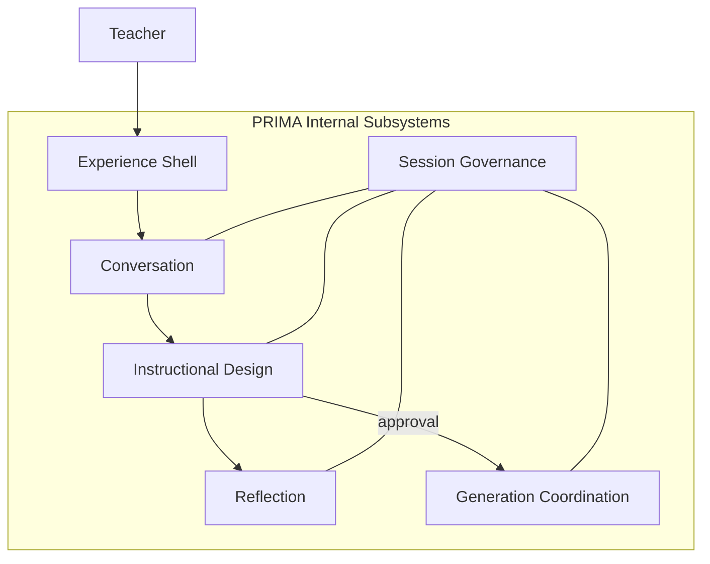
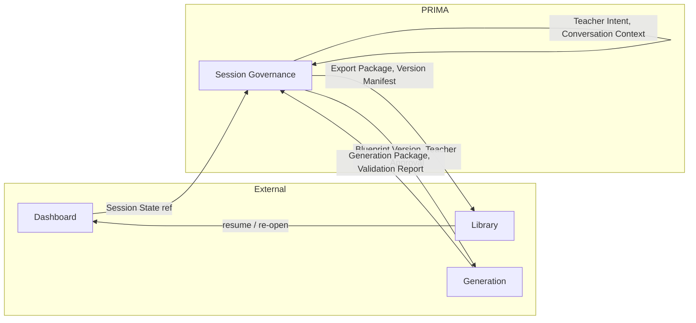
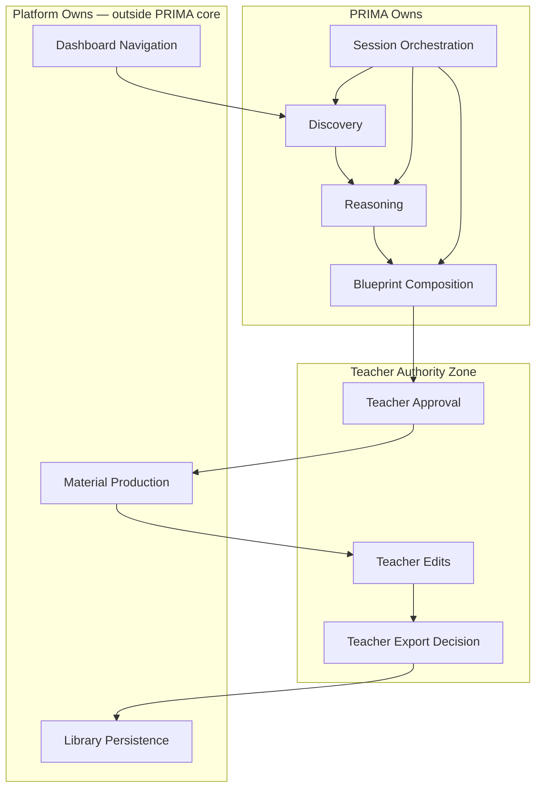
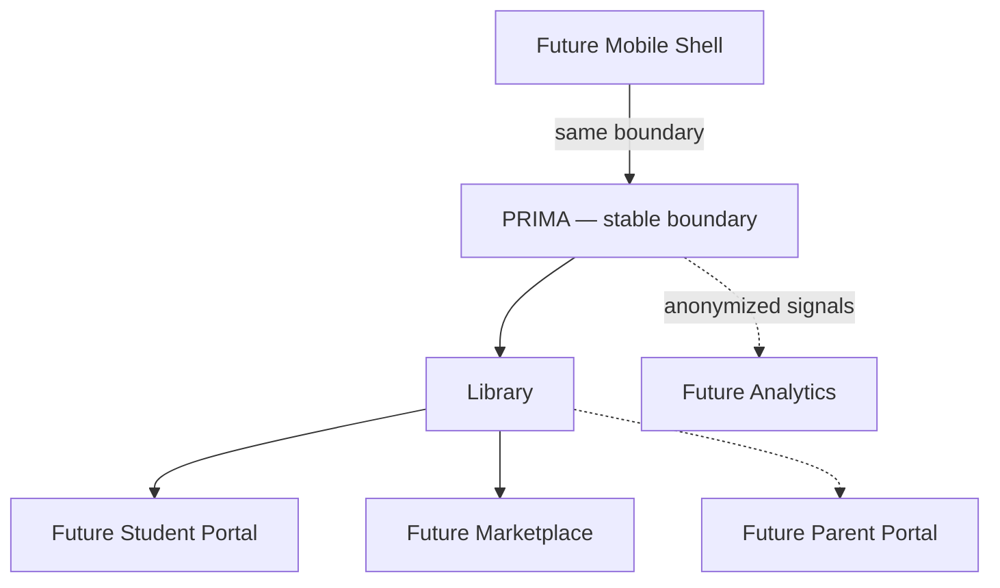

# PRIMA System Context

**Version:** 1.0  
**Status:** Official — Enterprise Solution Architecture Specification

---

## Purpose

This document defines the **official architectural context** of PRIMA — where PRIMA begins, where it ends, and how it relates to the LUDI ON ecosystem and the world beyond.

It answers one question:

> *Where does PRIMA begin and where does it end?*

PRIMA is not the entire LUDI ON platform. It is the **pedagogical intelligence system** bounded by explicit responsibilities, actors, and external relationships. This document establishes that boundary at the highest architectural level — before components, engines, APIs, or infrastructure.

This document does **not** define domain entities, artifact schemas, engine behaviour, capabilities, state machines, or implementation technology.

---

## Scope

| In scope | Out of scope |
|----------|--------------|
| PRIMA system boundary inside LUDI ON | Engine specifications and internal decomposition |
| External actors and external systems relative to PRIMA | Component catalogue (see Component Model) |
| Internal subsystems at context level (not engines) | Capability definitions (see Capability Model) |
| Responsibility ownership and interaction direction | Workflow state detail (see State Model) |
| Context diagrams (C4 Context level) | API contracts, protocols, databases, deployment |
| Boundary rules, governance, and compliance | UI composition, design tokens |
| Future ecosystem evolution without boundary change | Detailed artifact field schemas |

---

## Related Documents

| Document | Relationship |
|----------|--------------|
| [`LUDI_ON_PROJECT_BIBLE.md`](../LUDI_ON_PROJECT_BIBLE.md) | Defines **why** LUDI ON and PRIMA exist — product intent this context implements |
| [`PRIMA_ARCHITECTURAL_PRINCIPLES.md`](../PRIMA_ARCHITECTURAL_PRINCIPLES.md) | Defines **rules** — constitutional beliefs that constrain this boundary |
| [`PRIMA_DOMAIN_MODEL.md`](../PRIMA_DOMAIN_MODEL.md) | Defines **concepts** — entities that exist inside and adjacent to this boundary |
| [`PRIMA_CANONICAL_ARTIFACTS.md`](../PRIMA_CANONICAL_ARTIFACTS.md) | Defines **information** — artifacts that cross this boundary |
| [`PRIMA_CAPABILITY_MODEL.md`](./PRIMA_CAPABILITY_MODEL.md) | Next layer — capabilities delivered within this context |
| [`PRIMA_ENGINE.md`](../PRIMA_ENGINE.md) | Internal PRIMA decomposition — subordinate to this boundary definition |

**Precedence:** On system boundary, actor authority, or external relationship conflict, **this document prevails** until officially revised. On constitutional belief conflict, Architectural Principles prevail. On entity or artifact identity, Domain Model and Canonical Artifacts prevail.

---

## Why System Context Exists

Enterprise systems fail when boundaries are implicit. Features accumulate. Responsibilities merge. A conversational discovery module begins generating worksheets. A dashboard widget starts composing blueprints. A library stores design state that bypasses teacher approval. Scope creep is not a product management problem alone — it is an **architectural boundary problem**.

### Why explicit context boundaries matter

Without a governed system context, every team interprets "PRIMA" differently. Engineering treats it as a service. Product treats it as the whole app. Design treats it as the conversation screen. None of these interpretations is stable enough to govern a fifteen-year platform.

Explicit context defines:

- **What PRIMA owns** — and therefore what no adjacent system may absorb
- **What sits outside PRIMA** — and therefore what PRIMA must not internalize
- **Who holds authority** — and therefore where automated intelligence must stop

### Why context reduces coupling

When Dashboard, Library, and PRIMA each have documented boundaries, they integrate through **declared relationships** — not through shared assumptions. Dashboard routes teachers into PRIMA; it does not become PRIMA. Library stores teacher-owned exports; it does not become the design authority. Coupling stays at the relationship surface, not inside pedagogical logic.

### Why context survives implementation

Today's implementation may be a monolith. Tomorrow's may be distributed. The context diagram remains valid because it describes **roles and boundaries** — not deployment units. PRIMA partners with teachers to produce approved Instructional Blueprints whether the platform runs on one process or fifty. System Context is the layer that outlives every technology generation.

---

## Architectural Position

PRIMA occupies a defined position inside the LUDI ON product ecosystem — neither the whole platform nor a peripheral feature.

### Position hierarchy

```
LUDI ON Platform
│
├── Teacher-facing platform systems (outside PRIMA core)
│   ├── Dashboard ..................... entry, selection, resume, recommendations
│   ├── Personal Library .............. persistence, reuse, export retrieval
│   └── Teacher Settings .............. preferences, memory controls
│
├── PRIMA ............................. pedagogical intelligence (THIS DOCUMENT)
│   ├── PRIMA Experience .............. focused teacher partnership environment
│   ├── Instructional design arc ...... discovery → reasoning → blueprint approval
│   └── Generation handoff ............ coordinates execution after approval
│
├── Platform execution systems (adjacent, post-approval)
│   └── Generation and validation ..... faithful rendering of approved design
│
└── Future ecosystem (outside current boundary)
    ├── Student Portal
    ├── Parent Portal
    ├── Marketplace / Collaboration
    ├── School integrations
    └── Analytics and institutional services
```

### Teacher journey through the ecosystem

```
Teacher
   ↓
Dashboard ..................... "What do I want to build?"
   ↓
PRIMA Experience ................ "How will students learn it?"
   ↓
Instructional Blueprint ......... design authority (approved by teacher)
   ↓
Generation ...................... classroom materials (editable drafts)
   ↓
Library / Export ................ teacher-owned assets
   ↓
Future ecosystem ................ delivery beyond LUDI ON (manual or integrated)
```

PRIMA governs the middle of this journey — from intentional entry into the **PRIMA Experience** through **Instructional Blueprint** approval and **Generation** handoff. It does not own Dashboard browsing, library catalogues, or future student delivery.

### Canonical ecosystem chain

The official architectural position of PRIMA within LUDI ON:

```
LUDI ON
   ↓
Dashboard ...................... creative workspace; entry and resume
   ↓
PRIMA Experience ............... instructional design partnership (PRIMA system)
   ↓
Library ........................ teacher-owned assets; export retrieval
   ↓
Future ecosystem ............... student delivery, marketplace, institutional integrations
```

PRIMA occupies the **PRIMA Experience** layer — not Dashboard, not Library, not future delivery channels. Generation execution sits adjacent to PRIMA (handoff boundary), between PRIMA Experience and Library persistence.

### C4 Context — PRIMA in the ecosystem

At C4 Level 1 (System Context), PRIMA is one system among several that together form LUDI ON for the teacher.



---

## System Boundary

### Inside PRIMA

PRIMA owns the **instructional design intelligence arc** — everything required to partner with a teacher from session entry through approved Instructional Blueprint and governed handoff to Generation.

| Inside the boundary | Responsibility |
|---------------------|----------------|
| **PRIMA Experience environment** | Focused pedagogical partnership — separate from Dashboard |
| **Intent discovery** | Guided dialogue capturing instructional intent |
| **Pedagogical reasoning** | Application of curriculum-aware design logic |
| **Instructional Blueprint composition** | Structured Learning Experience design |
| **Blueprint review and approval coordination** | Presentation and recording of teacher authority |
| **Reflection and explainability** | Mirroring understanding; presenting reasoning at the right moment |
| **Session orchestration** | Workflow integrity, gates, artifact routing within PRIMA session |
| **Generation handoff coordination** | Activation of platform execution only after approval |
| **Validation routing within session** | Directing quality findings back to teacher or scoped regen |
| **Teacher memory consumption** | Personalization hints — advisory, non-authoritative |
| **Knowledge consumption** | Structured queries against curated pedagogical corpus |
| **PRIMA voice and expression** | Teacher-facing language governed by Prompt subsystem |

### Outside PRIMA

These systems exist in the LUDI ON ecosystem but are **not part of the PRIMA system boundary**.

| Outside the boundary | Why outside |
|----------------------|-------------|
| **Dashboard** | Creative workspace — selection and navigation, not pedagogical reasoning |
| **Personal Library** | Asset persistence and catalogue — not design authority |
| **My Projects** | Project listing and resume entry — not session orchestration |
| **Platform Generation execution** | Post-approval content and resource production — execution, not design |
| **Identity and authentication** | Cross-platform concern — PRIMA consumes identity, does not own it |
| **Export format rendering** | Deliverable production — downstream of teacher finalization |
| **Curriculum corpus curation** | Knowledge stewardship — PRIMA consumes, curators maintain |
| **LMS, SIS, school admin** | Institutional systems — outside product scope v1.0 |
| **Student / Parent portals** | Future delivery channels — not PRIMA design scope |
| **AI inference infrastructure** | Implementation — invisible at system context |

### Shared responsibilities

Some concerns span PRIMA and adjacent systems with **explicit split ownership**:

| Concern | PRIMA owns | Adjacent system owns |
|---------|------------|---------------------|
| **Session continuity** | Conversation Session, Workflow State, design artifacts | Dashboard resume entry; Project persistence |
| **Teacher assets** | Export initiation; Version Manifest binding | Library storage and retrieval |
| **Generation** | Handoff authorization; blueprint binding | Content and resource production |
| **Traceability** | Design-to-execution artifact chain | Library lineage display |
| **Personalization** | Memory Context consumption in session | Memory Profile persistence; Settings controls |

Shared responsibilities require **artifact-mediated handoffs** — never merged ownership. See [`PRIMA_CANONICAL_ARTIFACTS.md`](../PRIMA_CANONICAL_ARTIFACTS.md).

### Explicit exclusions

PRIMA is permanently excluded from:

| Exclusion | Rationale |
|-----------|-----------|
| Learning Management System functions | Product scope — design platform, not course delivery |
| Student Information System functions | No student identity in PRIMA domain |
| School administration | No institutional management |
| Teacher payroll / HR | Out of product category |
| Messaging between teachers, students, parents | Not instructional design |
| Video conferencing / virtual classroom | Not activity design |
| Autonomous publishing to learners | Teacher exports; platform does not deliver |
| Curriculum authorship and corpus maintenance | PRIMA consumes Knowledge Package; curators own source |
| Generic global EdTech templating | Romanian classroom first |

---

## Context Principles

These principles govern how the PRIMA system context is defined and preserved. They align with [`PRIMA_ARCHITECTURAL_PRINCIPLES.md`](../PRIMA_ARCHITECTURAL_PRINCIPLES.md) without restating engine-level detail.

| Principle | Context meaning |
|-----------|-----------------|
| **CP-01 — Single bounded system** | PRIMA is one identifiable system with a documented perimeter — not an ambiguous "AI layer" |
| **CP-02 — Clear responsibility ownership** | Every context concern has one primary owner — inside or outside PRIMA |
| **CP-03 — Explicit system boundaries** | No hidden dependencies across Dashboard, PRIMA, Library, or Generation |
| **CP-04 — Human-centered architecture** | Teacher is the primary human actor at the context boundary |
| **CP-05 — Teacher authority** | PRIMA recommends; teacher approves — authority never crosses inward from automation |
| **CP-06 — Design before execution** | PRIMA boundary ends at governed Generation handoff — not at material production |
| **CP-07 — Two worlds separation** | Dashboard and PRIMA Experience are distinct systems at context level |
| **CP-08 — Artifact-mediated crossing** | Information crosses the PRIMA boundary only through canonical artifacts |
| **CP-09 — Technology independence** | Context valid regardless of AI vendor, storage, UI framework, or deployment |
| **CP-10 — Stable over time** | Boundary rules survive feature growth and implementation rewrites |
| **CP-11 — No scope absorption** | Adjacent systems must not absorb PRIMA design responsibilities under delivery pressure |
| **CP-12 — Loose coupling outward** | PRIMA depends on adjacent systems through declared relationships — not shared internal state |

---

## External Actors

Actors are entities outside the PRIMA system that interact with it. Only architecturally justified actors are registered.

### ACT-01 — Teacher

| Field | Content |
|-------|---------|
| **Purpose** | Design Learning Experiences; approve instructional plans; own final classroom materials |
| **Responsibilities** | Enter PRIMA intentionally; confirm or correct PRIMA understanding; review and approve Instructional Blueprint; edit generated output; initiate export |
| **Relationship with PRIMA** | Primary partner — not operator of a form or recipient of autogenerated lessons |
| **Authority** | Final authority on design approval, pedagogical overrides, edits, and export decisions |
| **Expected interactions** | Enters via Dashboard; participates in PRIMA Experience; approves blueprint; edits resources; exits to Library or Dashboard |
| **Version 1.0 status** | Active — sole human actor |

### ACT-02 — Knowledge Curator

| Field | Content |
|-------|---------|
| **Purpose** | Maintain authoritative curriculum, framework, and pedagogical corpus consumed by PRIMA |
| **Responsibilities** | Curate Knowledge Pack sources; ensure Romanian curriculum alignment; version pedagogical reference content |
| **Relationship with PRIMA** | Upstream content steward — PRIMA consumes, never mutates corpus |
| **Authority** | Authority over knowledge corpus quality — not over teacher design decisions |
| **Expected interactions** | Indirect — corpus updates flow into Knowledge subsystem; no runtime teacher-facing role |
| **Version 1.0 status** | Active — operational role, not runtime actor |

### ACT-03 — Product Team

| Field | Content |
|-------|---------|
| **Purpose** | Govern platform evolution, boundary integrity, and architectural compliance |
| **Responsibilities** | Approve boundary changes; maintain specification hierarchy; prevent architectural drift |
| **Relationship with PRIMA** | Governance authority over context definition — not runtime participant |
| **Authority** | Official revision authority for this document and system boundary |
| **Expected interactions** | Documentation governance; boundary amendment review |
| **Version 1.0 status** | Active — governance only |

### ACT-04 — Future Administrator

| Field | Content |
|-------|---------|
| **Purpose** | Institutional platform oversight — moderation, configuration, usage reporting |
| **Responsibilities** | School or platform-level policy — not individual instructional design |
| **Relationship with PRIMA** | Adjacent future actor — must not enter PRIMA design session or override teacher authority |
| **Authority** | Institutional policy outside PRIMA session boundary |
| **Expected interactions** | None in v1.0; future read-only analytics or moderation surfaces |
| **Version 1.0 status** | Registered — not active |

### ACT-05 — Future Student

| Field | Content |
|-------|---------|
| **Purpose** | Participate in teacher-designed learning activities |
| **Relationship with PRIMA** | **No direct relationship** — receives materials teacher exports or publishes |
| **Authority** | None over PRIMA design |
| **Version 1.0 status** | Registered — excluded from PRIMA boundary |

### ACT-06 — Future Parent

| Field | Content |
|-------|---------|
| **Purpose** | View child progress summaries |
| **Relationship with PRIMA** | **No direct relationship** |
| **Version 1.0 status** | Registered — excluded from PRIMA boundary |

### Actors explicitly excluded from PRIMA context

| Actor | Reason |
|-------|--------|
| **AI Provider** | Implementation infrastructure — not an architectural actor at context level |
| **Future Analytics** | Consumes aggregated signals — does not participate in design sessions |

---

## External Systems

External systems interact with PRIMA but are **not inside the PRIMA boundary**. Each has declared purpose, direction, and ownership.

### EXT-01 — Dashboard System

| Field | Content |
|-------|---------|
| **Purpose** | Teacher creative workspace — activity selection, resume, recommendations, library access |
| **Relationship** | Upstream entry system — routes teachers into PRIMA Experience |
| **Direction** | Dashboard → PRIMA (session start/resume); PRIMA → Dashboard (session complete, continue-working signals) |
| **Ownership** | LUDI ON platform — Teacher Interaction and Orchestration domains at product level |
| **Responsibility boundary** | Owns browsing and selection; never owns discovery dialogue or blueprint composition |

### EXT-02 — Library System

| Field | Content |
|-------|---------|
| **Purpose** | Persist and retrieve teacher-owned activities, Export Packages, and Version Manifests |
| **Relationship** | Downstream asset system — receives traceable outputs from PRIMA session |
| **Direction** | PRIMA → Library (Export Package, Version Manifest); Library → PRIMA (re-open for edit or new iteration) |
| **Ownership** | LUDI ON platform — Teacher Interaction domain |
| **Responsibility boundary** | Owns storage and catalogue; never owns Instructional Blueprint authority |

### EXT-03 — Platform Generation System

| Field | Content |
|-------|---------|
| **Purpose** | Execute approved Instructional Blueprint into editable classroom materials |
| **Relationship** | Downstream execution system — activated only by PRIMA handoff after Teacher Approval |
| **Direction** | PRIMA → Generation (Blueprint Version, Teacher Approval, Revision Directives); Generation → PRIMA (Generation Package, progress signals) |
| **Ownership** | LUDI ON platform — Generation and Validation domains |
| **Responsibility boundary** | Owns material production; never owns pedagogical reasoning or blueprint mutation |

### EXT-04 — Identity System

| Field | Content |
|-------|---------|
| **Purpose** | Authenticate teachers; provide account context for session binding |
| **Relationship** | Cross-cutting platform system — PRIMA consumes authenticated teacher identity |
| **Direction** | Identity → PRIMA (teacher account context); PRIMA does not manage credentials |
| **Ownership** | LUDI ON platform |
| **Responsibility boundary** | Owns authentication; PRIMA owns session content |

### EXT-05 — Knowledge Sources System

| Field | Content |
|-------|---------|
| **Purpose** | Authoritative curriculum, competency frameworks, and pedagogical reference corpus |
| **Relationship** | Upstream reference system — PRIMA Knowledge subsystem consumes structured packages |
| **Direction** | Knowledge Sources → PRIMA (Knowledge Package assembly); PRIMA never writes corpus |
| **Ownership** | Curated platform content — stewarded by Knowledge Curator actor |
| **Responsibility boundary** | Owns universal pedagogical truth; Memory owns teacher-specific context |

### EXT-06 — Teacher Settings System

| Field | Content |
|-------|---------|
| **Purpose** | Memory controls, locale preferences, opt-out settings |
| **Relationship** | Adjacent preference system — feeds Memory Context into PRIMA sessions |
| **Direction** | Settings → PRIMA (preference signals); PRIMA → Settings (post-session learning signals — async) |
| **Ownership** | LUDI ON platform — Memory domain |
| **Responsibility boundary** | Owns preference persistence; PRIMA owns session behaviour |

### EXT-07 — AI Inference Providers

| Field | Content |
|-------|---------|
| **Purpose** | Supply machine inference capability consumed by PRIMA and Platform Generation during session execution |
| **Relationship** | External implementation dependency — invisible at product context; PRIMA behaviour must not depend on any specific provider |
| **Direction** | Providers ← PRIMA/Generation (inference requests); Providers → PRIMA/Generation (inference results) — conceptual only |
| **Ownership** | External vendors — platform abstraction layer owns provider selection at implementation tier |
| **Responsibility boundary** | Providers own model execution; PRIMA owns pedagogical meaning of inputs and outputs. Provider failure is a platform recovery concern — not a design authority concern. |

AI Inference Providers are **not architectural actors**. They appear here because every enterprise context diagram must acknowledge inference dependency while keeping PRIMA boundary independent of vendor choice.

### Future external systems (registered, not active v1.0)

| System | Purpose | Connection principle |
|--------|---------|---------------------|
| **Notification Service** | Alert teachers on session events | Must not enter design session; async only |
| **Marketplace** | Share teacher-created activities | Consumes Library exports — not PRIMA internals |
| **Analytics Platform** | Aggregate anonymized usage | Read-only; no session participation |
| **School Integration Hub** | Institutional roster and policy | Outside PRIMA boundary; teacher-mediated only |
| **Student Portal** | Deliver assigned activities | Receives teacher-published content — never PRIMA design access |

---

## Internal Systems

Internal systems are **major subsystems within the PRIMA boundary**. These are contextual subdivisions — not engine specifications.

| Subsystem | Purpose | Boundary role |
|-----------|---------|---------------|
| **PRIMA Experience Shell** | Host the focused teacher partnership environment — no Dashboard chrome | Outermost teacher-facing PRIMA surface |
| **Conversation Environment** | Govern discovery dialogue and intent capture | Design phase entry |
| **Instructional Design Workspace** | Reasoning, blueprint composition, and teacher review | Core design authority zone |
| **Reflection Environment** | Mirror understanding; present reasoning and validation findings | Interpretive layer — non-gating |
| **Generation Coordination Workspace** | Handoff, progress, validation routing, edit session entry | Post-approval execution interface within PRIMA session |
| **Session Governance** | Orchestration, workflow integrity, gates, audit coordination | Cross-cutting within PRIMA — no pedagogical logic |
| **Artifact Registry** | Authoritative index of canonical artifact identity and routing rules at context level | Governance reference — schema authority lives in [`PRIMA_CANONICAL_ARTIFACTS.md`](../PRIMA_CANONICAL_ARTIFACTS.md) |
| **Artifact Coordination** | Enforce registry rules; route artifacts between subsystems | Operational expression of Artifact Registry within session — implements **AP-03** |



Internal subsystems **do not correspond one-to-one with engines**. Engines implement subsystem responsibilities — engine detail belongs in [`PRIMA_ENGINE.md`](../PRIMA_ENGINE.md).

---

## Responsibility Matrix

For each internal subsystem — what it owns, uses, produces, consumes, and must never own.

| Subsystem | Owns | Uses | Produces | Consumes | Never owns |
|-----------|------|------|----------|----------|------------|
| **PRIMA Experience Shell** | Teacher session presentation scope | Session Governance state | Teacher action events | Reflection output, blueprint presentation, generation status | Pedagogical reasoning; blueprint content |
| **Conversation Environment** | Discovery dialogue scope | Memory Context | Conversation Context, Teacher Intent | Teacher utterances, session scope | Instructional Blueprint authority |
| **Instructional Design Workspace** | Design session truth | Knowledge Package, Memory Context, Decision Context | Instructional Blueprint, Blueprint Version | Teacher Intent, Teacher corrections | Generated classroom materials |
| **Reflection Environment** | Interpretive presentation | Reasoning summaries, validation findings | Reflection Report | Conversation Context, blueprint drafts | Workflow gates; approval authority |
| **Generation Coordination Workspace** | Post-approval session scope | Approved Blueprint Version | Handoff authorization, edit session scope | Generation Package, Validation Report | Blueprint redesign without teacher initiation |
| **Session Governance** | Workflow and session integrity | All subsystem status signals | Session State, Workflow State, Audit Record | Teacher Approval, engine events | Pedagogical decisions; artifact content |
| **Artifact Registry** | Canonical artifact identity at context level | Registry specification | Routing rules reference | [`PRIMA_CANONICAL_ARTIFACTS.md`](../PRIMA_CANONICAL_ARTIFACTS.md) | Artifact field schemas; engine behaviour |
| **Artifact Coordination** | Routing integrity per registry | Producer artifacts, registry rules | Delivered artifacts to consumers | Artifact Registry definitions | Artifact schema authority — registry owns |

---

## System Relationships

Conceptual relationship chain — no protocols, no APIs.

### Canonical relationship chain

```
Teacher
   ↓
Dashboard ............ entry, selection, resume
   ↓
PRIMA ................ discovery, reasoning, blueprint approval, generation handoff
   ↓
Library .............. persistence, reuse
   ↓
Exports .............. teacher-owned deliverables (PDF, PPTX, etc.)
   ↓
Future ecosystem ..... LMS, student portal, marketplace — outside PRIMA boundary
```

Exports are initiated within PRIMA session governance but realized through Platform Generation and Library — PRIMA authorizes; teacher owns the result.

### Primary teacher path

```
Teacher
  │
  ├─► Dashboard System ............... select activity, browse, resume entry
  │         │
  │         └─► PRIMA System ......... enter PRIMA Experience (deliberate transition)
  │                   │
  │                   ├─► Conversation Environment ... discover intent
  │                   ├─► Instructional Design Workspace ... compose blueprint
  │                   ├─► Reflection Environment ....... understand design
  │                   │
  │                   ├─► [Teacher Approval Gate]
  │                   │
  │                   ├─► Platform Generation System ... produce drafts
  │                   ├─► Generation Coordination Workspace ... edit, validate
  │                   │
  │                   └─► Library System ............... save Export Package
  │
  └─► Library System ................... reopen, reuse, duplicate
            │
            └─► PRIMA System ......... new iteration or continue edit (governed)
```

### Information authority flow

```
Teacher Intent ──► Instructional Blueprint ──► Teacher Approval ──► Blueprint Version
                                                                        │
                                                                        ▼
                                                              Generation Package
                                                                        │
                                                                        ▼
                                                              Export Package ──► Library
```

Authority flows **downward** through teacher gates — never backward from execution to design without explicit teacher initiation.

### Return paths

| Return path | Condition | Destination |
|-------------|-----------|-------------|
| Pause and resume | Teacher pauses mid-session | Dashboard → PRIMA (Session State restored) |
| Design revision | Teacher rejects or edits blueprint | Instructional Design Workspace — not Generation |
| Scoped regen | Execution failure or validation finding | Generation Coordination — design locked |
| Library re-open | Teacher opens saved activity | PRIMA or edit path — Version Manifest governs |

---

## Context Diagrams

### Diagram 1 — Overall ecosystem context



### Diagram 2 — PRIMA boundary (inside / outside)



### Diagram 3 — External actor relationships



### Diagram 4 — Subsystem context



### Diagram 5 — Information context (artifact crossings)



Artifact identity defined in [`PRIMA_CANONICAL_ARTIFACTS.md`](../PRIMA_CANONICAL_ARTIFACTS.md).

### Diagram 6 — Responsibility context



---

## System Responsibilities

### What PRIMA IS responsible for

| Responsibility | Description |
|----------------|-------------|
| **Instructional design partnership** | Guided discovery of teacher intent through dialogue |
| **Pedagogical reasoning** | Curriculum-aware composition of Learning Experience design |
| **Instructional Blueprint production** | Structured design artifact as contract before execution |
| **Blueprint review coordination** | Present design for teacher understanding and correction |
| **Teacher approval gate enforcement** | No Generation handoff without recorded Teacher Approval |
| **Generation orchestration initiation** | Authorize and coordinate platform execution post-approval |
| **Validation routing** | Direct quality findings to teacher or scoped recovery |
| **Session integrity** | Maintain coherent PRIMA session across pause, resume, and failure |
| **Explainability at design stage** | Reflection and reasoning visible when teacher reviews plan |
| **Traceability within session** | Design decisions link to discovery evidence |
| **PRIMA voice** | Calm, human, Romanian teacher-facing expression |
| **Personalization consumption** | Apply Memory Context hints without overriding authority |

### What PRIMA is NOT responsible for

| Exclusion | Owner |
|-----------|-------|
| Dashboard navigation and activity browsing | Dashboard System |
| Library catalogue and long-term asset storage | Library System |
| Classroom material rendering and file formats | Platform Generation System |
| Authentication and credential management | Identity System |
| Curriculum corpus authorship and curation | Knowledge Sources / Knowledge Curator |
| Learning Management — courses, enrollments, gradebooks | External / out of scope |
| Student Information — records, demographics | External / out of scope |
| School administration — timetables, staffing | External / out of scope |
| Messaging — teacher-student-parent communication | External / out of scope |
| Video conferencing / live teaching | External / out of scope |
| Auto-publish to students | Teacher via export — not PRIMA |
| Assessment databases and institutional reporting | External / future Analytics |
| AI model selection and inference infrastructure | Implementation layer |

---

## Boundary Rules

Permanent architectural boundaries. Violation requires Architectural Principles review and this document amendment.

| ID | Rule |
|----|------|
| **BR-01** | PRIMA never delivers instruction directly to students. |
| **BR-02** | PRIMA never owns or mutates the curriculum corpus — consumption only. |
| **BR-03** | PRIMA never stores individual student identities. |
| **BR-04** | PRIMA never replaces teacher authority on design, approval, or export. |
| **BR-05** | PRIMA never bypasses Instructional Blueprint approval before Generation handoff. |
| **BR-06** | PRIMA never embeds Dashboard navigation inside the PRIMA Experience. |
| **BR-07** | PRIMA never absorbs Library persistence responsibilities. |
| **BR-08** | PRIMA never performs LMS, SIS, or school administration functions. |
| **BR-09** | PRIMA never auto-publishes materials to learners. |
| **BR-10** | PRIMA never exposes internal engine topology to teachers. |
| **BR-11** | PRIMA never treats Memory Context as design authority. |
| **BR-12** | PRIMA never allows Platform Generation to mutate approved Blueprint Version. |
| **BR-13** | PRIMA never creates shadow design state parallel to Instructional Blueprint. |
| **BR-14** | External systems must not compose Instructional Blueprints on PRIMA's behalf without PRIMA session governance. |
| **BR-15** | Future portals (Student, Parent) remain outside PRIMA boundary permanently unless Principles amended. |

---

## Context Interaction Principles

How PRIMA collaborates with external systems — governing all cross-boundary relationships.

| Principle | Requirement |
|-----------|-------------|
| **Loose coupling** | PRIMA depends on external systems through declared artifact handoffs — not shared runtime state |
| **Explicit responsibilities** | Every cross-boundary concern documented in External Systems section — no implicit ownership |
| **No hidden dependencies** | PRIMA must function with documented external relationships only; undeclared dependencies prohibited |
| **Single direction of authority** | Teacher authority flows inward; execution results flow outward — design authority never inferred from generated content |
| **Stable interfaces** | Cross-boundary contracts are canonical artifacts — stable across implementation changes |
| **Technology independence** | Relationships described conceptually — no protocol or vendor binding at context level |
| **Fail-visible crossing** | Handoff failures surface to teacher — no silent drop at boundary |
| **Version binding** | Generation and Export bind to explicit Blueprint Version — not implicit "latest" |

---

## Future Context

The ecosystem will grow. PRIMA's boundary must remain stable while adjacent systems expand.

### Future connections (conceptual)

| Future system | Connection pattern | PRIMA boundary impact |
|---------------|-------------------|----------------------|
| **Student Portal** | Receives teacher-published Export Package — not PRIMA session access | None — delivery channel only |
| **Parent Portal** | Reads progress summaries derived from teacher content | None — no PRIMA design access |
| **Marketplace** | Shares Library items between teachers | None — asset sharing, not design inference |
| **Collaboration** | Co-editing of exported materials | Outside PRIMA session — post-export only |
| **School integrations** | Institutional roster, policy flags | Identity/policy adjacency — not session entry |
| **Analytics** | Aggregated anonymized session signals | Read-only — no workflow participation |
| **Mobile applications** | Alternative Experience Shell | Same PRIMA boundary — presentation only |
| **Notification Service** | Async alerts on session events | No design session entry |

### Evolution principle

Future systems **connect to PRIMA outputs or adjacent platform systems** — they do not enter the instructional design arc. PRIMA remains the sole system governing discovery, reasoning, and blueprint approval. Expanding PRIMA's boundary to include delivery, administration, or analytics would require explicit Architectural Principles amendment.



---

## Governance

### Boundary change authority

| Change type | Authority | Process |
|-------------|-----------|---------|
| Clarification without semantic change | Product Team | Document patch; no version bump |
| New external system registration | Product Team | This document amendment; session log |
| Boundary expansion or contraction | Product Team + Principles review | Version bump; dependent spec alignment |
| New actor with PRIMA session access | Architectural review mandatory | Principles compliance check |
| Future system connection | Product Team | Future Context section update |

### Architectural drift prevention

| Mechanism | Description |
|-----------|-------------|
| **Specification hierarchy** | Context → Capability → Component → Engine → Technical |
| **Compliance rules** | Downstream specs must respect this boundary |
| **Session logs** | Boundary amendments recorded with rationale |
| **Principles precedence** | Constitutional conflicts escalate to Architectural Principles |
| **Review gate** | No new subsystem or external dependency without documented ownership |

Only the **LUDI ON Product Team** may officially revise this document.

---

## Compliance Rules

Future specifications and implementations must comply with this system context.

| ID | Rule |
|----|------|
| **CR-01** | No component may assume responsibilities listed under "Outside PRIMA" or "PRIMA is NOT responsible for." |
| **CR-02** | No new internal subsystem without registration in this document and Component Model alignment. |
| **CR-03** | No external system dependency without documented entry in External Systems section. |
| **CR-04** | No feature may violate Boundary Rules BR-01 through BR-15. |
| **CR-05** | No cross-boundary data exchange except through canonical artifacts. |
| **CR-06** | No actor may receive design authority beyond levels defined in External Actors. |
| **CR-07** | Dashboard, Library, and Generation implementations must respect shared responsibility splits. |
| **CR-08** | Future system integrations must follow Future Context connection patterns. |
| **CR-09** | Engine specifications must not expand PRIMA boundary without this document revision. |
| **CR-10** | Technical Architecture must map to this context — not redefine it. |

---

## Summary

This document defines the **official architectural position of PRIMA inside the LUDI ON ecosystem**.

PRIMA is the bounded pedagogical intelligence system responsible for instructional design partnership — from PRIMA Experience entry through Instructional Blueprint approval and governed Generation handoff. It is surrounded by Dashboard, Library, Platform Generation, Identity, and Knowledge Sources systems with explicit, artifact-mediated relationships.

The enterprise architecture stack divides responsibility clearly:

| Document | Defines |
|----------|---------|
| **Project Bible** | **WHY** — product intent and mission |
| **Architectural Principles** | **RULES** — constitutional beliefs |
| **Domain Model** | **CONCEPTS** — entities and ownership |
| **Canonical Artifacts** | **INFORMATION** — contracts that cross boundaries |
| **System Context** (this document) | **BOUNDARIES** — where PRIMA begins and ends |

Everything downstream — capabilities, components, interactions, state, errors, engines, and technical architecture — must fit inside the perimeter defined here.

---

## Next Recommended Document

→ [`PRIMA_CAPABILITY_MODEL.md`](./PRIMA_CAPABILITY_MODEL.md) — Capabilities PRIMA delivers within this system boundary.
