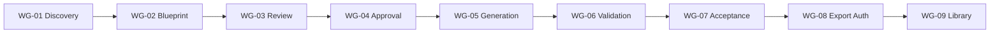
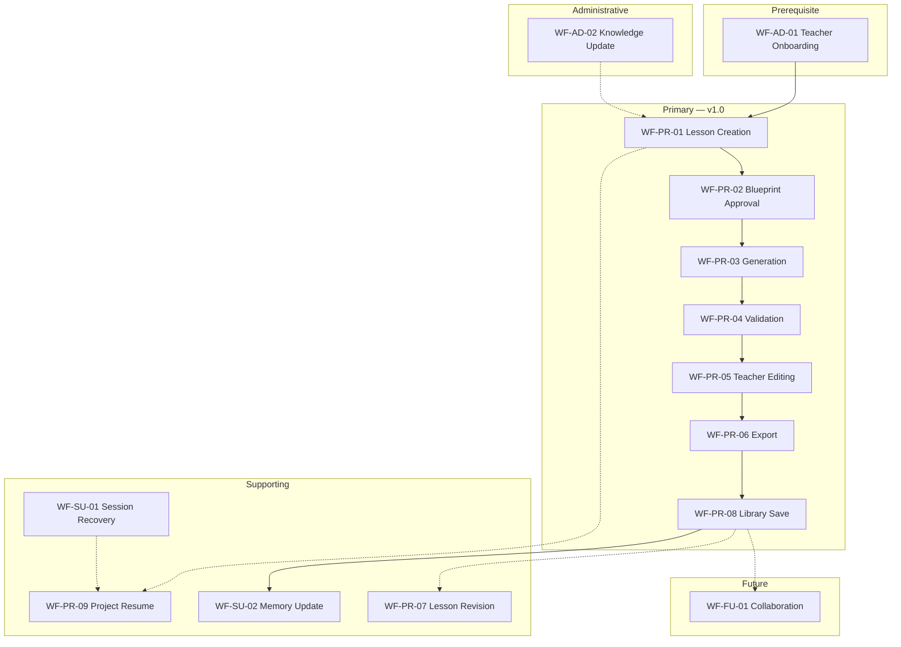
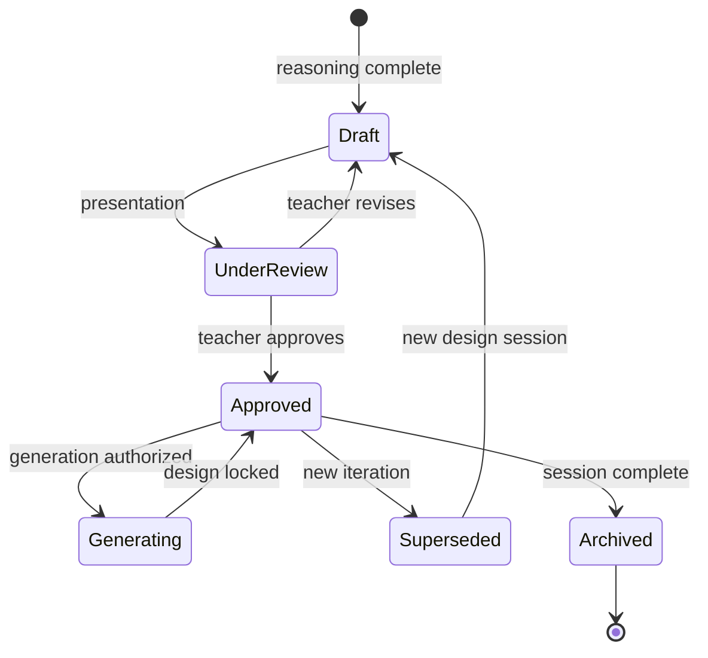
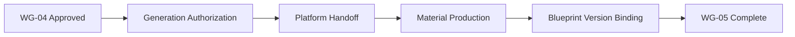
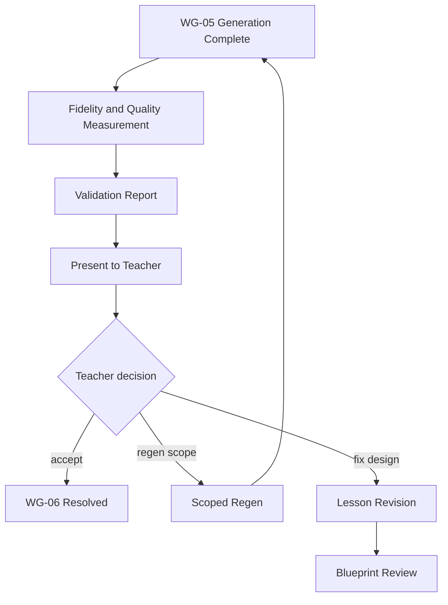
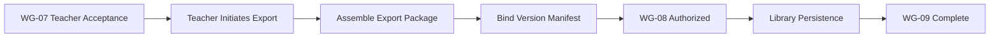
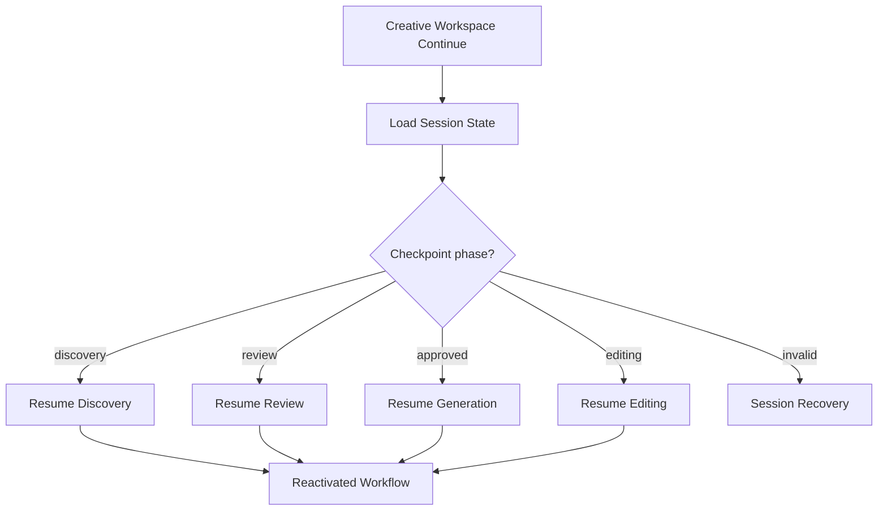
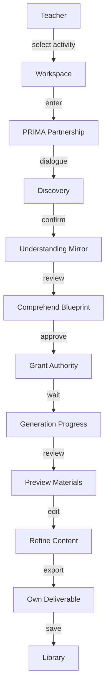

# PRIMA Workflow Model

**Version:** 1.0  
**Status:** Official — Enterprise Solution Architecture Specification

---

## Purpose

This document defines the **end-to-end business workflows** of the PRIMA platform within LUDI ON — complete business processes that deliver value to teachers, from first entry through library persistence and recovery.

It answers one architectural question:

> *How does PRIMA deliver value through end-to-end business workflows?*

Workflows describe **business processes** — triggers, participants, outcomes, gates, and rules. They do not describe APIs, engine internals, infrastructure, or technical state machine enums (see [`PRIMA_STATE_MODEL.md`](./PRIMA_STATE_MODEL.md)).

---

## Scope

| In scope | Out of scope |
|----------|--------------|
| Primary and supporting business workflows | Workflow state enum definitions (State Model) |
| Workflow gates, entry/exit criteria, business rules | Interaction handoff detail (Interaction Model) |
| Participants, capabilities, components, artifacts per workflow | Engine behavioural logic |
| Workflow variants and dependencies | API sequencing, message formats |
| Governance, evolution, compliance | UI screen flows, prompt design |

**Relationship to State Model:** Workflows describe *what business process runs*. State Model describes *coordination states that govern process phases*. Every workflow phase maps to Workflow State — field definitions remain in State Model.

---

## Workflow Principles

| ID | Principle | Meaning |
|----|-----------|---------|
| **WP-01 — Business-first** | Workflows express teacher and platform outcomes — not technical tasks |
| **WP-02 — End-to-end value** | Each primary workflow delivers a complete business result |
| **WP-03 — Teacher authority** | Workflows pause at approval gates until teacher decides |
| **WP-04 — Blueprint centrality** | Design workflows complete before execution workflows |
| **WP-05 — Artifact traceability** | Every workflow phase produces or consumes canonical artifacts |
| **WP-06 — Gate discipline** | No workflow phase skips its architectural gate |
| **WP-07 — Deterministic outcomes** | Same entry criteria + same teacher decisions → same business outcome |
| **WP-08 — Recoverable continuity** | Workflows support pause, resume, and recovery without value loss |
| **WP-09 — Boundary respect** | Workflows honor System Context — PRIMA design vs platform execution |
| **WP-10 — Technology independence** | Workflows remain valid regardless of implementation |

---

## Workflow Taxonomy

| Class | Description | Examples |
|-------|-------------|----------|
| **Primary** | Core teacher value paths — Version 1.0 committed | Lesson Creation, Blueprint Approval, Export |
| **Supporting** | Enable or sustain primary workflows | Session Recovery, Memory Update, Knowledge Update |
| **Composite** | Orchestrate multiple primary workflows | Lesson Creation (spans discovery through library save) |
| **Future** | Registered — not active v1.0 | Future Collaboration |
| **Administrative** | Platform stewardship — not teacher session | Knowledge Update (curator-driven) |

---

## Workflow Participants

| Participant | Role in workflows |
|-------------|-------------------|
| **Teacher** | Primary actor — initiates, approves, edits, exports |
| **Creative Workspace** (CMP-E01) | Entry, resume, navigation |
| **PRIMA Experience** (CMP-E02) | Hosts design and generation session |
| **Instructional Design process** (Conversation + Design subsystems) | Discovery through blueprint |
| **Platform Generation** (CMP-X01) | Post-approval material production |
| **Validation process** (CMP-X02) | Quality measurement |
| **Library** (CMP-A02, CMP-E04) | Persistence and retrieval |
| **Session Governance** (CMP-I02) | Gate enforcement, checkpoint, routing |
| **Lineage Service** (CMP-G02) | Traceability and version binding |
| **Knowledge Curator** | Corpus stewardship — not runtime teacher session |

---

## Workflow Responsibilities

| Responsibility | Owner |
|----------------|-------|
| Instructional design partnership | PRIMA design workflows |
| Teacher approval recording | Blueprint Approval workflow |
| Material production | Generation workflow (platform) |
| Quality assessment | Validation workflow (platform) |
| Teacher finalization | Editing and Export workflows |
| Asset persistence | Library Save workflow |
| Session continuity | Project Resume, Session Recovery workflows |
| Corpus freshness | Knowledge Update workflow (administrative) |
| Personalization continuity | Memory Update workflow |

---

## Workflow Inputs

Conceptual inputs available to workflows at platform level:

| Input | Source | Used by |
|-------|--------|---------|
| Teacher identity and preferences | Identity / Settings | Onboarding, Personalization |
| Activity type selection | Creative Workspace | Lesson Creation |
| Teacher expressions | Teacher | Discovery, Review, Editing |
| Curriculum evidence | Knowledge Sources | Instructional Reasoning |
| Memory hints | Memory Profile | Discovery, Reasoning |
| Prior session checkpoint | Session Store | Project Resume, Session Recovery |
| Saved export reference | Library | Re-open, Revision variants |

---

## Workflow Outputs

| Output | Workflow | Consumer |
|--------|----------|----------|
| Teacher Intent | Discovery phase | Reasoning |
| Instructional Blueprint | Design phase | Review, Approval |
| Teacher Approval | Blueprint Approval | Generation |
| Generation Package | Generation | Validation, Editing |
| Validation Report | Validation | Teacher decision |
| Export Package | Export | Library Save |
| Version Manifest | Traceability binding | Library, Audit |
| Updated Memory Profile | Memory Update | Future sessions |

---

## Workflow Gates

Architectural gates — preconditions that must be satisfied before the next workflow phase.

| Gate ID | Name | Condition | Blocks until |
|---------|------|-----------|--------------|
| **WG-01** | Discovery Complete | Teacher Intent normalized; discovery-complete signal | Instructional Reasoning |
| **WG-02** | Blueprint Complete | Instructional Blueprint draft exists | Blueprint Review |
| **WG-03** | Review Complete | Teacher has reviewed blueprint presentation | Blueprint Approval decision |
| **WG-04** | Teacher Approval | Teacher Approval artifact recorded; Blueprint Version `approved` | Generation |
| **WG-05** | Generation Complete | Generation Package produced for scope | Validation |
| **WG-06** | Validation Resolved | Validation Report acknowledged; critical findings resolved or teacher override | Teacher Editing preview |
| **WG-07** | Teacher Acceptance | Teacher finalizes edited resources | Export |
| **WG-08** | Export Authorization | Teacher initiates export; lineage complete | Library Persistence |
| **WG-09** | Library Persistence | Export Package + Version Manifest stored | Workflow completion |



---

## Workflow Dependencies

| Workflow | Requires | Enables |
|----------|----------|---------|
| Lesson Creation | Teacher Onboarding (identity) | Blueprint Approval, Generation, Export |
| Blueprint Approval | Lesson Creation (design phase) | Generation |
| Generation | Blueprint Approval | Validation |
| Validation | Generation | Teacher Editing |
| Export | Teacher Editing | Library Save |
| Project Resume | Prior Session Recovery data | Lesson Creation (continued) |
| Session Recovery | Session checkpoint exists | Project Resume |
| Lesson Revision | Library Save or in-session draft | Blueprint Approval (re-iteration) |
| Memory Update | Completed session | Future Lesson Creation |
| Knowledge Update | Curator action | Future Instructional Reasoning |

---

## Primary Workflows

Each workflow uses the official template. Workflow IDs: **WF-{category}-{sequence}**.

---

### WF-PR-01 — Lesson Creation (Lecție)

| Field | Content |
|-------|---------|
| **Purpose** | Deliver complete end-to-end business value: from activity selection to library-ready Lecție |
| **Trigger** | Teacher selects Lecție activity type in Creative Workspace |
| **Participants** | Teacher, CMP-E01, CMP-E02, Instructional Design process, Session Governance, Platform Generation, Validation, CMP-E03, CMP-A02, CMP-G02 |
| **Capabilities Used** | TE-02, ID-01–ID-06, GN-01–GN-03, QA-01–QA-02, PS-04, PS-03, PS-02, GV-01–GV-05 |
| **Components Involved** | CMP-E01, CMP-E02, CMP-I01, CMP-I02, CMP-X01, CMP-X02, CMP-E03, CMP-A01, CMP-A02, CMP-G02 |
| **Canonical Artifacts** | Full chain: Conversation Context → Teacher Intent → Instructional Blueprint → Teacher Approval → Blueprint Version → Generation Package → Validation Report → Generated Resource → Export Package → Version Manifest |
| **Business Outcome** | Teacher-owned Lecție saved in Library with full traceability |
| **Entry Criteria** | Authenticated teacher; activity type selected |
| **Exit Criteria** | WG-09 satisfied; session completed |
| **Business Rules** | Design before execution; teacher approval mandatory; all materials editable |
| **Architectural Constraints** | Composite workflow — sub-workflows must not skip gates |

**Sub-workflow sequence:** Discovery → Reasoning → Review → Approval → Generation → Validation → Editing → Export → Library Save

---

### WF-PR-02 — Blueprint Approval

| Field | Content |
|-------|---------|
| **Purpose** | Record teacher authority over Instructional Blueprint before any execution |
| **Trigger** | Instructional Blueprint draft ready; teacher enters review |
| **Participants** | Teacher, CMP-E02, Instructional Design Workspace, Reflection process, Session Governance, CMP-G02 |
| **Capabilities Used** | ID-05 Blueprint Review; ID-06 Blueprint Approval; RF-02 Design Explainability; GV-05 Teacher Authority Enforcement |
| **Components Involved** | CMP-E02, CMP-I01, CMP-I02, CMP-G02 |
| **Canonical Artifacts** | Consumes: Instructional Blueprint, Reflection Report. Produces: Teacher Approval, Blueprint Version (`approved`), Audit Record |
| **Business Outcome** | Approved design locked; generation authorized |
| **Entry Criteria** | WG-02 satisfied; blueprint presented |
| **Exit Criteria** | WG-04 satisfied OR revision path initiated |
| **Business Rules** | Teacher must explicitly approve; no automated consent |
| **Architectural Constraints** | Highest authority gate in design arc; see INT-TE-04 |

---

### WF-PR-03 — Generation

| Field | Content |
|-------|---------|
| **Purpose** | Produce editable classroom drafts faithful to approved instructional design |
| **Trigger** | WG-04 passed; Session Governance authorizes handoff |
| **Participants** | Session Governance, Generation Coordination, CMP-X01, CMP-E02 |
| **Capabilities Used** | GN-03 Generation Coordination; GN-01 Learning Resource Generation |
| **Components Involved** | CMP-I02, CMP-X01, CMP-E02 |
| **Canonical Artifacts** | Consumes: Blueprint Version, Teacher Approval, Revision Directives. Produces: Generation Package |
| **Business Outcome** | Draft worksheets, presentations, plans bound to Blueprint Version |
| **Entry Criteria** | WG-04 satisfied |
| **Exit Criteria** | WG-05 satisfied |
| **Business Rules** | Faithful rendering only — no pedagogical redesign |
| **Architectural Constraints** | Platform execution — outside PRIMA design core; CMP-X01 never mutates blueprint |

---

### WF-PR-04 — Validation

| Field | Content |
|-------|---------|
| **Purpose** | Assess whether generated materials meet approved design and quality standards |
| **Trigger** | Generation scope complete |
| **Participants** | CMP-X01, CMP-X02, Reflection process, CMP-E02, Teacher |
| **Capabilities Used** | QA-01 Blueprint Fidelity Validation; QA-02 Pedagogical Quality Validation; RF-03 Quality Finding Presentation |
| **Components Involved** | CMP-X01, CMP-X02, CMP-I01, CMP-E02 |
| **Canonical Artifacts** | Consumes: Generation Package, Blueprint Version. Produces: Validation Report |
| **Business Outcome** | Teacher receives actionable quality assessment before preview |
| **Entry Criteria** | WG-05 satisfied |
| **Exit Criteria** | WG-06 satisfied |
| **Business Rules** | Validation informs; teacher decides regen, edit, or design return |
| **Architectural Constraints** | Advisory — critical findings may block preview, never auto-approve |

---

### WF-PR-05 — Teacher Editing

| Field | Content |
|-------|---------|
| **Purpose** | Enable teacher to finalize generated materials as owned professional output |
| **Trigger** | Validation resolved; teacher enters editor |
| **Participants** | Teacher, CMP-E03, CMP-E02 |
| **Capabilities Used** | PS-04 Teacher Editing |
| **Components Involved** | CMP-E03, CMP-E02 |
| **Canonical Artifacts** | Consumes: Generation Package, Generated Resource. Produces: Generated Resource (teacher-modified) |
| **Business Outcome** | Teacher-satisfied drafts ready for export |
| **Entry Criteria** | WG-06 satisfied |
| **Exit Criteria** | WG-07 satisfied |
| **Business Rules** | All generated content editable; edits do not mutate blueprint |
| **Architectural Constraints** | Editing ≠ design revision — blueprint changes require WF-PR-07 |

---

### WF-PR-06 — Export

| Field | Content |
|-------|---------|
| **Purpose** | Assemble teacher-initiated deliverable bundle for classroom use |
| **Trigger** | Teacher confirms finalize and export |
| **Participants** | Teacher, CMP-E02, Session Governance, CMP-G02 |
| **Capabilities Used** | PS-03 Export; GV-02 Traceability; GV-04 Version Lineage |
| **Components Involved** | CMP-E02, CMP-I02, CMP-G02 |
| **Canonical Artifacts** | Consumes: Generated Resource (finalized), Blueprint Version. Produces: Export Package, Version Manifest |
| **Business Outcome** | Deliverable bundle with complete lineage |
| **Entry Criteria** | WG-07 satisfied |
| **Exit Criteria** | WG-08 satisfied |
| **Business Rules** | Teacher-initiated only; no auto-export |
| **Architectural Constraints** | Export Package is domain artifact — formats are implementation |

---

### WF-PR-07 — Lesson Revision (Design Iteration)

| Field | Content |
|-------|---------|
| **Purpose** | Govern instructional design change after initial approval or from library re-open |
| **Trigger** | Teacher requests design change during review OR re-opens library item for new iteration |
| **Participants** | Teacher, Instructional Design Workspace, Reflection process, Session Governance, CMP-G02 |
| **Capabilities Used** | ID-07 Blueprint Evolution; ID-03 Instructional Reasoning; ID-05 Blueprint Review; ID-06 Blueprint Approval |
| **Components Involved** | CMP-E02, CMP-I01, CMP-I02, CMP-E04, CMP-A02, CMP-G02 |
| **Canonical Artifacts** | Consumes: Instructional Blueprint, Version Manifest. Produces: Revision Directives, new Blueprint Version, new Teacher Approval |
| **Business Outcome** | New approved design iteration with preserved lineage |
| **Entry Criteria** | Teacher revision intent; OR library re-open for new iteration |
| **Exit Criteria** | WG-04 satisfied for new version |
| **Business Rules** | Prior approved versions immutable; new iteration = new Conversation Session or governed branch |
| **Architectural Constraints** | Distinct from execution-only partial regen (WF-SU-01) |

---

### WF-PR-08 — Library Save

| Field | Content |
|-------|---------|
| **Purpose** | Persist teacher-owned activity for reuse and retrieval |
| **Trigger** | Export workflow completes |
| **Participants** | CMP-E02, CMP-A02, CMP-G02, CMP-E04 |
| **Capabilities Used** | PS-02 Library Management; GV-02 Traceability |
| **Components Involved** | CMP-A02, CMP-G02, CMP-E04 |
| **Canonical Artifacts** | Consumes: Export Package, Version Manifest. Produces: Library catalogue entry |
| **Business Outcome** | Activity available in Personal Library with traceable provenance |
| **Entry Criteria** | WG-08 satisfied |
| **Exit Criteria** | WG-09 satisfied |
| **Business Rules** | No save without Version Manifest |
| **Architectural Constraints** | Library never owns design authority |

---

### WF-PR-09 — Project Resume

| Field | Content |
|-------|---------|
| **Purpose** | Continue in-progress work from valid checkpoint |
| **Trigger** | Teacher selects continue working from Creative Workspace |
| **Participants** | Teacher, CMP-E01, CMP-A01, CMP-I02, CMP-E02 |
| **Capabilities Used** | TE-03 Work Continuation; GV-01 Session Integrity |
| **Components Involved** | CMP-E01, CMP-A01, CMP-I02, CMP-E02 |
| **Canonical Artifacts** | Consumes: Session State, Workflow State, phase artifact refs. Produces: Restored session scope |
| **Business Outcome** | Teacher returns to exact valid business phase |
| **Entry Criteria** | In-progress Project with valid checkpoint |
| **Exit Criteria** | Appropriate sub-workflow reactivated |
| **Business Rules** | No gate bypass; approved design remains approved on resume |
| **Architectural Constraints** | Variant entry points: discovery, review, generation, editing |

---

### WF-AD-01 — Teacher Onboarding

| Field | Content |
|-------|---------|
| **Purpose** | Establish teacher identity, locale, and baseline preferences for platform use |
| **Trigger** | First authentication or explicit settings configuration |
| **Participants** | Teacher, CMP-G01 (Identity and Preferences) |
| **Capabilities Used** | PS-06 Configuration |
| **Components Involved** | CMP-G01 |
| **Canonical Artifacts** | Produces: preference signals; Memory Profile initialization |
| **Business Outcome** | Teacher ready to enter Lesson Creation workflow |
| **Entry Criteria** | Valid authentication |
| **Exit Criteria** | Locale and baseline preferences established |
| **Business Rules** | Romanian default for v1.0 |
| **Architectural Constraints** | Outside PRIMA design session — prerequisite only |

---

### WF-AD-02 — Knowledge Update

| Field | Content |
|-------|---------|
| **Purpose** | Refresh curriculum and pedagogical corpus consumed by instructional reasoning |
| **Trigger** | Knowledge Curator publishes corpus update |
| **Participants** | Knowledge Curator, Knowledge Sources system |
| **Capabilities Used** | KI-01 Curriculum Alignment; KI-02 Pedagogical Evidence Access |
| **Components Involved** | External to teacher session — corpus layer |
| **Canonical Artifacts** | Produces: updated Knowledge Package sources |
| **Business Outcome** | Future design workflows reference current curriculum evidence |
| **Entry Criteria** | Curator authorization |
| **Exit Criteria** | Corpus version incremented |
| **Business Rules** | PRIMA consumes — never mutates corpus in teacher workflows |
| **Architectural Constraints** | Administrative workflow — no teacher session participation |

---

### WF-SU-01 — Session Recovery

| Field | Content |
|-------|---------|
| **Purpose** | Restore business continuity after failure, timeout, or interruption |
| **Trigger** | Failure signal, timeout, or teacher resume after pause |
| **Participants** | Teacher, Session Governance, CMP-E02, CMP-A01, CMP-G02 |
| **Capabilities Used** | GV-06 Failure Recovery; GV-01 Session Integrity; TE-03 Work Continuation |
| **Components Involved** | CMP-I02, CMP-E02, CMP-A01, CMP-G02 |
| **Canonical Artifacts** | Consumes: Session State, Audit Record. Produces: recovery routing; updated Workflow State |
| **Business Outcome** | Teacher offered retry, pause, rollback, or cancel — work preserved |
| **Entry Criteria** | Recoverable failure OR paused session |
| **Exit Criteria** | Collaboration resumed OR session safely paused OR terminal cancel |
| **Business Rules** | Fail visible; no silent data loss |
| **Architectural Constraints** | Detail in Error Model; never bypasses WG-04 |

---

### WF-SU-02 — Memory Update

| Field | Content |
|-------|---------|
| **Purpose** | Capture post-session personalization signals for future teacher sessions |
| **Trigger** | Session completion (async, post-Library Save) |
| **Participants** | Session Governance, CMP-G01 |
| **Capabilities Used** | PS-05 Personalization |
| **Components Involved** | CMP-I02, CMP-G01 |
| **Canonical Artifacts** | Consumes: session completion signals. Produces: Memory Profile updates |
| **Business Outcome** | Returning teachers experience reduced repetition |
| **Entry Criteria** | Session completed or cancelled with capture eligibility |
| **Exit Criteria** | Memory Profile updated per policy |
| **Business Rules** | Memory advisory only — never overrides Teacher Approval |
| **Architectural Constraints** | Async — does not block workflow completion |

---

### WF-FU-01 — Future Collaboration (Registered)

| Field | Content |
|-------|---------|
| **Purpose** | Enable multi-teacher co-editing of exported materials |
| **Trigger** | Teacher invites collaborator on library item |
| **Participants** | Teachers, Library, future Collaboration service |
| **Capabilities Used** | FE-04 Collaboration (future) |
| **Components Involved** | CMP-A02, CMP-E04 — future extension |
| **Canonical Artifacts** | Consumes: Export Package. Produces: shared edit scope (future) |
| **Business Outcome** | Collaborative refinement post-export |
| **Entry Criteria** | Exported activity exists |
| **Exit Criteria** | TBD — product decision |
| **Business Rules** | Must not enter PRIMA design session; post-export only |
| **Architectural Constraints** | Future — does not alter WF-PR-01 through WF-PR-09 |

---

## Supporting Workflows

| ID | Workflow | Purpose |
|----|----------|---------|
| **WF-SU-03** | Session Pause | Teacher-initiated hold; triggers checkpoint via Session Governance |
| **WF-SU-04** | Scoped Execution Regen | Fix generation scope without design reopen — subset of Generation |
| **WF-SU-05** | Library Re-open (Edit) | Continue editing exported activity — bypasses design phases |
| **WF-SU-06** | Library Re-open (New Iteration) | New design branch from saved activity — enters WF-PR-07 |
| **WF-SU-07** | Session Cancel | Teacher terminates session; optional draft preservation |

---

## Workflow Variants

| Base workflow | Variant | Difference |
|---------------|---------|------------|
| WF-PR-01 Lesson Creation | **Resume variant** | Enters at checkpoint via WF-PR-09 — skips completed phases |
| WF-PR-01 Lesson Creation | **Returning teacher variant** | Personalization enriches discovery — same gates |
| WF-PR-03 Generation | **Partial regen variant** (WF-SU-04) | Scoped re-execution; design locked |
| WF-PR-07 Lesson Revision | **Library-initiated variant** | New Conversation Session from Version Manifest |
| WF-PR-04 Validation | **Design return variant** | Critical design finding routes to WF-PR-07 |
| WF-PR-04 Validation | **Execution regen variant** | Execution finding routes to WF-SU-04 |

---

## Workflow Diagrams

### Diagram 1 — Overall workflow landscape



### Diagram 2 — Lesson creation workflow

```mermaid
flowchart TD
  START[Teacher selects Lecție] --> ENTRY[Design Session Entry]
  ENTRY --> DISC[Discovery]
  DISC --> G1{WG-01 Discovery Complete}
  G1 --> REASON[Instructional Reasoning]
  REASON --> COMPOSE[Blueprint Composition]
  COMPOSE --> G2{WG-02 Blueprint Complete}
  G2 --> REVIEW[Blueprint Review]
  REVIEW --> G3{WG-03 Review Complete}
  G3 --> APPROVE[Blueprint Approval]
  APPROVE --> G4{WG-04 Teacher Approval}
  G4 --> GENERATE[Generation]
  GENERATE --> G5{WG-05 Generation Complete}
  G5 --> VALIDATE[Validation]
  VALIDATE --> G6{WG-06 Validation Resolved}
  G6 --> EDIT[Teacher Editing]
  EDIT --> G7{WG-07 Teacher Acceptance}
  G7 --> EXPORT[Export]
  EXPORT --> G8{WG-08 Export Authorized}
  G8 --> SAVE[Library Save]
  SAVE --> G9{WG-09 Persisted}
  G9 --> DONE[Complete]
```



### Diagram 3 — Blueprint lifecycle



### Diagram 4 — Generation workflow



### Diagram 5 — Validation workflow



### Diagram 6 — Export workflow



### Diagram 7 — Project continuation workflow



### Diagram 8 — Teacher interaction workflow



---

## Workflow Governance

| Concern | Authority | Process |
|---------|-----------|---------|
| New primary workflow | Product Team | Session log; Capability Model alignment; gate registration |
| New gate | Product Team + Principles review | Update WG registry; State Model sync |
| Workflow variant | Product Team | Document variant table; verify gate preservation |
| Workflow retirement | Product Team | Version bump; dependent spec alignment |
| Overlap prevention | Workflow Architecture Lead | Quarterly registry audit |

---

## Workflow Evolution

| May evolve freely | Evolves deliberately | Must remain stable |
|-------------------|---------------------|-------------------|
| Supporting workflow granularity | New primary workflow registration | WG-04 Teacher Approval before Generation |
| Variant definitions | New gate introduction | Design-before-execution sequence |
| Administrative workflow detail | Future workflow activation | Teacher authority at approval and export |
| | | Blueprint as design authority |
| | | Traceability chain to Library |

Future workflows (WF-FU-*) attach to **outputs** of existing workflows — Lesson Creation gates and phases remain unchanged.

---

## Compliance Rules

| ID | Rule |
|----|------|
| **WF-CR-01** | Every workflow respects System Context boundaries |
| **WF-CR-02** | Every workflow phase consumes/produces only canonical artifacts |
| **WF-CR-03** | No workflow bypasses WG-04 Teacher Approval for generation |
| **WF-CR-04** | No workflow mutates approved Blueprint Version silently |
| **WF-CR-05** | Workflows map to registered capabilities — no orphan processes |
| **WF-CR-06** | Workflows use registered interactions — see Interaction Model |
| **WF-CR-07** | State transitions align with Workflow Model phases — see State Model |
| **WF-CR-08** | Recovery workflows never bypass governance gates |
| **WF-CR-09** | Future workflows register before implementation exploration |
| **WF-CR-10** | Technical Architecture implements workflows — does not redefine them |

---

## Summary

The Workflow Model defines **how PRIMA delivers value through end-to-end business processes** — **9 primary workflows**, **7 supporting workflows**, **2 administrative workflows**, and **1 future workflow**, governed by **9 architectural gates** (WG-01 through WG-09).

Workflows sit between **interactions** (how components collaborate) and **state** (how coordination positions are tracked):

```
Interaction Model ... COLLABORATION (handoffs)
Workflow Model ..... BUSINESS PROCESSES (value delivery)
State Model ........ COORDINATION STATES (phase tracking)
```

Every primary workflow respects teacher authority, blueprint centrality, artifact traceability, and gate discipline. Lesson Creation (WF-PR-01) is the composite flagship path for Version 1.0 Lecție end-to-end delivery.

---

## Next Recommended Document

→ [`PRIMA_STATE_MODEL.md`](./PRIMA_STATE_MODEL.md) — Coordination state machines that govern workflow phase transitions.
