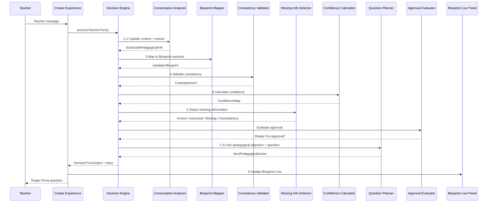
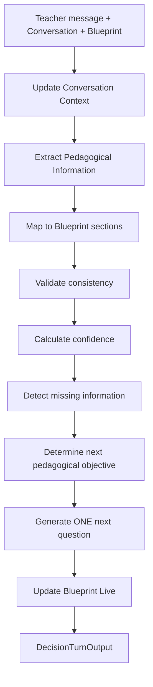

# Pedagogical Decision Engine (IT-003)

Deterministic pedagogical reasoning layer for PRIMA.

This is **not** an AI chat and **not** an LLM wrapper. The engine owns pedagogical decisions. An LLM may be used later only as a service behind Prompt/Reflection — never to bypass this engine.

**AI-001:** Every `processTeacherTurn` runs the [PRIMA Reasoning Pipeline](../reasoning/README.md) (Intent → … → sealed Conversation Plan → LLM verbalization only).

Conforms to [`PRIMA_DECISION_ENGINE.md`](../../../docs/product/PRIMA_DECISION_ENGINE.md) principles and Instructional Blueprint section names from CS-005. It does **not** redefine Blueprint concepts and never generates lessons, worksheets, or presentations.

## Responsibilities

| Decision | Owner |
|----------|--------|
| What PRIMA already knows | Missing Information Detector + Confidence Calculator |
| What is still missing | Missing Information Detector |
| What question is next | Question Planner (one objective) |
| Whether clarification is required | Confidence + Consistency |
| Whether Blueprint is ready for approval | Approval Evaluator |

## Folder structure

```
src/engines/decision/
  types.ts
  constants.ts
  stateMachine.ts
  pipeline.ts
  decisionEngine.ts
  index.ts
  services/
    conversationAnalyzer.ts
    blueprintMapper.ts
    confidenceCalculator.ts
    consistencyValidator.ts
    missingInformationDetector.ts
    questionPlanner.ts
    approvalEvaluator.ts
  tests/
    decisionEngine.acceptance.test.ts
  README.md
```

## Engine states

`idle` → `listening` → `reasoning` → (`clarifying` | `updating_blueprint`) → `waiting_teacher` → `ready_for_approval` → `approved`

## Decision loop (every teacher message)



## Pipeline architecture



## Outputs

- Updated Blueprint
- Confidence Map (`high` | `medium` | `low` | `unknown`)
- Missing Information List
- Next Pedagogical Action
- Reflection Summary
- Approval Recommendation
- Generation Readiness
- Explainability `trace[]` (no hidden reasoning)

## Ready For Approval

Returns true only when these reach required confidence:

Learning Context · Objectives · Learning Flow · Assessment · Resources · Validation

## Tests

```bash
npm run test:decision
```

Acceptance coverage: no repeated questions, no skipped mandatory sections, contradiction detection, Blueprint Live updates, confidence, one objective per turn, teacher corrections override assumptions, Ready For Approval.
